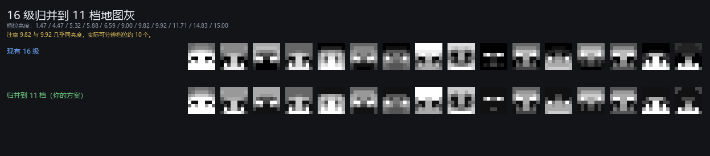
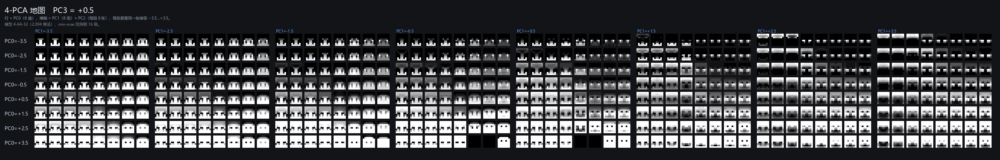
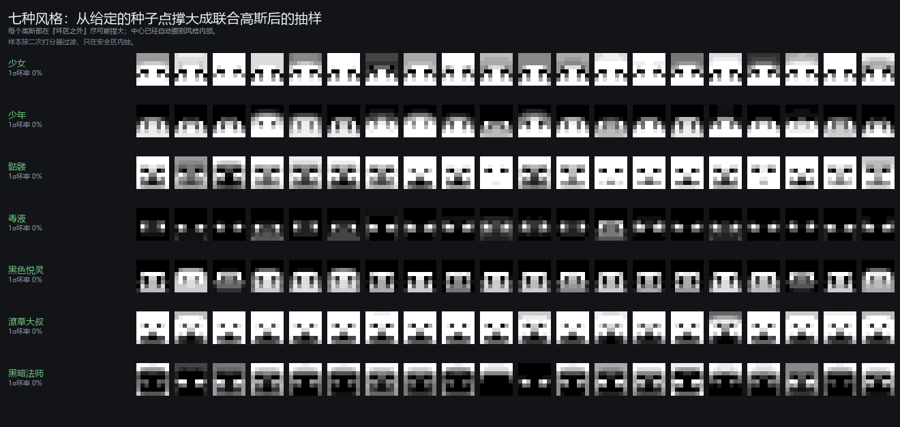

# 二期工程时间线：从找不到模型到初步适配红石

---

## 摘要

二期工程在四个自然日内，把 8×8 头像生成从"找不到可用的模型"推进到"可直接移植红石"。

起点是一期的八条死路，以及一条只有一千余张图支撑的"GAN 不可行"结论。审计撤销了该结论的数据前提，随后在同一晚完成的八种条件横向对比中确定了 PCA 条件生成。

此后的主线是三次逐层压缩，每一次都以多样性为代价。输出从 512 个 logits 压到 32 个连续值，成本降 88.5%；约 28% 的位置其条件分布多峰，连续标量只能取均值，这一误差被评估为可接受并随方案采纳。输入从 22 维压到 4 维，依据是条件扫描时 PCA-4 与 PCA-8 已经表现更干净，与输出压缩无因果关系；配合后处理归一化把良率由 20.9% 提升到 62.1%，代价是 28.9% 的灰度方差不再可达。网络从 74,752 次乘法压到 2,304 次，三轮盲测测不出差异。

最终的良率结构由一次 4,096 点全空间测量给出。66.5% 的空间可接受，且好区是单一连通块，因此球状限制无效，按各轴阈值做矩形夹取才能在保留 23.4% 多样性的前提下把良率提到 89.1%。打分器由线性（4 次乘法，AUC 0.694）换为二次型（14 次乘法，AUC 0.853）。六个风格可由联合高斯采样复现，一倍标准差的坏率均为 0。

交付物是一个 2,304 次乘法的前馈网络、一个 14 次乘法的打分器、零成本的采样限制，以及一份可在单个 HTML 文件内离线运行的全部模型。彩色头像与非对称头像不在本文范围。

---

## 背景

一期工程在头像生成上留下的是负面资产：八条路线被记为死路，唯一的成功方案依赖近邻查找，不可移植到红石。一期的正面资产是数据（50,000 张 8×8 头像、2.6 GB 皮肤包）和方法（权重可视化、指标固化的尝试）。

二期面临的是一个结构性困难。分类问题是收缩的：225 个输入像素 → 10 个输出分数 → 取最大，红石只需一次聚合加一个 argmax。生成问题不是收缩的：每个输出像素都需要一条独立的聚合通路。这一约束贯穿全程，它决定了输出通道数、输入维数、网络宽度，以及最终能不能真的做出来。

本文记录的范围是三个阶段：**找不到能生成头像的模型 → 找到能生成头像的模型 → 压缩并对齐到红石成本**。彩色头像、非对称头像不在此范围内。

工程的起点是 2026-10-16 15:46，终点是 10-19。四个自然日内完成，全部实验可在 `src/`（210 个脚本）与 `results/` 中复现。

---

## 时间线总表

| 阶段  | 时间                      | 内容                     | 终态                   |
| --- | ----------------------- | ---------------------- | -------------------- |
| 1   | 10-16 15:46–16:44       | 资产审计、路线规划、环境重建         | 一期的死路结论被有条件撤销        |
| 2   | 10-16 17:19–22:04       | 生成式表述的搜索：无条件、半脸、编码、PCA | PCA 条件生成成立           |
| 3   | 10-16 22:03–10-17 14:47 | 空间一致性治理与人工优选           | 输入潜变量可排序，偏好可建模       |
| 4   | 10-17 12:03–14:00       | 输出通道 512 → 32          | 32 个连续输出采纳，成本降 88.5% |
| 5   | 10-17 11:48–18:56       | 输入通道 22 → 4，后处理归一化     | 四旋钮方案成立              |
| 6   | 10-18 10:00–14:30       | 网络结构定宽定层               | 4-64-32，2,304 乘法     |
| 7   | 10-17 21:49–10-18 15:00 | 评价与筛选体系校准、MC 颜色体系      | 筛选是弱杠杆；11 档灰可实物化     |
| 8   | 10-18 17:53–10-19       | 全空间地图、风格、筛选策略          | 能力边界完整测量，方案定型        |

第 3 与第 4 阶段在时间上交错：空间一致性治理从 10-16 夜间开始，横跨输出通道压缩，人工优选在其后。

第 4 与第 5 阶段在时间上并行：输入维数的分析（10-17 11:48）早于输出压缩的方案定稿（12:03），依据是第 2 阶段扫描留下的 PCA-4 与 PCA-8 模型。

第 7 阶段的评分器对比（10-17 21:49）早于第 6 阶段，两部分互不依赖。

---

## 第 1 阶段：资产审计与路线规划

**任务。** 一期的八条死路是否可信？哪些资产可直接复用？二期的第一步应该是什么？

**做法。** 派两份独立审计：一份重读 GAN 代码与日志，一份重跑数据管线。同时建立独立 venv 并安装 CPU 版 torch，使旧结论失去"无框架"这一前提。

**结果。**

无条件 GAN 那次实验的训练集并不存在。数据集 `faces8.npy` 写入时间为 2026-10-05 11:48，而 GAN 产物时间为 2026-10-04 21:33 至 22:32，早 13 小时；脚本自述样本数 1,205。也就是说，被判为"8×8 规模下 GAN 学不动"的证据，建立在约一千张图上。

判据本身也无法区分失败模式。旧脚本汇报 256 真 / 256 假上的 sigmoid 均值，而训练用了标签平滑至 0.9，常数预测器的最优解恰为 0.45：

$$p^* = 0.45 \quad\text{解}\quad (p-0.9)+(p-0)=0$$

这个数值既不能证明判别器没学到东西，也不能证明达到纳什均衡。

决定性反证是判别器本身学得会。用同一份 D、同一学习率 lr=1e-4 单独训练：

| 设置 | 判别准确率 |
|---|---:|
| 单独训练 D（同一生成器、同一 lr） | 95.5% – 98.4% |
| 对归档的 G 权重 | 99.0% / 97.9% |
| 单层线性分类器 | 98.4% / 97.6% |
| 联合训练中的 D | 50.8% |

信息完全存在，一层线性即可取出，联合更新把它丢掉了。

数据侧另有三处污染：全库 52,690 条（4.76%）头部完全透明的样本被当作全黑头像，把调色板第 8 号颜色抬到全部像素的 12.6%；1,107,411 条中仅 932,636 个不同裁切，重复率 15.78%，单一"全黑裁切"出现 51,156 次；取数逻辑是按 zip 顺序取满前 50,000 个，是模板聚集数据的头部 8.2%。两个 npy 被同一脚本原地重写，10-04 那批结果所依据的数据集已不存在。

**指向。** 三条约束被确立并贯穿后续所有阶段：不使用 MSE/L1 这类重建损失；不逐像素独立建模；颜色必须当离散类别处理。评估先于模型建立。

---

## 第 2 阶段：生成式表述的搜索

**任务。** 找到一个能让网络生成出可辨认头像的问题表述。

**做法。** 先做离散与连续的对照实验，确认输出编码方向。随后在同一套生成器结构上比较八种条件：

| 条件 | 输入 |
|---|---|
| uncond | 仅噪声 |
| half | 已知左半脸 32 级 + 噪声 |
| code3 / code5 | 3 / 5 维编码 + 噪声 |
| pca4 / pca8 / pca16 / pca22 | 前 k 个 PCA 系数 + 噪声 |

八臂在 10-16 19:48–20:04 一次扫完，每臂 1,500 步，batch 256，对抗损失加交叉熵。另有两条独立探针：一是教师强制的遮蔽交叉熵，给定潜码与已知左半脸，预测被遮住的右半脸，不含判别器；二是基于核的风格聚类重建。

**结果。**

半脸条件与 PCA 条件都能产出可辨认的头像，无条件维持在退化状态。遮蔽交叉熵探针在无判别器条件下达到低损失并产出脸形输出，说明生成器结构本身是可训练的，对抗动力学是此前的失败来源。

PCA 条件的控制力最强，且维数越少输出越平滑：

| 条件 | 逐像素准确率 | 相邻同色率 | CE |
|---|---:|---:|---:|
| PCA-4 | 0.2104 | 74.5% | 2.175 |
| PCA-8 | 0.2701 | 69.4% | 1.866 |
| PCA-16 | 0.3521 | 66.6% | 1.576 |
| PCA-22 | 0.3820 | 65.1% | 1.474 |
| 真实数据 | — | 77.6% | — |

漏掉的高频主成分正是产生杂色的那些，去掉它们反而更接近真实脸的同色率。同时测得真正控制输出的是 PCA 槽位而非噪声槽位：PCA-8 下换掉全部 64 维噪声只改变 8% 的像素，换掉 8 个 PCA 值则改变 89%。

*同一轮扫描中八个条件臂的生成结果，上方为真实数据参照。*

**指向。** PCA 作为条件成立，且 PCA-4 的平滑度最接近真实数据。既然少量 PCA 就能画出一张合理的脸，输入侧可以只保留几个旋钮。这同时暴露了后续的主线：PCA-4 的准确率只有 PCA-22 的 55%，它画的是一张合理的脸，不是被指定的那张脸。

---

## 第 3 阶段：空间一致性治理与人工优选

**任务。** 去除输出中的杂色（"麻麻赖赖"）；在此基础上判断人的偏好是否可学习。

**做法。** 杂色先被量化：同色连通块数量、四邻域同色的像素比例、边缘密度、孤立像素计数，均在真实脸与生成脸之间对照。治理走两条路，一是训练目标侧的相干性约束与 λ 扫描，二是噪声幅度的 ramp 扫描。随后转为人工优选：对 w128 的生成结果打标，用输入潜变量拟合偏好模型，再以该模型对随机输入排序取头部。

**结果。**

杂色与噪声幅度、λ 的关系被定量下来，相干性约束能缓解但不能消除杂色。人工优选的效果远超预期：

| 轮次 | 内容 | 效果 |
|---|---|---|
| w128 打标 | 偏好模型排序取头部 | 提升 47 个百分点 |
| 第二轮 | 换模型、重打标后复测 | 净效果 2.57 倍，多样性几乎零损失 |

偏好的方向出奇稳定：w128 与 dim4x 两批独立标签都指向靠近平均脸、不夸张的方向（PC1 约 −0.259、PC2 约 −0.300）。分风格拟合探针时，每个风格都能被一个线性方向分离。

**指向。** 一个极小的模型（输入侧 22 维，输出 1 维）就能对生成结果排序，这意味着筛选可以放在生成之前，与红石的部署顺序一致。但线性探针是否足以刻画"可接受"，需要单独验证。

---

## 第 4 阶段：输出通道 512 → 32

**任务。** 512 个输出 logits 在红石上代价过高，压缩到 32 个连续值。

**做法。** 在 22 维输入上依次尝试：先蒸馏，再对连续场加 TV 惩罚，最后收缩中间层。用同一个 1000 张留出样本统一核算，真实参考在同一样本上重算。

**结果。**

成本目标达成。质量上出现可量化的残余缺陷，经评估后接受。

| 结构 | 乘法 | 相对教师 | 准确率 |
|---|---:|---:|---:|
| 教师 512（22-256-256-512） | 202,240 | 100% | 0.7151 |
| 32 输出（22-256-256-32） | 79,360 | 39% | 0.7719 |
| 32 输出（22-128-128-32） | 23,296 | 11.5% | 0.7392 |
| 32 输出（22-32-32） | 1,728 | 0.85% | 0.6791 |

质量缺陷出在取值上：只有 26.1% 的输出值落在整数 ±0.1 内，平均小数部分 0.230，渲染后就是可见的渐变。

根因在条件分布的形状。平均条件熵 2.610 bit，28.14% 的位置存在至少两个各占 20% 以上质量的条件众数。MSE 的最优解是条件均值：某位置在训练集中有时是灰度 6、有时是 7，最优答案就是 6.5，一个不存在的级。

$$\text{MSE} \Longrightarrow \hat{y}=\mathbb{E}[y\mid x] \Longrightarrow \text{落在两峰之间}$$

一个连续标量在数学上无法表达双峰，只能取平均。512 个 logits 可以表达双峰，argmax 选一个尖峰，产生清晰台阶。

*连续值行（学生、学生 + TV）可见明显的级间渐变，离散行（argmax）边缘清晰。*

成本下降一个数量级是本阶段的决定因素，级间取值作为代价一并接受。渲染时它会被量化成一次硬选择，转换为局部误差而非可见的渐变。计划中的修法是在训练目标里加平滑惩罚，实测无效，最终改由显示端的逐张归一化解决，见下一阶段。

**指向。** 32 个连续输出采纳定型。约 28% 的多峰位置在连续标量下只能取均值，这部分误差不可消除，是该架构的固定开销。

---

## 第 5 阶段：输入通道 22 → 4，后处理归一化

**任务。** 输入从 22 维压到 4 维；并在显示端解决输出偏灰偏暗的问题。

条件扫描时已训练过 4 / 8 / 16 / 22 四个输入维度的模型，其中 PCA-4 与 PCA-8 的生成结果在视觉上明显更干净：漏掉的高频主成分正是产生杂色的那些，去掉它们反而更接近真实脸的同色率。输入侧的压缩由此展开，以这四个模型为阶梯。

**做法。** 统一用逐张 min-max 拉伸到满幅作为后处理。另做两组对照：把拉伸烘焙进训练目标；用固定增益替代 min-max。

**结果。**

后处理拉伸是此阶段收益最大的一步：

| 方案 | PCA-4 良率 |
|---|---:|
| 无拉伸 | 20.9% |
| 逐张 min-max 拉伸 | 62.1% |
| 把拉伸烘焙进训练 | 54.1%（不显著劣于拉伸） |

烘焙失败，原因在于训练时的拉伸目标需要以整张脸为参照，而网络是逐位独立输出的，该依赖无法表达。固定增益则被发现比 min-max 更接近真实分布，且成本低得多。

拉伸处理的是另一个缺陷。输出偏灰偏暗源于动态范围过窄，取值挤在少数几级之内；逐张拉伸把良率从 20.9% 拉到 62.1%。多峰位置只能取均值这一项不受拉伸影响，它仍然存在，只是被量化转换成了局部误差。

拉伸本身也有代价：它把对比度顶到 15.00，而真实数据只有 11.20。这是本阶段确立的目标漂移的直接体现，目标已从"复现指定样本"转为"生成一张合理的随机头像"。四维输入能保留 71.1% 的灰度方差，其余 28.9% 的变化原理上不可达。

*同一组权重，仅显示变换不同；第三行为 22 维参照。*

**指向。** 四个旋钮足以产出合理的脸，且后处理几乎是免费的良率来源。目标既然已经转为生成而非复现，后续的每一个压缩决定都要以多样性为代价记账。

---

## 第 6 阶段：网络结构定宽定层

**任务。** 在 4 维输入下确定最终结构，给出红石乘法数。

**做法。** 扫描两个家族的全部宽度：两层 `4-h-h-32`（h = 32、64、96、128、192、256）与单层 `4-h-32`（h = 64、128、256）。同一批随机种子逐列渲染，视觉与验证集准确率同时记录，再做三臂盲测。

**结果。**

同等乘法预算下，单层优于两层：

| 结构 | 乘法 | acc |
|---|---:|---:|
| 4-32-32-32 | 2,176 | 0.3562 |
| **4-64-32（单层）** | **2,304** | **0.3651** |
| 4-128-32（单层） | 4,608 | 0.3790 |
| 4-96-96-32 | 12,672 | 0.3920 |
| 4-256-256-32 | 74,752 | 0.4030 |

两层的第二层只有 32 宽，表达力在此处被卡住。盲测确认压缩没有可测的代价：

| 轮次 | 标签数 | 三臂结果 | 结论 |
|---|---:|---|---|
| round 7 | 248 | 60.5% / 59.5% / 61.4% | p ≈ 1.0 |
| round 9 | 263 | 64.8% / 62.5% / 61.8% | p = 0.76 / 0.75 / 1.00 |

$$\text{2,304 乘法} = \text{74,752 乘法，1/32 成本，测不出差异}$$

**指向。** 结构定案为 4-64-32。成本不再是瓶颈，剩下的问题是这个模型在什么情况下画得好、什么情况下画不好。

---

## 第 7 阶段：评价与筛选体系的校准

**任务。** 判断"小模型对输入打分并对生成做筛选"这一模式是否值得保留；确定灰度在 Minecraft 中的实物化方案。

**做法。** 在 153 条风格标签上横向比较四类评分器（线性、二次型、4-16-1、4-16-16-1），全部五折交叉验证。随后在真实盲测中检验筛选的实际增益。颜色一侧，取 Minecraft 地图存储格式的 62 个地图基色与四档修饰，另取 61 个方块均色，测量哪一档既能实物化又包含纯白。

**结果。**

评分器对"可接受"与对"风格"的能力差别很大：

| 评分器 | 对「可接受」AUC | 对「类二次元」AUC |
|---|---:|---:|
| 线性 | 0.543 | 0.896 |
| 二次型 | 0.690 | 0.930 |
| 4-16-1 | 0.647 | 0.920 |
| 4-16-16-1 | 0.709 | 0.931 |

线性方向足以刻画风格，不足以刻画可接受。而在真实盲测中，筛选的增益只有 3 至 5 个百分点，远低于交叉验证给出的预期。原因是筛选作用于种子，人判断的是生成后的脸：

| 轮次 | 种子均分 | 脸均分 | 相关系数 |
|---|---:|---:|---:|
| round 7 | 1.75 | 2.91 | 0.671 |
| round 9（base） | 4.76 | 6.76 | 0.649 |
| round 9（w64） | 3.79 | 5.26 | 0.555 |

$$r^2 \approx 0.3 \quad\Longrightarrow\quad \text{只对种子打分，有效性折损到三成}$$

标签本身另有约 11% 至 12% 的噪声：像素距离小于 0.5 的近重复对，会被判成相反结论。

颜色一侧的结论是单列 HIGH 最优。地图的 NORMAL 档天花板为 219/255 = 12.94 级，四档全开才有 15.00，而方块均色可达 14.94。HIGH 档的数值等于基色本身，即"不做任何修饰"，既包含纯白又是最省的硬件实现。

| 灰度方案 | 良率 | 可分辨档位 | 近重复率 |
|---|---:|---:|---:|
| 16 级自由 | 64.8% | 16 | 基线 |
| 11 档 MC 灰归并 | 66.0% | **9** | 3–4 倍 |

两者统计上无差别（p = 0.90）。11 档的好处是每像素只需 4 bit 索引，代价是 11 档中只有 9 档肉眼可分。

*同一批输入在 16 级与 11 档归并下的对照；归并后 11 档中仅 9 档肉眼可分。*

**指向。** 筛选是弱杠杆，其上限由种子与输出的相关性决定。要真正提高良率，需要知道模型在哪些旋钮位置画得好。这要求对整个输入空间做一次完整测量，而不是继续抽样评估。

---

## 第 8 阶段：PCA4 定型

**任务。** 完整测量四维旋钮空间，确定四个旋钮的语义、采样策略、以及可复现的风格。

**做法。** 四个旋钮各取 −3.5 至 +3.5 的八个等距值（跳过 0，因为该点对应分布均值、输出最平），构成 $8^4 = 4096$ 点的格子。做一个平面标注工具，一次呈现两个旋钮构成的 8×8 平面，支持单击、按住拖过、以及自定义类别。完成 1,372 点标注后，用离散标签而非拟合模型定义安全区，再做几何分析、打分器升级与风格拟合。

**结果。**

标注的忠实度可由独立数据验证：标记为"中"的比例 33.5%，与 round 10 盲测的不可接受率 35.2% 一致。

各旋钮的影响强度与形状差别很大：

| 旋钮 | 最差档 | 最好档 | 跨度 | 形状 |
|---|---|---|---:|---|
| PC0 明度 | −3.5（48%） | −0.5（24%） | 23 点 | U 型 |
| PC1 发肤 | +0.5（51%） | −3.5（15%） | 36 点 | 倒 U |
| PC2 眼型 | −3.5（54%） | +3.5（19%） | 35 点 | 单调 |
| PC3 脸型 | −0.5（39%） | −1.5（29%） | 11 点 | 基本平 |

坏区是连续的、成片的：相邻格点落在同一输出簇的比例为 81.7%，随机分配下为 13.8%。输出的内在维数很低，4096 张脸中 92.7% 的方差集中在前 4 个主成分。好区是**一个**连通块，占 66.5%。

这个形状决定了采样策略。球状限制无效，因为坏区是切穿空间的片状，缩到球里既躲不开坏区又丢掉多样性：

| 采样方案 | 覆盖 | 坏率 |
|---|---:|---:|
| 全体 | 100% | 33.5% |
| 最优球（半径 3.0） | 9.7% | 32.8% |

矩形夹取与各轴的有序性匹配，效果强得多：

| 夹取规则 | 覆盖 | 坏率 | 良率 |
|---|---:|---:|---:|
| PC2 ≥ −0.5 且 PC1 ≤ −1.5 | 23.4% | 10.9% | **89.1%** |
| PC1 ≤ −2.5 | 25.0% | 17.2% | 82.8% |

打分器随之升级。线性形式无法表达 PC1 的倒 U，二次型可以：

| 形式 | AUC | 乘法 |
|---|---:|---:|
| 线性 4→1 | 0.694 | 4 |
| 二次 14 项 | **0.853** | 14 |
| 最近中心 12 球 | 0.776 | 48 + 12 比较 |

二次型中绝对值最大的项为 `PC0·PC1 +0.129`、`PC2 −0.124`、`PC0·PC2 +0.106`、`PC1² −0.081`，其中 `PC1²` 为负即倒 U 的数学表达。

风格由用户给出种子点后自动撑大成联合高斯，中心允许移动，协方差允许各向异性：

| 风格 | 中心 | 1σ 坏率 | 2σ 坏率 |
|---|---|---:|---:|
| 少女 | (1.51, −1.60, −1.56, −0.01) | 0.0% | 0.6% |
| 少年 | (−0.46, −2.55, 2.49, 1.46) | 0.0% | 0.0% |
| 骷髅 | (2.21, 2.31, 1.58, 2.28) | 0.0% | 2.8% |
| 毒液 | (−2.78, 1.64, 2.84, −0.03) | 0.0% | 3.3% |
| 黑色悦灵 | (−2.21, −2.25, 2.71, −2.70) | 0.0% | 0.0% |
| 黑暗法师 | (−1.48, 3.11, −0.45, 1.52) | 0.0% | 0.0% |

PC3 的语义被独立验证：少女沿 PC3 全扫的像素变化幅度为 1.13，沿 PC1 为 2.71，沿 PC2 为 2.38。PC3 只改表情不改脸型，与该轴的低阶跨度（11 点）一致。

**指向。** 红石清单可以闭合：主网络 2,304 乘法，二次打分器 14 乘法，矩形夹取 0 成本（随机源限幅），灰度输出 16 级自由或 11 档地图灰。打分器与主网络同为乘加结构，可共用同一套乘法器硬件，增量成本接近零。四维输入能表达 71.1% 的灰度变化，扩展到 14 维可达 90%，而乘法只增加 27.8%（2,304 → 2,944），这是下一阶段扩大风格空间最直接的一步。

---

## 总结

二期工程解决的是"生成能否在红石里成立"这个问题，答案是可以，代价是 2,304 次乘法的前馈网络加 14 次乘法的打分器。

三个阶段的技术主线是同一个方向：**逐层缩减输入的确定性，把不确定性交给可枚举的输入维度。** 输出从 512 个 logits 降到 32 个连续值，输入从 22 维降到 4 维，网络从 74,752 乘法降到 2,304。每一次缩减都以多样性为代价，四维输入最终保留了 71.1% 的灰度变化。

这条主线的副产物是一个判断：目标已从中期的"复现指定样本"转为"生成一张合理的随机头像"。四个旋钮能控制的自由度本来就少于一张脸的完整描述，而 4096 点全空间测量显示，在 66.5% 的空间里模型画得足够好。

最终的良率结构也清楚了。不处理时 66.5% 可接受；矩形夹取到 23.4% 的空间可以得到 89.1%；筛选只能再贡献 3 至 5 个百分点，因为种子与生成结果的相关系数仅约 0.6。真正有效的杠杆是采样分布，不是挑拣。

三个未解问题按代价排序：四维空间只能表达 71.1% 的变化，扩到 14 维的代价是 27.8% 的乘法；二次打分器在角落仍有约 15% 的局部误判，需要以离散标签为准；风格包依赖用户手动给种子点，尚未自动化。

---

## 附录 A：文档替代关系与勘误

本附录记录阶段内部曾成立的结论被后续修正的情形，以及本文与既有文档的关系。正文只呈现理顺后的结论。

### A.1 被修正的结论

| 原结论                            | 出处                                                     | 修正                                                    |
| ------------------------------ | ------------------------------------------------------ | ----------------------------------------------------- |
| 无条件 GAN 在此规模学不动，判别器不学          | 一期，转述于 `docs/00_已知死路与重启指引.md` 1.1                      | 该实验训练集仅约 1,205 张；同一份 D 单独训练达 95.5–98.4%。结论降级为"那一次没走通" |
| 标签平滑下 sigmoid 均值 0.45 表示 D 未学到 | 同上                                                     | 0.45 是标签平滑 0.9 的常数最优解，不能区分失败模式                        |
| 条件 GAN 不可行（调色板当标量）             | 同上 1.3                                                 | 工程缺陷，one-hot 或 embedding 可修                           |
| 逐像素独立必然失败                      | 同上 1.2                                                 | 需限定为"逐位均值必然失败"，"逐位边缘分布"在足够尖时可以成功                      |
| 生成质量差的主因是碎片化                   | `docs/512_to_32_FINAL.md`                              | 放大观察后确认为"输出落在级间"，判据改为整数级命中率                           |
| 线性打分器足以刻画可接受                   | `docs/W128_LABELING_RESULT.md`、`docs/ROUND2_RESULT.md` | 该结论只对风格成立（AUC 0.896），对可接受仅 0.543                      |
| 去噪声等价于多训练约 4000 步              | `docs/PCA4_8_ANALYSIS.md` 记载的早期说法                      | 混淆了步数变量；固定步数重测后，噪声在训练不足时起正则作用                         |
| 风格以球状区域复现                      | 本文第 8 阶段之前的设想                                          | 好区是单一连通块，球状采样仅提升 0.7 点；改为矩形夹取                         |
| 二次打分器可作最终裁判                    | 本文第 8 阶段内部                                             | 角落存在约 15% 误判，安全区必须以离散标签为准                             |

### A.2 本文与既有文档的关系

| 文档                                       | 关系                                           |
| ---------------------------------------- | -------------------------------------------- |
| `docs/00_已知死路与重启指引.md`                   | 本文第 1 阶段的上游输入；其死路清单已被有条件撤销（见 A.1）            |
| `docs/01_盘点与重启建议.md`                     | 本文第 1 阶段的主要证据来源                              |
| `docs/512_to_32_PLAN.md` / `_RESULTS.md` | 已被 `_FINAL.md` 取代                            |
| `docs/512_to_32_FINAL.md`                | 本文第 4 阶段的依据                                  |
| `docs/PHASE2_WRAPUP.md`                  | 已被 `_V2.md` 取代                               |
| `docs/DIM_YIELD_DESIGN.md`               | 已被 `docs/DIM_LADDER_TRAINED.md` 取代           |
| `docs/STYLE_CONDITIONED.md`              | 已被 `docs/FILTER_FINAL.md` 取代                 |
| `docs/COLOUR_EXPERIMENT_DESIGN.md`       | 已被 `docs/COLOUR_EXPERIMENT_RESULT.md` 取代     |
| `SUMMARY.md`                             | 彩色的技术摘要；本文不含彩色内容，两者互补                        |
| `RESEARCH_ROUTE.md`                      | 早期路线复盘；时间线以本文为准，其第 1 阶段缺少多峰性根因、第 8 阶段缺少全空间测量 |
| `results/DOC_INDEX.md`                   | 全部 34 份 Markdown 的清单与摘要                      |

### A.3 时间线上的三处修正

| 项 | 通行说法 | 实际 |
|---|---|---|
| 无条件 GAN 的位置 | 二期早期弯路 | 属一期（10-04/05）；二期在 10-16 为验证性复核 |
| 聚类条件的位置 | 早于 PCA | 与 PCA 同期并行（`kernel_style` 19:37，PCA 扫 19:48–20:04）；"按风格分别训练"在 10-17 19:01 |
| 四旋钮命名的时间 | 第 8 阶段 | 命名与相关性表出自 10-17 19:20，第 8 阶段以 4096 点地图复核其控制幅度 |

### A.4 证据索引

| 阶段 | 脚本 | 关键产物 | 正文插图 |
|---|---|---|---|
| 1 | `restart_probe.py`、`rebuild_faces8.py`、`install_wheels.py` | `audit_tmp/AUDIT_REPORT.md` | — |
| 2 | `diag_masked_ce.py`、`cond_gan.py`、`sweep_condition.py`、`stage2_conditions_fig.py` | `results/sweep/sweep_*` | `results/sweep/STAGE2_CONDITIONS.png` |
| 3 | `measure_speckle.py`、`coherence/*`、偏好模型脚本 | `results/preference/` | `results/preference/W128_BEFORE_AFTER.png` |
| 4 | 蒸馏与收缩脚本 | `results/distill/`、`results/shrink/` | `results/distill/VISUAL/DISTILL_COMPARE.png` |
| 5 | `dim_sweep.py` | `results/dimsweep/`、`results/dimmix/` | `results/dimsweep/POST_STRETCH_COMPARE.png` |
| 6 | `family_sheet.py`、`export_compressed.py` | `results/dimsweep/COMPRESS/` | `results/dimsweep/COMPRESS/FAMILY_SHEET.png` |
| 7 | 评分器对比、`mc_fit.py`、`mc_shade.py`、`mc_merge11.py` | `results/filter_final/`、`results/colour/mcfit/` | `results/colour/mcfit/MERGE11.png` |
| 8 | `pca4_map.py`、`plane.html`、`pca4_geometry.py`、`pca4_labels.py`、`export_scorer_quad.py`、`styles_gauss.py` | `results/pca4map/`、`results/styles/` | `results/pca4map/MAP_p3_p0_5.png`、`results/styles/STYLES_7.png` |
