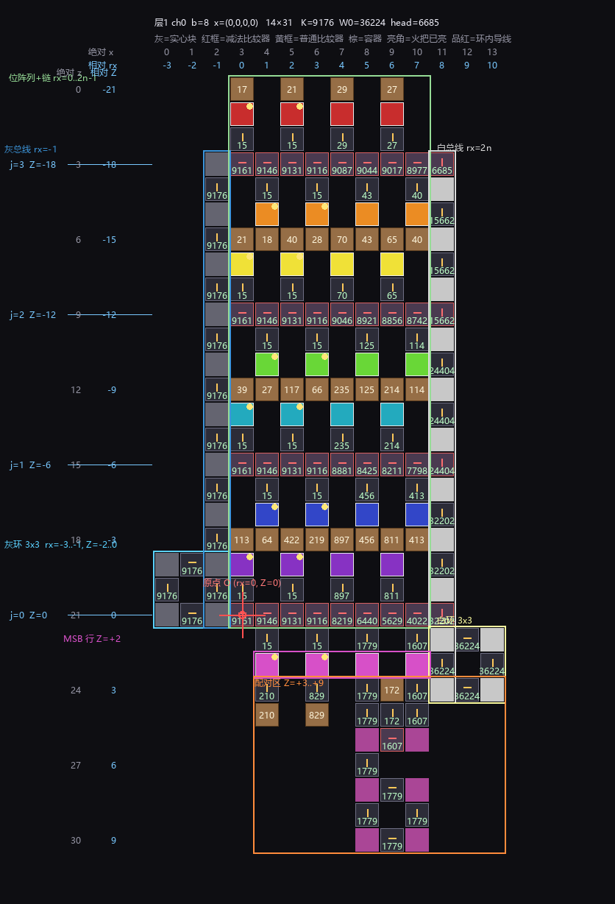

# 单层结构定稿 与 .schem 导出方法

**阶段**：P3 实现
**日期**：2026-10-24
**状态**：平面参数全通（1536/1536），游戏内四次测试通过
**代码**：`viewer/plane_sim.html`（建板 + 求值）、`src/schem_export.py`（导出）、`src/schem_verify.py`（校验）

---

# 零、读图指南（先看这张图）



**示例参数**：层1 通道 0，$n=4$、$b=8$、输入 $X=(0,0,0,0)$、全部方向默认。
$W\times L = 14\times31$，$K=9176$，$W_0=36224$，头部输出 $6685$。

## 0.0 输入到底是什么（最容易搞错的一点）

$$\boxed{\text{输入是 }n\ \text{个整数 } X_i\in[0,\ 2^{b_x}-1]\text{，不是 }n\ \text{个 0/1}}$$

层1：$b_x=8\Rightarrow X_i\in[0,255]$；层2：$b_y=10\Rightarrow X_j\in[0,1023]$（见 `docs/39`）。

每个整数 $X_i$ 拆成 $b$ 个二进制位：

$$X_i=\sum_{k=0}^{b-1}X_i^{(k)}\,2^k,\qquad X_i^{(k)}\in\{0,1\}$$

$$\boxed{\text{位 }X_i^{(k)}\text{ 控制第 }i\text{ 路第 }k\text{ 位那一格的火把}}$$

$$\boxed{\text{火把亮}\iff X_i^{(k)}\ne\bigl[W^{(k)}_i>0\bigr]}$$

分符号写：

$$W^{(k)}_i>0:\ \text{位}=0\ \text{时亮};\qquad W^{(k)}_i<0:\ \text{位}=1\ \text{时亮}$$

### 推导（为什么方向是这个）

板子的恒等式：

$$\Sigma_{\text{出}}=15nb+\sum_{\text{火把灭}}\lvert W\rvert,\qquad N=\sum_{A}\lvert W\rvert$$

**只有"火把灭"的格子贡献 $\lvert W\rvert$**（火把亮时该格被截断成 15，只计入基础量 $15nb$）。

而整数前向要求

$$N=\sum_{i,k}\bigl(W\cdot X^{(k)}-\min(0,W)\bigr)$$

逐格拆：

| $W$ | 表达式 | $X=0$ | $X=1$ |
|---|---|---|---|
| $W>0$ | $WX$ | $0$ | $W=\lvert W\rvert$ |
| $W<0$ | $W(X-1)$ | $-W=\lvert W\rvert$ | $0$ |

$$\Rightarrow\quad \text{贡献}\lvert W\rvert\iff X=[W>0]$$

$$\boxed{\text{所以"火把灭"}\iff X=[W>0]\quad\Longleftrightarrow\quad\text{"火把亮"}\iff X\ne[W>0]}$$

$$\text{直觉：亮 = 这一格不干活。}W>0\text{ 时位为 1 才该出力（灭）；}W<0\text{ 时位为 0 才是那个偏置（灭）}$$

所以：**4 个输入 = 4 个字节，共 32 个二进制位**，每一位对应板上一格。
图上那张示例用了 $X=(0,0,0,0)$，即所有位都是 0 —— 这只是一个特例，真正可测的有 $256^4$ 种。

$$\text{注意：}X_i=(0,1,1,0)\ \text{这种写法是错的}——\text{输入的四个量各是一个 }0\ldots255\text{ 的整数}$$

## 0.1 坐标怎么读

图的上方有**两行数字**：

| 行 | 颜色 | 含义 |
|---|---|---|
| 绝对 $x$ | 灰 | 导出到 schem 用的格子列号，从 0 开始 |
| 相对 $r_x$ | 青 | $r_x = x - \text{originX}$，数组左侧第一列是 $r_x=0$ |

图的左侧有**两行数字**：

| 列 | 颜色 | 含义 |
|---|---|---|
| 绝对 $z$ | 灰 | 导出用的格子行号 |
| 相对 $Z$ | 青 | $Z = z - \text{originZ}$，**向上为负** |

$$\boxed{\text{板上一切公式都用相对坐标 }(r_x,\ Z)\ \text{写；导出时才加 originX/originZ}}$$

## 0.2 红色十字 = 原点

$$\boxed{O=(\text{最高权重链的第一个比较器})\quad\Longleftrightarrow\quad (r_x,Z)=(0,0)}$$

本图里绝对坐标是 $(3,\ 21)$。**原点不是左上角，也不是 (0,0) 格。**

## 0.3 各区域一览

| 颜色框 | 区域 | 位置 | 作用 |
|---|---|---|---|
| 青 | **灰环** | 列 $r_x=-3..-1$，3 行 | 存 $K=\sum S$，是全场总电源 |
| 深蓝 | **灰总线** | 列 $r_x=-1$，从环上沿到 $Z_{\text{ch}}(J-1)$ | 把 $K$ 分给每条链 |
| 绿 | **位阵列 + 减法链** | 列 $r_x=0..2n-1$ | 核心：位块、位容器、减法比较器 |
| 白 | **白总线** | 列 $r_x=2n$ | 从 $W_0$ 里扣掉四条链的减量 |
| 浅黄 | **白环** | 列 $r_x=2n..2n+2$，3 行 | 存 $W_0=J\cdot K-15nb$ |
| 品红 | **MSB 行** | $Z=+2$ | 最高位权那一排彩色方块 |
| 橙 | **配对区** | $Z=+3..+9$ | 把两路 MSB 分开（环 / Δ桶 / 减法）|

## 0.4 $j$ 是什么

图中左侧每个 $j=0,1,2,3$ 标在**减法链**上：

$$\boxed{\text{链 }j\text{ 的行号 } Z_{\text{ch}}(j) = -6j\qquad j=0\ldots J-1,\quad J=\lceil b/2\rceil}$$

每条链负责**两位**：上槽一位、下槽一位。本图：

| $j$ | $Z_{\text{ch}}$ | 管哪两位 |
|---:|---:|---|
| 0 | $0$ | 位 6、位 7(MSB) |
| 1 | $-6$ | 位 4、位 5 |
| 2 | $-12$ | 位 2、位 3 |
| 3 | $-18$ | 位 0、位 1 |

## 0.5 符号与缩写全表

| 符号 | 读法 | 含义 |
|---|---|---|
| $n$ | — | 输入路数（层1 是 4，层2 是 64） |
| $b$ | — | 位宽。**同时是输入位宽和权重位宽**（`compiler.py` 的约定） |
| $J$ | — | 链数，$J=\lceil b/2\rceil$ |
| $i$ | — | 输入下标，$0\ldots n-1$ |
| $k$ | — | 位下标，$0\ldots b-1$（0 是最低位） |
| $j$ | — | 链下标，$0\ldots J-1$ |
| $r_x$ | "r x" | 相对列 |
| $Z$ | — | 相对行（向上负） |
| $x,z$ | — | 绝对列、绝对行 |
| `originX` | — | $r_x=0$ 对应的绝对列，恒为 3 |
| `originZ` | — | $Z=0$ 对应的绝对行，随 $b$ 变 |
| $W^{(k)}_i$ | "W 上标 k 下标 i" | 第 $i$ 路第 $k$ 位的位权重（整数，可负） |
| $S^{(k)}_i$ | — | 该格容器的存储量，$S=15+\lvert W\rvert$ |
| $K$ | — | 灰环值，$K=\sum_i\sum_k S^{(k)}_i$ |
| $W_0$ | "W 零" | 白环值，$W_0=J\cdot K-15nb$ |
| $N$ | — | 头部输出（非负累加量） |
| `XI(i)` | — | 输入重排，`inRev=0` 时恒等，`=1` 时 $n-1-i$ |
| `CE` / `CO` | — | 偶列、奇列函数；`parSwap` 会把两者交换 |
| `slot(k)` | — | 位 $k$ 落在哪个槽（哪个 $j$、上槽还是下槽） |
| `hasUp[j]` / `hasDn[j]` | — | 链 $j$ 上槽/下槽有没有位（没有就不建那排读入比较器） |
| `zr` | "z r" | 配对区起始行，$Z_{\text{msb}}+1=+3$ |
| $c_L,c_M,c_R$ | — | 一对的两列与其中点列 |
| $x_{\text{big}}/x_{\text{small}}$ | — | 一对里信号大/小的那一列 |
| 情形 Ⅰ/Ⅱ/Ⅲ | — | 按 $\lvert W\rvert$ 是否超过 882 分三类 |
| `src` | — | 标记"该比较器是源（环），求值时锁定" |
| `powered` | — | 比较器方块状态，有输出时必须 `true` |
| `OutputSignal` | — | 比较器 BlockEntity 里的数值，上限 $2^{31}-1$ |
| `inRev` / `bitRev` / `parSwap` | — | 三个自由度：输入反转 / 位权镜像 / 列奇偶交换 |

## 0.6 图例

| 图形 | 含义 |
|---|---|
| 深灰块 + 黄箭头 | 普通比较器，箭头=输出方向，中间数字=输出值 |
| 紫灰块 + 红箭头 | **减法**比较器 |
| 棕色块 | 容器（木桶） |
| 彩色块 | 输入块（颜色=位号）；右上角**亮点=火把亮** |
| 品红块 | 环内导线（被比较器充能的实心块） |
| 白块 | 白环/白总线的方块 |
| 浅灰块 | 基底（灰环/灰总线） |

---

# 一、坐标约定（最重要的一节）

## 1.1 原点

$$\boxed{\text{原点 }O=(\text{最高权重链的第一个比较器})}$$

平面坐标系用两组量：

| 记号 | 含义 | 范围 |
|---|---|---|
| $r_x$ | 相对列号，$r_x = x - 3$ | 数组占 $0\ldots 2n-1$ |
| $Z$ | 相对行号，$Z=0$ 在原点行，**向上为负** | 见下 |
| $(x,z)$ | 绝对格坐标（导出用） | $x\ge0,\ z\ge0$ |

$$\text{平移关系：}\quad x = r_x + \text{originX},\qquad z = Z + \text{originZ}$$

`originX`、`originZ` 由建板后量包围盒得出，**不是常数**，随 $n$、$b$、结构选项变化。

## 1.2 列函数

$$C_{\text{odd}}(i)=2i,\qquad C_{\text{even}}(i)=2i+1$$

$$\text{parSwap}=0:\ (C_E,C_O)=(C_{\text{odd}},C_{\text{even}});\qquad
\text{parSwap}=1:\ (C_E,C_O)=(C_{\text{even}},C_{\text{odd}})$$

$$\boxed{\text{colOf}(k,i)=\bigl(\text{slot}(k).\text{up}\ ?\ C_E : C_O\bigr)\bigl(\text{XI}(i)\bigr)}$$

$$\text{XI}(i)=\begin{cases}i,&\text{inRev}=0\\ n-1-i,&\text{inRev}=1\end{cases}$$

## 1.3 行

$$J=\Bigl\lceil \frac b2\Bigr\rceil,\qquad \boxed{Z_{\text{ch}}(j)=-6j}\quad (j=0\ldots J-1)$$

$$\text{MSB 行 } Z_{\text{msb}}=+2$$

$$\text{配对区 } z_r=Z_{\text{msb}}+1=+3,\qquad \text{延伸至 } Z=+9$$

---

# 二、位 \(\to\) 槽位（决定所有 $b$）

## 2.1 槽位表

$$SLOTS=\bigl\{(j,\ Z_{\text{ch}}(j)+2,\ \text{up}=0)\bigr\}_{j=0}^{J-1}
\ \cup\ \bigl\{(j,\ Z_{\text{ch}}(j)-2,\ \text{up}=1)\bigr\}_{j=0}^{J-1}$$

$$\text{排序键：}\ |Z|\ \text{升序；同 }|Z|\ \text{时 } +2\ \text{在前}$$

$$\boxed{\text{SLOT}[b-1-i] = SLOTS[i]\quad\Longrightarrow\quad \text{位权最高者进最靠近 }Z=0\text{ 的槽}}$$

## 2.2 两个必须记住的后果

**① 密排**：$b$ 个位连续占用前 $b$ 个槽，不跳槽。

**② 奇数 $b$ 的空槽落在 $j=J-1$**

$$\text{例 }b=9,\ J=5:\quad
\text{槽序}=+2,-2,-4,-8,-10,-14,-16,-20,-22,-26$$
$$\text{9 个位占前 9 个}\Rightarrow \text{空出 }-26=\text{链 }4\text{ 的上槽}=j=J-1\ \checkmark$$

---

# 三、结构块的 $Z$

| 结构 | 位置 | 说明 |
|---|---|---|
| 减法链 | $Z_{\text{ch}}(j)=-6j$，列 $0\ldots 2n-1$ | 每条链一行 |
| 上方读入行 | $Z_{\text{ch}}(j)-1$，仅 $C_E$ 列 | `hasUp[j]` 时建 |
| 下方读入行 | $Z_{\text{ch}}(j)+1$，仅 $C_O$ 列 | `hasDn[j]` 时建 |
| 位块 | $Z=\text{slot}(k).Z$ | 颜色 $\text{bitRev}=0$ 时取 $k$，否则取 $b-2-k$ |
| 位容器 | $Z=\text{slot}(k).Z\ \mp 1$（上槽减、下槽加） | |
| **灰环** | $\text{greyUp}: Z_{\text{ch}}(0)-2=-2$<br>$\text{greyDown}: -6J+4$ | 3 行 $\times$ 3 列，列 $-3\ldots-1$ |
| 灰总线 | $r_x=-1$，$Z$ 从环上沿到 $Z_{\text{ch}}(J-1)$ | 偶数行放实心块，奇数行放比较器 |
| **白环** | $\text{whiteUp}: Z_{\text{msb}}-1=+1$<br>$\text{whiteDown}: Z_{\text{ch}}(J-1)-3$ | 3 行 $\times$ 3 列，列 $2n\ldots2n+2$ |
| 白总线 | $r_x=2n$，$Z$ 从起点到 $Z_{\text{ch}}(0)$ | 链行处为减法比较器 |
| 配对区 | $z_r=+3$ 起，环在 $z_r+3\ldots z_r+5$ | 见第五节 |

$$\boxed{\text{greyDown 的 }-6J+4\ \text{与 whiteDown 的 }-6(J-1)-3\ \text{不是同一个公式，别混}}$$

---

# 四、常数

$$K=\sum_{i,k}S_i^{(k)},\qquad S_i^{(k)}=15+|W_i^{(k)}|$$

$$\boxed{W_0=J\cdot K-15nb}$$

$$\text{层1 }n=4,b=8: K=9176,\quad W_0=4\times9176-15\times4\times8=36224$$

---

# 五、配对区

## 5.1 按列配对（不是按输入序号）

```js
COLS = [{col: CO(XI(i)), i} for i in 0..n-1]
COLS.sort(by col)
for p in 0..floor(n/2)-1:
    xa = COLS[2p].col ;  iAtA = COLS[2p].i
    xb = COLS[2p+1].col; iAtB = COLS[2p+1].i
    sa = S[iAtA][b-1];  sb = S[iAtB][b-1]
```

$$\boxed{\text{这一条是"输入反转"能不能对的全部关键}}$$

## 5.2 情形判定

$$w_a=|W^{(b-1)}_{iAtA}|,\quad w_b=|W^{(b-1)}_{iAtB}|,\quad \text{lo}=\min,\ \text{hi}=\max$$

$$\text{情形}=\begin{cases}\text{Ⅰ},&\text{lo}>882\\ \text{Ⅱ},&\text{hi}>882\ge\text{lo}\\ \text{Ⅲ},&\text{hi}\le882\end{cases}$$

## 5.3 三种情形下的结构

| 情形 | 大值列 | 小值列 |
|---|---|---|
| Ⅲ | 直通桶在 $(x,4)$ | 直通桶在 $(x,4)$ |
| Ⅱ | 环角块 | 直通桶在 $(x,4)$ |
| Ⅰ | 环角块 | 减法器输出 |

统一三级梯子：

$$(x,2)_{\text{MSB}}\ \xleftarrow{\ N\ }\ (x,3)\ \xleftarrow{\ \text{rear}=S\ }\ (x,4)\ \xleftarrow{\ N\ }\ (x,5)$$

## 5.4 环（3 列 $\times$ 3 行，$r_0=6$）

```
角块 (cL,r0) (cR,r0) (cL,r0+2) (cR,r0+2)
(cM,r0)   out=W  → (cL,r0)
(cR,r0+1) out=N  → (cR,r0)
(cM,r0+2) out=E  → (cR,r0+2)
(cL,r0+1) out=S  → (cL,r0+2)
```

$$\text{四角块都持 } S_{\text{big}}\text{，四个比较器 } \texttt{src}=\text{true}$$

## 5.5 情形Ⅰ 的减法

$$\Delta=S_{\text{big}}-S_{\text{small}}\ \text{放在 }(c_M,r_0-1)$$
$$\text{减法器在 }(x_S,r_0)\text{，rear}=S_{\text{big}}(x_S,r_0+1)\ \text{环侧，side}=\Delta$$

$$\boxed{\text{Δ 桶不能直接当侧输入 —— 红石木桶给比较器侧输入 0}}$$

---

# 六、位权镜像（bitRev）

$$\boxed{Z\to-Z\ \text{的镜像方向映射是 } N\leftrightarrow S\ \text{，}E,W\ \text{不变}}$$

```js
nc.Z = -c.Z
if (cmp) nc.out = {N:'S', S:'N', E:'E', W:'W'}[c.out]   // 不是 FLIP！
```

$$\text{镜像后 } z' = L-1-z,\qquad \text{originZ} = L-1-(0-\min Z)$$

$$\boxed{\text{镜像后链行} = \text{originZ}+6j\ \text{（不是 }-6j\text{）}}$$

## 端口

$$\text{port} = \begin{cases}\min(\text{chainRows}),&\text{whiteUp}\ne\text{bitRev}\\ \max(\text{chainRows}),&\text{whiteUp}=\text{bitRev}\end{cases}$$

---

# 七、往期回归（自查清单）

| # | 曾经的错 | 现在的正确做法 | 若忘了会怎样 |
|---|---|---|---|
| 1 | 用 `FLIP` 做 $Z$ 镜像 | $N\leftrightarrow S$ 专用表 | 东西向链全反，环断 |
| 2 | 配对区用 `CO(i0)` | `CO(XI(i0))`，即按列配对 | 输入反转永远错 |
| 3 | 奇偶槽判定按输入序号 | 按 $|Z|$ 排序后的实际槽 | 紫色块被覆盖、橙色无比较器 |
| 4 | `hasUp/hasDn` 用旧映射 | 用 `slotOf(k)` | 下槽那排比较器不建 |
| 5 | 白环朝下用 $-6J-3$ | $-6(J-1)-3$ | 白环位置错 |
| 6 | 端口硬编码 | 按 `whiteUp !== bitRev` | 输出取反 |
| 7 | $\Delta$ 桶直接当侧输入 | 经一个比较器再进 side | 减法恒为 0 |
| 8 | 测试脚本链行用 $-6j$ | 镜像后 $+6j$ | 误判 bitRev 全错 |

---

# 八、schem 导出

## 8.1 文件格式（WorldEdit Sponge v3）

```
(根, 空名)                          ← 必须有这一层
└ Schematic
  ├ Version = 3
  ├ DataVersion = 3953
  ├ Width, Height, Length          ← TAG_Short
  ├ Offset  [0,0,0]                ← TAG_Int_Array
  ├ Metadata { Date(long), WorldEdit{ Version, EditingPlatform, Origin[3], Platforms{…} } }
  ├ Blocks
  │ ├ Palette { "minecraft:…": idx }        ← TAG_Int
  │ ├ Data    <varint 索引流>                ← 长度必须 = W×H×L
  │ └ BlockEntities [ … ]
  └ PaletteMax
```

$$\boxed{\text{缺 }Schematic\text{ 这一层，WorldEdit 会报 unknown error}}$$

## 8.2 方块映射

| 板内 | Minecraft |
|---|---|
| 比较器 `out=X`，`state>0` | `comparator[facing=FLIP[X],mode=compare\|subtract,powered=true]` |
| 比较器 `out=X`，`state=0` | 同上但 `powered=false` |
| 容器 | `barrel[facing=up,open=false]` |
| 基底 | `light_gray_concrete` |
| 白色方块 | `white_concrete` |
| 环内导线 | `magenta_concrete` |
| 输入块 | `<red\|orange\|yellow\|lime\|cyan\|blue\|purple\|magenta>_concrete` |
| 火把 | `redstone_torch[lit=true]`，放输入块侧向空格、$y=1$ |

$$\texttt{facing}\ \text{取 }\mathrm{FLIP}[\text{out}]\quad\Longrightarrow\quad \texttt{facing}\ \text{是"输入来向"}$$

## 8.3 BlockEntities

### 比较器

```nbt
{ Id:"minecraft:comparator", Pos:[x,0,z],
  Data:{ id:"minecraft:comparator", OutputSignal:<state> } }
```

$$\boxed{\texttt{OutputSignal}\ \text{上限 } 2^{31}-1\ \text{，不是 }15}$$

**所以 $K=9176$、$W_0=36224$ 都能直接写。** 这是环能成立的前提。

$$\text{同时方块状态必须 } \texttt{powered=true}\ \text{（当 state}>0\text{）—— 否则游戏把它当无输出清零}$$

### 容器

$$\text{signal}=1+\left\lfloor\frac{14\,U}{64n}\right\rfloor,\qquad n=27\ \text{(木桶)}$$

用 **不可堆叠物品（木斧）**，`count` 每格最多 64：

$$U=\Sigma\,\text{count},\qquad \text{signal}_{\max}=1+\left\lfloor\frac{14\times27\times64}{27}\right\rfloor=897$$

```nbt
{ Id:"minecraft:barrel", Pos:[x,0,z],
  Data:{ id:"minecraft:barrel",
         Items:[{Slot:0b,count:64b,id:"minecraft:wooden_axe"}, …],
         CustomName:'"signal: S, item: Nx64"' } }
```

$$\text{反解：}N=\Bigl\lceil\frac{(S-1)\times27}{14}\Bigr\rceil,\qquad \text{若 }N>27\times64=1728\Rightarrow S\text{ 不可达}$$

| $S$ | $N$ | 每格 |
|---:|---:|---|
| 7 | 12 | 12 |
| 17 | 31 | 31 |
| 895 | 1725 | 26×64+61 |
| 896 | 1727 | 26×64+63 |
| 897 | 1728 | 27×64 |
| 898 | — | 不可达 |

$$\boxed{\text{板上 }S\le897\text{ 的容器全可达；}S>897\text{ 的只能靠环}}$$

## 8.4 文件名

$$\boxed{\text{必须全 ASCII —— 中文文件名会导致加载器失败}}$$

```
layer1_ch0_C0_all0.schem
layer1_ch0_C1_all1.schem
layer1_ch0_C2_1010.schem
layer1_ch0_C3_0101.schem
```

---

# 九、导出流程

```
① 仿真器 build(n,b,U,ch,opts) → 板（cells + 值）
② 按 opts 设火把：on ⟺ (x_i=1) ≠ (W^(k)_i>0)
③ evalBoard：锁 src（环）→ 拓扑扩散求值
④ 填色 = 15 if torch on else S
⑤ dump_board.js → board_dump.json
⑥ schem_export.py → .schem（方块 + BlockEntities）
⑦ schem_verify.py → 回读校验
   · NBT 读到文件末尾（字节数相等）
   · len(Data) == W×H×L
   · powered=true 的个数 == OutputSignal>0 的个数
```

## 回读器的一个坑

$$\text{TAG\_Long\_Array (tag 12) 读完后必须 } \texttt{self.i += 8*n}$$

否则解析立刻失步 —— 会误判"格式错误"，而其实文件是对的。

---

# 十一、求值算法：锁源 + 拓扑扩散

## 11.1 为什么不能用迭代

板上有**闭环**（灰环、白环、配对区的 $S_a$ 环）。朴素迭代有两个坏结果：

$$\text{① 震荡：改一边、另一边跟着变，永远不收敛}$$
$$\text{② 早锁：rear 一就绪就定值，可侧输入还没算出来}\Rightarrow\text{整条链错}$$

实测：朴素迭代 400 轮后，$Z=-18$ 链停在 `1542 / 0 / 0 / 0`（只有首格对）。

## 11.2 算法

```
① 锁源
   对所有 src=true 的比较器：state = init，加入 locked 集合
   把它们的输出方向上的方块登记为"已充能"

② 循环直到没有新锁定
   对每个未锁比较器 c：
       a. rear 可解析？（见 11.3）
       b. 所有"指向 c 的侧位比较器"都已锁定？（见 11.4）
       两者都满足 → 按 11.5 算出 c.state，锁定，并登记它充能的方块

③ 结果：所有 103 个比较器都有确定值
```

## 11.3 rear 的解析规则

$$\text{rear}(c)=c-d,\qquad d=\text{DV}[\texttt{c.out}]$$

| rear 是什么 | 取值 |
|---|---|
| 容器 | 该容器的信号值 |
| 带火把的方块 | $15$ |
| 比较器（且 `out` 指向 $c$）| 它的 state |
| 被充能的方块 | 充能者的 state |
| 空方块 + 背后有容器 | 背后容器的值（**穿透读**）|
| 以上都不是 | **未就绪** |

$$\text{背后的判定：容器在 rear 的 }-d\text{ 方向，即 }(c-2d)$$

## 11.4 侧输入

$$\boxed{\text{只有"比较器"能当侧输入；容器、红石块、方块一律给 }0}$$

$$\text{侧位}s\in\{(-d_z,d_x),\ (d_z,-d_x)\}\ \text{（$d$ 的左右两个垂直方向）}$$

$$\text{某侧位算数}\iff\text{该格是比较器，且它的 out 正好指向 }c$$

$$\text{侧输入}=\max(\text{所有算数的侧位比较器的 state})$$

$$\text{侧就绪}\iff\text{所有算数的侧位比较器都已锁定}$$

$$\boxed{\text{这一条是踩过的坑：只判 rear 不判侧位，会让 }(x,0)\text{ 在侧位算出来之前就定值}}$$

## 11.4b 补充规则：方块被多个比较器充能时取最大

$$\boxed{\text{一个方块若被两个比较器同时充能（且没有更高优先级的火把/中继器/红石粉），}}$$
$$\boxed{\text{读它的比较器看到的是两者中较大的那个信号}}$$

优先级从高到低：

$$\text{火把} > \text{中继器} > \text{红石粉} > \text{比较器}$$

$$\text{有更高优先级的源时，比较器的充能被完全忽略}$$

$$\boxed{\text{本版平面里没有出现"同一方块被两个比较器充能"，所以求值器暂不实现这条}}$$

$$\text{实现时只需把方块的值改成 }\max(\text{所有充能者的 state})\text{，当前代码已经是这个语义}$$

## 11.5 比较器取值

$$\text{compare}:\quad \text{out}=\begin{cases}\text{rear},&\text{rear}\ge\text{side}\\ 0,&\text{rear}<\text{side}\end{cases}$$

$$\text{subtract}:\quad \text{out}=\max\bigl(0,\ \text{rear}-\text{side}\bigr)$$

## 11.6 源（`src`）清单

一版平面里 `src=true` 的元件恰好 12 个（$n=4,b=8$）：

| 环 | 位置 $(r_x,Z)$ |
|---|---|
| 灰环 | $(-3,-1),\ (-2,-2),\ (-2,0),\ (-1,-1)$ |
| 白环 | $(8,2),\ (9,1),\ (9,3),\ (10,2)$ |
| 配对区第 2 对的 $S_a$ 环 | $(5,8),\ (6,7),\ (6,9),\ (7,8)$ |

$$\text{白环 }r_x=2n=8\ ;\quad \text{配对区 }r_x=5..7$$

$$\boxed{\text{源不是"init}>0\text{ 的所有比较器——只有环是源，其余 init 只是建板种子}}$$

## 11.7 校验点

求值完必须满足：

| 检查 | 判据 |
|---|---|
| 全部解析 | 没有 state 为 `undefined` 的比较器 |
| 链减量 | 每条链的减量 = 它管那两位的 $\Sigma$出 |
| 头部 | $(r_x=2n,\ \min$ 或 $\max$ 链行$)$ 的值 $=N$ |
| 环 | 四个角的值都等于 $K$（灰）或 $W_0$（白）|

实测（$n=4,b=8$，层1 通道 0）：

$$K=9176,\quad W_0=36224,\quad
\text{链减量 } 6375/8386/8889/9014,\quad \text{头部}=3560=N$$

---

# 十二、尚未实现的三块（预留）

| # | 部分 | 状态 |
|---|---|---|
| 1 | 投掷器随机器（生成 $X_i$）| 规格有（`docs/22/23/27`），未实现 |
| 2 | ReLU 的整数除法 $\lfloor(F_j-A_j)/c_j\rfloor$ | **未设计** —— 比较器只能加/减/比较 |
| 3 | 负权重的 $C_{i,\min}$、$P_i$ 硬件实现 | **未设计**（`docs/39` §七第 2 项）|

$$\boxed{\text{CLIP 简单：减偏置 + 侧输入夹上界，比较器直接可做}}$$

$$\boxed{\text{ReLU 的"除以 }c_j\text{"是硬骨头 —— 一格比较器做不了除法}}$$

---

# 十、参数变化时的位置速查

| 量 | 随 $n$ | 随 $b$ | 随选项 |
|---|---|---|---|
| $J=\lceil b/2\rceil$ | — | ✅ | — |
| 链行 $-6j$ | — | ✅（条数） | 镜像后 $+6j$ |
| 位槽 $|Z|$ 排序 | — | ✅ | — |
| 灰环 $Z$ | 列 $-3..-1$ | ✅（$J$） | `greyUp` 换公式 |
| 白环 $Z$ | 列 $2n..2n+2$ | ✅（$J$） | `whiteUp` 换公式 |
| 配对区 $z_r=+3$ | 列 $0..2n-1$ | ✗ 不随 $b$ | `inRev`/`parSwap` 改列 |
| 高度 $L$ | 链数 + 环 + 配对区 | ✅ | 镜像不变 |
| originX = 3 | ✅ 固定 | ✗ | ✗ |
| originZ | — | ✅ | 镜像后翻 |

## 实测尺寸表（$n=4$，全默认选项）

| $b$ | $J$ | $W\times L$ | originZ |
|---:|---:|---|---:|
| 2 | 1 | 14×8 | 3 |
| 3 | 2 | 14×11 | 6 |
| 4 | 2 | 14×14 | 9 |
| 5 | 3 | 14×17 | 12 |
| 6 | 3 | 14×20 | 15 |
| 7 | 4 | 14×23 | 18 |
| **8** | **4** | **14×31** | **21** |
| 9 | 5 | 14×29 | 24 |
| 10 | 5 | 14×32 | 27 |
| 11 | 6 | 14×35 | 30 |
| 12 | 6 | 14×38 | 33 |

$$\boxed{\text{宽度恒为 } W=2n+6\quad(n=4\Rightarrow 14)}$$

$$L\ \text{没有简单闭式：}b=8\to31\ \text{但}\ b=9\to29\ \text{（奇数 }b\text{ 的空槽改变了上界）}$$

$$\boxed{\text{所以：}L\text{ 一律由包围盒量出来，不要用公式推}}$$

## 宽度随 $n$

| $n$ | $W$ | originX |
|---:|---:|---:|
| 1 | 8 | 3 |
| 2 | 10 | 3 |
| 3 | 12 | 3 |
| 4 | 14 | 3 |

$$\boxed{W=2n+6\ \text{（数组 }2n\text{ 列 + 左侧 3 列环/总线 + 右侧 3 列环/总线）}}$$

$$\text{originX}=3\quad\text{（灰环/灰总线占 }r_x=-3\ldots-1\text{）}$$
