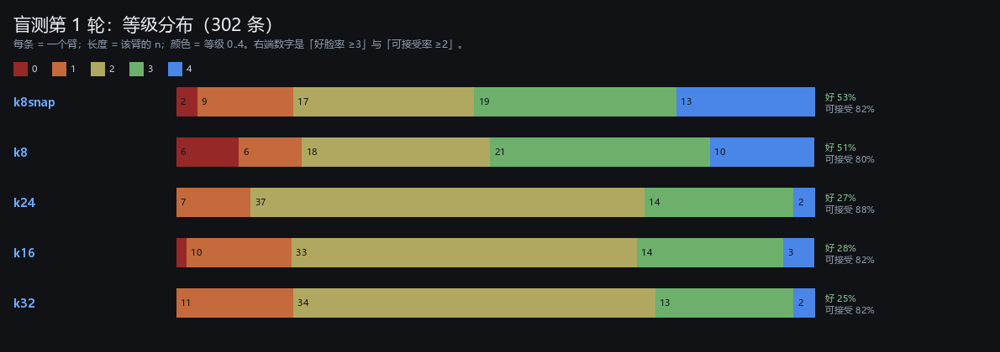

# 四期第一批实验计划

**状态**：工具已核、地基数已算、E1 已跑出第一批（`results/train/K16_w128_k{8,16,24}`）。
**日期**：2026-11-01
**范围**：彩色头像的第一批训练实验：PCA 维数 × 16 色。不含红石实现，不含 schem 编译。

> **本页是"计划与过程"**。五轮盲测的完整梳理（每轮参与者、结构、按等级描框的生成图、筛选前后对照）见 [`04_盲测全记录.md`](04_盲测全记录.md)。

---

## 一、工具：你问的两件事

### 1.1 torch：不用装，机器上已经有三份（实测过）

| 解释器 | Python | numpy | torch | PIL | 实测跑通四期训练 |
|---|---|---|---|---|---|
| `D:\Program Files\Python313\python.exe` | 3.13.2 | 2.2.2 | **2.14.1+cpu** | 11.1.0 | ✅（本页所有臂都是它跑的） |
| `02_phase2_avatar\.venv\Scripts\python.exe` | 3.12.14 | 2.3.5 | **2.14.1+cpu** | 12.3.0 | ✅ |
| `C:\ProgramData\anaconda3\python.exe` | 3.13.9 | — | **2.14.1+cpu** | — | 未试，应有同版本 |

**结论：不需要为 torch 做任何安装。** 三份都是 CPU 版，正好——前向与训练在 CPU 上都够用，GPU 版反而会让"哪台机器能复现"变成新问题。

**关于"要不要专门建一个四期 venv"——我原来打算说是，实测之后改口：现在不建。**

- 二期 venv 的 torch 装在**它自己的** `Lib\site-packages` 里（不是继承来的），所以从 DSH 自带 Python 新建一个 `--system-site-packages` venv **拿不到 torch**；
- 你系统 Python 3.13 的 numpy/torch 装在**用户级** `AppData\Roaming\Python\Python313\site-packages`，而 venv 默认屏蔽用户级包，所以从它也新建不出来（我试过，`ensurepip` 先失败、`numpy` 也找不到）；
- 要一个自包含的四期 venv，就得联网重装：`python -m pip install torch --index-url https://download.pytorch.org/whl/cpu`（约 200 MB）。

**所以现阶段直接用 `D:\Program Files\Python313\python.exe` 跑**，命令写在 `docs/03` 各节的示例里。等到真要加 diffusion/flow 这类新依赖时，再建 venv 一次性装齐——那时才值得付这 200 MB 和一次环境固定的成本。

**实测速度**（24 线程，batch 256，128 隐层，`32×16` 输出）：

| 步数 | 墙钟 |
|---:|---:|
| 2,000 | 3 s |
| 12,000 | **20~26 s** |

所以**算力不是四期的瓶颈，标注才是**：一个臂 12,000 步 20 秒，而一轮盲测要 100~300 条人判，按二期经验是 20~40 分钟。实验设计应当反过来——**先想清楚要人判什么，再决定跑几个臂**。

### 1.2 node：其实已经装好了，只是不在 PATH

| 位置 | 版本 |
|---|---|
| `D:\Program Files\nodejs\node.exe` | **v22.20.0**，npm 10.9.3、npx、corepack 齐全 |
| `C:\Users\lenovo\.dsh\dsh-runtimes\...\dependencies\node\bin\node.exe` | v24.21.0（DSH 自带，另有 pnpm 11.7.0） |

`where node` 找不到它，是因为 **`D:\Program Files\nodejs` 不在 PATH 里**。三种做法，按推荐排序：

1. **加进用户 PATH（一次性，不需要管理员）**：

```powershell
$old = [Environment]::GetEnvironmentVariable('Path','User')
[Environment]::SetEnvironmentVariable('Path', $old + ';D:\Program Files\nodejs', 'User')
# 新开的终端里生效；当前会话临时生效：
$env:Path += ';D:\Program Files\nodejs'
```

2. **只用绝对路径**：`& 'D:\Program Files\nodejs\node.exe' script.js`。零配置，但每个命令都要写全。
3. **用 DSH 自带的 v24 + pnpm**：`node <...>\pnpm\bin\pnpm.mjs install`。适合装包，不适合日常敲 `node`。

**关于 HTML 编辑，有个更容易被忽略的事实：现在的工具页不需要 node。** `02_phase2_avatar/webapp/sandbox_standalone.html` 是 5.27 MB 的单文件、纯 vanilla JS、无构建步骤，双击就能用。所以：

- **改页面 / 加一个标注页**：只写 HTML+JS，用 `python -m http.server` 起静态服务即可（四期的 `label_colour.html` 也是这条路）。
- **需要 node 的场合**：想用 Playwright/Puppeteer 做自动截图或端到端测试；想要 TypeScript/打包；想跑 diff 图生成器。这三件都不是必需，但**自动截图**对四期有用（每次训练完自动出一张效果图），要用时再加 PATH。

---

## 二、开训前已经定下的三条数

脚本：`tools/phase4_prep.py` → `results/prep/prep.json`、`results/prep/palette16.png`。数据只读：`02_phase2_avatar/results/colour/cache.npz`（321,219 张）。

### 2.1 PCA 维数：8 → 32 只多 20 个点，但多 24 条随机源

| k | 累计解释方差 | 重建残差（每通道 RMS） | 前 k 系数协方差条件数 |
|---:|---:|---:|---:|
| 8 | 75.0% | 2.54 级 | 1.000 |
| 16 | **86.1%** | 1.89 级 | 1.000 |
| 24 | 91.9% | 1.45 级 | 1.000 |
| 32 | 95.1% | 1.13 级 | 1.001 |

**关键**：一直到 32 维，标准化后的系数协方差几乎还是单位阵（条件数 1.000~1.001，非对角相关 <1e-5）。所以**"8 个独立标准正态"这个零成本采样方案对 16/24/32 维同样成立**，不需要学协方差矩阵，也不需要 32×32 的线性变换。这是四期能直接加维的许可证。

### 2.2 16 色调色板：选出来容易，"吸附"有三个坑

| 方案 | 调色板量化误差（均值 / p95） | 吸附到 61 个 HIGH 色 | 吸附到 244 个地图色 |
|---|---|---|---|
| K=8 自由（二期同款） | 2.42 / 5.66 级 | 误差 1.71 级，8/8 不撞色 | 1.23 级，8/8 |
| K=8 自由 + 饱和×1.2（二期部署） | 2.45 / 5.72 | 2.09 级，8/8 | 1.53 级，8/8 |
| **K=16 自由** | **1.71 / 4.12** | 1.73 级，**15/16（撞 1 对）** | 1.32 级，16/16 |
| **K=16 自由 + 饱和×1.2** | **1.76 / 4.25** | 1.93 级，**15/16** | 1.59 级，16/16 |

**作者 2026-11-02 已定：只吸附到 61 个 HIGH 色，撞色就撞色。** 执行结果：

- 16 个槽位吸附后只有 **15 个不同颜色**（两个近黑 `#211A18` 与 `#010001` 都吸到 `BLACK`），但**索引仍是 16 个 → 4 bit/像素不变**，硬件不变；
- 吸附误差 **平均 1.93 级、最大 3.80 级**（244 色方案是 1.59/3.79，省下的 0.34 级以撞一个槽位为代价）；
- 地图介质本身的下限：真实像素到最近地图色，**61 个 HIGH 平均 1.69 级（31% 的像素在 1 级内）**，244 色是 1.20 级（48%）。所以 16 色 + HIGH 的还原精度已经接近"这个介质只能做到这么多"，**再加颜色（K=24/32）的收益会很快饱和**。

部署件已生成：`results/train/<臂>/model_snap.json`（同权重 + 吸附后调色板，即二期 `k8snap` 的做法），调色板清单在 `results/fit/deploy_palette.json`。

图：`04_phase4_colour_avatar/results/prep/palette16.png`（16 色 → HIGH 吸附 → 244 吸附三行对照）。
JSON：`results/prep/palette16.json`（每个槽位的 RGB、hex、吸附名、误差）。

### 2.3 成本有两条轴，二期只记了一条

乘法 $= k\cdot W + W\cdot W + W\cdot 512$（两层 128，K=16）：

| k | W=128（可红石） | W=256（只作上限参照） | 输入随机源 |
|---:|---:|---:|---:|
| 8 | 82,944 | 198,656 | 8 条 |
| 16 | 83,968 | 200,704 | 16 条 |
| 24 | 84,992 | 202,752 | 24 条 |
| 32 | 86,016 | 204,800 | 32 条 |

- **k 几乎免费**：8→32 只加 3.7%。
- **W 是贵的那一维**：128→256 涨 2.4 倍，而且超过你说的红石上限（≈128）。
- **最后层占 76%~79%**（$128\times512=65{,}536$）。所以"16 色"本身就把成本抬了一倍（对比 K=8 的 $128\times256=32{,}768$）。
- **第二条轴：随机源条数 = k**。乘法账上看不见它，但每条输入都要一条量化/随机链路（见 `kb/10_游戏机制/投掷器.md`）。k=32 是 k=8 的四倍输入硬件，**这条必须单独记，否则"加维免费"是假象**。

---

## 三、已经跑出的第一批（E1）

配置：K=16 自由调色板（饱和×1.2）、`k→128→128→32×16`、12,000 步、batch 256、Adam 3e-4，无对抗、无 TV。**每个臂 20~26 秒。**

> 口径说明：`cache.npz` 里的颜色 PCA 系数只有 24 维，k=32 跑不了。现在统一改为**在 rgb192 上重算 32 维基**，并把前 24 列按符号对齐到缓存（SVD 符号是任意的，不对齐会让"同一个旋钮"在不同臂里反号）。四个臂都用这**同一套基的前 k 列**，所以跨臂可比。基缓存在 `results/prep/cpc32.npz`。

| 臂 | k | 乘法 | 位置准确率 | 同色率 | 平均色数 | 边缘 p90 |
|---|---:|---:|---:|---:|---:|---:|
| `K16_w128_k8` | 8 | 82,944 | 0.6485 | 70.7% | 4.07 | 13.74 |
| `K16_w128_k16` | 16 | 83,968 | 0.7183 | 65.0% | 4.75 | 14.45 |
| `K16_w128_k24` | 24 | 84,992 | 0.7731 | 62.6% | 4.97 | 14.50 |
| `K16_w128_k32` | 32 | 86,016 | **0.8141** | 62.3% | 5.04 | 14.87 |

图：`results/prep/arms_5.png`（五个臂、同一批 20 个随机输入、逐列可比）。

**怎么读**（二期的老规律，四期原样重现）：

- k↑ → **位置准确率升**（信息多了），**同色率降**（杂色多了），**色数升**。也就是"更像指定的那张脸"和"更干净"是**反向**的。
- 真实数据参照（二期量过）：色数 7.2、边缘 p90 15.4。现在这些臂都还偏"平"（4~5 色），说明**模型还没到"真实数据的丰富度"**，但比二期的 K=8 已经接近（二期 K=8 色数约 3.2~3.6）。
- **这些全是代理指标，不能当结论。** 它们只用于把明显坏的臂筛掉，真正的判据是盲测。

### 3.1 顺手跑的四个附加臂（每个 20 秒，用来省掉以后的争论）

| 臂 | 变量 | 结果 | 结论 |
|---|---|---|---|
| `K16_w128_k8_s1` | 换种子 | acc 0.6478 vs 0.6485 | **种子噪声可忽略**（0.0007），以后单种子即可，省一半时间 |
| `K16_w256_k16` | W=256 | acc 0.7480 vs 0.7183（+0.030） | 2.4 倍乘法换 +3.0 点位置准确率；**W=256 不值得进盲测** |
| `K16nosat_w128_k16` | 调色板不饱和 | acc 0.7202，边缘 13.95（饱和臂 14.45） | 饱和×1.2 基本不改准确率（0.7202 vs 0.7183），**只把边缘抬锐 0.5**——这正是二期当初加它的理由 |
| `K16med_w128_k16` | 244-medoid 调色板 | acc 0.7662，但调色板量化误差 **2.25**（自由臂 1.74），色数 4.05 | **准确率不可横比**：调色板更粗 → 目标更容易命中。**这个臂必须靠人判**，数字会骗人 |

最后一行正好是二期教训的重演：**换调色板会同时改变"目标"和"难度"，位置准确率就不再是可比量。**

### 3.2 一个必须提前写下来的坑

位置准确率的分母是"该像素的调色板索引"，**调色板一变，分母就变**。所以：

- 同一调色板内比 k：可以（上面的 8/16/24/32）。
- 不同调色板之间比（自由 vs 饱和 vs medoid）：**不可以**，只能看人的盲测。


---

## 四、实验矩阵

| 编号 | 目的 | 配置 | 成本 | 判据 | 预计 |
|---|---|---|---|---|---|
| **E0** | 口径与基线 | 复用二期 `label_colour.html`；把二期 k8snap（`colour_k8snap_model.json`）作为**固定对照臂**放进每一轮；先跑 200 条热身 | 20~30 min 人判 | 与二期 57.3%/61.1% 对得上（不一致说明流程漂了） | 半天 |
| **E1** | PCA 维数 | k=8/16/24/32，K=16，W=128，12k 步，**每臂 2 个种子** | 8 次训练 ≈ 3 min | 同轮盲测（4 臂 + 基线，每臂 ≥100），Fisher 对基线 | 1 天（含人判） |
| **E2** | 调色板怎么来 | 在 E1 最好的 k 上比：free / free+去重 / 244-medoid / 不做饱和 | 4 次训练 ≈ 2 min | 同轮盲测 + 吸附误差 | 半天 |
| **E3** | 采样先验（先验证前提） | 见 §5.4：矩形/打分器/神谕三方对比，再做分布拟合 | 1 次分析 ≈ 1 min | 覆盖率-坏率曲线 | 半天 |
| **E4** | 两阶段上色（备选 A） | 冻结二期 4-64-32 出灰度；色度头吃 [灰度 32 级, 色度 PCA] | 1~2 天 | 同轮盲测 | 2~3 天 |
| **E5** | diffusion（备选 B） | 8 维流上的小 diffusion（每步 1 次前向） | 1 周 | 上限研究，不部署 | 1 周 |
| **E6** | 头部网络 + GAN（你的设想） | 冻结 G，训 head（z→w），见 §5.4 | 2~3 天 | 与 E3 的"打分器限制"对比 | 3 天 |

**关键设计约束**：同一轮里必须**只有 3~4 个臂**（人一次判 300 张已经到极限），所以上面每一行都要单独成轮，不能一次全上。

---

## 五、对你三个设想的评估

### 5.1 朴素 PCA → 16 色：可以开始，且成本几乎不涨

这是当前主线。16 色比 8 色多花一倍最后一层（32,768 → 65,536 乘法），但**从 k=8 加到 k=32 只多 3.7%**，所以 E1 的四个臂可以一次全跑，代价只有人判时间。

有一个**先要做的小决定**：16 色是"吸附后的 16 个物理色"，训练目标是**索引**（交叉熵）。如果训练时用自由色、部署时换吸附色，就是二期的 `k8snap` 做法（不掉分）。若直接用 244-medoid（调色板本身就是物理色），训练目标就已经是物理色——但二期在 K=8 上试过"事前限定"并大败（33.6% vs 57.3%，p=0.0008）。**那次失败的直接原因是只在 61 个 HIGH 色里选，缺中间色**；244 色的候选密度高得多（介质下限 1.20 级 vs 1.69），是否还会失败必须实测，这就是 E2。

### 5.2 两阶段上色（灰度 + 色相/饱和度 PCA → 彩图）

**两个必须提前想清楚的技术点**：

1. **色相在近灰处无定义**。二期测过：明度→色相 $R^2=0.06$（推不出来）。色相/饱和度的 PCA 在低饱和像素上会有大跳变，PCA 本身也不适合环形量（色相是 0~360 的环）。更稳的等价做法是**用对色通道**：$Y$（亮度）+ $C_b,C_r$（或线性 RGB 的两个色度轴），在 $C_bC_r$ 上做 PCA——仍然是"亮度 / 色度分离"，但坐标是线性的。
2. **二期 E3 的失败模式会原样重现**：给"这张脸的灰度"配"另一张脸的颜色分量"，模型只能输出极端值（荧光色）。你这一版是"灰度图 + 色度的 PCA"，**如果色度是独立采样的，就还是同一个病**。修法是给色度加一个**条件先验** $p(\text{色度}\mid\text{灰度旋钮})$——用真实数据拟合一个很小的条件高斯/kNN 即可，成本几乎为零。**这一步不做，两阶段基本注定失败。**

### 5.3 diffusion

**先说代价**：diffusion 每张脸要 N 次前向。若 N=20，红石成本就是 20×82,944 ≈ 166 万乘法，比二期整条灰度线贵 700 倍。所以它的定位应当是**质量上限研究**（"离散调色板这个编码到底丢了多少"），不是部署路线；除非能做到 1~4 步蒸馏。二期已经有一个相关证据：**多步采样能换来多样性，但每像素的类别分布本身是瓶颈**（28% 位置多峰），diffusion 在 8×8 上未必比 16 类 softmax 强多少。

### 5.4 头部网络 + GAN（你的设想）：我先把两个前提测了

你的判断是：**PCA 模型能拟合训练集，但"好脸到好脸"之间的高维连线可能一路都是丑脸；所以在训练好的 PCA 模型前面加一个可训练网络来变换输入，让它参与 GAN，比从头训 GAN 好。**

这个结构（冻结生成器 + 可训练 head）在文献里就是"潜空间重参数化"，方向是对的：它把"生成什么"和"怎么采样"解耦，只训后者，样本效率远高于从头训 GAN。**但它能修的东西有上界**：G 冻结，图像流形不变，head 只能重排质量分布，不能增加细节，也不能消除 28% 的多峰位置。

我用二期留下的 1,372 个坏点标注把两个前提量了一下（4096 格全空间）：

**前提一「好点之间的连线是不是丑的」——部分成立。**

| 两个好点的距离 | 中点（落回格点）的坏率 |
|---|---|
| 0~2 | 3.3% |
| 2~4 | 9.9% |
| 4~6 | 22.2% |
| >6 | **31.1%** |
| 全体好点对的中点 | **24.9%** |
| 对照：随机格点 | 34.4% |

所以：**近距离连线基本安全，远距离连线的中点和随机差不多（31% vs 34%）**。你的直觉在"远距离"这一半上是对的——但那也意味着**只要采样不跨远距离，问题就不大**，而这正是"矩形夹取"在做的事。

**前提二「数据密度能告诉你哪里好」——不成立。**

4 个旋钮的标准化坐标，真实数据的协方差就是单位阵（条件数 1.000），我用 20 万张真实脸做了 kNN 密度，**用密度预测"坏"的 AUC 只有 0.504**（等于抛硬币）。也就是说：**拟合数据分布（GMM / flow / VAE 先验）拿不到"好不好"的信息**，因为数据在旋钮空间里几乎是均匀的。这一条直接否掉了"用 head 学一个更好的先验"的最省事版本。

**那什么有用？** 同一批 4096 格点上，三种"选区域"的办法对比（覆盖率都取 23.4%）：

| 规则 | 覆盖 | 坏率 | 良率 |
|---|---:|---:|---:|
| 手写矩形 `PC2≥−0.5 且 PC1≤−1.5` | 23.4% | 10.9% | **89.1%** |
| 二次打分器（14 乘法）取最低分 23.4% | 23.4% | **4.6%** | **95.4%** |
| 神谕（直接挑好点） | ≤66.5% | 0 | 100% |

**学习的"安全区"比手写矩形好 6.3 个点**（95.4% vs 89.1%），而神谕说明上限是 100%/66.5%——中间还有很大空间。二期当时没用打分器划区，是因为**它在角落有约 15% 误判**，而矩形规则可以解释、可以手算。但如果四期要的是良率，**用打分器/能量模型划区比矩形更划算，成本 14 次乘法**。

所以我的建议是把你的设想改成一条更短的路：

> **冻结 G，训练一个"安全区/能量"模型（在旋钮空间上），用它做拒绝采样或限幅；而不是训一个 head 去骗判别器。**

理由（都是上面测出来的）：

1. 密度无信息（AUC 0.504），所以 head 的"先验"版本学不到东西；
2. GAN 的判别器在 16 色离散输出上**平凡可分**（二期实测 D 准确率 0.99），梯度只会把颜色统计推离真实；
3. 而"安全区"这个目标有现成的监督信号：二期已有 1,108 条彩色标签 + 1,372 个灰度坏点；四期每轮盲测又会产生新标签。

**如果你仍然想做 GAN**（我不反对试，但要按这三条做，否则一定会重演二期）：

1. **判别器看连续期望色**（softmax 加权后的调色板颜色），不看 argmax 索引——否则 16 色离散输出让 D 一秒满分；
2. **D 加容量/正则限制**（小 D、谱归一化、R1），并把 D 的输入限制在"结构特征"（亮度排布、眼睛对比）而不是全局色彩统计；
3. **head 必须低维/平滑**（仿射 + 逐元素单调样条），否则它会跑到 G 的流形边缘去找骗 D 的怪图——二期 C2 就是这么坏的；
4. **判据只能是同轮盲测**，不许用 D 的分数或代理打分器当结论。

---

## 六、模型对训练集的拟合（已回答你的好奇）

做法：从**训练集**里均匀取头像，把每张脸自己的 k 个 PCA 坐标喂给模型，argmax 解码，再和原图比。
指标用 2,000 行算（16 张脸只有 512 个像素，抽样噪声 ±4 点会误导），图用 16 张画。

| 臂 | 训练集命中（自有调色板） | 验证集命中 | 部署色（61 HIGH）命中 | RGB MAE | 调色板地板 |
|---|---:|---:|---:|---:|---:|
| `K16_w128_k8` | 64.0% | 64.8% | 50.6% | **1.88 级** | 1.13 |
| `K16_w128_k16` | 71.2% | 71.8% | 55.4% | 1.57 | 1.13 |
| `K16_w128_k24` | 77.0% | 77.3% | 58.5% | 1.42 | 1.13 |
| `K16_w128_k32` | 81.0% | 81.4% | 60.1% | **1.36** | 1.13 |

图：`results/fit/fit_val.png`（真实 / 调色板地板 / 四个臂，逐列同一张脸）。

三条结论：

1. **没有过拟合**：训练集与验证集几乎一样（64.0 vs 64.8、81.0 vs 81.4）。31 万张脸对 8 万个参数来说太富余了。
2. **k 越大越"像真脸"**，单调、不饱和：62 → 77% 的命中率、1.88 → 1.36 级的 MAE。
3. **但谁都到不了 100%**，离"调色板地板"（1.13 级）也还有一段。原因是这类模型本质上是**把输入投影到"每个位置的条件均值"**：给真实坐标它能画出**这张脸的合理版本**，不是这张脸本身。这也解释了二期为什么在 32 输出上撞到"28% 的位置多峰"那堵墙。

**这正好解释你"k=8 最干净"的感觉**：干净 = 平滑 = 丢细节。k=8 的 1.88 级误差意味着它主动抹掉了大量局部变化；k=32 保留更多细节，同时把"抹平"带来的整洁也一起丢掉了。**"干净"和"像真脸"在同一个方向上不可兼得**，而四期要的是随机采样好看——所以你的直觉可能是对的，但 E1 的随机图里 k=8 也偏平（色数 4.07，真实 7.2），这一点要靠盲测定。

## 七、安全区试探（彩色旋钮，已测）

把二期四个彩色轮的 **1,108 条人工标签**（round 6/8/11/12，每条都带 8 个颜色 PCA 坐标）拿来，只看旋钮预测"会不会被接受"：

| 模型 | 项数 | 5 折 CV AUC | 样本内 AUC | 留一轮（6/8/11/12） |
|---|---:|---:|---:|---|
| 线性 | 9 | 0.635 | 0.661 | 0.71 / 0.59 / 0.63 / 0.65 |
| **二次** | **45** | **0.685** | 0.728 | 0.73 / 0.68 / 0.62 / 0.66 |

对照：灰度 4 旋钮的二次打分器是 **0.853**（同一套做法）。图：`results/safe/safe_map.png`（PC0-PC1 截面的安全区热图 + 真实标签点）。

四条判断：

1. **彩色旋钮能预测接受，但比灰度弱得多**（0.685 vs 0.853）。原因合理：灰度的好坏主要由"明暗/发肤/眼型"这几个光滑方向决定，而彩色还多出"配色是否协调"这种更难从坐标里读出的东西。
2. **留一轮不崩**（0.62~0.73）说明**信号不是某个模型特有的**——可以当跨模型的通用先验。
3. **45 项在 60 条/臂的数据量下必然过拟合**。所以第一轮盲测之后（每臂 ~60 条）只能拟合线性（9 项）或强正则的二次；**要真正学一个 16 色模型的安全区，需要更多标签**（≥300 条/臂）。
4. 预测曲线显示"取分数最高 30% → 预测 100% 可接受"，但这是自洽结果，**必须用盲测证实**。

**结论**：安全区在四期值得做，但优先级低于"先把 k 和调色板定下来"；而且它更可能是**通用先验**（用现成 1,108 条标签训一个，直接套到新模型上），而不是每换一个模型重训一个。

## 八、盲测怎么跑（已就绪）

页面与服务都写好了，一条命令起：

```powershell
D:\Program Files\Python313\python.exe 04_phase4_colour_avatar\tools\label_server.py --port 8771
# 浏览器打开（n= 是每臂张数，默认 60）
http://127.0.0.1:8771/04_phase4_colour_avatar/tools/label.html?round=1&n=60
```

设计要点：

- **五个臂**：k=8/16/24/32（16 色、已吸附到 61 HIGH）+ **二期 k8snap 基线**，每臂 60 张，共 300 张（约 25 分钟）。
- 臂随机、且**按配额抽**（哪个臂答得少就出哪个），不告诉你是哪个。
- 键盘 `0`~`4` 定级，`s` 跳过；"可接受"仍是 ≥2，和二期口径一致。
- **前向自检**：页面载入时用 `selftest.json` 里 Python 算好的 argmax 对账，右上角会显示"✓ 前向自检通过"或红色报错——**如果报错，先别标，告诉我**。
- 标签落到 `04_phase4_colour_avatar/results/labels/colour_round1.jsonl`，`http://127.0.0.1:8771/stats` 随时看各臂计数与良率。

## 九、判据与统计

1. **同轮对照**：每轮必须包含二期 k8snap 作为锚，且每臂 ≥100 条标签。跨轮数字不可比（人的标准会漂）。
2. **每臂 100 条时 95% 置信区间约 ±10 点**；要分辨 5 点差异需要 ~400 条/臂。四期的第一轮只求"有没有大坑"，不求精细。
3. **Fisher 精确检验**（双侧）用于两臂对比；二期已用它算过 0.402/0.017/0.0008，口径可直接沿用。
4. **代理指标只用于筛**：位置准确率、同色率、色数、边缘 p90 都记录，但不作为"更好"的结论依据。
5. **红石成本记两条**：乘法数 + 输入随机源条数；W≤128。

---

## 十、止损与时间盒

| 阶段 | 时间盒 | 若未达标 |
|---|---|---|
| E0+E1 | 2 天 | 若 16 色在 k 上全都不如二期 8 色，先查调色板（E2），再考虑回 8 色 |
| E2 | 1 天 | 若 244-medoid 显著更差，就固定"自由拟合 + 事后吸附" |
| E3 | 1 天 | 若打分器划区在彩色上不灵，接受矩形 |
| E4 | 3 天 | 两阶段仍出荧光色 → 放弃这条线 |
| E5/E6 | 各 3~7 天 | 只作为研究，不进主线的关键路径 |

**一条明确的止损线（已按第一轮结果修订）**：不再用二期的绝对良率（跨轮不可比），改用**轮内基线**——新臂在同轮盲测里若显著低于 k8snap 基线，就止损转 E4/E6。第一轮的结果是：k8 与基线打平（可接受/好脸率都不显著），k≥16 的**好脸率**显著更低，所以"继续加维"这条支线应当停在这里。

---

## 十一、需要你拍板的事

1. ~~16 色用 244 还是 61 个 HIGH~~ → **已定：61 个 HIGH，撞色接受**（16 槽 15 色，索引仍 4 bit）。
2. ~~W 用 128 还是 256~~ → **W=128**（W=256 只给 +3.0 点位置准确率、2.4 倍乘法，已跑过不进盲测）。
3. ~~k 取哪个~~ → **第一轮数据说 k=8**（好脸率 50.8%，k≥16 只有 25~28%，Holm 校正后显著）。等你确认后，加维这条支线停掉。
4. **16 色退回 8 色吗**？k=8 下两者三项检验都不显著（p=0.47 / 1.00 / 0.86），回 8 色省 39% 乘法；但 8 色的调色板量化误差 2.45 级（16 色 1.76）。这是"省乘法 vs 游戏内颜色准"的取舍。
5. **装置要哪种风险画像**：偶尔惊艳但 10% 翻车（k8），还是绝不翻车但只有 3% 惊艳（k24）？产品口径，不是统计问题。
6. **第二轮怎么设计**：建议 4 臂 × 80 张，**事先把「好脸率 ≥3」定为主判据**（第一轮它是事后看的），确认 k8 的优势，并同轮测"安全区选择"能否把 50% 抬到 65%。

---

## 十二、盲测第一轮结果（302 条，2026-11-02）

五臂各 ~60 张，随机抽、臂隐藏；"可接受"= ≥2（事先定），"好"= ≥3（事后补充，见下方警告）。

| 臂 | n | 均值 | 可接受 ≥2 | **好 ≥3** | 分布 0/1/2/3/4 |
|---|---:|---:|---:|---:|---|
| **k8snap**（二期基线） | 60 | **2.53** | 81.7% | **53.3%** | 2/9/17/19/13 |
| **k8**（16 色） | 61 | 2.38 | 80.3% | **50.8%** | 6/6/18/21/10 |
| k24 | 60 | 2.18 | **88.3%** | 26.7% | 0/7/37/14/2 |
| k16 | 61 | 2.13 | 82.0% | 27.9% | 1/10/33/14/3 |
| k32 | 60 | 2.10 | 81.7% | 25.0% | 0/11/34/13/2 |



*长条＝该臂 n，色块＝等级 0..4。k8/k8snap 两端都粗（既有 4 也有 0），k16/24/32 全挤在 2 上。*

**三条结论**：

1. **"可接受"这一刀切不开**（5 臂 80~88%，两两 Fisher p 全 ≥0.44）。你预期的"几个模型不相上下"在这个判据下成立。
2. **"好脸率"分得开**：k8/k8snap ~51~53%，k16/24/32 ~25~28%。对 k8snap 的置换检验：k24 −26.7 点 p=0.005、k16 −25.5 点 p=0.005、k32 −28.3 点 p=0.0028，**Holm 校正后仍显著**；k8 vs k32 +25.8 点 p=0.0053（Holm 0.035）。
3. **两端也分开**：k8 的 P(grade=0)=9.8% vs k24/k32 的 **0%**（Fisher p=0.028）；k8 的 P(grade=4)=16.4% vs k24/k32 的 3.3%（p=0.030）。**k8 是"泥沙俱下"型，高维是"不烂也不惊艳"型。**

**机制解释**（与 §六 的重建实验互补）：k↑ 让模型更会复现**给定**的脸（重建 MAE 1.88→1.36），但随机采样时它多了很多"可以乱走的维度"，于是输出向"平均脸附近的中间态"回归——分布被压到 grade 2，两端都被削掉。这正是二期"PCA-4 更干净"的同一条规律，只是这次用 16 色重演。

**两个必须写下来的口径警告**：

- "好 ≥3"是**事后**看的，事先定的主判据是"可接受 ≥2"（它没有差异）。所以 k8 的优势是**探索性结论**，要再跑一轮确认才算定案。
- 本轮总体可接受率 ~80%，而二期彩色轮是 32.8%~61.1%（同一个 k8snap 模型！）。**说明跨轮绝对不可比**（标准/抽样都变了），只能轮内比。这也让 §十 的"止损线"失效，得改成轮内表述：**新臂只要显著低于同轮基线就止损**。

**直接推论（待你拍板）**：

- **k 不是越大越好**：四期的产品是随机采样，而 k≥16 的"好脸率"砍半。k=8 与二期 8 维基线打平，说明**加维这条路在当前配方下没有收益**。
- **16 色也没买到东西**：k8（16 色，82,944 乘法）与 k8snap（8 色，50,176 乘法）在均值、可接受率、好脸率三项上都不显著（p=0.47 / 1.00 / 0.86）。**如果确认，回到 8 色能省 39% 的乘法**，代价只是调色板量化误差从 1.76 涨到 2.45 级（而人没测出偏好差异）。
- 若装置的目标是"绝不翻车"而不是"偶尔惊艳"，k24 的 0% 灾难率有独立价值——**这是产品口径问题，不是统计问题**，需要你定。

### 下一轮的量化依据（离线估算，2026-11-02）

用本轮的 **121 条**（k8 + k8snap，都是 8 维输入）拟合一个 **9 项线性打分器**（8 个旋钮 + 常数，红石成本 **9 次乘法**），用 5 折 out-of-fold 分数模拟"按分数拒绝采样"：

| 保留比例 | 好脸率 ≥3 | 可接受率 ≥2 | 灾难率 (=0) |
|---|---:|---:|---:|
| 100%（现状） | 52.1% | 81.0% | 6.6% |
| 80% | 57.7% | 82.5% | 5.2% |
| 60% | 63.0% | 84.9% | 5.5% |
| **50%** | **68.3%** | **91.7%** | 3.3% |
| 40% | 70.8% | 89.6% | 4.2% |
| 30% | 77.8% | 91.7% | 5.6% |
| 20% | 83.3% | 91.7% | 4.2% |

权重（常数 + PC0..PC7）：`[0.071, 0.208, -0.199, 0.086, 0.087, -0.214, -0.139, 0.016, 0.095]`。
打分器对"好 ≥3"的 CV AUC **0.708**（线性 9 项，n=121），对"可接受 ≥2"只有 0.50~0.59——**它排序的是"好不好"，不是"能不能用"**，这也解释了为什么本轮的差异只在好脸率上。

⚠️ 这是**同批标签上的乐观估计**（拟合与选择共用数据），必须用新一轮确认。但方向很清楚：

> **加维把好脸率从 50% 砍到 26%；选择把它从 52% 抬到 68%。同样的乘法预算（+9 次乘法），一个亏一个赚。**

所以第二轮的主攻方向应当是**选择/安全区**，而不是继续加维。

## 十三、第二轮盲测：选择 vs 随机（已就绪，2026-11-02）

作者口径更新：可接受线在 2~3 之间，**主判据改为 grade ≥ 3**（"会想展示"）。据此设计第二轮，只测一个变量——**同一次采样里留最好的那个**：

| 臂 | 采样方式 | 说明 |
|---|---|---|
| `k8` | 随机 1 组旋钮 | 对照（第一轮 50.8% 好脸率） |
| `k8snap` | 随机 1 组 | 二期基线（8 色、50,176 乘法） |
| `k8_sel2` | 抽 2 组，按 9 项线性打分器留最高 | 相当于"取前 50%" |
| `k8_sel4` | 抽 4 组，留最高 | 约等于"取前 25%" |

打分器来自第一轮 121 条（k8+k8snap，目标 ≥3），**9 项线性、8 次乘加**，CV AUC 0.708；权重在 `results/labels/scorer_good.json`。
离线估计：保留 50% 时好脸率 52%→68%，保留 30% 时 →78%（同批标签上的乐观值，需本轮确认）。

**红石含义**：打分完全发生在生成之前（8 个旋钮已知），所以**不需要多生成几张**；多出来的成本只是"多抽几组随机数 + 8 次乘加"，比加宽网络便宜得多。

## 十四、训练集清洗（已测，2026-11-02）

`tools/clean_dataset.py` 在 32 位置 × 3 通道上判定四类坏样本：

| 类别 | 判据 | 张数 | 占比 |
|---|---|---:|---:|
| 纯色 uniform | 整张脸只有 1 个颜色 | 7,703 | 2.40% |
| 全黑 black | 平均亮度 <0.5 且最大色度 <0.5 | 932 | 0.29% |
| 近灰 low_chroma | 最大色度 <0.5 且亮度极差 <2 | 2,650 | 0.82% |
| 重复 duplicate | 96 维取整后完全相同 | 12,739 | 3.97% |
| **合并去重后** | — | **15,698** | **4.89%** |

（另有"只有 ≤2 个颜色或亮度极差 <1"的 near_flat 共 27,995 张 = 8.7%，本轮**没有**剔除，只记录。）

训练集实际剔除 **15,227 / 311,583 = 4.89%**；验证集 471 张。图：`results/clean/clean_examples.png`。

**清洗后重训 k8 的结果：几乎没变。**

| 模型 | acc（全量 val） | acc（干净 val） | 随机采样色数 | 边缘 p90 |
|---|---:|---:|---:|---:|
| k8（原） | 0.6485 | 0.6373 | 4.54 | 14.17 |
| k8 + 清洗 | 0.6467 | 0.6362 | 4.59 | 13.74 |

差 0.2 个点、色数 0.05——**在这批数据上，清洗不是杠杆**。原因也清楚：坏样本只占 4.9%，而且它们"太容易"（模型本来就能画平），剔掉不影响它学到的映射。**结论：清洗当卫生做（避免演示时抽到纯色脸），不要指望它提升良率。**

## 十五、上色训练：给同一张脸的灰度图 + 颜色 PCA（已测，2026-11-02）

结构 40 → 128 → 128 → 96（33,792 乘法，比单阶段的 29,696 只贵 14%），MSE，12,000 步。
关键差别：**灰度与颜色 PCA 来自同一张脸**（二期 E3 喂的是阶段 1 的*预测*灰度，所以当年没测出灰度的价值）。

| 口径 | RGB MAE | 色相误差 | 饱和度均值 |
|---|---:|---:|---:|
| **A 真值灰度 + 真值颜色 PCA** | **0.62 级** | 10.1° | 3.01 |
| B 生成器灰度 + **采样**颜色 PCA | 5.68 | 83.7° | 7.31 |
| C 生成器灰度 + **由灰度预测**颜色 PCA | 5.24 | 39.2° | 1.96 |
| D C + 残差重采样（把方差补回来） | 5.33 | 64.7° | 3.24 |
| E6 参照：只有颜色 PCA（二期单阶段） | 1.35 | 9.8° | 2.97 |

图：`results/colourise/cmp.png`（真实 / A / B / C / D）。

**三条结论**：

1. **上色模块本身非常成功**：A 的 0.62 级比单阶段 E6 的 1.35 级好一倍多，色相误差 10.1° vs 9.8° 持平。**灰度确实有用——但必须是同一张脸的灰度。** 这一条同时解释了二期 E3 为什么失败：它喂的是预测灰度（准确率约 40%），信息已经被毁掉了。
2. **但作为生成管线它不成立**，因为生成时拿不到"这张脸的颜色 PCA"：
   - 采样（B）→ 荧光色，色相误差 83.7°（这就是二期记录的病）；
   - 由灰度预测（C）→ 结构对、但饱和度塌到 1.96，发灰；
   - 残差重采样（D）→ 饱和度补到 3.24，色相又乱（64.7°）。
   **单次线性条件先验无法同时给出正确的色相与饱和度**，这是"信息缺失"不是"调参不够"。
3. 因此两阶段如果要救，方向不是更好的上色头，而是**把颜色 PCA 变成被生成的对象**（例如先采样颜色 PCA、再由它生成灰度与颜色——那退化成单阶段），或者用**混合密度/flow**做条件分布，代价是输出变多。

## 十六、第二轮结果：选择没有帮上忙（320 条，2026-11-02）

| 臂 | n | 均值 | 好 ≥3 | 分布 0/1/2/3/4 |
|---|---:|---:|---:|---|
| k8snap（基线） | 80 | 2.46 | **46.2%** | 1/6/36/29/8 |
| k8 | 80 | 2.28 | 32.5% | 2/8/44/18/8 |
| k8_sel2 | 80 | 2.26 | 32.5% | 1/4/49/25/1 |
| k8_sel4 | 80 | 2.26 | 37.5% | 2/6/42/29/1 |

四臂两两既不显著（p≥0.10，Holm 后更远），**两个"按打分器留最优"的臂与随机臂完全打平**。第一轮那个"保留 50% 好脸率 52%→68%"的估计**被证伪**：它是在同一批 121 条标签上又拟合又挑选，典型的自选偏差；换一批新样本（本轮的 80×4）就消失了。

结论：**9 项线性打分器不足以做拒绝采样**。要想真的抬良率，要么标签多到能拟合二次/混合模型，要么换别的杠杆（结构、损失、或干脆接受现状）。

## 十七、只给灰度预测颜色：能学到"合理"的颜色，但学不到"这张脸"的颜色（2026-11-02）

`src/train_gray2colour.py`：输入 32 个灰度级 → 输出 96 个 RGB，**完全不给颜色 PCA**。

| 口径 | RGB MAE | 色相误差 | 饱和（真实 0.32） | 色数（真实 7.2） | 边缘（真实 15.6） |
|---|---:|---:|---:|---:|---:|
| 真值灰度 → 颜色 | **1.18 级** | 29.3° | **0.35** | 12.3 | 14.7 |
| 两段式（灰度 → 预测色 PCA → 上色） | 1.18 | 27.0° | 0.34 | 11.9 | 14.8 |
| 单阶段 E6（只有颜色 PCA） | 1.35 | 9.8° | — | — | — |

**它学到的是一张"统计上正确"的配色**：饱和度、边缘都贴住真实数据，MAE 甚至比单阶段的 1.35 低。但色相误差 29° 说明**具体颜色经常错**——同一张灰度可以有多种配色，模型给的是条件均值，所以画出来自然却"没有个性"，而且**没有颜色旋钮可控**。

### 两阶段其实可能是更省的方案

`z → k8 灰度 → 只给灰度上色` 的产物统计：饱和 0.32（真实 0.31）、边缘 16.2（15.6）、亮度 7.7（7.3）——**几乎贴住真实数据**，视觉上也自然（`results/gan/gan_fig.png` 第三行）。

而且成本更低：

| 方案 | 乘法 | 输出通道 |
|---|---:|---|
| 单阶段 16 色（k8） | 82,944 | 32×16 = **512** |
| **两阶段（4 旋钮灰度 + 灰度上色）** | 2,304 + 32,768 = **35,072** | 32×3 = **96** |

**便宜 2.4 倍、输出通道只有 1/5。** 代价是没有颜色控制、且没有做过盲测。

## 十八、G 能骗过 D 吗 + 先训再 GAN 微调（已测，2026-11-02）

判别器：96→128→128→1，3,000 步；真样本 3,000 张，假样本来自三个模型。

| G | D 判对率 | D AUC | 只用 6 个可解释统计量的 AUC | G 骗过 D 的比例 |
|---|---:|---:|---:|---:|
| 16 色 k8（argmax） | 81.5% | 0.879 | 0.792 | 18.5% |
| 16 色 k8（softmax 期望色） | 95.3% | 0.990 | 0.978 | 4.7% |
| 二期 k8snap（8 色） | 88.1% | 0.941 | 0.847 | 11.9% |

**只看 6 个统计量（色数/饱和/边缘/亮度均值/亮度标准差/色相熵）就能到 AUC 0.79~0.98**——两个分布在人类可解释的层面就分开了，不是"网络太强"。这是二期 C2 失败的同一条根因。

**热身式 GAN 微调（k8 为初值，CE + 0.1×对抗，2,000 步）——失败：**

| step | CE | adv | D 判对率 | 色数 | 饱和 |
|---:|---:|---:|---:|---:|---:|
| 0（起点） | **0.87** | — | 0.82 | 4.5 | 0.37 |
| 500 | 1.77 | 12.2 | 0.99 | 6.1 | 0.38 |
| 1,000 | 2.21 | 18.0 | 0.995 | 6.5 | 0.37 |
| 1,500 | 2.15 | 25.6 | 0.971 | 5.7 | 0.42 |
| 2,000 | **3.06** | 11.2 | 0.940 | **2.4** | 0.51 |

CE 从 0.87 涨到 3.06，色数从 4.5 崩到 2.4（图里那行"微调后"全是近乎纯色的暗脸）。原因很直接：D 一开始就有 0.82 的判对率、对抗损失量级 12~25，**即使权重 0.1 也压过 CE**，于是 G 被推离真实分布而不是靠近。

**结论**：以现有模型为 G 做 GAN 微调，在当前 D 强度下不会变好，只会崩。若非要试，需要先把 D 弱到接近随机（强正则/小容量/特征受限），否则就是在优化一个"骗过平凡分类器"的目标。

## 十九、第三轮：两阶段（灰度 → 16 色吸附索引），灰度换成 PCA22（2026-11-02）

作者指定：目标不是"贴色相饱和度"，而是**尽量贴近原彩图吸附到 16 色后的索引**；连续 RGB 那一臂肉眼明显更差，已排除。

灰度来源对比（两段都是二期已导出的模型，不重训）：

| 灰度来源 | 结构 | 乘法 | 灰度与真值的平均差 | 该灰度喂二阶段后的结果 |
|---|---|---:|---:|---|
| PCA4（二期终版） | 4→64→32 | 2,304 | 2.81 级 | 索引命中 48.6%，RGB MAE **2.50 级** |
| **PCA22** | 22→128→128→32 | 23,296 | **1.48 级** | 索引命中 **52.4%**，RGB MAE **2.11 级** |

颜色头同结构（32→128→128→32×16，86,016 乘法），目标＝原彩图吸附到 61 HIGH 16 色后的索引。
地板（真值颜色→调色板）1.13 级；单阶段 16 色（k8）1.88 级。

**三条读数**：

1. **灰度变好确实有用**：PCA22 把灰度误差从 2.81 降到 1.48 级，二阶段随之从 2.50 降到 2.11 级。方向是对的。
2. **但仍追不上单阶段**（2.11 vs 1.88），而且更贵：23,296 + 86,016 = **109,312** 对 82,944。因为 16 色输出的最后层 $128\times512$ 是固定的 65,536，两阶段省不掉它，反而多背一台灰度机。
3. 二阶段真正的天花板在灰度那一段：真值灰度的同结构头上限是 **1.70 级**（§十七），说明即使灰度完美，也只比单阶段好一点点；而任何可部署的 22 旋钮灰度机都到不了完美。

**第三轮盲测的四个臂**（320 张，主判据 ≥3）：`two_pal16`（PCA4 灰度→16 色）、`p22_pal16`（PCA22 灰度→16 色）、`k8`（单阶段 16 色）、`k8snap`（二期 8 色基线）。

## 二十、第三轮结果（320 条，2026-11-02，作者调低了标准、重点区分 3/2）

| 臂 | n | 均值 | 可接受 ≥2 | **好 ≥3** | 分布 0/1/2/3/4 |
|---|---:|---:|---:|---:|---|
| **two_pal16**（PCA4 灰度→16 色） | 80 | 2.41 | 87.5% | **50.0%** | 2/8/30/35/5 |
| k8snap（二期 8 色基线） | 80 | 2.43 | 91.2% | 48.8% | 2/5/34/35/4 |
| k8（单阶段 16 色） | 80 | 2.31 | 83.8% | 47.5% | 1/12/29/37/1 |
| p22_pal16（PCA22 灰度→16 色） | 80 | 2.08 | 88.8% | **17.5%** | 0/9/57/13/1 |

- **两阶段（PCA4）与最好的单阶段打平**：50.0% vs 48.8%，p=1.00；对 k8 也是 +2.5 点、p=1.00。它只有 **4 条随机源**（vs 8），乘法 88,320（vs k8snap 的 50,176）。
- **PCA22 灰度反而更差**：17.5%，对基线 −31.2 点、p=0.0001（Holm 0.0003）。可它的**重建**更好（2.11 vs 2.50 级）。矛盾的解释只有一个：22 个旋钮随机采样时严重偏离流形，灰度变怪 → 上色头只能瞎猜。**"旋钮越多，随机采样越差"这条规律，在管线里也一样成立。**

### 作者提出的"PCA4 加筛选"——分臂拟合后确实有信号

第三轮按臂拟合旋钮打分器（`tools/fit_scorer_arm.py`）：

| 臂 | 形式 | 项数 | CV AUC | 取前 50% 好率 | 取前 30% 好率 |
|---|---|---:|---:|---:|---:|
| two_pal16 | **二次** | 15 | 0.654 | 57.5% | **66.7%**（基线 50.0%） |
| two_pal16 | 线性 | 5 | 0.340 | — | —（方向都不对，说明关系不是单调的） |
| k8snap | **线性** | 9 | **0.734** | **70.0%** | **75.0%**（基线 48.7%） |

第二轮之所以失败，是把 k8 与 k8snap 的标签**混在一起**拟合再套到单一臂上；分臂之后信号明显更强。但同一批标签上的"前 30% → 66.7%"必然乐观（第二轮就是这么翻车的），所以要做第四轮确认。

单轴统计也给了零成本的线索：两个臂都是 **PC1 越低越好**（k8snap：低 70% / 中 35% / 高 41%）。这条可以直接做成"随机源限幅"，不用打分器。

### 第四轮设计（已就绪）

2×2 设计，主判据仍为 ≥3，n=80/臂：

| 臂 | 内容 |
|---|---|
| `two_pal16` | 随机（对照） |
| `two_sel` | 同模型 + 二次 15 项打分器，抽 3 组留最高 |
| `k8snap` | 随机（对照） |
| `snap_sel` | 同模型 + 线性 9 项打分器，抽 3 组留最高 |

## 二十一、第四轮：一次被 bug 变成"重复测量"的筛选实验（2026-11-02）

**先说 bug**：盲测页 `boot()` 只把 `__name/__k/__gray` 拷到臂对象上，**没有把清单里的 `select` 拷过去**，于是 `next()` 里 `arm.select` 恒为 `undefined`——两个"筛选"臂实际是**随机臂**。已修（加一行 `m.select = a.select`），并用 Node 回归确认标签里出现 `candidates: 3, score: 0.47`。
**第二轮也是同一个 bug**，所以"选择无用（第二轮 32.5% vs 32.5%）"这个结论无效：**拒绝采样从未被真正测过。**

| 臂 | 计划 | 实际 | 好脸 ≥3 |
|---|---|---|---:|
| two_pal16 | 随机 | 随机 | 43.8% |
| two_sel | 二次打分器留 3 | **随机** | 61.3% |
| k8snap | 随机 | 随机 | 46.2% |
| snap_sel | 线性打分器留 3 | **随机** | 30.0% |

**它意外给了两件有用的东西：**

1. **同轮噪声地板**：同一个模型的两条"臂"相差 **−17.5 点**（two_pal16 vs two_sel）与 **+16.2 点**（k8snap vs snap_sel），而理论上应为 0。也就是 n=80 时好脸率的抽样波动可达 ±17 点。**此前所有 ≤10 点的差异（含第三轮的"两阶段与基线打平"）都不可信。**
2. **一个更干净的对比**：既然同模型的两臂是重复测量，可以合并成 n=160：
   - 两阶段（PCA4 灰度→16 色）：**84/160 = 52.5%**，95% CI [44.8, 60.1]
   - k8snap（8 色）：**61/160 = 38.1%**，95% CI [31.0, 45.8]
   - **Δ +14.4 点，Fisher p=0.0134**
   这是目前**最可靠**的一个结论：两阶段（只要 4 条随机源）不比二期 8 色基线差，且大概率更好。

### 作者的等级标准（从第四轮标签反推，`tools/grade_gallery.py`）

| grade | n | 饱和 | 色数 | 边缘 p90 | 明度 |
|---|---:|---:|---:|---:|---:|
| 0 | 10 | 0.14 | **1.10** | **0.0** | 9.2 |
| 1 | 31 | 0.18 | 3.39 | 10.0 | 7.0 |
| 2 | 134 | 0.22 | 3.96 | 13.9 | 6.6 |
| 3 | 124 | 0.19 | 4.13 | 14.6 | 8.0 |
| 4 | 21 | 0.20 | **4.86** | **16.0** | 8.1 |

**等级几乎就是"边缘 + 色数"的单调函数**（0→4：边缘 0→16、色数 1.1→4.9），而饱和度基本不参与（0.14~0.22 无单调性）。所以作者的标准可以概括为：**有结构、颜色够多、不要空脸**；不是"越鲜艳越好"。

## 二十二、第五轮：真正的筛选实验（已就绪，2026-11-02）

修正页面 bug 后（`m.select = a.select`），筛选才第一次真正生效。打分器**合并第三、四轮同一模型的全部标签**重拟合（第四轮那两个"筛选"臂因 bug 实际是随机，正好是重复测量）：

| 模型族 | 标签来源 | n | 选用形式 | CV AUC | 前 50% 好率 | 前 30% 好率 |
|---|---|---|---:|---|---:|---:|
| 两阶段（4 旋钮） | r3 two_pal16 + r4 two_pal16 + r4 two_sel | 240 | **二次 15 项 λ=20** | **0.759** | 70.0% | 76.4% |
| k8snap（8 旋钮） | r3 k8snap + r4 k8snap + r4 snap_sel | 240 | 线性 9 项 λ=1 | 0.615 | 50.0% | 56.9% |

对比第三轮单独用 80 条拟合时（两阶段二次 0.654、k8snap 线性 0.734）：**数据量翻三倍后，两阶段的信号变强（0.654→0.759），k8snap 的信号变弱（0.734→0.615，之前的 0.734 是小样本的乐观值）。**

"留 4 选 1"在分数分布上的实际效果（模拟 4,000 次）：

| 模型族 | 单抽分数均值 | 留 4 选 1 | 等效于单抽的第几分位 |
|---|---:|---:|---:|
| 两阶段 | +0.02 | +0.50 | **第 80 百分位** |
| k8snap | −0.14 | +0.17 | **第 80 百分位** |

**第五轮的 4 个臂（n=100/臂，共 400 张，主判据 ≥3）**：

| 臂 | 内容 |
|---|---|
| `two_pal16` | 两阶段，随机（对照） |
| `two_sel4` | 两阶段 + 二次打分器，留 4 选 1 |
| `k8snap` | 二期 8 色，随机（对照） |
| `snap_sel4` | 二期 8 色 + 线性打分器，留 4 选 1 |

**读法（事前写死）**：只比同模型的两臂——`two_sel4` vs `two_pal16`、`snap_sel4` vs `k8snap`。n=100 时好脸率的标准误约 5 点，两臂之差的标准误约 7 点，所以 **≥15 点的差异才谈得上显著**（第四轮已经量出 n=80 的噪声地板是 ±17 点，这一轮把它压到 ±10）。

## 二十三、第五轮结果：筛选第一次真正生效，而且只在小维度上生效（400 条，2026-11-02）

| 臂 | n | 均值 | 可接受 ≥2 | **好 ≥3** | 分布 0/1/2/3/4 |
|---|---:|---:|---:|---:|---|
| **two_sel4**（两阶段 + 二次打分器，留 4 选 1） | 100 | **2.84** | **99.0%** | **76.0%** | 0/1/23/67/9 |
| snap_sel4（二期 8 色 + 线性打分器） | 100 | 2.48 | 96.0% | 50.0% | 2/2/46/46/4 |
| k8snap（二期 8 色，随机） | 100 | 2.38 | 94.0% | 42.0% | 2/4/52/38/4 |
| two_pal16（两阶段，随机） | 100 | 2.27 | 90.0% | 37.0% | 3/7/53/34/3 |

**事前写死的两个比较：**

| 对比 | 好脸率 | Δ | 置换 p | Fisher p |
|---|---|---:|---:|---:|
| two_sel4 vs two_pal16 | 76% vs 37% | **+39 点** | **0.0001** | **<0.0001** |
| snap_sel4 vs k8snap | 50% vs 42% | +8 点 | 0.32 | 0.32 |

**结论一：两阶段的筛选是巨大收益，8 旋钮的筛选是噪声。** 差别不在"选不选"，在**旋钮维数**：4 旋钮的二次打分器（15 项）外样本 AUC **0.859**，8 旋钮的线性打分器只有 **0.644**——8 维里"好坏"的方向太多太杂，80~240 条标签学不出来。

**结论二：打分器确实泛化，不是自证循环。** 把第四轮拟合好的打分器**原封不动套到第五轮的随机臂**（全新样本）：
- two_pal16 随机臂：AUC **0.859**（拟合时的 CV 估计 0.759，外样本反而更高）
- k8snap 随机臂：AUC 0.644（与 CV 的 0.615 一致）

**结论三：两阶段真正的价值不是"颜色更准"，而是"用 4 个旋钮就拿到了颜色"，从而让旋钮空间的筛选变得可行。** 这是本轮最结构性的一条。

**最优配置（目前）**：

| 项 | 值 |
|---|---|
| 结构 | 4 旋钮 → PCA4 灰度（4→64→32，2,304）→ 16 色头（32→128→128→32×16，86,016） |
| 乘法 | 88,320 + 选择 4×15 = 60 |
| 随机源 | **4 条**（vs 二期 8 条） |
| 好脸率 / 可接受率 | **76% / 99%**（同轮对照 37% / 90%） |
| 代价 | 选择的 4 组候选 = 4 倍的**采样时间**，不是 4 倍的硬件（投掷器是顺序的） |

## 附：本页引用的机器产物

| 文件 | 内容 |
|---|---|
| `tools/phase4_prep.py` | PCA / 调色板 / 介质下限 / 成本表，一次跑完（≈40 s） |
| `results/prep/prep.json` | 全部数字 |
| `results/prep/palette16.png` | 16 色三行对照图 |
| `src/train_palette.py` | 训练入口（`--k/--K/--hid/--layers/--palette/--palette-json/--sat/--basis/--steps/--seed`），产物与二期 webapp 同构（`{type,body,head,palette,meta}`），可直接被渲染脚本读 |
| `tools/show_arms.py` | 把若干 `model.json` 渲染成一张"同一批输入"的对照图 |
| `results/prep/cpc32.npz` | 统一重算的 32 维颜色 PCA 基（前 24 列与二期缓存符号对齐） |
| `results/train/K16_w128_k*/` | E1 各臂的 `model.json` + `summary.json` + 学习曲线 |
| `results/prep/arms_5.png` | 五个臂的对照图 |
| `results/train_logs/` | 各次训练的完整 stdout |
| `results/train/<臂>/model_snap.json` | 部署件：同权重 + 吸附到 61 HIGH 的调色板 |
| `results/fit/fit_val.png`、`fit.json` | 训练集/验证集重建图与指标（含调色板地板） |
| `tools/eval_fit.py` | 跑上一条：吸附、重建、指标、出图 |
| `results/safe/safe_map.png`、`safe.json` | 彩色旋钮安全区（1,108 条标签，CV + 留一轮） |
| `tools/probe_safe.py` | 跑上一条 |
| `tools/label.html`、`label_server.py`、`make_manifest.py`、`label_manifest.json`、`selftest.json` | 盲测页、本地服务、清单与自检参考 |
| `results/labels/colour_round1.jsonl` | 盲测标签（302 条） |
| `results/labels/analysis_round1.json` | 每臂均值/区间/两两置换检验与 Fisher 结果 |
| `results/labels/round1_dist.png` | 等级分布堆叠条 |
| `tools/analyse_round.py` | 分析任意一轮（`--round N`）：Wilson 区间、置换检验、Holm、顺序漂移 |
| `tools/plot_round.py` | 画分布条 |
| `tools/_page_selftest.js` | 盲测页的回归测试（Node 里跑页面 JS） |
