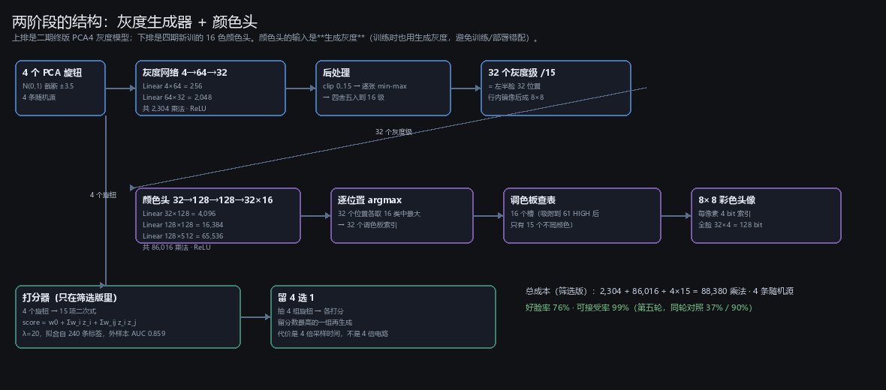
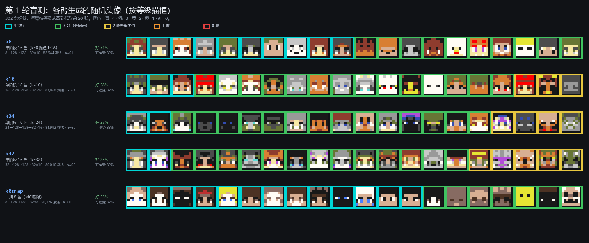
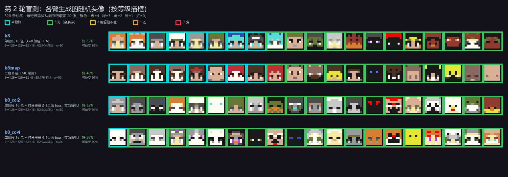
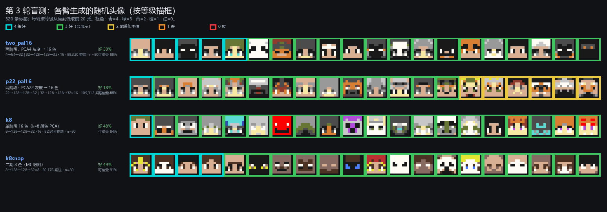
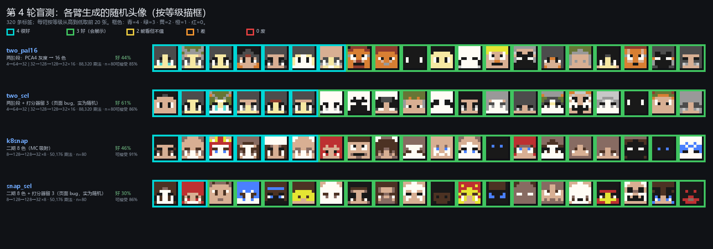
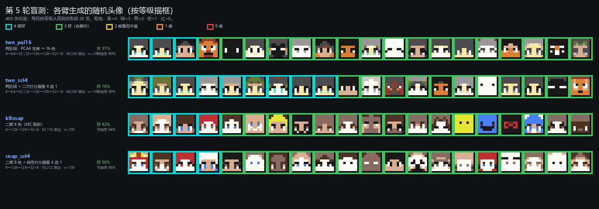
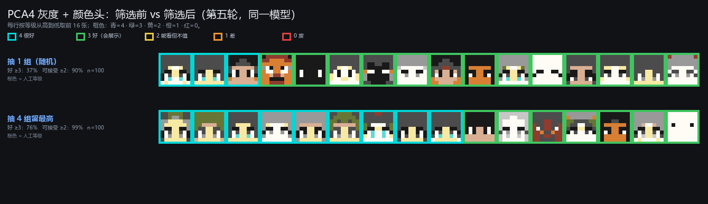

# 四期盲测全记录（第 1–5 轮）

**状态**：五轮盲测已完成并整理。**日期**：2026-11-02。
**范围**：每一轮**参与了哪些模型、它们长什么样、怎么训的**，以及**每个模型实际生成的随机头像**（按人工等级描框）。数字与结论的原始上下文见 [`03_第一批实验计划.md`](03_第一批实验计划.md)；本页只做"梳理 + 看图"。

一键重绘本页所有图：`python tools/blindtest_report.py --per 20`
每轮每臂的统计（n、均值、好率、可接受率、直方）：`results/labels/blindtest_summary.json`

---

## 一、判据：五级与主判据

| 等级 | 含义 | 框色 |
|---:|---|---|
| **4** | 很好 | **青** `#00D6D6` |
| **3** | 好（会想展示） | **绿** `#40C460` |
| **2** | 能看但不值 | **黄** `#E8C840` |
| **1** | 差 | **橙** `#F09430` |
| **0** | 废（空脸、纯色、认不出） | **红** `#E44040` |

- **主判据 = ≥3**。作者的可接受线在 2 与 3 之间；4 的判定较松（"看心情"），所以 3 与 4 的差别不再细分，但 ≥3 是稳的。
- 统计用 Wilson 95% 区间 + 两两置换检验（10,000 次）+ Fisher 精确检验；多臂时 Holm 校正。
- **噪声地板**：第四轮意外量出——**同一个模型的两条"臂"在 n=80 下相差 ±16~17 点**。所以 n=80 时小于 15 点的差异不算数；n=100 时约 ±10 点。
- **跨轮不可比**：同一个 k8snap 模型，第 1 轮 53.3%、第 3 轮 48.7%、第 5 轮 42.0%。作者的口径在漂，只有**同轮内**的比较有效。

---

## 二、参与过的模型：结构与训练

### 2.1 一览

| 名称 | 结构 | 乘法 | 随机源 | 训练 | 出处 |
|---|---|---:|---:|---|---|
| `k8` / `k16` / `k24` / `k32` | `k → 128 → 128 → 32×16` logits | 82,944 / 83,968 / 84,992 / 86,016 | k | 交叉熵，12,000 步 | `results/train/K16_w128_k*` |
| `k8snap` | `8 → 128 → 128 → 32×8` + MC 吸附调色板 | 50,176 | 8 | 二期原模型（交叉熵 12,000 步，8 色） | `02/webapp/colour_k8snap_model.json` |
| `two_pal16` | **PCA4 灰度** `4→64→32` **＋颜色头** `32→128→128→32×16` | 2,304 + 86,016 = **88,320** | **4** | 灰度用二期终版；颜色头新训 12,000 步 | `results/twostage/pal16.json` |
| `p22_pal16` | **PCA22 灰度** `22→128→128→32` ＋同一颜色头 | 23,296 + 86,016 = 109,312 | 22 | 同上 | `results/twostage/pal16_p22.json` |
| `*_sel*` | 同上 + 旋钮打分器"留 N 选 1" | + 4×15（含在 88,380） | 同上 | 见 §2.4 | 页面现场选择 |

### 2.2 灰度生成器（二期终版 PCA4）

| 项 | 值 |
|---|---|
| 结构 | **4 → 64 → 32**（单隐层，ReLU；最后一层线性） |
| 参数 / 乘法 | 2,400 / **2,304**（$4\times64=256$，$64\times32=2,048$） |
| 输入 | 4 个标准化灰度 PCA 系数（z 分数），部署时取 N(0,1) 截断 ±3.5 |
| 输出 | 32 个连续灰度值（左半脸 32 位置） |
| 解码 | `clip(0,15)` → **逐张 min-max 拉伸到 [0,15]** → 四舍五入到 16 级 → 行内镜像 |
| 训练 | `02_phase2_avatar/src/dim_sweep.py`：MSE + 5.0×TV（高斯软分布 σ=0.35）+ 对抗 BCE 1.0；Adam G 3e-4 / D 2e-4；**12,000 步 / batch 256**；数据 311,583 张 |
| 指标 | 逐位置 acc **0.3651**（同色率旧口径 70.3%） |
| 文件 | `02_phase2_avatar/webapp/pca22_dim4w64L1_model.json`；灰色那一段在四期被复制成 `results/twostage/gray_pca4.json` |

**它的定位**：只负责"画一张灰度脸"，只要 4 个旋钮——这是四期能用筛选的根本原因（4 维空间的好坏可学）。

### 2.3 颜色头（四期新训）

| 项 | 值 |
|---|---|
| 结构 | **32 → 128 → 128 → 32×16**（两个 ReLU 隐层，最后一层线性） |
| 参数 / 乘法 | 84,736 / **86,016**（$32\times128=4{,}096$；$128\times128=16{,}384$；$128\times512=65{,}536$） |
| 输入 | 灰度段的 32 个等级 ÷15（**训练与部署都用生成灰度**，避免训练/部署错配） |
| 输出 | 32 位置 × 16 类 logits → **逐位置 argmax** → 调色板索引 |
| 训练目标 | 原彩色头像**吸附到 16 色后的索引**（不是"贴色相饱和度"）：$y_p=\arg\min_c\lVert \text{rgb}_p - \text{pal}_c\rVert$ |
| 训练 | 交叉熵；Adam 3e-4；**12,000 步 / batch 256**；`src/train_two_stage.py` |
| 指标 | 索引命中 48.6%、RGB MAE **2.50 级**（同调色板地板 1.13 级；真值灰度上限 1.70 级） |
| 文件 | `results/twostage/pal16.json`、`gray_pca4.json` |

### 2.4 调色板与打分器

- **调色板 16 槽，吸附到 61 个 HIGH 地图色后只剩 15 个不同颜色**（两个近黑都吸到 `BLACK`；作者定：撞色就撞色）。吸附误差平均 1.93 级、最大 3.80 级。清单：`results/fit/deploy_palette.json`。
  颜色：SAND / ORANGE / BLACK / MAGENTA / GRAY / WOOL / BLUE / TERRACOTTA_LIGHT_GREEN / YELLOW / DIAMOND / RAW_IRON / TERRACOTTA_RED / FIRE / BLACK / LIGHT_GRAY / QUARTZ。
- **打分器**（只在 `*_sel*` 臂里）：4 个旋钮的 **15 项二次式**，λ=20，拟合自第 3、4 轮同一模型的 **240 条**标签；CV AUC 0.759，**外样本 AUC 0.859**（把第四轮打分器原封不动套到第五轮随机臂上量的）。红石成本 15 次乘加/候选。

---

## 三、第 1 轮：PCA 维数扫描（302 条）

**参与者**：`k8 / k16 / k24 / k32`（同一配方只改输入维数）+ 二期 `k8snap`。
**训练**：交叉熵，12,000 步、batch 256、Adam 3e-4；16 色自由调色板（饱和×1.2）。`k8snap` 是二期原模型（8 色、MC 吸附）。

| 臂 | n | 均值 | 可接受 ≥2 | 好 ≥3 | 直方 0/1/2/3/4 |
|---|---:|---:|---:|---:|---|
| k8 | 61 | 2.38 | 80.3% | **50.8%** | 6/6/18/21/10 |
| k16 | 61 | 2.13 | 82.0% | 27.9% | 1/10/33/14/3 |
| k24 | 60 | 2.18 | **88.3%** | 26.7% | 0/7/37/14/2 |
| k32 | 60 | 2.10 | 81.7% | 25.0% | 0/11/34/13/2 |
| k8snap | 60 | **2.53** | 81.7% | **53.3%** | 2/9/17/19/13 |

**结论**：加维没有好处。k≥16 的好脸率只有 25~28%，且分布挤在"2"上（不烂也不惊艳）；k8 与 k8snap 则是"泥沙俱下"（既有 4 也有 0）。图上看得很清楚：k16~k32 每行前几张仍是青框，但很快就变成黄框。

---

## 四、第 2 轮：第一次尝试筛选（320 条）——**页面 bug，实为随机**

**参与者**：`k8 / k8snap / k8_sel2 / k8_sel4`。
`sel2`/`sel4` 原本要"抽 2 或 4 组旋钮、按 9 项线性打分器留最高"，但页面没把清单里的 `select` 拷到臂对象上，**实际全部是随机采样**。

| 臂 | n | 好 ≥3 | 可接受 ≥2 |
|---|---:|---:|---:|
| k8 | 80 | 32.5% | 87.5% |
| k8snap | 80 | **46.3%** | 91.2% |
| k8_sel2 | 80 | 32.5% | **93.8%** |
| k8_sel4 | 80 | 37.5% | 90.0% |

**结论**：四臂无显著差异——因为**根本没有筛选**。这一轮的价值是暴露了 bug，并且它的数据后来被当成"同一模型的重复测量"用于第 4 轮的合并分析。

---

## 五、第 3 轮：两阶段 vs 单阶段（320 条）

**参与者**：`two_pal16`（PCA4 灰度→16 色）、`p22_pal16`（PCA22 灰度→16 色）、`k8`、`k8snap`。
**训练**：颜色头同为 `32→128→128→32×16`，目标＝原彩图吸附后的索引；灰度段不训练，直接用二期权重。

| 臂 | n | 均值 | 可接受 ≥2 | 好 ≥3 | 直方 0/1/2/3/4 |
|---|---:|---:|---:|---:|---|
| two_pal16 | 80 | 2.41 | 87.5% | **50.0%** | 2/8/30/35/5 |
| p22_pal16 | 80 | 2.08 | 88.7% | **17.5%** | 0/9/57/13/1 |
| k8 | 80 | 2.31 | 83.8% | 47.5% | 1/12/29/37/1 |
| k8snap | 80 | 2.43 | 91.2% | 48.7% | 2/5/34/35/4 |

**结论**：

1. **PCA22 灰度反而更差**（17.5%，对基线 p=0.0001 / Holm 0.0003），尽管它的**重建**更好（2.11 vs 2.50 级）。原因：22 个旋钮随机采样时严重偏离流形，灰度先变怪，上色头只能瞎猜。
2. PCA4 两阶段与单阶段/基线在噪声内打平（50.0% vs 47.5% / 48.7%）。
3. 图上 p22_pal16 那一行几乎全是黄框与少量绿框——这是"不烂也不惊艳"的极端形态。

---

## 六、第 4 轮：又一次被 bug 变成"重复测量"（320 条）

**参与者**：`two_pal16`、`two_sel`、`k8snap`、`snap_sel`。**又一次全部是随机**（同一个 bug）。

| 臂 | 计划 | 实际 | n | 好 ≥3 |
|---|---|---|---:|---:|
| two_pal16 | 随机 | 随机 | 80 | 43.8% |
| two_sel | 打分器留 3 | **随机** | 80 | 61.3% |
| k8snap | 随机 | 随机 | 80 | 46.3% |
| snap_sel | 打分器留 3 | **随机** | 80 | 30.0% |

**结论（两个都不是原计划的）**：

1. **噪声地板**：同模型两臂相差 −17.5 / +16.2 点（理论应为 0）。
2. **合并成 n=160 后**：两阶段 **52.5%**（84/160）vs k8snap **38.1%**（61/160），Δ +14.4 点，**Fisher p=0.0134**。这是"两阶段不比二期基线差、大概率更好"的第一份可靠证据。

---

## 七、第 5 轮：筛选第一次真正生效（400 条，n=100/臂）

**参与者**：`two_pal16`（随机）、`two_sel4`（二次打分器留 4 选 1）、`k8snap`（随机）、`snap_sel4`（线性打分器留 4 选 1）。
**打分器**：合并第 3、4 轮同一模型的 240 条重拟合（两阶段二次 15 项 CV AUC 0.759；k8snap 线性 9 项 0.615）。

| 臂 | n | 均值 | 可接受 ≥2 | 好 ≥3 | 直方 0/1/2/3/4 |
|---|---:|---:|---:|---:|---|
| **two_sel4** | 100 | **2.84** | **99.0%** | **76.0%** | 0/1/23/67/9 |
| snap_sel4 | 100 | 2.48 | 96.0% | 50.0% | 2/2/46/46/4 |
| k8snap | 100 | 2.38 | 94.0% | 42.0% | 2/4/52/38/4 |
| two_pal16 | 100 | 2.27 | 90.0% | 37.0% | 3/7/53/34/3 |

**同模型两两（事前写死的唯一读法）**：

| 对比 | 好脸率 | Δ | 置换 p | Fisher p |
|---|---|---:|---:|---:|
| two_sel4 vs two_pal16 | 76% vs 37% | **+39 点** | **0.0001** | **<0.0001** |
| snap_sel4 vs k8snap | 50% vs 42% | +8 点 | 0.32 | 0.32 |

**结论**：

1. **筛选在 4 旋钮的两阶段上是巨大收益**（+39 点），且 `two_sel4` 的 0 级为 0、可接受率 99%。
2. **在 8 旋钮的二期模型上无效**（+8 点，p=0.32）。差别不在"选不选"，在**旋钮维数**：4 维的二次打分器外样本 AUC 0.859，8 维的线性只有 0.644。
3. 图上看最直观：`two_sel4` 那一行前 16 张几乎全是青框；`two_pal16` 那一行青框只有三四张，其余是绿/黄。

---

## 八、筛选前后（同一个模型：PCA4 灰度 + 颜色头）

上面是抽 1 组（随机），下面是抽 4 组按打分器留最高。**同一批权重、同一套调色板**，唯一区别是"生成之前先把旋钮挑一遍"。青框比例从三四成升到七成以上，红框彻底消失。

---

## 九、汇总：现在最好的配置

| 项 | 值 |
|---|---|
| 结构 | 4 旋钮 → PCA4 灰度（4→64→32，2,304）→ 16 色头（32→128→128→32×16，86,016） |
| 选择 | 4 个旋钮代入 15 项二次打分器，抽 4 组留最高（4×15 = 60 乘法） |
| 乘法合计 | **88,380** |
| 随机源 | **4 条**（二期是 8 条） |
| 输出 | 每像素 4 bit 调色板索引（16 槽 / 15 色），全脸 128 bit |
| 实测 | 好脸率 **76%**、可接受率 **99%**（第五轮，同轮随机对照 37% / 90%） |
| 代价 | 选择 = 4 倍**采样时间**，不是 4 倍电路（投掷器顺序采样） |

**最省的一刀还没砍**：86,016 里有 65,536 是最后一层 $128\times512$。把颜色头压到 64 宽，成本可减半，而筛选可能补回大部分损失——这是下一轮最值得做的事。

---

## 十、文件清单

| 文件 | 内容 |
|---|---|
| `tools/blindtest_report.py` | 重绘本页所有图（`--per` 控制每行张数） |
| `results/labels/round{1..5}_graded.png` | 每轮：行=臂、格=脸、框=等级 |
| `results/labels/blindtest_summary.json` | 每轮每臂的 n/均值/好率/可接受率/直方/结构/乘法 |
| `results/labels/round{1..5}.jsonl`→`colour_round*.jsonl` | 原始标签（含旋钮坐标、等级、选择分数） |
| `results/labels/analysis_round*.json` | 每轮的 Wilson 区间、置换检验、Holm、顺序漂移 |
| `results/twostage/pipeline.png` | 灰度生成器 + 颜色头的结构与数据流 |
| `results/twostage/selection_ba.png` | 筛选前后对照 |
| `results/twostage/{pal16.json, gray_pca4.json}` | 第五轮用的部署权重 |
| `results/labels/scorers_round5.json` | 打分器权重（分模型族） |
