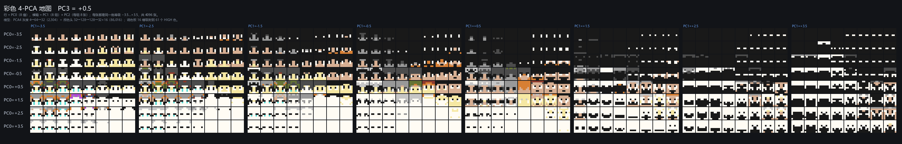
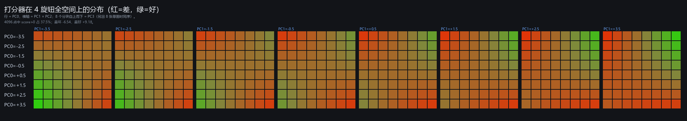
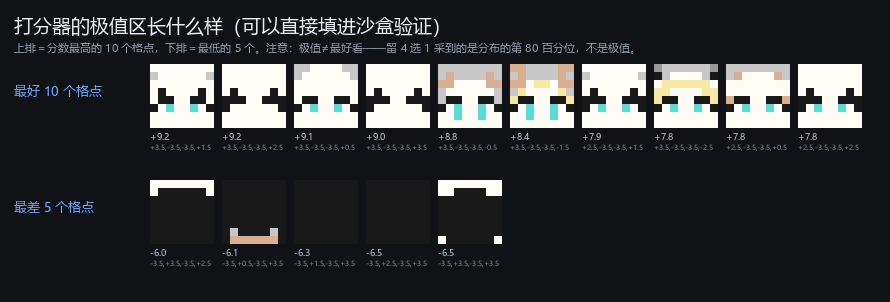

# 彩色头像的 4 旋钮全空间地图（4096 点）

**日期**：2026-11-02。**对应**：二期 `02_phase2_avatar/results/pca4map/MAP_p3_*.png` 的彩色版。
**用途**：看彩色头像在参数空间里怎么分布——哪里画得出脸、哪里是白块/黑块，以及打分器认为的好区在哪。

一键重绘：`python tools/pca4_map_colour.py`（约 20 s）
原始数据：`results/pca4map/score.json`（4096 个点的坐标、分数、色数、边缘）

---

## 一、版式（与二期灰度地图完全一致）

每个旋钮取 **−3.5, −2.5, −1.5, −0.5, +0.5, +1.5, +2.5, +3.5** 八个值（跳过 0：0 是分布均值，输出最平），共 $8^4=4096$ 张，拆成 8 张图：

```
一张图 = 一个 PC3 值
    行        PC0（8 行，从上到下 −3.5 → +3.5）
    横轴      PC1（8 个分块，每块 8 列）× PC2（块内 8 列）
```

8 张图：`results/pca4map/COLOUR_MAP_p3_{m3_5,m2_5,m1_5,m0_5,p0_5,p1_5,p2_5,p3_5}.png`（每张 2870×460）。



*PC3 = +0.5 的整张地图。行 = PC0，横轴 = PC1 × PC2。*

## 二、一眼看出来的结构

| 旋钮 | 语义（沿轴扫时脸怎么变） | 这一轴上的分数形状 |
|---|---|---|
| PC0 | **明度**：越大越亮、越白 | **倒 U**，峰在 +0.5~+1.5，两端都掉 |
| PC1 | **发肤/结构**：越小越像"有五官的脸"，越大越糊成白块 | **单调**，−3.5 最好、+2.5 最差 |
| PC2 | **眼型/配色**：中间最糟，两端各有好脸 | **U 形**（两端好、中间差） |
| PC3 | **脸型/表情**：只改表情不改脸型 | **倒 U**，峰在 ±0.5~+1.5 |

具体读数（固定其余 3 个、对 8 个值取平均）：

| 档位 | PC0 | PC1 | PC2 | PC3 |
|---|---:|---:|---:|---:|
| −3.5 | −1.39 | **+0.61** | −0.07 | −0.80 |
| −2.5 | −0.76 | +0.20 | −0.29 | −0.37 |
| −1.5 | −0.28 | −0.14 | −0.43 | −0.08 |
| −0.5 | +0.03 | −0.40 | **−0.50** | +0.07 |
| +0.5 | **+0.19** | −0.58 | −0.48 | **+0.07** |
| +1.5 | +0.18 | −0.68 | −0.38 | −0.07 |
| +2.5 | +0.02 | **−0.70** | −0.21 | −0.35 |
| +3.5 | −0.30 | −0.64 | **+0.05** | −0.78 |

（表内是打分器分数；>0 视为"预测可接受"。）

**和二期灰度地图的区别**：灰度那张的好区是 **66.5%**、且是**一个连通块**；这张彩色地图的好区只有 **37.5%**，而且被 PC1 切成了左右两半（PC1 为负的那半边明显更好）。也就是说：**彩色模型的可接受区比灰度窄，主要窄在 PC1 上。**

## 三、整体统计（4096 点）

| 项 | 值 |
|---|---|
| 预测可接受（score > 0） | **37.5%** |
| 分数范围 / 均值 | −6.54 ~ **+9.18** / −0.29 |
| 平均色数 | **2.86**（范围 1–9） |
| 平均饱和 | **0.047**（真实数据约 0.32） |
| 边缘 p90 均值 | 15.7 |

两条值得注意：

1. **色数平均只有 2.86**——每张脸平均只用了不到 3 种颜色。真实头像是 7.2 种。彩色头实际上在"少色、偏灰白"的区域里生成，这与盲测里"两阶段偏白偏平"的观感一致。
2. **平均饱和 0.047**，远低于真实数据。也就是说 16 色调色板里那些鲜艳的颜色（CRIMSON_NYLIUM、LAPIS、YELLOW）在地图上出现频率很低——模型很少用它们。

## 四、打分器的分布



*行 = PC0，横轴 = PC1 × PC2；颜色红→绿是分数低→高。*

## 五、极值区长什么样（重要警告）



- **最好 10 个格点**全部是同一类：`PC0=+3.5, PC1=−3.5, PC2=−3.5`，即「很亮的脸 + 低 PC1 的结构 + 低 PC2 的眼睛配色」，分数 +7.8~+9.2。
- **最差 5 个**是暗块/白块：`PC0=−3.5` 配 `PC1=+2.5~+3.5`。

**用法警告**：留 4 选 1 采到的是分数分布的**第 80 百分位**，不是极值。极值区是"白色脸 + 青色眼睛"这种很窄的风格，如果你按极值去手调滑杆，会得到一堆长得很像的脸。地图应当用来**判断哪些区域安全**，不是用来找"最高分那一张"。

## 六、文件

| 文件 | 内容 |
|---|---|
| `results/pca4map/COLOUR_MAP_p3_*.png` | 8 张地图，共 4096 张彩色头像 |
| `results/pca4map/SCORE_MAP.png` | 同一布局的分数热图 |
| `results/pca4map/EXTREMES.png` | 最好 10 点 / 最差 5 点 |
| `results/pca4map/score.json` | 4096 点：坐标、分数、色数、边缘；边际统计；best10/worst5 |
| `tools/pca4_map_colour.py` | 生成脚本（批量前向，约 20 s） |
