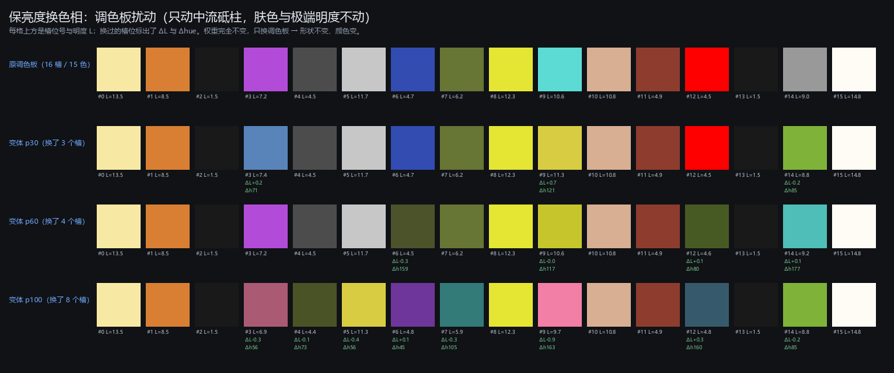
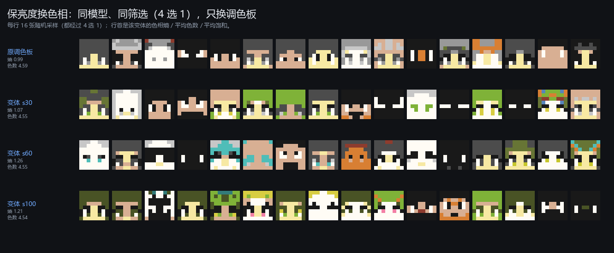
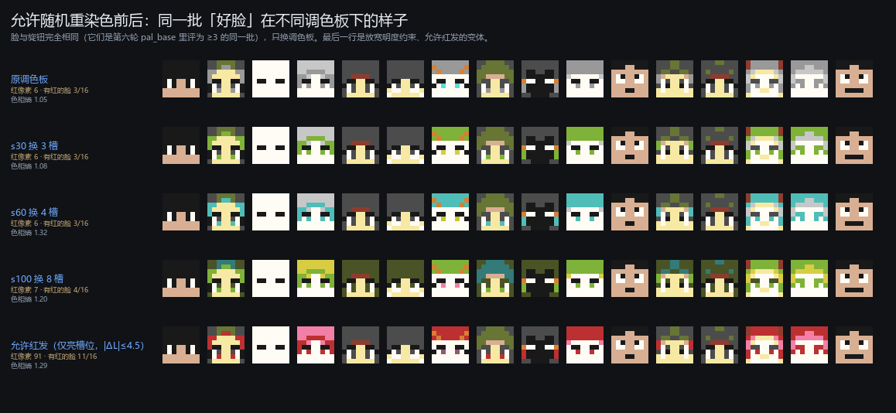

# 保亮度换色相：用一个便宜的调色板扰动换多样性

**日期**：2026-11-02。**来源**：作者提出的方案。**目的**：PCA4 系列的多样性不够，试试不训练、只改调色板能不能变花而不变丑。

---

## 一、方法

调色板（16 槽）先按三个桶分类：

| 桶 | 判据 | 处理 |
|---|---|---|
| 肤色系 | 色相 8°~55°、饱和 >0.15、明度 3.5~13.5（ORANGE、RAW_IRON） | **不动** |
| 极暗 / 极亮 | 明度 <2.5 或 >13.0（BLACK×2、QUARTZ、SAND） | **不动** |
| **中流砥柱** | 其余（鲜艳浅色、灰、蓝绿紫） | **按概率 p 换掉** |

替换条件（在 244 个地图色里找）：

- **明度相近**：$|\Delta L|\le 1.0$ 级（0..15 量纲）；
- **色相或饱和度明显不同**：$|\Delta\text{hue}|\ge45°$ 且候选饱和 ≥0.30（不要洗成灰），或 $|\Delta\text{sat}|\ge0.30$ 且 $\Delta\text{hue}\ge20°$；
- 候选本身也不能是肤色或极端明度；同一调色板内不重复。

因为**明度保持**，模型的形状（= 灰度那一层）完全不变，只有颜色变——理论上"好脸不会变丑"。

## 二、三个变体实际换了什么

| 变体 | 换了几个槽 | 具体映射（ΔL / Δhue） |
|---|---:|---|
| `s30` | 3 / 10 | MAGENTA→LIGHT_BLUE(+0.16/71°)；DIAMOND→GOLD(+0.72/121°)；LIGHT_GRAY→GRASS(−0.24/85°) |
| `s60` | 4 / 10 | BLUE→T_C_GREEN(−0.26/159°)；DIAMOND→YELLOW(−0.02/117°)；FIRE→GREEN(+0.12/80°)；LIGHT_GRAY→DIAMOND(+0.15/177°) |
| `s100` | 8 / 10 | MAGENTA→PINK(−0.32/56°)；GRAY→T_LIGHT_GREEN(−0.09/73°)；WOOL→GOLD(−0.38/56°)；BLUE→PURPLE(+0.12/45°)；T_LIGHT_GREEN→WARPED_STEM(−0.29/105°)；DIAMOND→PINK(−0.86/163°)；FIRE→CYAN(+0.28/160°)；LIGHT_GRAY→GRASS(−0.24/85°) |

平均 $|\Delta L|$ 只有 0.14~0.37 级。

## 三、多样性确实上去了

同一模型、同一套筛选（4 选 1）、2000 张随机采样：

| 变体 | 色相熵（12 桶，最大 2.48） | 平均色数 | 平均饱和 |
|---|---:|---:|---:|
| 原调色板 | 0.985 | 4.59 | 0.113 |
| `s30` | 1.067（+8%） | 4.55 | 0.179 |
| `s60` | **1.262（+28%）** | 4.55 | 0.168 |
| `s100` | 1.213（+23%） | 4.54 | **0.290** |

- **色相熵最多涨 28%**，平均饱和最多涨 1.5 倍；
- **平均色数几乎不变**（4.59→4.54）——因为换的是"哪些颜色"，不是"用几种颜色"。这也说明"多样性"要分两个口径：**色相多样性**（涨了）与**用色数量**（没涨）。

## 四、风险与注意事项

1. **可能把脸染成非肤色**。肤色槽位不动，但脸部的其它区域（头发、衣服、装饰）会变成绿/紫/青。作者假设"明度不变 → 好脸不变丑"，这正是第六轮要验证的。
2. **打分器是在原调色板上拟合的**。它的输入是 4 个旋钮、不含颜色信息，所以筛选结果不受调色板影响——这既是优点（对照干净），也是缺点（它没法帮忙避开"染色难看"的区域）。
3. **红石成本要看清**：调色板本质上是一张 16 项的查表 ROM。"换一个变体"= 换一张表（零乘法，但要做新表）；若想**每张脸随机换**，需要 N 张表 + 一个选择器（例如 2 bit 随机选 4 张），这是额外硬件。**只做一次静态替换是免费的**，做随机替换不是。

## 五、第六轮盲测设计

四个臂**用同一个模型、同一套筛选（4 选 1）**，唯一区别是调色板：

| 臂 | 调色板 |
|---|---|
| `pal_base` | 原 16 槽（15 色） |
| `pal_s30` | p=0.3 的扰动（换 3 槽） |
| `pal_s60` | p=0.6 的扰动（换 4 槽） |
| `pal_s100` | p=1.0 的扰动（换 8 槽） |

每臂 80 张、共 320 张，主判据仍是 **≥3**。读法：**四个臂两两比，看"多样性涨了之后好脸率掉多少"**——若 `s30/s60` 的好脸率与原色板相差在噪声内（n=80 时约 ±13 点），就是这个方案成立；若掉 20 点以上，说明"换色相"确实会毁脸。

## 七、第六轮结果：不但没变丑，反而更好看（320 条）

| 臂 | n | 均值 | 可接受 ≥2 | **好 ≥3** | 分布 0/1/2/3/4 |
|---|---:|---:|---:|---:|---|
| **pal_s30** | 80 | 2.76 | 96.2% | **80.0%** | 1/2/13/63/1 |
| **pal_s100** | 80 | 2.80 | **100.0%** | **80.0%** | 0/0/16/64/0 |
| pal_s60 | 80 | 2.64 | 93.8% | 70.0% | 1/4/19/55/1 |
| pal_base | 80 | 2.59 | 98.8% | 60.0% | 1/0/31/47/1 |

对基线 `pal_base`：

| 对比 | Δ好脸率 | 置换 p | Holm p |
|---|---:|---:|---:|
| pal_s100 vs base | **+20.0 点** | 0.0081 | **0.0243** |
| pal_s30 vs base | **+20.0 点** | 0.0094 | **0.0243** |
| pal_s60 vs base | +10.0 点 | 0.2427 | 0.2427 |

**换言之：把颜色换掉没有毁脸，反而把好脸率从 60% 抬到 80%**（两个变体都过了 Holm）。最可能的解释是：原调色板下大量脸是"白/灰/褐"的低对比组合，换色后轮廓和五官的色差变大，看起来更像一张脸。

`pal_s100` 的 0 级为 0、可接受率 100%——这是目前所有臂里第一次做到。

## 八、为什么没见到红头发（作者的观察，已确认）

地图色的明度分布决定了这件事。**红色在地图色里几乎全部集中在低明度**：

| 明度档 | 红系数量（色相 ≥335° 或 ≤20°、饱和 ≥0.4） | 举例 |
|---|---:|---|
| L 0–3 | 18 | NETHER、CRIMSON_HYPHAE、TERRACOTTA_BLACK |
| L 3–5 | 19 | FIRE(4.5)、RED(4.8)、TERRACOTTA_RED(4.9) |
| L 5–7 | 9 | CRIMSON_NYLIUM(5.3)、TERRACOTTA_MAGENTA(6.3) |
| L 7–9 | **1** | PINK/NORMAL(8.4) |
| L 9–11 | **1** | PINK/HIGH(9.7) |
| L ≥11 | **0** | — |

而"保亮度"要求 $|\Delta L|\le1$。于是：

- 灰/白发（LIGHT_GRAY 9.0、WOOL 11.7、YELLOW 12.3、DIAMOND 10.6）**够不到任何真红**，最近的红是 L 9.7 的 PINK——那是粉，不是红；
- 能换到 FIRE / CRIMSON_NYLIUM 的只有 L 4–6 的槽位，而那几个本来就偏暗（GRAY 4.5、BLUE 4.7、T_RED 4.9、FIRE 4.5）。

所以不是漏了规则，是**明度约束把红发锁死了**：红发必须从"亮"降到"暗 4~5 级"，而那正是我们禁止的方向。

### 放宽成一个「红发变体」

只对**亮槽位**（L ≥ 7、排除肤色）放开：候选限红系、$|\Delta L|\le4.5$、p=0.5。结果换了 5 个槽：

| 槽位 | 换成 | ΔL |
|---|---|---:|
| WOOL（11.7） | PINK/HIGH（9.8） | −2.0 |
| YELLOW（12.3） | PINK/NORMAL（8.4） | −3.9 |
| DIAMOND（10.6） | TERRACOTTA_MAGENTA/HIGH（6.3） | −4.3 |
| LIGHT_GRAY（9.0） | CRIMSON_NYLIUM/HIGH（5.3） | −3.7 |
| MAGENTA（7.2） | PINK/LOW（6.9） | −0.3 |

红像素：**6 → 91**；有红像素的脸：**3/16 → 11/16**（同一批 16 张好脸）。

*同一批"好脸"（第六轮 pal_base 评为 ≥3 的），旋钮完全相同，只换调色板。最后一行是允许红发的变体。*

## 九、第七轮（已就绪）

`pal_base` / `pal_s30` / `pal_s100` / **`pal_red`**（允许红发），各 80 张、共 320 张，主判据 ≥3。
目的：看红发能不能在 s30/s100 的基础上再补一点，且不掉好脸率。

## 六、文件

| 文件 | 内容 |
|---|---|
| `results/palette_shift/palettes.json` | 槽位分类、每槽候选、三个变体的映射 |
| `results/palette_shift/shift.png` | 原色板 vs 三变体（含 ΔL/Δhue 标注） |
| `results/palette_shift/preview.png` | 四种色板下的采样对照 |
| `results/palette_shift/diversity.json` | 色相熵 / 色数 / 饱和 |
| `results/twostage/pal16_s{30,60,100}.json` | 权重不变、只换调色板的模型文件 |
| `tools/palette_shift.py` | 生成脚本 |
