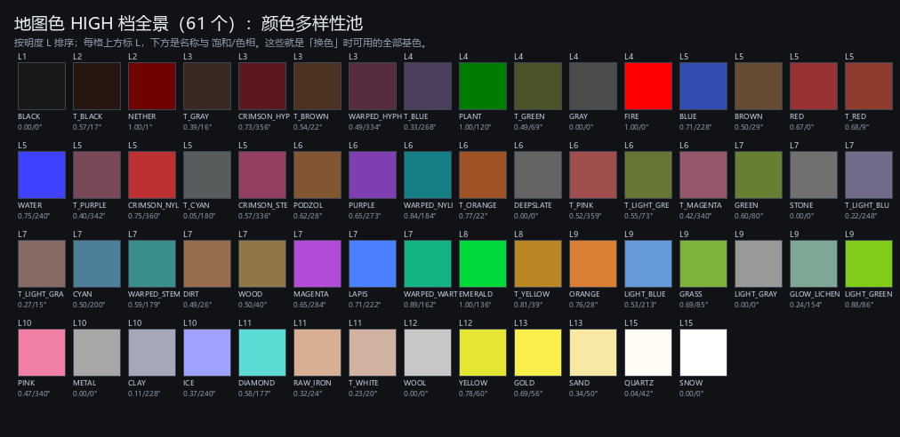
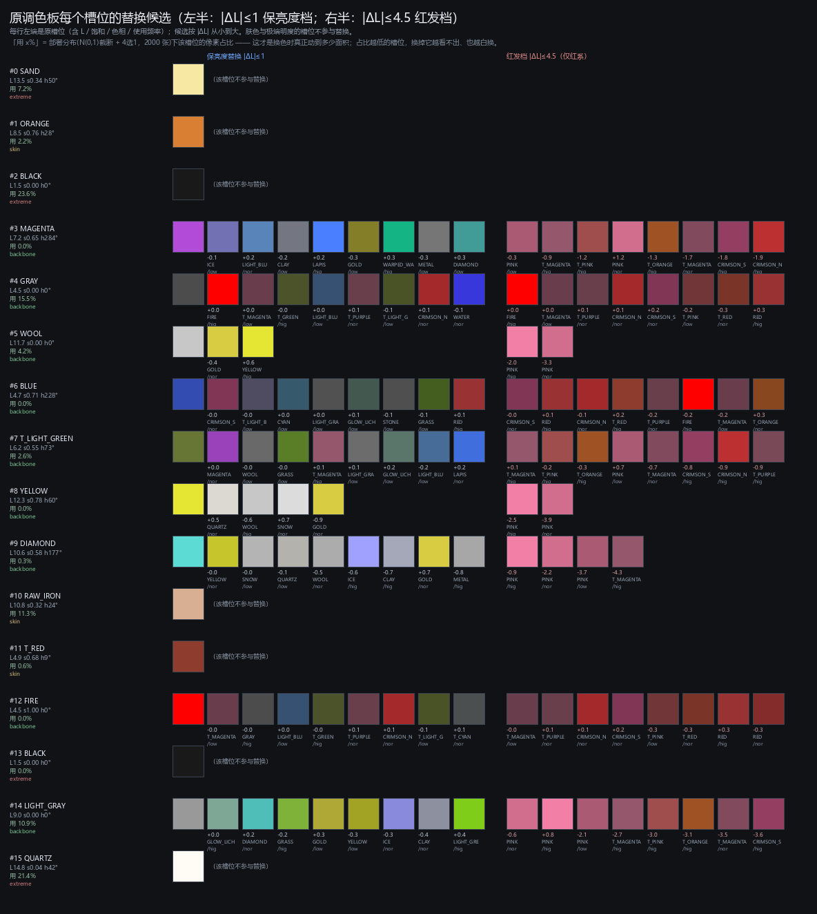

# 调色板作为「生成前的一次选择」

**日期**：2026-11-02。**来源**：作者对方案的重新归类——"我们在干的事情其实可以划归为：在生成头像前概率不均地选择调色板配置"。这份文档把这层抽象摊开。

---

## 一、61 个 HIGH 地图色：颜色多样性的池子

所有"换色"都只能从这 61 个基色（及其 NORMAL/LOW/LOWEST 修饰，共 244 个）里挑。

| 明度档 | 数量 | 举例 |
|---|---:|---|
| 明度档 | 数量 | 举例 |
|---|---:|---|
| L 0–3 | 5 | BLACK、T_BLACK、NETHER、T_GRAY、CRIMSON_HYPHAE |
| L 3–5 | 11 | T_BROWN、WARPED_HYPHAE、T_BLUE、PLANT、T_GREEN、GRAY… |
| L 5–7 | 20 | WATER、T_PURPLE、CRIMSON_NYLIUM、T_CYAN、CRIMSON_STEM、PODZOL… |
| L 7–9 | 9 | WOOD、MAGENTA、LAPIS、WARPED_WART_BLOCK、EMERALD、T_YELLOW… |
| L 9–11 | 10 | LIGHT_GRAY、GLOW_LICHEN、LIGHT_GREEN、PINK、METAL、CLAY… |
| L 11–13 | 2 | WOOL、YELLOW |
| L 13–16 | 4 | GOLD、SAND、QUARTZ、SNOW |

**关键事实**：这个池子的明度分布是偏低的——$L\ge9$ 只有 23 个，$L\ge11$ 只有 10 个，而**红系（色相 ≥335° 或 ≤20°、饱和 ≥0.4）在 $L\ge11$ 一个都没有**。所以"保亮度换色相"在高明度区天然只能换成黄/绿/青/灰。

## 二、原调色板各槽位能换成什么

| # | 槽位 | L | 饱和 | 色相 | 部署用量 | 保亮度候选（|ΔL|≤1，按 |ΔL| 排序） |
|---:|---|---:|---:|---:|---:|---|
| 0 | SAND | 13.5 | 0.34 | 50° | 7.2% | *（极暗/极亮，不参与）* |
| 1 | ORANGE | 8.5 | 0.76 | 28° | 2.2% | *（肤色，不参与）* |
| 2 | BLACK | 1.5 | 0.00 | 0° | 23.6% | *（极暗/极亮，不参与）* |
| 3 | MAGENTA | 7.2 | 0.65 | 284° | **0.0%** | ICE/low (-0.1)；LIGHT_BLUE/nor (+0.2)；CLAY/low (-0.2)；LAPIS/hig (+0.2) |
| 4 | GRAY | 4.5 | 0.00 | 0° | **15.5%** | FIRE/hig (+0.0)；T_MAGENTA/low (+0.0)；T_GREEN/hig (-0.0)；LIGHT_BLUE/low (+0.0) |
| 5 | WOOL | 11.7 | 0.00 | 0° | **4.2%** | GOLD/nor (-0.4)；YELLOW/hig (+0.6) |
| 6 | BLUE | 4.7 | 0.71 | 228° | **0.0%** | CRIMSON_STEM/nor (-0.0)；T_LIGHT_BLUE/low (-0.0)；CYAN/low (+0.0)；LIGHT_GRAY/low (+0.0) |
| 7 | TERRACOTTA_LIGHT_GREEN | 6.2 | 0.55 | 73° | **2.6%** | MAGENTA/nor (+0.0)；WOOL/low (-0.0)；GRASS/low (-0.0)；T_MAGENTA/hig (+0.1) |
| 8 | YELLOW | 12.3 | 0.78 | 60° | **0.0%** | QUARTZ/nor (+0.5)；WOOL/hig (-0.6)；SNOW/nor (+0.7)；GOLD/nor (-0.9) |
| 9 | DIAMOND | 10.6 | 0.58 | 177° | **0.3%** | YELLOW/nor (-0.0)；SNOW/low (-0.0)；QUARTZ/low (-0.1)；WOOL/nor (-0.5) |
| 10 | RAW_IRON | 10.8 | 0.32 | 24° | 11.3% | *（肤色，不参与）* |
| 11 | TERRACOTTA_RED | 4.9 | 0.68 | 9° | 0.6% | *（肤色，不参与）* |
| 12 | FIRE | 4.5 | 1.00 | 0° | **0.0%** | T_MAGENTA/low (+0.0)；GRAY/hig (-0.0)；LIGHT_BLUE/low (+0.0)；T_GREEN/hig (-0.0) |
| 13 | BLACK | 1.5 | 0.00 | 0° | 0.0% | *（极暗/极亮，不参与）* |
| 14 | LIGHT_GRAY | 9.0 | 0.00 | 0° | **10.9%** | GLOW_LICHEN/hig (+0.0)；DIAMOND/nor (+0.2)；GRASS/hig (-0.2)；GOLD/low (+0.3) |
| 15 | QUARTZ | 14.8 | 0.04 | 42° | 21.4% | *（极暗/极亮，不参与）* |

（"部署用量"= N(0,1) 截断 ±3.5 + 4 选 1 的 2000 张抽样里，该槽位占全部像素的比例。）

## 三、最重要的读数：用量极度集中

| 槽位 | 部署用量 |
|---|---:|
| #2 BLACK | **23.6%** |
| #15 QUARTZ | **21.4%** |
| #4 GRAY | **15.5%** |
| #10 RAW_IRON | 11.3% |
| #14 LIGHT_GRAY | **10.9%** |
| #0 SAND | 7.2% |
| #5 WOOL | 4.2% |
| #7 T_LIGHT_GREEN | 2.6% |
| #1 ORANGE | 2.2% |
| #11 T_RED | 0.6% |
| #9 DIAMOND | 0.3% |
| #3 MAGENTA / #6 BLUE / #8 YELLOW / #12 FIRE / #13 BLACK | **0.0%** |

三件事直接由此得出：

1. **45% 的像素是黑色与白色**（#2 + #15），而这两个正是"极端明度、不参与替换"的槽位。所以**任何调色板扰动最多只能影响 55% 的像素**。
2. **真正的杠杆只有 GRAY（15.5%）与 LIGHT_GRAY（10.9%）**，两者合计 26%。其它"有颜色"的槽位全在 4% 以下，**五个槽位是 0.0%——换它们等于没换**。
3. 这解释了第六轮为什么 s30 与 s100 只差一点点、却都比原色板好 20 点：**它们都动了 LIGHT_GRAY/GRAY**。也解释了为什么"看不到红头发"：`MAGENTA/BLUE/YELLOW/FIRE` 这些鲜艳槽位根本不被使用。

## 四、把方案写成公式：期望变色面积

设调色板配置为 $\pi$，第 $i$ 个槽位的用量为 $u_i$，替换它引入的感知变化为 $\delta_i$（例如 $|\Delta L_i|$ 与 $|\Delta\text{hue}_i|$ 的加权）。那么一次配置扰动的有效效果约是

$$\mathbb{E}[\Delta] \approx \sum_i p_i \, u_i \, \delta_i$$

也就是说：**"概率不均地选配置"里的"不均"，应该由用量 $u_i$ 来定，而不是均匀地给每个槽位一个 p。** 按均匀 p 抽，$5\times0.0\%$ 的槽位浪费了 1/3 的替换预算，而真正改变画面的 GRAY/LIGHT_GRAY 只有 1/5 的概率被抽到。

**修正后的参数化建议**：

- 只对 $u_i>2\%$ 的槽位抽样（本模型：GRAY、LIGHT_GRAY、WOOL，加上被排除的极端明度）；
- 每个槽位的替换概率按 $u_i$ 归一化，或直接固定成"必换 GRAY、50% 换 LIGHT_GRAY"；
- 候选按 $|\Delta L|$ 从小到大排，取前若干，**并偏向高饱和**（否则等于把它变成另一个灰）。

## 五、红头发到底能不能来

- **保亮度档（|ΔL|≤1）其实能出红**：GRAY（15.5%）的候选里有 `FIRE/HIGH (ΔL +0.0)`、`T_RED/HIGH`；BLUE（0.0%）也能到 `CRIMSON_STEM`。也就是说红发一直可达，只是**在 s30/s60/s100 那三次抽样里没抽到**（抽到了绿/青）。
- **亮槽位（WOOL 11.7、YELLOW 12.3、DIAMOND 10.6、LIGHT_GRAY 9.0）要出红必须放宽明度**，因为 $L\ge9$ 的红只有 PINK（8.4 / 9.7）。这就是 `pal_red` 做的事（|ΔL|≤4.5，只对亮槽位、只换红系）。

## 六、文件

| 文件 | 内容 |
|---|---|
| `results/palette_shift/high_colours.png` | 61 个 HIGH 色全景（按 L 排序） |
| `results/palette_shift/slot_candidates.png` | 16 槽 × 替换候选（保亮度档 + 红发档） |
| `results/palette_shift/slot_table.json` | 同上，机器可读（含每槽候选与用量） |
| `results/pca4map/slot_usage.json` | 槽位用量（格点分布 / 部署分布两套） |
| `tools/palette_slots_report.py` | 生成脚本 |
