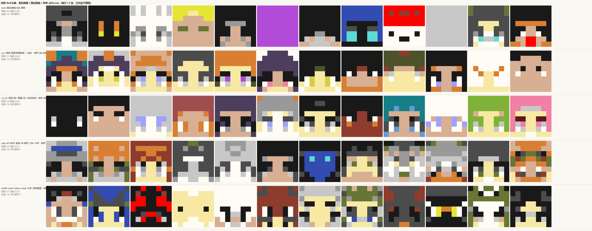

# 四期 · diffusion 路线计划（上限探测）

**日期**：2026-11-08。**状态**：计划；L1 的**冒烟已过**（他的权重能直接跑，见 §2.5），对称头像的第一批扩散已出图（§2.4），盲测未做。
**一句话**：把 diffusion 当**上限探针**而不是部署方案——先用 Jim_Sama 的现成权重测出"8×8 上正统 diffusion 到底多好"，再把它压到**纯 MLP 去噪器**，看成本-质量曲线在哪里穿过现役的 76%。

**本文的定位**：只回答"怎么试、试什么、什么算数"。不承诺结果，不引入未测的数字。
所有成本数字可用 `python tools/jim_diffusion_cost.py` 复算（输出另存 `results/jim_diffusion_cost.txt`）。

---

## 0. 摘要

| 项 | 现役（四期第十一轮） | Jim 的正统 diffusion | 本计划要做的 MLP diffusion |
|---|---|---|---|
| 结构 | 灰度 4→64→32 + 颜色头 32→128→128→32×16 | 2.83 M 参数 conv U-Net + 自注意力 | 96→h→96（1~2 隐层） |
| **体积**（乘加/前向） | **88,380** | **65,207,680**（738×） | 13,312 ~ 368,640（0.15× ~ 4.2×） |
| **时间**（前向次数） | 4（4 选 1，现状） | 20（10 步 × CFG） | N（步数，4~10） |
| 随机源 | 4 条 | 1 个种子 → 192 个数 | 1 个种子 → 96 个数 |
| 实测好脸率 | **72~76%**（≥3 级，同轮 n=80~100） | 未盲测（§2.5 冒烟：肉眼≈不压过现役） | 未盲测（§2.4 首轮：连续版偏软、token 版更脆但也更花） |

$$\boxed{\text{体积看\"一次前向\"，时间看\"步数\"：正统 diffusion 体积贵 738 倍；MLP 化以后体积 }0.15\sim1.3\text{ 倍、时间与现役的 4 选 1 相同。}}$$

---

## 1. 读了什么

| # | 文件 | 拿到什么 |
|---:|---|---|
| 1 | `04_phase4_colour_avatar/docs/08_阶段总结.md` | 现役管线、11 轮盲测的效应量表（筛选 +39、换色板 +20、PCA22 −31…）、成本 88,380 / 4 随机源 |
| 2 | `04_phase4_colour_avatar/docs/02_可用资产与规则.md` | 三条硬约束（禁 MSE、禁逐像素独立、颜色当离散类）、良率结构、$b^*=\log_2 W_{\rm ref}$、编译规则 |
| 3 | `04_phase4_colour_avatar/docs/03_第一批实验计划.md` §2.1/§2.3/§5.3 | **旋钮空间到 32 维仍近各向同性（条件数 1.000~1.001）**；成本两条轴（乘法 + 随机源条数）；当时对 diffusion 的定价（20 步 × 82,944 ≈ 700 倍）与定位（上限研究） |
| 4 | `04_phase4_colour_avatar/docs/05_参数空间地图.md` | 4096 点全空间：好区 37.5%、平均色数 2.86、平均饱和 0.047 —— 彩色模型"少色、偏灰白" |
| 5 | `04_phase4_colour_avatar/docs/06_保亮度换色相.md`、`07_调色板作为生成前的选择.md` | 换色板 +20 点；16 槽用量极度集中（BLACK 23.6% + QUARTZ 21.4% + GRAY 15.5% + LIGHT_GRAY 10.9%），5 个槽用量 0.0% |
| 6 | `kb/95_训练记录/phase2_avatar/01_训练取舍路线.md` | 八步取舍 + 12 条被证伪的做法 + 三次"指标骗人"；**第 7 条遗留明确说：「四期若用 diffusion（多步、天然可拒绝采样），筛选上限会重新变得重要」** |
| 7 | `kb/95_训练记录/phase2_avatar/02_里程碑模型档案.md` | 10 个里程碑模型的结构/成本/良率；C2 对抗失败根因（D 在 8 色离散输出上平凡可分） |
| 8 | `kb/00_入口/状态与口径.md` | R-05（四期不含红石侧）、可信度四档、数字口径 |
| 9 | `kb/20_数学/卷积_跨度与多核堆叠.md` | 卷积在强模里的真实代价：$n=8,k=3$ 一行横跨 **19 列**，$C_{\rm in}$ 让跨度按倍数涨 —— **卷积在红石里天然贵**，这是"必须 MLP 化"的硬理由 |
| 10 | `shared_by_jim_sama/index_v6.3u_diffusion.html` | 7.74 MB 单文件；模型源码 `DDPM6`（第 905~1743 行）与 payload `meta`（第 904 行）已拆出，见 §2.2 |

> 读法说明：文档回答"当时怎么想"，知识库回答"现在什么是真的"。本计划凡是引用数字都带了口径；凡是"未测"的一律写未测。

---

## 2. 两个钱数

### 2.1 现役的成本点

$$\underbrace{4\to64\to32}_{2{,}304}\ \to\ \underbrace{32\to128\to128\to32\times16}_{86{,}016}\ +\ \underbrace{4\times15}_{\text{筛选 }60}=88{,}380$$

- 随机源 **4 条**（比二期 8 条少一半）；
- 每像素 4 bit 索引（16 槽 / 吸附后 15 色），全脸 128 bit；
- 好脸率 **72~76%**、可接受率 97~99%（round 6~11，同轮）；
- 选择只花**采样时间**（4 倍），不占乘法通路。

这是后面所有比较的唯一对照点。

### 2.2 Jim 的模型：拆开看

从 payload 的 `meta` 与 `DDPM6` 源码读出来的**实际结构**（不是他页面上的文字）：

| 项 | 值 | 出处 |
|---|---|---|
| 图 | 8×8×3，归一化到 $[-1,1]$ | 源码 `toRGB` |
| 扩散 | $T=1000$，余弦 $\bar\alpha$ 表，**v-prediction** | `meta.pred="v"` |
| 采样 | **DDIM 确定性**，取 `steps+1` 个等距 $t$（999→0），默认 10 步 | `ddimInit` / `ddimStep` |
| 主干 | 宽 64；`d1`(8×8, 2 残差) → attn(8×8, 4 头) → `down`(stride2→4×4) → `d2`(2 残差) → attn2(4×4, 8 头) → `mid`(2 残差) → `up2` → `u2`(2 残差) → `u1`(1 残差) → `outc`(64→3) | `rawA` |
| 归一化 | **GroupNorm(8)**，统计范围"该组所有通道 × 所有像素" | `gn` |
| 激活 | SiLU | `silu` |
| 时间 | 正弦编码 96 维 → MLP 96→384→384 → **加到每个残差块**（ADM 式） | `temb` |
| 条件 | **9 档**（8 个质量桶 + 1 个 null），384 维 embedding 直接加到时间 embedding 上 | `meta.ncond=9, null=8` |
| CFG | $x_0={\rm null}+w\,({\rm cond}-{\rm null})$，默认 $w=1.2$，**每步 2 次前向** | `rawCfg` |
| 镜像引导 | 每步对 $\hat x_0$ 做 $\hat x_0\leftarrow \hat x_0+\frac{\alpha}{2}(\mathrm{flip}-\hat x_0)$，$\alpha=0.08$；末帧 β=0.25 | `ddimStep` |
| 收尾 | **逐张 k-means（k=12，24 轮）→ 吸附 234 色 → 对称吸附 $\tau=16$** | `quantizeSnap` / `symSnap` |
| 参数 | **2,828,355** | `meta.params`，与 layout 逐张量相加一致 |
| 乘法 | **65,207,680 / 前向** | `tools/jim_diffusion_cost.py` |
| 训练 | 25,000 步 / 46 分钟（GPU）；995,074 张 MC 皮肤头部 8×8，按质量分 8 桶 | 页面 §训练 |

**成本分解**（复算输出前 12 名）：

```
 9,437,184  conv3x3 128->128 @8x8   ×2  (u2.1)
 7,077,888  conv3x3 192->64  @8x8       (u1.0.c1，吃 cat(h,h0))
 4,718,592  conv3x3 128->64  @8x8   ×2  (up / u2.0.c2)
 2,359,296  conv3x3 128->128 @4x4   ×8  ...
 1,179,648  conv3x3  64->128 @4x4       (down, stride2)
   786,432  conv1x1 128->384  @4x4 ×2   (attn2 qkv / out)
```

**三个从代码里读出来、页面上没写的事实**：

1. **DDIM 是确定性的 ⇒ 全程只需要 1 个噪声向量**（`nxx = sn*x0 + snb*eps`，没有新噪声）。这一点对红石极重要：不是"每步都要抽一次随机"，而是"**开头抽一次 192 个数，之后全是算术**"。页面说的"同种子同参数 = 同一张图"就是这个意思。
2. **CFG 让每步翻倍——那是时间翻倍，不是体积翻倍**。$w=0$ 时只跑一次前向；他默认 1.2 是为了"五官清楚"。所以 CFG 在红石上是可以接受的代价（多花时间），只是延迟变长。
3. **他用了 GroupNorm 与 SiLU。** 归一化要算方差再除，而"可变除数"的除法器极贵（作者裁定）。**按本计划的约定：暂不考虑归一化**，MLP 去噪器一律不带归一化，靠训练侧补偿（`tools/train_mlp_diffusion.py` 就是这么写的）。

### 2.3 价格表（**口径已改：体积 vs 时间**）

> **作者裁定（2026-11-08）**：去噪网络的参数在每一步是同一套，所以这些乘法**不重复算体积**——
> 机器体积没有显著增加，增加的是**运行时间**。体积几乎等于参数量；**对卷积则不是参数量，
> 而是一次卷积的乘加数**（3×3、9 个参数，空间成本却和几千参数的 MLP 一个量级，见 `kb/20_数学/卷积_跨度与多核堆叠.md`）。

$$\boxed{\text{体积}\approx\text{一次前向要实例化的“输出}\times\text{输入”对（MLP 上就等于参数个数）};\qquad \text{时间}=\text{前向次数}}$$

| 走法 | **体积**（乘加/前向） | 相对 88,380 | **时间**（前向次数） |
|---|---:|---:|---:|
| 现役：一阶段 + 4 选 1 | 88,380 | 1× | **4**（4 个候选，已是现状） |
| 现役：一阶段不筛选 | 88,380 | 1× | 1 |
| Jim：10 步 × CFG | 65,207,680 | **738×** | 20 |
| Jim：1 步 | 65,207,680 | 738× | 1 |
| MLP 去噪器 h=64 · 单隐层 | **13,312** | **0.15×** | N（步数） |
| MLP 去噪器 h=128 · 单隐层 | 27,136 | 0.31× | N |
| MLP 去噪器 h=256 · 双隐层 | 118,784 | 1.34× | N |
| MLP 去噪器 h=512 · 双隐层 | 368,640 | 4.2× | N |

**两个立刻能改的结论**：

1. **他的 23 倍展开全在卷积上**：65,207,680 / 2,828,355 = **23.05×**。卷积的"参数不多、乘法很多"正是它在红石里贵的原因。
2. **现役本来就在花 4 次前向的时间**（4 选 1 要跑 4 遍整条管线）。所以「4 步 MLP 扩散」的时间预算与现役**完全相同**，而体积只有 0.15~1.3×。**在同样的时间里，扩散的体积可以更小。**

diffusion 真正新增的硬件不是"乘 T 倍"，而是两件小东西：

$$\text{① 一份可回读的状态寄存器（96 或 192 个数）};\qquad \text{② 一个步数计数器 + 时间条件的 ROM 表}$$

时间条件按本计划的实现走**输入维**（Fourier 特征查表，零乘法），所以**权重在所有步共享**——这正是"体积不随步数涨"成立的前提。若改成每步一组 FiLM 偏置，就要按步复制偏置表（$h\times T$ 个常数），那才是会涨体积的写法。

---

## 2.4 对称头像的第一批 diffusion（已跑，n=200/臂，**未盲测**）

作者要求"先看对称头像上的效果"。数据就是现役那套：`cache.npz` 的 `rgb96`（32 自由位置 × RGB，4 bit），
解码也复用现役的 16 槽调色板（`results/fit/deploy_palette.json`）。
**全程无卷积、无归一化、ReLU、时间条件走输入维（Fourier 查表）**，权重在所有步共享——所以体积不随步数涨。

命令（都在 `tools/` 下，torch 用 `02_phase2_avatar/.venv`）：

```bash
python train_mlp_diffusion.py   --tag mlp96_h256x --hid 256 --layers 2 --pred x0 --steps 40000
python train_token_diffusion.py --kind uniform --tag tok_h192  --hid 192 --layers 2 --steps 40000
python train_token_diffusion.py --kind mask    --tag tokM_h192 --hid 192 --layers 2 --steps 40000
python sample_token.py --weights results/diffusion/tokM_h192.json --scheme rand --steps 10
python sample_baselines.py --which real --n 200     # 真实数据（对照组）
python sample_baselines.py --which cur  --n 200     # 现役两阶段 + 4 选 1（对照组）
python diffusion_compare.py --per 12 --row ...      # 拼成一张对照图
```



*每行一臂、每行 12 张；行与行之间**不是同一批种子**，只能看"分布像不像"。*

| 臂 | 结构 | **体积** | 时间 | 色数 | 饱和 | 边缘 p90（级） | 眼带中位 |
|---|---|---|---:|---:|---:|---:|---:|
| `real` 真实数据 | — | 0 | — | 4.15 | 0.239 | **12.1** | 1 |
| **`cur` 现役 + 逐张换调色板 + 4 选 1** | 4-64-32 + 32-128-128-512 | **88,380** | 4 | 5.09 | **0.257** | 12.5 | 2 |
| `curfix` 现役 + **固定**调色板 + 4 选 1 | 同上 | 88,380 | 4 | 5.11 | **0.178** | 12.1 | 2 |
| `mlp-x0` 连续 · x0 预测 | 112-256-256-96 | **118,784**（1.34×） | 10 | 6.17 | 0.211 | **10.3** ⚠️ | 2 |
| `mlp-x0-512` 连续 · x0 · 加宽 2× | 112-512-512-96 | **368,640**（4.17×） | 10 | 5.99 | 0.218 | **10.4** ⚠️ | 2 |
| `mlp-v` 连续 · v 预测 | 112-256-256-96 | 118,784 | 10 | 7.43 | 0.225 | 10.5 ⚠️ | 2 |
| `mlp-v-512` 连续 · v · 加宽 2× | 112-512-512-96 | 368,640 | 10 | 6.67 | 0.210 | 10.5 ⚠️ | 2 |
| `tok-uni` token · uniform D3PM（确定性后验） | 272-192-192-512 | **187,392**（2.12×） | 10 | 8.45 | **0.393** ⚠️ | 13.0 | 2 |
| `tokM-conf` token · mask + 置信度 argmax | 同上 | 187,392 | 10 | **2.00** ❌ | 0.006 ❌ | 23.0 ❌ | **0** ❌ |
| **`tokM-rand` token · mask + 采样揭盖** | 同上 | 187,392 | 10 | 5.67 | **0.231** | **14.3** | **2** |

> **一处更正（作者指出，2026-11-08）**：第一版对照里的 `cur` **没有打开"逐张换调色板"**——
> `sample_baselines.py` 只读了模型的 `palette`，忽略了 `configs`/`palette_sets`/`slot_p`/`slot_w`，
> 等于把 06/07 号文档里实测 **+20 点**的那个杠杆关掉了。现按 `tools/label.html` 的 `samplePalette()`
> 逐条重写，`curfix` 是"关掉它"的对照：**饱和 0.178 → 0.257（+44%），而色数几乎不变**，
> 与 `docs/06 §三`"色相熵 +28%、平均色数不变"完全对得上。
> **上一版"现役高度同质/偏灰白"的说法是那次 bug 的产物，撤回。**
>
> **二次修正（同日稍晚）**：`wool2white` 也写反了（`not (idx==15).all()` 应为 `.any()`），
> 于是"画面里有白"时也会把 WOOL 刷成白。已修，并加了**逐值对账**
> `python tools/sample_baselines.py --verify`（对齐页面 JS 的 `coloursOf()`：8 组 × 96 值，最大差 **0.00000000**）。
> 上表是两次修正后的数。**第十二轮盲测里 `cur_pal` 那一行因此作废**，见 [`10_第十二轮盲测_扩散对比.md`](10_第十二轮盲测_扩散对比.md)。
> **教训：凡是"重写页面上的那条管线"，必须先与页面逐值对账，再做任何人与人的比较。**

### 五条读数

1. **连续 RGB 的 diffusion 也不行。** 训练是好的（val loss 从 1.58 降到 0.40），但出图**偏软**：边缘 10.3 级，真实数据 12.1 级。
   这跟二期 E6 的结论一致——**只要输出端还是"回归一个 RGB 值"，就还是在猜条件均值**，多步只是把它慢慢拉回来。
   **而且加宽没用**：$h=256\to512$（体积 1.34×→4.17×）边缘 10.3→10.4，色数 6.17→5.99，**一点没动**。
   这和二期"加宽 2× 无变化"是同一条规律：**限制在输出形式，不在容量**。
2. **离散 token 才是这条路上对的方向**，理由不是"效果更好"，而是**它符合项目自己的纪律**（颜色当离散类别），
   而且输出形状与现役解码器完全相同（32 × 16 argmax），**不增加任何解码硬件**。
3. **离散 diffusion 的成败在采样器，不在网络。** 同一个网络、同一批权重：
   - uniform D3PM 的确定性后验 argmax → 过饱和（0.393 vs 真实 0.239），肉眼也最差（作者原话："第五行明显更差"）；
   - mask 扩散 + 置信度 argmax → **直接塌成单色**（色数 2.0、饱和 0.006、整张黑）；
   - mask 扩散 + **每步按分布采样揭盖** → 饱和 0.231、边缘 14.3 级、眼带中位 2，**这是 diffusion 侧最好的一版**。
4. **代价是一条新的"随机源账"**：DDIM 只要**1 个**初始噪声向量；mask + 采样式揭盖要**每步 32 个**（10 步 = 320 个）。
   这是"确定性 vs 随机性"的真实取舍，直接打在红石的随机源预算上——**这条以前没人算过**。
5. **公平比较还没做。** 现役那 76% 是 **4 选 1 之后**的结果（时间 ×4），而 `tokM-rand` 是**单次采样**。
   体积上 token 版是现役的 **2.12 倍**，时间上是 10 步 vs 4 步。**下一次必须给 diffusion 也上拒绝采样**（4 次采样、4×时间），
   这样两边才是"同时间预算"，那时才能回答"上限高不高"。

### 现役这一版其实相当能打

`cur` 那一行在代理指标上与真实数据同级：饱和 0.257（真实 0.239）、边缘 12.5 级（真实 12.1）、
色数 5.09、眼带中位 2，而且结构稳定（几乎每张都成立）。
diffusion 侧最好的一版（`tokM-rand`）在边缘上更锐（14.3），但**废片（0/1 分）明显更多**。

$$\text{以"好看的命中率"论，现役仍在上风；扩散还只是个"能出脸"的原型——}\textbf{第十二轮盲测的 }real/mlp/tokM\text{ 三臂已经证实这一点。}$$

真正的差别在**成本结构**：现役靠 4 选 1 拿稳定（时间 ×4），扩散靠多步拿细节（时间 ×10、体积 ×1.34~2.12）。
所以下一步不是"谁好看"，而是**同时间预算下的命中率**——也就是给扩散也加拒绝采样。

---

## 2.5 L1 已经跑了一半：他的权重能直接跑

写计划的过程中先做了一次**冒烟**（不是盲测，也不是结论）：把 HTML 里的 `DDPM6` 与 payload 挖出来，用 node 原样跑他的 10 步 CFG 采样。

- 工具：`tools/jim_diffusion_run.js`（零改动地复用他的推理内核）、`tools/jim_diffusion_gallery.py`（出图 + 代理指标）；
- 产物：`results/diffusion/jim_n200_s10.json`、`jim_n200_s10.png`（200 张，每张两格：吸附前 / 吸附后）、`jim_n200_s10_stats.json`；
- 速度：**≈142 ms/张**（10 步 × 2 次前向，纯 JS，含 k-means 收敛）；

| 代理指标（n=200，口径同 `tools/grade_gallery.py` 的 `feats`） | 值 | 参照 |
|---|---:|---|
| 平均饱和（HSV $(\max-\min)/\max$） | **0.285** | 真实数据 ≈0.32；现役部署抽样 **0.113**（`docs/06 §三`）、全空间地图 0.047（`docs/05 §三`） |
| 眼带连续度中位 | **2 px** | 真实高质量头像中位 2 px（他自己的口径，也是我们的 `feats` 口径） |
| 平均色数 | 10.51 | **口径不同，不可横比**：他吸附到 234 色、逐张 k-means k=12；现役是 16 槽固定调色板、平均 4.59 |
| 边缘 p90 | 206.16（0–255 单位）≈ **12.1 级** | 现役 k16 各臂 13.74~14.87 级；真实数据 15.4 级 |

**我的肉眼印象（200 格，非盲测，不能当结论）**：能出真正的脸——眼睛、刘海、发色（红/蓝/青/绿）、肤色变化都在；但也有一批退化成色块的。**整体看起来并不明显压过现役的 72~76%。**

$$\text{这恰好说明 L1 的盲测必须做：若体积 }738\text{ 倍（}20\text{ 次前向）的扩散都压不过 }76\%\text{，那么"上限"本身就不高。}$$

两条可以直接用的事实：

1. **他的颜色比我们活**（饱和 0.285 vs 0.113），而"少色、偏灰白"正是 `docs/05` 给现役彩色的诊断。**这一条不需要 diffusion 也能抄**（他的解码是逐张 k-means + 234 色吸附；我们能做的是把先验校正/调色板往这边推）。
2. **工具链是通的**：不需要复现他的训练，就能把他当黑箱评。所以 L1 从"1 天"降到"半天"，真正的成本只剩盲测的人时。

---

## 3. 把 Jim 的思路拆成七个零件（哪些能搬，哪些别搬）

| # | 零件 | 他的做法 | 对我们的意义 | 搬不搬 |
|---:|---|---|---|---|
| 1 | 在 8×8 上做 diffusion | 一次下采样，4×4 瓶颈，自注意力放在两个尺度 | 8×8 的 diffusion **确实能出可辨认头像**（他自己的 99.5 万张数据） | ✅ 搬 |
| 2 | v-prediction + 余弦 $\bar\alpha$ | $\hat x_0=\sqrt{\bar\alpha}x_t-\sqrt{1-\bar\alpha}v$ | 8×8 少步采样下比 ε-pred 稳 | ✅ 搬 |
| 3 | DDIM 确定性采样 | 10 步、等距 $t$ | **只需 1 个噪声向量**，红石上省掉"每步抽随机" | ✅ 搬 |
| 4 | 条件 = 质量桶 | 9 档 embedding 加到时间 embedding 上 | 我们的对应物是 **PCA 旋钮**（4 条，风格/安全区/预设系统都建在这上面） | ✅ 搬（换成旋钮） |
| 5 | CFG | 每步 2 次前向，$w=1.2$ | **只花时间，不花体积**（同一套权重跑两遍） | ✅ 可以先留着，迟点再蒸馏掉 |
| 6 | 镜像引导 | 在 $\hat x_0$ 上软对称，$\alpha=0.08$：双眼齐备 86%→91% | **直接冲击我们的成本模型**：我们把"行内镜像"写死成 32 位（省一半），他用引导代替架构约束，还能给"侧分刘海"留口子 | ✅ 搬，并**当成一个待测的假设**（见 §6 L3c） |
| 7 | 收尾 = 逐张 k-means + 吸附 | k=12 聚类 → 234 色 → 对称吸附 | 逐张聚类是搜索循环，红石上做不到；我们已有更便宜的等价物（固定 16 槽 + argmax + 吸附 61 高色） | ❌ 不搬（用现役解码） |
| — | GroupNorm / SiLU | GN(8) 每步算均值方差 | 除法/开方是已知缺口 | ❌ 不搬（见 §5.2） |
| — | 自注意力 | 8×8 上 4 头、4×4 上 8 头 | 需要 exp 与除法；8×8 上收益存疑 | ❌ 不搬 |

---

## 4. 为什么这次值得试（三条来自本项目的证据）

### 4.1 病根就是"条件均值"，而这正好是 diffusion 治的病

二期的三次"糊"其实是同一件事：

- 512 logits 压成 32 个连续值 → **26%~29%** 的输出落在整数级 ±0.1，剩下全在级间；
- 根因：**28.14% 的位置条件分布至少两个众数各占 20% 以上**，MSE 的最优解是条件均值，均值落在"大家都不像"的地方；
- 连续 RGB 版（E6）MAE 1.349 已经接近该架构的极限，但视觉不可用（"糊和脏"）。

$$\text{一次性回归} = \mathbb E[x \mid \text{条件}] \quad\text{vs}\quad \text{diffusion} = \text{从 } p(x\mid\text{条件}) \text{ 里采一个样本}$$

**这是本项目所有失败模式里被诊断得最清楚的一条，而 diffusion 是唯一直接在它上面动刀的模型族。** 二期当时没做 diffusion，理由从来不是"不该做"，而是"红石做不起"（`kb/95_训练记录/phase2_avatar/01` §遗留言）。

### 4.2 但"潜空间 diffusion"在本项目里没有东西可学

这一条决定了路线，也否掉了最省钱的方案。

| 事实 | 值 | 出处 |
|---|---|---|
| PCA 旋钮的协方差（到 32 维） | 条件数 **1.000~1.001**，非对角相关 <1e-5 | `03_第一批实验计划 §2.1` |
| 用 20 万张真实脸做 kNN，用密度预测"坏" | AUC **0.504**（等于抛硬币） | `03_第一批实验计划 §5.4` |

$$\boxed{\text{旋钮空间里的数据分布 ≈ }\mathcal N(0,I)\quad\Rightarrow\quad\text{在旋钮空间做 diffusion 只会学出一个高斯，增益为零}}$$

所以 diffusion **必须做在像素/色号空间**，那里才是多峰的。这一条同时解释了为什么现役"多抽 4 组旋钮再筛选"有效（+39 点）：那不是采样器聪明，是**在训练分布上重抽**。真正的多峰全在解码器那一头。

### 4.3 二期彩色唯一的"加钱"证明"表达形式 > 容量"

| 改动 | 乘法变化 | 良率 |
|---|---|---|
| 连续 RGB96 → 8 色索引 | 29,696 → 50,176（**+69%**） | 32.8% → 50.0%，大致翻倍 |
| 加宽 2×（128→256） | ×2 | 无变化 |
| 训练 4×（12k→48k 步） | 0 | 边缘 +6.5%，其余不变 |

**加容量没用，换表达形式有用。** diffusion 是"换表达形式"里最极端的一种，所以它测的是**上限**，不是"再多训一点"。

---

## 5. 三个必须先接受的事实（风险）

### 5.1 体积看宽度，时间看步数——所以"步数"不是成本，是延迟

$$\boxed{\text{体积} = f(\text{一次前向的乘加数});\qquad \text{时间} = \text{步数}\times(\text{CFG ? }2:1)\times(\text{单步延迟})}$$

这改变了整套取舍：

- **加宽**（h 更大）才涨体积；
- **加步数**只涨延迟。红石的延迟本来就不敏感（一期 10 层网络 ≤15 秒），所以"10 步"在体积上几乎是**免费**的；
- 但 10 步以下不能再用朴素 DDIM：要换 DPM-Solver（2 阶，约 8 步）或一致性/渐进蒸馏（到 4/2/1 步）。
- **"1 步的 diffusion" 在数学上退化成一个确定性生成器**——也就是现役已经在用的东西（外加一个随机输入）。所以：

$$\text{若 }1\text{ 步就够，diffusion 的增益只能来自"随机性"；若要多步才够，增益可以来自"多步"，但延迟翻倍。}$$

**两者的体积相同**，这是 diffusion 与红石最契合的一点：**用时间换质量，而不是用方块换质量。**

### 5.2 归一化：本计划**不做**（作者裁定）

**可变除数**的除法器在红石里极贵，而归一化每步都要算一次方差再除。所以：

$$\boxed{\text{去噪器一律不带 GroupNorm/BatchNorm/LayerNorm}}$$

代价是要在训练侧补偿（更小的学习率、更长的训练、固定输入缩放）。`tools/train_mlp_diffusion.py` 就是这个写法，**实测能训**（§2.4）。这一条从"必须先解决的风险"降级成"已经绕开的约束"。

> 顺带一句口径：**可变 × 可变**的乘法也比"常数权重 × 可变输入"贵得多。所以扩散里所有该乘的东西都要尽量变成"常数乘"——DDIM 的更新 $x\leftarrow a_t x_0+b_t\varepsilon$ 天然满足（$a_t,b_t$ 是编译期常数），这是 DDIM 比 SDE 采样器更适合红石的第二个理由。

### 5.3 整数化误差会在步之间累积 —— 全新的误差类别

三期测的 2.21% / 4.65% 都是**单次前向**：量化误差一次性通过。扩散是**反馈回路**——第 $t$ 步的输出是第 $t-1$ 步的输入，误差会随步数放大。

$$e_T\to e_{T-1}\to\cdots\to e_0,\qquad \text{若 }\|J\|\text{ 略大于 }1\text{，(几乎一定) 会放大}$$

**必须补的实验**：把整个采样器写成整数（8 bit 权重 / 12 bit 累加，照三期口径），与浮点版本逐像素比，并报"第几步开始崩"。**这是这个项目从未测过的一类误差**，也是 diffusion 能不能上红石的真正卡点之一。

---

## 6. 路线：五级梯子

每一级都能单独停。**上一级没出数，不启动下一级。**

| 级 | 做什么 | 体积（乘加/前向） | 时间 | 判据 | 时间盒 |
|---|---|---|---|---|---|
| **L0** | **表示上限**：真实验证集三臂（真实原样 / 真实走现役解码 / 现役最优档） | 0（不训） | — | 给后面所有臂一个天花板数 | 0.5 天 |
| **L1** | **直接评 Jim 的权重**：Node 跑他的 `DDPM6`（零改动），200 张 | **65,207,680**（738×） | 20 | 实测"正统 diffusion 的上限" | 半天（冒烟已完成，§2.5） |
| **L2** | 自己训正统 diffusion（conv U-Net 0.3~1 M 参数） | ~10~25 M | 8~20 | 只为交叉验证 L1 + 给 L4 当教师 | 3~5 天 |
| **L3** | **纯 MLP 去噪器**（真正的目标） | **13k ~ 369k**（0.15~4.2×） | 4~10 | §2.4 已跑出第一批 | 1 周 |
| **L4** | **蒸馏到 1~2 步** | 同 L3 | 1~2 | 1 步版本 vs 现役同轮盲测 | 2~3 天 |

### L0 表示上限（0.5 天，最先做）

**三臂，同一轮盲测**（这是整条路线的坐标系，必须先钉死）：

| 臂 | 做法 | 它回答什么 |
|---|---|---|
| `oracle_raw` | 真实验证集的脸，**原样** | 这批数据里"好脸"的人判基线是多少（人自己的上限） |
| `oracle_q16` | 同一批脸 → 16 槽 → 吸附 61 高色 → 对称吸附 | **介质**（4 bit/像素 + 61 高色）吃掉多少分 |
| `cur64_rule` | 现役最优档 | 模型离"介质允许的最好"还差多少 |

读法：

- 若 `oracle_q16` ≈ `oracle_raw`（差 < 10 点）→ 介质几乎不亏，**模型才是瓶颈，diffusion 值得追**；
- 若 `oracle_q16` 已经 ≈ 现役 76% → **现役摸到的是介质天花板**，diffusion 最多只能省成本，整个计划降级为"技术验证"；
- `oracle_raw` 本身的绝对值也很重要：它给出"这批 8×8 对称头像在人眼里最高能到多少"，**这个数本项目从来没有测过**（二期/四期所有良率都是模型输出，没有真实数据的人判基线）。

**这一级最便宜、信息量最大，必须先做。**

### L1 直接评 Jim 的权重（半天，冒烟已过，见 §2.5）

不训练，只推理。他的 `DDPM6` 是纯 JS、有 `module.exports`，node 直接跑（node 不在 PATH，用绝对路径）。**工具已写好并跑通 200 张。**

剩下的是盲测，注意三件事，写进报告里：

1. **数据不同**：他吃的是 99.5 万张**未过滤**的真实皮肤头部；我们吃的是 ≥95% 对称的 321,219 张。所以这是"**分布级**比较"，不是同条件比较。
2. **他的条件是质量桶，不是我们的旋钮**。所以只能比边际质量（随机采样），不能比"控制力"。
3. **他的调色板是 234 色，我们是 61 高色**。所以要比两次：他的原生输出、以及吸附到我们 61 色后的输出。

### L2 自己训正统 diffusion（3~5 天）

- 数据：`02_phase2_avatar/results/colour/cache.npz` 的 `rgb192`（321,219 × 192，0..15 整数），除以 15 后映射到 $[-1,1]$；
- 结构：照 Jim 缩小一号（宽 48~64、2 个尺度、去掉注意力先看）；
- 训练：CPU 24 线程，$T=1000$ 余弦表，v-pred，batch 128~256，先跑 10k~20k 步看是不是"能出脸"。
- **只为了两个目**：给 L1 的数字做交叉验证；给 L4 当教师。
- 若 L1 已经很好，L2 可以砍到"只训教师"的最小规模。

### L3 纯 MLP 去噪器（1 周，核心）

**空间**：$\hat x\in\mathbb R^{96}$（32 个自由度 × RGB，行内镜像），量化到 4 bit/通道对齐现役；另做 $\mathbb R^{192}$（不折叠）作对照。

**结构**（全部无卷积、无归一化）：

```
x_t (96) ─┐
t  ──────┤→ [Linear] → ReLU → [Linear] → ReLU → [Linear] → v̂ (96)
旋钮 (4) ─┘     ↑
                时间条件走查表 → 加偏置（零乘法）
```

$$\text{体积}=(96+2n_f)h+(L-1)h^2+96h\qquad(\textbf{与步数无关})$$

> $n_f=8$ 时 $2n_f=16$（时间条件的 Fourier 维数，查表零乘法）。**若再加 4 个 PCA 旋钮作条件，前层多 $4h$**。
> 下表是**无条件版**（§2.4 实际训练的就是这个）。

| 配置 | **体积**（乘加/前向） | 相对 88,380 | 时间（4 步 / 8 步） |
|---|---:|---:|---|
| 连续 rgb96 · $h=64$ 单隐层 | **13,312** | **0.15×** | 4 / 8 |
| 连续 rgb96 · $h=128$ 单隐层 | 26,624 | 0.30× | 4 / 8 |
| 连续 rgb96 · $h=256$ 双隐层（**已跑**） | 118,784 | **1.34×** | 4 / 8 |
| 连续 rgb96 · $h=512$ 双隐层 | 368,640 | 4.2× | 4 / 8 |
| **token 32×16 · $h=192$ 双隐层（已跑）** | **187,392** | **2.12×** | 4 / 10 |
| token 32×16 · $h=96$ 双隐层 | 84,480 | 0.96× | 4 / 10 |

> token 版的体积里，最后层 $h\times 512$ 占大头（$192\times512=98,304$）——**和现役颜色头的最后一层同形**，所以它"不增加解码硬件"是真的，但最后一层是它的价格上限。$h=96$ 时体积 84,480，**比现役还小 4%**。

**四个子实验（每轮只放 3~4 臂，必须带现役对照）**：

- **L3b 步数-质量曲线**（原 L3a 的归一化对照已按作者裁定取消）：2 / 4 / 8 / 16 步各一臂。**因为步数只花时间，这一条是在"体积固定"下做质量曲线**，是"上限"的主读数。
- **L3c 镜像折叠 vs 镜像引导**：32 位折叠（体积 ×1）vs 64 位 + 收尾折叠（体积 ×2）。若后者显著更好，说明**我们把镜像写死成 32 位是有质量代价的**，而这个代价从来没测过——它会反过来影响三期的成本模型。
- **L3d 预测目标 / 输出去形式**：连续 v / 连续 x0 / token uniform / token mask（§2.4 已给出第一批对比：**token + mask + 采样揭盖最好**）。
- **L3e 拒绝采样**：diffusion 采 4 张、用现成的二次打分器挑一张，与现役的 4 选 1 **同时间预算**对比。**这是下一步最该做的一条**——现役 76% 里有一部分是"筛"出来的，而 diffusion 这一版还是单次采样。

### L4 蒸馏到 1~2 步（2~3 天，可选）

一致性蒸馏 / 渐进蒸馏到 4→2→1 步。判据只有一条：**1 步版本 vs 现役同轮盲测，是否 ≥ +10 点**（n=100 时 10 点才算得出来）。

---

## 7. 评估协议（照二期的纪律，一条都不许省）

| 纪律 | 具体做法 | 依据 |
|---|---|---|
| 同轮、≤4 臂、$n\ge100$ | 每轮必须含**现役最优档**作对照（`cur64_rule`） | round 4 的同模型两臂差 ±17 点 |
| 主判据 ≥3 | Wilson 95% 区间 + 置换检验 10,000 次 + 多臂 Holm | `04_盲测全记录 §一` |
| **禁止用被优化的量当指标** | 训练 loss、D 分数、代理打分器都只能用来筛掉明显坏的臂 | 二期三次"指标骗人"（100% / 95.1% / +19%） |
| **三元组一起报** | （好脸率, 乘法, 随机源或采样时间），不许只报好脸率 | 二期"加维免费"是假象 |
| 解码口径固定 | 连续 RGB → 16 槽 → 吸附 61 高色 → 对称吸附；同时报吸附前/后 | `03 §2.2`：吸附误差 1.93 级 |
| 跨轮不可比 | 每轮自带对照组，不跨轮引用百分点 | 同一模型跨轮 53.3%/48.7%/42.0% |

**工具缺口已解决（2026-11-08）**：`tools/label.html` 现在支持

| 改动 | 作用 |
|---|---|
| **默认种子 = 打开页面的时刻**（`Date.now() ^ Math.random()`） | **每轮都不一样**；想复现某一轮就加 `?seed=` |
| **整轮顺序先洗牌**（每臂 $n$ 张，Fisher-Yates） | 不再"每次都是同样的排列顺序"，避免审美疲劳 |
| `precomputed` 臂 | 直接把一批 `#rrggbb` 色号喂给页面（扩散、真实数据这类页面算不出来的臂），页面不跑前向 |
| 跳过不消耗配额 | 跳过会**重抽同一臂**，配额不歪 |
| 每条标签记录 `seed0 / seat / sample / cols` | 事后能精确复现"第几张、哪个种子、抽到哪个样本" |

自检：`node tools/_label_seed_selftest.js`（验证同秒可复现、隔一秒种子必变、臂顺序打乱、预计算臂抽得动、跳过不吃配额）。

**下一轮的清单已经备好**（4 臂、全部预计算）：`tools/label_manifest_diffusion.json` —— `real` / `cur_pal` / `mlp_x0` / `tokM_rand`。

```bash
python tools/label_server.py --port 8771
# 浏览器：http://127.0.0.1:8771/04_phase4_colour_avatar/tools/label.html?man=label_manifest_diffusion.json&n=50&round=12
```

---

## 8. 成本-质量表（空表，填进去就是本计划的结论）

| 臂 | 空间 | 步数 | CFG | 乘法 | 随机源 | 好脸率（≥3, n） | 备注 |
|---|---|---:|---|---:|---:|---|---|
| `cur64_rule`（对照） | 32 位灰度 + 16 色头 | 1 | — | 88,380 | 4 | 72~76%（历史） | 每轮必带 |
| `oracle_raw` | 真实脸原样 | — | — | 0 | — | **L0** | 人判基线 |
| `oracle_q16` | 真实脸走现役解码 | — | — | 0 | — | **L0** | 介质天花板 |
| `jim_raw` | 192 | 10 | 1.2 | 1.3 G | 1 种子 | **L1** | 外部分布 |
| `jim_snap` | 192 | 10 | 1.2 | 1.3 G | 1 种子 | **L1** | 吸附到我们的 61 色 |
| `mlp96_s4_w128` | 96 | 4 | 1 | 174,080 | 1 种子 | **L3b** | 目标臂 |
| `mlp96_s8_w64` | 96 | 8 | 1 | 108,544 | 1 种子 | **L3b** | 最省的候选 |
| `mlp96_full64` | 192 | 4 | 1 | 272,384 | 1 种子 | **L3c** | 不折叠 |
| `mlp96_s1_distill` | 96 | 1 | 1 | 43,520 | 1 种子 | **L4** | 部署候选 |

---

## 9. 时间盒与止损

| 止损线 | 触发条件 | 动作 |
|---|---|---|
| **S0** | L0 的介质天花板 ≈ 现役 | 整个计划降级为"技术验证"，不再作为部署候选，不投 L2/L4 |
| **S1** | L1（2.8 M conv，**体积 738×** / 20 次前向）相对现役增益 < 10 点且不显著 | "diffusion 上限不高"，L2 砍掉，L3 只为"同质量下的成本下探"保留。**§2.5 的肉眼印象已经指向这一档**，但盲测没做，不算数 |
| **S2** | ~~L3a 证明"必须有归一化才能训"~~ | **此条作废**（作者裁定不加归一化；§2.4 已证明不归一化能训） |
| **S3** | L3b 的 4 步臂 < 现役 76% | 先把"偏白/低对比"这个症状治掉（预测目标、宽度、对比度），治不掉就不追 L4 |
| **总时限** | 两周内必须出 L0 + L1 两个数 | 出不来就按 S0 处理 |

时间盒的理由很直接：**L0 半天、L1 只剩盲测**，两个数就能回答"上限在哪里"的一半。花两周训一个 2.8 M 的 U-Net 再发现"不如现役"，是这条路上最贵的错误。

---

## 10. 需要拍板的四件事

| # | 问题 | 选项 | 我的建议 |
|---:|---|---|---|
| 1 | **分辨率仍是 8×8？** | 8×8 / 16×16 | **锁 8×8**。16×16 让每次前向的乘加数 ×4，而 diffusion 的宽度还要再乘一次——体积讨论直接失效 |
| 2 | **随机源**（本轮的实测发现，见 §2.4）：DDIM 只要 **1 个**初始噪声向量；mask+采样揭盖要 **每步 32 个**（10 步 = 320 个），而确定性变体会塌 | 1 条随机源 + ROM/LFSR 展开 / 每步多条 / 只用确定性变体（但它塌了） | **优先保住"1 个种子"的 DDIM 或 uniform 路线**；mask 路线要额外算清 320 次随机抽取的硬件与时间 |
| 3 | **镜像**：现役把行内镜像写死（32 位，省一半） | 保持 32 位 / 改成 64 位 + 引导 | **两组都测（L3c）**。Jim 的 α 引导说明"对称"可以当采样约束而非架构约束 |
| 4 | **延迟能忍到多少步？** | 4 步 / 10 步 / 20 步 | 步数只花时间，所以先把步数开到够（10~20），再蒸馏到 4；**体积不变**，只是慢 |

---

## 11. 进度与下一步

| # | 做什么 | 状态 |
|---:|---|---|
| 1 | 拆 HTML + 成本核算（`tools/jim_diffusion_cost.py`） | ✅ 已做（§2.2/§2.3） |
| 2 | 零改动跑他的权重（`jim_diffusion_run.js` + `gallery.py`），200 张 + 代理指标 | ✅ 已做（§2.5） |
| 3 | 三组对照的采样器（`sample_baselines.py`：真实数据 / 现役+4选1） | ✅ 已做（§2.4） |
| 4 | 对称头像上的 MLP 扩散：连续 v/x0、token uniform、token mask | ✅ 已做（§2.4，6 臂对照图） |
| 5 | **盲测页已经能跑**（时间种子 + 顺序洗牌 + `precomputed` 臂） | ✅ 已做，见 §7 |
| 6 | **L0 + L3e**：真实数据基线 + diffusion 上"4 次采样 + 二次打分器挑一张"，和现役的 4 选 1 同时间预算 | ⬜ 1 天 |
| 7 | **第十二轮盲测**：`real` / `cur_pal` / `mlp_x0` / `tokM_rand` 四臂，≥100/臂（清单已备好） | ⬜ 1 天（含人判） |

第 5~7 步做完，才有本计划的第一个**真数字**：在"同时间预算"下，diffusion 相对现役的 72~76% 是高还是低。
在那之前，§2.4 的所有读数都只是代理指标 + 我的肉眼。

---

## 附：本文没有做的事与新增的文件

- 成本表是从 `meta.layout` 的形状算的，不是计时测的（计时另有一项：他的 10 步 CFG ≈142 ms/张，纯 JS）；
- **没有做盲测**：§2.4/§2.5 的图只有代理指标和我的肉眼印象，**代理指标会骗人**（二期三次翻车），所以我不把任何一张图当结论；
- **没有做 §2.4 表格以外的训练**：没扫宽度/步数/种子，没做镜像折叠对照，也没做 4 位整数化模拟；
- 没有改任何现存文件，只往 `04_phase4_colour_avatar/README.md` 的表里加了几行。新增文件（全在四期目录下）：

| 文件 | 作用 |
|---|---|
| `docs/09_diffusion路线_计划.md` | 本文 |
| `tools/jim_diffusion_cost.py` | 从 `meta.layout` 算体积（乘加/前向）与 MLP 成本梯子 |
| `tools/jim_diffusion_run.js` | 零改动跑他的 `DDPM6` 权重采样 |
| `tools/jim_diffusion_gallery.py` | 把样本 JSON 画成图 + 代理指标（六臂共用） |
| `tools/sample_baselines.py` | 对照组：真实数据 / 现役两阶段（**逐张换调色板**按 `label.html` 的 `samplePalette()` 逐条实现，另有 `curfix` 固定色板对照） |
| `tools/train_mlp_diffusion.py` | 连续 rgb96 的 MLP 去噪器（无卷积无归一化） |
| `tools/train_token_diffusion.py` | token 空间扩散（uniform D3PM / mask） |
| `tools/sample_token.py` | 只换采样器、不重训（三种揭盖策略） |
| `tools/diffusion_compare.py` | 多臂拼成一张对照图 |
| `tools/label.html`（改） | 盲测页：默认种子按打开时刻、整轮顺序洗牌、`precomputed` 臂、跳过不吃配额、记录 `seed0/seat/sample` |
| `tools/label_manifest_diffusion.json` | 第十二轮的四臂清单（全部预计算：`real`/`cur_pal`/`mlp_x0`/`tokM_rand`） |
| `tools/_label_seed_selftest.js` | 盲测页随机性自检（`node tools/_label_seed_selftest.js`） |
| `results/jim_diffusion_cost.txt`、`results/diffusion/*` | 成本核算与全部样本/图 |

- 没有回答"多头注意力在 8×8 上值不值得"——8×8 只有 64 个位置，注意力 MAC 约 $2P^2C$（8×8 上约 0.5 M/层），比同宽 MLP 便宜，但需要 exp 与除法，红石上先不考虑。

---

*2026-11-08 · 计划稿 + 第一批实测。口径：**体积** = 一次前向的乘加数，**时间** = 前向次数；"好脸率" = 盲测 ≥3 级占比，同轮有效。*


