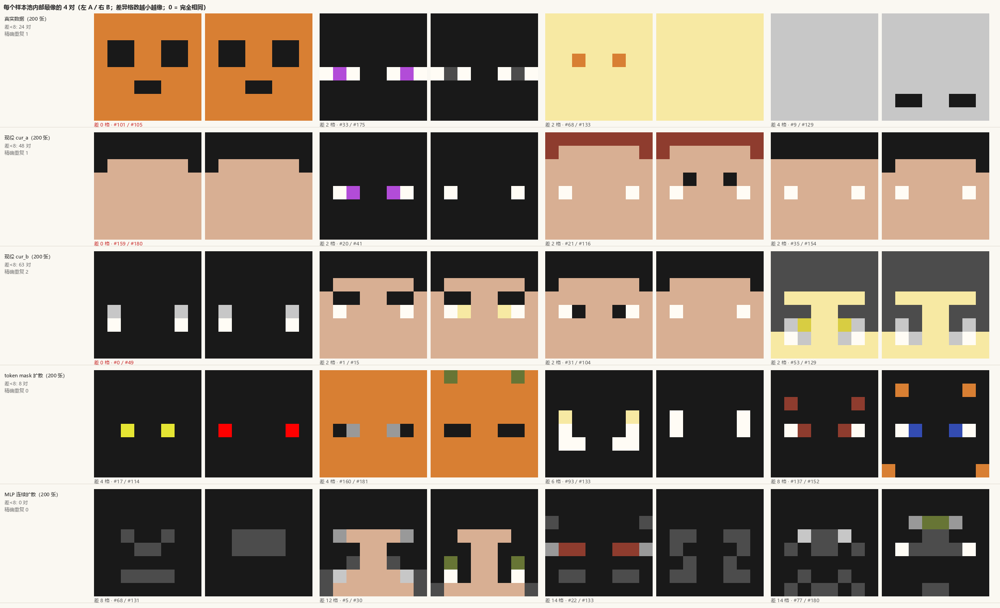

# 第十三轮盲测：噪声地板、重复图，与"现役 vs 真实"的定论

**日期**：2026-11-08。**规模**：4 臂 × 40 张 = **160 条**。**种子**：`2797293449`（单轮）。**用时**：305 秒（1.91 秒/张）。

**三句话**：

1. **"几乎一样的图"有两个原因**——① 页面抽样是**有放回**的（一轮 10.6% 是同一张图被抽了两次，已修）；② **现役模型自己会塌**（同一条采样流里出现完全相同的两张脸，近似重复率是真实数据的 **2.2 倍**）。
2. **现役 ≈ 真实数据**：`cur_a` 65.0%、`cur_b` 75.0%、`real` 72.5%，两两 p 全不显著。
3. **本轮噪声地板 = 10 点**（`cur_a` vs `cur_b`，同一配置的两条独立采样流）。扩散 `tokM_rand` **30.0%**，比真实数据低 **42.5 点**（Holm **0.0009**）。

---

## 一、"几乎一样的图"：两个原因，都要修

### 1.1 页面的抽样是**有放回**的（已修）

第一版 `precomputed` 臂这样取图：

```js
const si = Math.floor(rnd() * arm.__pool.length);   // ← 每次独立抽，抽过还能再抽到
```

200 张的池子里抽 40 张，生日悖论下**平均会重复 3.9 次/臂**。本轮实测：

| 臂 | 展示 40 张 | 重复组数 | 多出来的展示 |
|---|---:|---:|---:|
| `real` | 40 | 4 | 4（10%） |
| `cur_a` | 40 | 4 | 6（15%，其中一张出现 3 次） |
| `cur_b` | 40 | 2 | 2（5%） |
| `tokM_rand` | 40 | 4 | 5（12%） |
| 合计 | 160 | 14 组 | **17 次（10.6%）** |

**所以这确实是"纯随机"——只不过是"有放回的纯随机"。** 已改成不放回（先把整池 Fisher-Yates 洗一遍再逐个取），并在自检里加了一条硬检查：

```
node tools/_label_seed_selftest.js
  ✓ 每臂抽 40 张全部互不相同
```

### 1.2 更麻烦的那个：**现役模型自己会塌**

把五个池子各 200 张两两比较（距离 = 64 格里颜色不同的格数）：

| 池 | 张数 | 不同图 | **最近邻距离**（越大越多样） | 有邻居只差 <8 格的张数 |
|---|---:|---:|---:|---:|
| `real` 真实数据 | 200 | 199 | **20.0 ± 9.9** | 20 / 200 |
| `cur_a` 现役 | 200 | 199 | **16.3 ± 9.2** | **44 / 200** |
| `cur_b` 现役（另一条流） | 200 | 198 | **13.8 ± 8.7** | **51 / 200** |
| `tokM_rand` token 扩散 | 200 | 200 | 27.6 ± 9.1 | 7 / 200 |
| `mlp_x0` 连续扩散 | 200 | 200 | 30.9 ± 8.7 | 0 / 200 |



**读法**：

- `cur_a` 的 #159 与 #180、`cur_b` 的 #0 与 #49 **逐格完全相同**（0 格差）——不是抽样重复，是**模型从两个不同的旋钮值画出了同一张脸**；
- 现役池里"有邻居只差 <8 格"的占 **22~26%**，真实数据只有 **10%**；最近邻距离 14~16 格 vs 真实 20 格；
- 扩散正好相反：最近邻 28~31 格（比真实数据还散），没有近似重复。

$$\boxed{\text{现役的问题是"趋同"：200 张里有效不同的脸远少于 200；扩散的问题是"散但脏"。}}$$

这跟第十二轮肉眼看的一致：现役那一行几乎都是"黑发带 + 肤色脸 + 两只眼"的同一模板换色。

**这也解释了作者的直观感受**：即使把"有放回"改掉，**仍然会看到很像的图**，因为模型的支撑集本来就窄。要真正提高多样性，得回到 `docs/05`/`docs/09 §2.4` 那条线上的杠杆（调色板、旋钮维数、以及"多点采样"），不是抽样能救的。

---

## 二、第十三轮结果

| 臂 | n | 均值 | 可接受 ≥2 | **好脸 ≥3** | 分布 0/1/2/3/4 |
|---|---:|---:|---:|---:|---|
| `cur_b` 现役（流 B） | 40 | 2.775 | 97.5% | **75.0%**<br>[59.8, 85.8] | 0/1/9/28/2 |
| `real` 真实数据 | 40 | 2.775 | **100%** | **72.5%**<br>[57.2, 83.9] | 0/0/11/27/2 |
| `cur_a` 现役（流 A） | 40 | 2.850 | **100%** | **65.0%**<br>[49.5, 77.9] | 0/0/14/18/8 |
| `tokM_rand` token 扩散 | 40 | 2.125 | 82.5% | **30.0%**<br>[18.1, 45.4] | 0/7/21/12/0 |

**两两（置换检验 10,000 次，Holm）**

| 对比 | Δ≥3 | p（Holm） | Δ≥2 | p（Fisher） |
|---|---:|---:|---:|---:|
| `cur_a` vs `real` | −7.5 | 0.6355（1.0） | 0 | 1.0 |
| `cur_b` vs `real` | +2.5 | 1.0000（1.0） | −2.5 | 1.0 |
| **`tokM_rand` vs `real`** | **−42.5** | **0.0003（0.0009 ✔）** | **−17.5** | **0.0117** |

顺序漂移 **−0.038**（标准没漂）。

### 三条读数

**1. 现役已经到真实数据的水平，测不出差别。**
`cur_a` 65.0% / `cur_b` 75.0% / `real` 72.5%，差异 2.5~7.5 点，p 全为 1.0。
第十二轮"现役 38%、比真实差 20 点"一行不作数（见该轮文首口径说明）；第 13 轮同轮测得现役 65~75%。

**2. 本轮噪声地板 = 10 点。**
`cur_a` 与 `cur_b` 是**同一配置、同一模型、两条独立采样流**，理论上应完全相同，实测 65.0% vs 75.0%，差 **10 点**（n=40）。
这条数很重要：**n=40 时，10 点以内的差距不要读**。它也解释了为什么第十二、十三两轮能差出 30 点——`n=40~50` 的单轮分辨率就是这么粗。

**3. 扩散这一轮被判死了。**
`tokM_rand` 30.0%，比真实数据低 42.5 点、比现役低 35~45 点，p=0.0003（Holm 0.0009）；
而且 **7 张 1 分、0 张 4 分**。配合 §1.2 的多样性数据：

$$\text{扩散把"多样性"做到了（最近邻 28 格 vs 真实 20 格），但把"像不像脸"弄丢了；现役相反。}$$

---

## 三、下次开轮之前，两个已经固化的检查

```bash
node tools/_label_seed_selftest.js          # 种子每轮不同 / 顺序打乱 / 预计算臂不放回 / 跳过不吃配额
python tools/sample_baselines.py --verify   # 采样器与页面逐值对账（8 组 × 96 值，最大差 0.00000000）
```

加上出图/分析三件套：`analyse_round.py --round N`、`round12_gallery.py`（改 `--round` 可复用）、`near_dup_report.py`。

---

## 四、跨轮对得上吗？对得上——但要看"抽到哪几张"

同一个 `real` 池（200 张）在两轮各抽了一次，**共同抽到的 7 张分数完全一样**（7/7）；
`tokM_rand` 共同的 10 张里 8 张一样、2 张差 1 级。
**所以判定标准没有漂，漂的是抽样。**

真正的差别来自池子里那批"半垃圾"：

| | 抽到 | 其中"≤2 色"的样本 | 判 <2 的 |
|---|---:|---:|---:|
| 第十二轮 `real` | 44 张不同 | 10 张 | **9 张** |
| 第十三轮 `real` | 36 张不同 | 5 张 | **0 张** |

而"≤2 色"并不等于坏脸：同一批里 `#65` 被判 4、`#14/#164` 判 3，`#5/#149` 判 0。**真实皮肤库本身就有 15.5% 的纯色/两色头**，其中一部分是好看的极简设计，一部分是废图。
这解释了单轮 `real` 为什么能在 58%~72.5% 之间摆——**不是标准漂，是抽到了不同的垃圾**。

---

## 五、下一步

1. **扩散路线结案**：在"对称 8×8 + 16 槽 + 纯 MLP"这个设置下，它比现役低 35~45 点，且多样性过剩、结构不足。除非引入**拒绝采样**（拿现成的二次打分器筛，4 次采样 = 现役的 4 选 1 同时间预算），否则没有翻盘路径。
2. **现役的真实短板是"趋同"而不是"不好看"**：最近邻 14~16 格 vs 真实 20 格，22~26% 的样本有近似双胞胎。下一个杠杆应该打这里（调色板组合、旋钮维数 4→8、或"把打分器改成奖励与已选样本的距离"）。
3. **统计上**：任何想区分 10 点以内差距的轮次，**n 至少 80~100/臂**，并且**每轮必须带一对"同配置双臂"当噪声地板**（本轮 `cur_a`/`cur_b` 的做法，成本只有 1/4 的臂）。

---

## 六、文件

| 文件 | 内容 |
|---|---|
| `results/labels/colour_round13.jsonl` | 160 条原始标签 |
| `results/labels/analysis_round13.json` | Wilson / 置换检验 / Holm / 顺序漂移 |
| `results/labels/near_duplicates.png` | 五个池内部最像的 4 对（含 0 格差的完全重复） |
| `tools/near_dup_report.py` | 出上图 + 精确重复/近似重复/最近邻距离统计 |
| `tools/_label_seed_selftest.js` | 含"每臂抽满不重复"的硬检查 |
| `tools/label_manifest_diffusion13.json` | 本轮清单（含噪声地板臂 `cur_b`） |

*2026-11-08 · 4 臂 × 40 张，单轮单种子。跨轮不可比；同轮内 10 点以内的差距不要读（本轮实测噪声地板）。*
