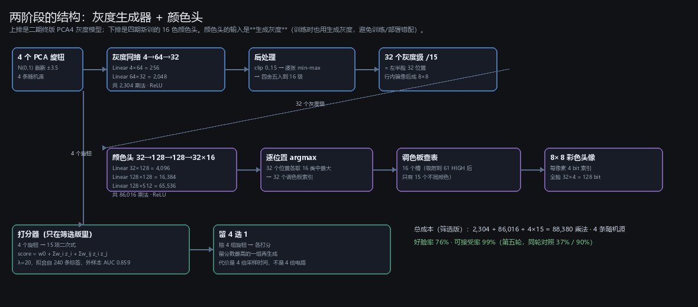
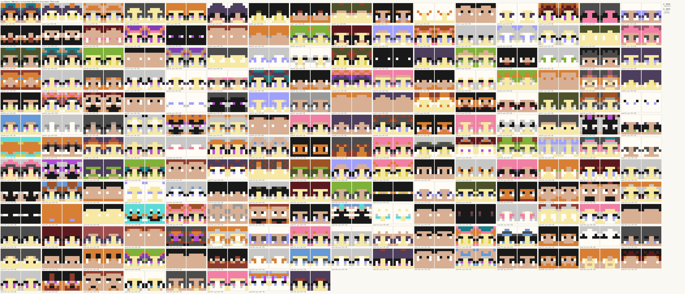
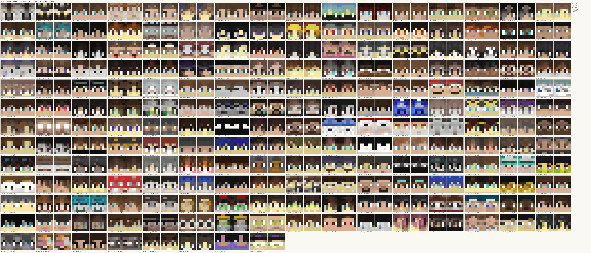
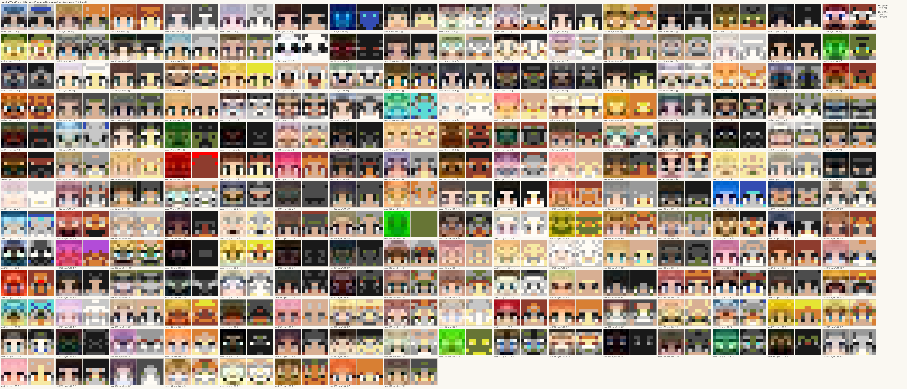
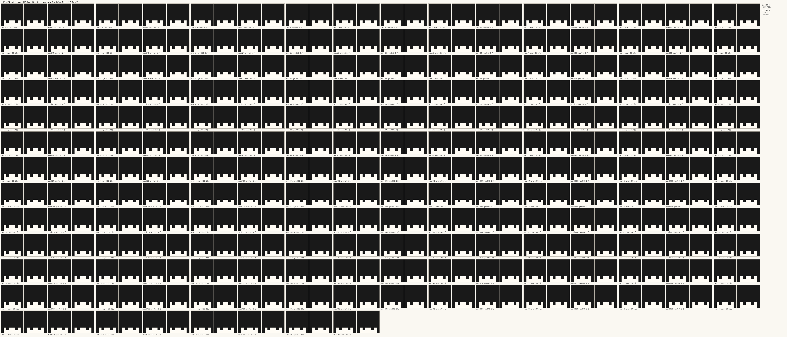
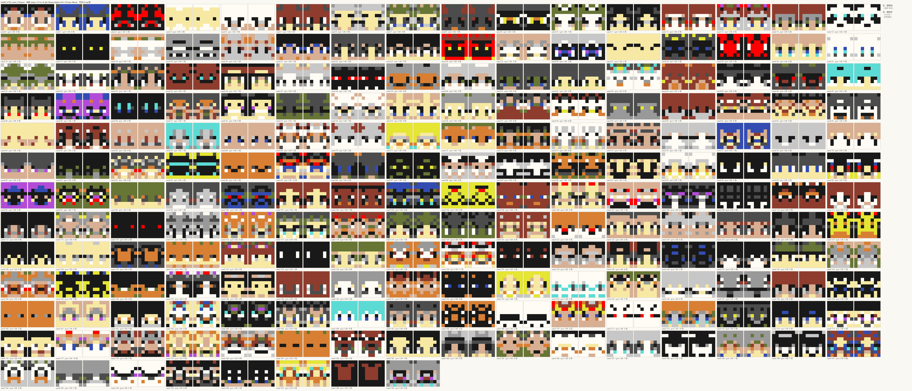
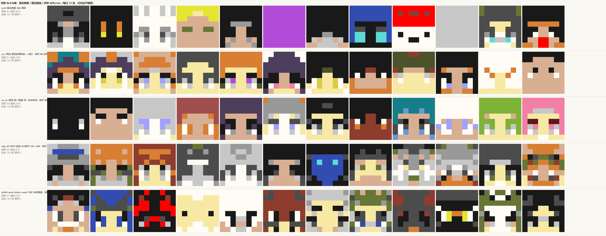
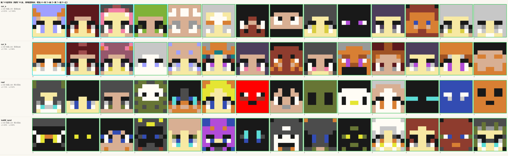
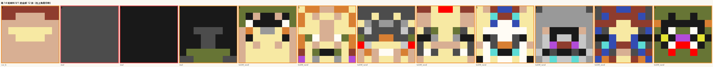
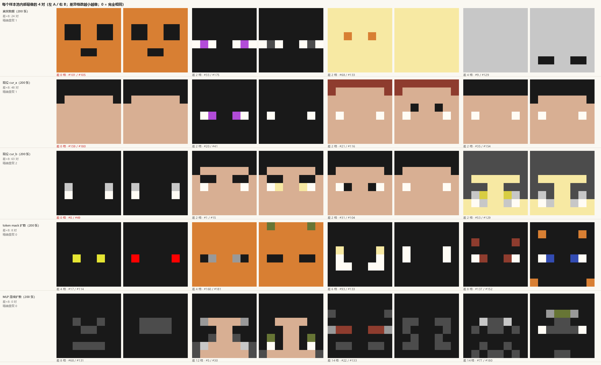

# 四期总结报告：红石神经网络彩色头像（截至第十四轮盲测）

**日期**：2026-11-08。**范围**：四期全部（第 1~14 轮盲测、1,600+ 条人工标签、扩散路线的进出场）。
**一句话**：现役管线（4 旋钮 → 灰度 → 16 色头 → 换调色板 → 4 选 1，**88,380 乘法 / 4 条随机源**）在盲测里**与真实数据统计上并列**
（第十四轮 85.0 / 77.5% vs 真实 72.5%）；**扩散路线在同设置下稳定低 30~40 点，判死**。

---

## 0. 一页纸

### 交付物

```
4 个 PCA 旋钮（N(0,1) 截断 ±3.5，4 条随机源）
  ↓ 灰度网络 4→64→32（2,304 乘法）
32 个灰度值 → clip → 逐张 min-max 拉满 → 16 级
  ↓ 颜色头 32→128→128→32×16（86,016 乘法）
逐位置 argmax → 16 个调色板索引 → 查表（16 槽吸附到 61 个 HIGH 色）
  ↓ 逐张换调色板（configs/palette_sets，零乘法）＋「无 QUARTZ 时 WOOL→白」
8×8 彩色头像（每像素 4 bit，全脸 128 bit）
  ↓ 可选：抽 4 组旋钮 → 15 项二次打分器 → 留最高分那组（4×15 = 60 乘法，花时间不花体积）
```

$$\text{乘法}=2{,}304+86{,}016+60=88{,}380\qquad\text{随机源}=4\text{ 条}\qquad\text{时间}=4\text{ 次前向}$$



### 三个核心数字

| 项 | 值 | 出处 |
|---|---|---|
| **现役好脸率（≥3 级）** | **65~85%**（三轮中位 ~76%） | 第 11、13、14 轮 |
| **真实数据自己的人判上限** | **72.5%**（两次独立测量都是 29/40） | 第 13、14 轮 |
| **纯 MLP 扩散（最好的一版）** | **30~40%**，比现役低 **35~45 点** | 第 13、14 轮 |

### 一句话结论

$$\boxed{\text{在"对称 8×8 + 16 色 + 红石可移植"这个设定下，现役已经到达数据本身的水准；扩散没有抬高质量上限。}}$$

---

## 1. 工期与主线：四期做了什么

| 段 | 轮次 | 干了什么 | 结果 |
|---|---|---|---|
| **前段**（整理期） | — | 把前三期读成两份文档（沿革 / 资产），定成本两条轴、良率结构 | 见 `docs/01`、`docs/02` |
| **中段**（摸索期） | 1~5 | PCA 维数扫描、单/两阶段、筛选 vs 随机 | 筛选首次生效：**+39 点**（37%→76%） |
| **中段**（增益期） | 6~11 | 换调色板（+20 点）、先验校正、WCOL→QUARTZ 规则、精选 64 组合 | 好脸率稳定在 **72~76%** |
| **后段**（验证期） | 12~14 | 引入 diffusion、把成本口径改成"体积 vs 时间"、**整顿度量**（噪声地板、对账、不放回） | 扩散判死；现役确认与真实数据并列 |

### 中段已经证伪过的两条（后段没有再走）

| 尝试 | 结果 | 出处 |
|---|---|---|
| **加输入维数**（k=8 → 16/24/32） | 好脸率 **50.8% → 27.9 / 26.7 / 25.0%**（越加越差） | 第 1 轮 |
| **换 PCA22 灰度引导** | **17.5%** vs PCA4 的 50.0%，Holm 显著（−31 点） | 第 3 轮 |

$$\boxed{\text{"加维"在四期早期就试过两次，都是更差——原因是旋钮越多，N(0,1) 随机采样越偏离流形。}}$$

**所以本报告不再把"4→8 维"列为下一步**（见 §8）。真正跑不动的不是维度，是"随机采样 + 高维"这对矛盾。

---

## 2. 现役管线长什么样（200 张实测样张）



*每张都是 4 旋钮 → 灰度 → 16 色头 → 逐张换调色板 → 4 选 1 的真实输出。*

代理指标（与真实数据同口径）：色数 5.09（真实 4.15）、饱和 **0.257**（真实 0.239）、边缘 p90 **12.5 级**（真实 12.1）、眼带中位 2 px。

---

## 3. 成本口径：**体积 vs 时间**（本阶段最重要的一次校正）

作者裁定：**去噪网络的参数每一步是同一套，所以这些乘法不重复算体积——机器体积不显著增加，增加的是运行时间。**

$$\boxed{\text{体积}\approx\text{一次前向要实例化的"输出}\times\text{输入"对};\qquad \text{时间}=\text{前向次数}}$$

两条推论：

1. **对 MLP**：体积 = 参数个数；
2. **对卷积**：体积 = **一次卷积的乘加数**，而不是参数量——3×3、9 个参数的核，在 8×8 上展开成 484 个非零，一行横跨 19 列（`kb/20_数学/卷积_跨度与多核堆叠.md`）。

| 走法 | **体积**（乘加/前向） | 相对 88,380 | **时间** |
|---|---:|---:|---:|
| 现役（含 4 选 1） | 88,380 | 1× | 4 |
| Jim 的 conv U-Net（2.83 M 参数） | **65,207,680** | **738×** | 20（10 步 × CFG） |
| 纯 MLP 连续扩散 h=256 双隐层 | 118,784 | 1.34× | 10 |
| 纯 MLP 连续扩散 h=512 双隐层 | 368,640 | 4.17× | 10 |
| 纯 MLP token(mask) 扩散 h=192 | 187,392 | 2.12× | 10 |

**他的 23 倍展开全在卷积上**：$65{,}207{,}680/2{,}828{,}355=23.05$。
另有两条操作性结论：**DDIM 确定性 ⇒ 全程只要 1 个噪声向量**（不是每步抽随机）；**CFG 花时间不花体积**。

---

## 4. 扩散路线：从玩家 Jim 的模型，到纯 MLP 去噪器

### 4.1 先拆开他的成品（不重训，直接当黑箱评）

`shared_by_jim_sama/index_v6.3u_diffusion.html` 是一个 7.74 MB 单文件；把里面的 `DDPM6` 与权重挖出来，node 原样跑：

| 项 | 值 |
|---|---|
| 结构 | 宽 64 的小 U-Net，9 个残差块，8×8 与 4×4 两级，两层自注意力（4/8 头） |
| 归一化 | **GroupNorm(8)** + SiLU（红石上要算方差与除法，贵） |
| 扩散 | 余弦 $\bar\alpha$、**v-prediction**、**DDIM 10 步确定性** |
| 条件 | 8 个"拟人化"质量桶 + null，**CFG w=1.2（每步 2 次前向）** |
| 收尾 | 逐张 k-means(k=12) → 吸附 234 色 → 对称吸附 |
| 规模 | 2,828,355 参数 / **65.2 M 乘加每次前向** |



*每对左=吸附前的连续色，右=吸附后。能出真正的脸（眼、刘海、发色），但也有退化块。代理指标：饱和 0.285、眼带中位 2 px —— 比现役更"活"，但 200 格里肉眼并不明显压过 76%。*

### 4.2 为什么"潜空间扩散"在本项目里没有意义

- 旋钮空间到 32 维仍近各向同性（条件数 **1.000~1.001**，非对角相关 <1e-5）；
- 用 20 万张真实脸做 kNN、用密度预测"坏"的 **AUC 只有 0.504**（抛硬币）。

$$\Rightarrow\quad\text{在旋钮空间做扩散只会学出一个高斯；必须做在像素/色号空间。}$$

### 4.3 五种纯 MLP 去噪器（无卷积、无归一化、ReLU、时间条件走输入维）

| 臂 | 结构 | 体积 | 色数 | 饱和 | 边缘（级） | 眼带 | 肉眼 |
|---|---|---:|---:|---:|---:|---:|---|
| 真实数据 | — | 0 | 4.15 | 0.239 | **12.1** | 1 | 参照 |
| 现役 | 4-64-32 + 32-128-128-512 | 88,380 | 5.09 | 0.257 | 12.5 | 2 | 稳 |
| 连续 `x0` | 112-256-256-96 | 118,784 | 6.17 | 0.211 | **10.3** ⚠️ | 2 | **偏软** |
| 连续 `x0`（加宽 2×） | 112-512-512-96 | 368,640 | 5.99 | 0.218 | **10.4** ⚠️ | 2 | 加宽没用 |
| token uniform D3PM | 272-192-192-512 | 187,392 | 8.45 | **0.393** ⚠️ | 13.0 | 2 | **过饱和、最差** |
| token mask + 置信度 argmax | 同上 | 187,392 | **2.00** ❌ | 0.006 ❌ | 23.0 ❌ | **0** ❌ | **塌成单色** |
| **token mask + 采样揭盖** | 同上 | 187,392 | 5.67 | 0.231 | **14.3** | 2 | 扩散最好的一版 |



*连续 RGB 扩散：训练正常（val loss 1.58→0.40），但出图偏软——**只要输出端还是"回归一个 RGB 值"，就还在猜条件均值**，多步只是把它拉回来。加宽 3.1 倍也没用（10.3→10.4 级）。*



*同一网络、同一批权重，只把采样器从"每步按分布采样揭盖"换成"每步取最自信的 argmax"——**直接塌成整片黑**（色数 2.0、饱和 0.006、眼带 0）。这是本阶段最干净的一个"成败在采样器不在网络"的证据。*



*改成每步按分布采样揭盖之后的样子：结构成立、颜色也活（饱和 0.231、边缘 14.3 级），但**代价是每步要 32 个随机数**（10 步 = 320 个），而 DDIM 只要 1 个初始噪声向量。*

### 4.4 五种对照放在一起



*行：真实数据 / 现役（换调色板）/ 现役（固定调色板）/ MLP 连续 / token mask；行间不是同一批种子，只能看分布像不像。*

---

## 5. 盲测：第 12~14 轮

### 5.1 协议在这三轮里被重做了什么

| 项 | 第 1~11 轮 | 第 12~14 轮 |
|---|---|---|
| 随机种子 | 硬编码（每轮图都一样） | **打开页面的时刻**（每轮都不同，可 `?seed=` 复现） |
| 臂的出场顺序 | 固定（取计数最少者） | **整轮洗牌** |
| 图的来源 | 页面现场跑模型 | 12~13 轮用预计算池；**14 轮现役改回现场生成** |
| 抽样 | 现场生成 = 天然不放回 | 池子**不放回**（一轮内每张图只出现一次） |
| 噪声地板 | 无 | **每轮带一对"同配置双臂"**（实测 7.5~10 点） |
| 记录 | 旋钮坐标 | 旋钮坐标 + **96 个颜色值（可精确重建图）** + 种子 + 座位号 |

### 5.2 为什么要放两条一模一样的臂：`cur_a` 与 `cur_b`

**它们不是两个模型，是同一个模型的两次独立采样。** 配置完全相同：

| | `cur_a` | `cur_b` |
|---|---|---|
| 灰度模型 | `gray_pca4.json` | 同 |
| 颜色头 | `pal16_curated64.json` | 同 |
| 旋钮数 / 归一化 | 4 / min-max 拉满 | 同 |
| 调色板机制 | 逐张抽（`configs` + `palette_sets`） | 同 |
| 打分器 | 15 项二次式，4 选 1 | 同 |
| **唯一的区别** | **消耗哪一段随机数** | 另一段 |

- 第 13 轮：两臂各是**离线生成的一池 200 张**（`cur_n200.json` / `cur_b_n200.json`，两个不同的种子）；
- 第 14 轮：两臂都由**页面现场生成**，共用页面的一条随机数流，但各自抽自己的旋钮——所以图不重复，而统计性质完全相同。

**用途**：它们是**空对照（null control）**。两条臂的真实好脸率在数学上必然相等，所以

$$\text{实测差值}\ =\ \text{本轮噪声地板}\quad(\text{第 13 轮 }10.0\text{ 点；第 14 轮 }7.5\text{ 点})$$

有了这个地板，才知道"两条臂差 5 点"是该忽略的，"差 30 点"才是信号。它同时解释了为什么同一配置能在不同轮次间摆动十几点——**单轮 n=40~50 的分辨率就是这么粗**。
代价很小：一轮 4 个臂里拿 1 个当对照，比事后争论"这个差是不是噪声"便宜得多。

### 5.3 三轮结果

| 臂 | 第 12 轮（n=50） | 第 13 轮（n=40） | 第 14 轮（n=40） |
|---|---:|---:|---:|
| 现役 `cur_a` | 38%（不作数，见下注） | 65.0% | **85.0%** |
| 现役 `cur_b` | — | 75.0% | 77.5% |
| 真实数据 `real` | 58.0% | 72.5% | 72.5% |
| 连续扩散 `mlp_x0` | 30.0% | — | — |
| token 扩散 `tokM_rand` | 32.0% | 30.0% | 40.0% |

> 第 12 轮的"现役"一行取自当时的离线脚本，其调色板后处理与页面实现不一致，**该行不作数**（依据见 [`10_第十二轮`](10_第十二轮盲测_扩散对比.md)）。现役的读数以第 11、13、14 轮为准。



*第 14 轮：行=臂、按等级降序、框色=等级（青 4 / 绿 3 / 黄 2 / 橙 1 / 红 0）。现役两臂（现场生成）拿走了全部 4 分；扩散那一行没有 4 分、有 8 张 1 分。*

**两两检验（第 14 轮，Holm）**

| 对比 | Δ≥3 | p（Holm） |
|---|---:|---:|
| `cur_a` vs `real` | +12.5 | 0.2664（0.53，不显著） |
| `cur_b` vs `real` | +5.0 | 0.8037（0.80，不显著） |
| **`tokM_rand` vs `real`** | **−32.5** | **0.0052（0.0156 ✔）** |

### 5.4 "上限"这个数怎么读：真实数据的垃圾尾



*第 14 轮全部 12 张被判 0/1 的图：8 张来自扩散、3 张来自真实数据、1 张来自现役。真实皮肤库里本来就有**纯色块**（整张红、整张绿、纯黑底两只眼），数据集只按"≥95% 对称"筛过，没按"像不像脸"筛——`real` 池里 **15.5%** 是"≤2 色"的头。*

**这就是为什么单轮 `real` 能在 58%~72.5% 之间摆**：不是标准漂，是抽到了不同的垃圾。
证据：同一个 `real` 池在第 13、14 轮各抽一次，共同抽到的 **7 张分数 7/7 完全一样**（`tokM` 共同 10 张里 8 张一样、2 张差 1 级）。**判定标准没漂，漂的是抽样。**

---

## 6. 度量纪律：这一阶段的另一半产出

盲测的价值全在"同轮可比 + 差距大于噪声"这两条上。这一阶段把三件事固化成了命令，任何一轮开跑前先过：

```bash
python tools/sample_baselines.py --verify   # 现役取样器与页面 JS 逐值对账：8 组 × 96 值，最大差 0.00000000
node   tools/_label_seed_selftest.js        # 种子每轮变 / 顺序洗牌 / 池子不放回 / 跳过不吃配额
node   tools/_manifest_smoke.js <清单> 12    # 清单冒烟：装载 + 出图 + 去重
```

**为什么要有第一条**：凡是"为了出对照图而在 Python 里重写页面那条管线"，都必须与页面逐值对齐。
页面里的后处理规则（`wool2white`、逐张换调色板）是有状态、有条件的，只看文档抄一遍很容易漏条件；
`--verify` 直接拿页面的 `coloursOf()` 当参考，96 个值一个不差才算过。

### 6.1 "趋同"怎么量：最近邻距离必须带样本量



*每个池内部最像的 4 对；`cur_a` 的 #159 与 #180、`cur_b` 的 #0 与 #49 是**逐格完全相同**——这是模型从两个不同旋钮值画出了同一张脸，不是抽样重复。*

| 尺度 | 真实数据 | 现役 | 扩散 |
|---|---:|---:|---:|
| 200 张池内：最近邻距离 | 20.0 ± 9.9 | 16.3 / 13.8 | 27.6 / 30.9 |
| **同一批池子随机抽 40 张：最近邻距离** | **28.1** | **23.6 / 21.7** | **33.2** |
| 一轮 40 张现场生成（实测） | 27.7 | 20.9 / 24.9 | 34.6 |
| 80 张现役里"相差 ≤2 格"的对 | — | **5 对**（0 组完全相同） | — |

**最近邻距离随样本量单调下降**：200 张池子里当然比一轮 40 张更容易找到近亲。
所以这个指标**必须连同"在这多少张里算的"一起引用**——拿 200 张池子的数去解释一轮 40 张的观感，会系统性高估"趋同"。

按一轮的尺度（40 张）读：**现役的多样性低于真实数据（最近邻 21~24 格 vs 28 格），但每 40 张里只有约 2 张有"只差 1~2 格"的近亲，没有一张是完全重复。**
这与作者的观察一致；也说明现役的瓶颈是**4 维输入本身的容量**，不是解码塌陷。

### 6.2 引用数字时必须带的口径

| 量 | 口径 | 容易混成 |
|---|---|---|
| 成本 | **体积** = 一次前向的乘加数；**时间** = 前向次数 | "乘法总数"（把步数乘进去会夸大 10 倍） |
| 好脸率 | 盲测 ≥3 级占比，**同轮内有效** | 跨轮直接横比 |
| 最近邻距离 | 必须带"在这多少张里算的" | 200 张池 vs 一轮 40 张 |
| `cur_pal`（第 12 轮） | 不作数（离线脚本与页面实现不一致） | 与第 11/13/14 轮的现役读数混用 |

---

## 7. 结论：能下的与不能下的

**能下的**

1. **现役与真实数据统计上并列**（65~85% vs 72.5%，两轮里 p 全不显著）；**可接受率 97.5~100%**，几乎不出废图。
2. **扩散在同设置下显著更差**（30~40%，比真实数据低 26~42 点，两轮都过 Holm）。
3. **离散（token）比连续（RGB 回归）对**：这不仅是因为分数，更因为它符合项目纪律（颜色当离散类）且**不增加解码硬件**（32×16 argmax 与现役同形）。
4. **离散扩散的成败在采样器**：同一网络，置信度 argmax 塌成单色，按分布采样揭盖才成立。
5. **体积看一次前向、时间看步数**：扩散的"贵"不在重复，而在一、卷积（23 倍展开）、二、步数带来的延迟。
6. **本轮噪声地板 7.5~10 点**（n=40）；**n=40~50 的单轮不能分辨 10 点以内的差异**。

**不能下的**

1. **"上限"尚未被真正顶到**：真实数据自己的人判只有 72.5%，里面还混着 15.5% 的纯色头。所以"现役 = 真实数据"不等于"现役到顶"——**二者都还有空间**，只是这个空间不在"更花"，而在"更像一张脸"。
2. **`cur` 的 65~85% 区间仍有 ±10 点的轮次噪声**，要钉到 ±5 点需要 n≥150/臂。
3. **扩散"拒绝采样"这一问还没做**（见 §8）——这是唯一没被排除的翻盘路径。

---

## 8. 下一步（按价值排序，且已排除"加维"）

| # | 做什么 | 为什么是它 | 成本 |
|---:|---|---|---|
| 1 | **给扩散加拒绝采样**：4 次采样 + 现成的 15 项二次打分器筛一张，与现役 4 选 1 **同时间预算** | 现役 76% 里有相当一部分是"筛"出来的；扩散现在是单次采样，等于让了一手。这是"扩散还有没有机会"的最后一问 | 半天（采样 4 ms/张） |
| 2 | **把"2 分"打开看**：现役有相当比例落在 2 分（第 14 轮 6~8/40）。单独出图，看是颜色闷、结构软还是缺眼睛 | 现役的问题已经是"很少惊艳"而不是"会不会废"，下一个杠杆必须针对 2 分这批 | 半天 |
| 3 | **换"选择"的目标**：现在打分器已经把"好"当目标（`grade>=3`），但它是**在旋钮上打分**；试试"在输出图上打分"（用现成的代理指标：眼带、色数、边缘） | 二期遗留：种子的分数与成品的分数 $r^2\approx0.3$；而 4 选 1 的收益全在成品侧 | 1 天 |
| ~~4~~ | ~~加输入维数 4→8~~ | **不做**：第 1 轮（k16/24/32 → 25~28%）与第 3 轮（PCA22 → 17.5%）已经两次证伪 | — |

---

### 复现命令（不入库的产物都能由下面重算出来）

**扩散的权重与样本池**（单份 0.4~7.9 MB，只在本地）：

```bash
# 玩法一：直接跑 Jim 的成品（不训练）
node tools/jim_diffusion_run.js --n 200 --steps 10 --seed 1000 --out results/diffusion/jim_n200_s10.json

# 连续 RGB 去噪器
python tools/train_mlp_diffusion.py --tag mlp96_h256v --hid 256 --layers 2 --pred v  --steps 40000
python tools/train_mlp_diffusion.py --tag mlp96_h256x --hid 256 --layers 2 --pred x0 --steps 40000
python tools/train_mlp_diffusion.py --tag mlp96_h512x --hid 512 --layers 2 --pred x0 --steps 60000
python tools/train_mlp_diffusion.py --tag mlp96_h512v --hid 512 --layers 2 --pred v  --steps 60000

# token 空间（uniform / mask）
python tools/train_token_diffusion.py --kind uniform --tag tok_h192  --hid 192 --layers 2 --steps 40000
python tools/train_token_diffusion.py --kind mask    --tag tokM_h192 --hid 192 --layers 2 --steps 40000
python tools/sample_token.py --weights results/diffusion/tokM_h192.json --scheme rand --steps 10 --n 200
```

**对照组的样本池**：

```bash
python tools/sample_baselines.py --which real   --n 200
python tools/sample_baselines.py --which cur    --n 200 --select 4
python tools/sample_baselines.py --which cur_b  --n 200 --seed 54321 --pal-seed 4242 --out results/diffusion/cur_b_n200.json
python tools/sample_baselines.py --which curfix --n 200 --select 4
```

**把标签重新变成图**（现在 `cur` 臂是现场生成，图存在标签的 `cols` 里，不依赖池子）：

```bash
python tools/analyse_round.py --round 14 --base real
python tools/round_gallery.py --round 14 --man label_manifest_diffusion14.json --per 14 --cell 30
python tools/near_dup_report.py --per 4
python tools/diffusion_compare.py --per 12 --cell 28 --row ...
```

**实验臂训练产物**（`results/train/`，每份 1.8~4.3 MB）：`src/train_palette.py --tag ... --k ... --K 16 --hid 128`，参数见各臂 `summary.json` 与 [`03_第一批实验计划`](03_第一批实验计划.md) §三。

---

## 9. 文件索引

### 文档

| 文件 | 内容 |
|---|---|
| [`01_沿革`](01_沿革_一期至三期.md) / [`02_可用资产`](02_可用资产与规则.md) / [`00_索引`](00_文档索引.md) | 前八轮的底座：前三期规则、工具、数据 |
| [`03_第一批实验计划`](03_第一批实验计划.md) ~ [`08_阶段总结`](08_阶段总结.md) | 第 1~11 轮：PCA 维数、两阶段、筛选、换调色板、先验校正 |
| [`09_diffusion路线_计划`](09_diffusion路线_计划.md) | 扩散的拆解、成本、五级梯子、止损线 |
| [`10_第十二轮`](10_第十二轮盲测_扩散对比.md) | 真实数据上限 58%、扩散 30~32%（`cur_pal` 一行不作数） |
| [`11_第十三轮`](11_第十三轮盲测_噪声地板与重复图.md) | 重复图的两个原因、噪声地板 10 点 |
| [`12_第十四轮`](12_第十四轮盲测_现场生成与趋同程度.md) | 现役改回现场生成、趋同程度的正确量法 |
| **本文** | 四期总结 |

### 工具（`tools/`）

| 文件 | 作用 |
|---|---|
| `jim_diffusion_cost.py` | 从 `meta.layout` 算体积（乘加/前向）与 MLP 成本梯子 |
| `jim_diffusion_run.js` / `jim_diffusion_gallery.py` | 零改动跑 Jim 的权重 / 出图 + 代理指标 |
| `train_mlp_diffusion.py` / `train_token_diffusion.py` / `sample_token.py` | 连续扩散 / token 扩散（uniform & mask）/ 只换采样器 |
| `sample_baselines.py` | 对照组：真实数据、现役（**含逐张换调色板**）、固定色板对照；`--verify` 与页面对账 |
| `diffusion_compare.py` / `near_dup_report.py` / `round_gallery.py` | 多臂拼图 / 重复图诊断 / 任意一轮描框图 |
| `label.html` / `label_server.py` / `label_manifest_diffusion1{3,4}.json` | 盲测页（时间种子、洗牌、不放回、预计算臂） |
| `_label_seed_selftest.js` / `_manifest_smoke.js` / `_cur_crosscheck.js` | 三道防线 |

### 图（本报告用到的）

| 图 | 说明 |
|---|---|
| `results/twostage/pipeline.png` | 现役管线结构与数据流 |
| `results/diffusion/cur_n200.png` | 现役 200 张实测样张 |
| `results/diffusion/jim_n200_s10.png` | Jim 的 200 张（左吸附前 / 右吸附后） |
| `results/diffusion/mlp96_h256x_s10.png` | 连续 RGB 扩散（偏软） |
| `results/diffusion/tokM_h192_conf_s10.png` | mask + 置信度 argmax（塌成黑） |
| `results/diffusion/tokM_h192_rand_s10.png` | mask + 采样揭盖（扩散最好的一版） |
| `results/diffusion/compare_arms.png` | 五臂横向对照 |
| `results/labels/round14_graded.png` | 第 14 轮四臂按等级描框 |
| `results/labels/round14_badtail.png` | 第 14 轮全部 0/1 分 |
| `results/labels/near_duplicates.png` | 各池内部最像的几对（含完全重复） |

*2026-11-08 · 四期收尾。所有数字都能在标出的文档或 `results/` 里找到原文；口径：**体积** = 一次前向的乘加数，**时间** = 前向次数，**好脸率** = 盲测 ≥3 级占比（同轮有效，跨轮不可比）。*

