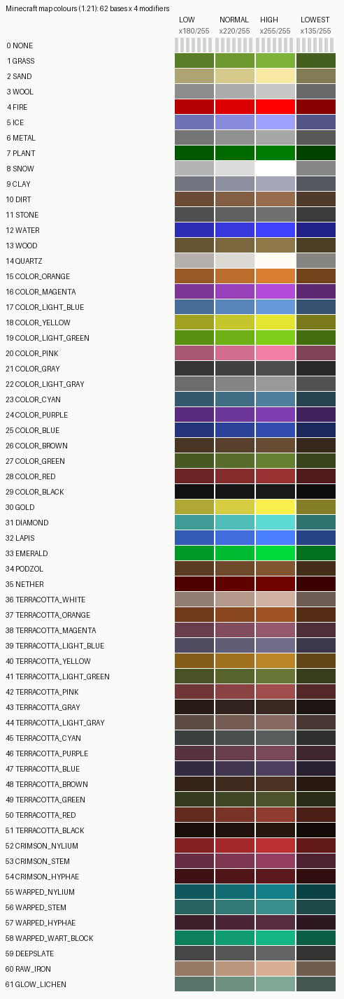

# 地图画：像素的编码与色板

状态: 待验
可信度: 权威口径（Minecraft Wiki「地图存储格式」）+ 数值验证（本目录 `_calc/map_palette.py` 复算 62×4 色值）
最后核实: 2026-10-30
适用: Java 版 1.21；地图缩放等级 0（1 像素 = 1 方块）；`colors` 数组直写或建筑记录两条路径

---

## 引言

地图是 Minecraft 里唯一一种**天生就是彩色像素屏**（存在其他彩色显示方案，比如展示柜里放彩色旗帜、彩色坐垫与红石灯配合、彩色玻璃和遮光玻璃与红石灯配合等）的东西：一张地图是 128×128 的位图，缩放等级 0 时**每个像素恰好对应世界里一个方块**。而当缩放等级变大，一个像素对应的实际面积会变大，这意味着——

> 控制一个像素的红石电路不一定要挤在“一平米”截面空间内。

对“红石显示设备”来说这条很重要：可以用活塞改变方块的遮挡关系从而改变“这块地朝天亮出的颜色”，大面积决定1像素使得布线空间宽裕，可以实时控制。
（比如，另一条路是"方块打印机"，用活塞把方块推成图案；它慢、贵、且每个像素都要一个活塞飞行器来回运动。）

但地图的像素**不是 RGB**。一个像素是一个字节，字节里装的是"**地图色**"：高 6 位是**基色**，
低 2 位是**颜色修饰**。所以做地图画的核心工作不是调色，而是：**给定一个想要的颜色，
反查它属于哪个（基色, 修饰）组合，再把那个组合换成游戏里的方块。**

这一页讲清楚三件事：字节怎么排、62 个基色是什么、以及为什么**应当优先把色板固定在一种修饰上**。

---

## 符号

| 符号 | 含义 | 取值 |
|---|---|---|
| $p$ | 地图边长（像素） | 128 |
| $N$ | 像素总数 $p^2$ | 16 384 |
| $x,z$ | 像素坐标（左上为原点，$x$ 向右、$z$ 向下） | 0~127 |
| $i$ | 该像素在 `colors` 数组里的下标 | $x+128z$ |
| $B$ | **地图基色**（base color） | 0~61 |
| $M$ | **颜色修饰**（modifier / shade） | 0~3 |
| $C$ | 地图色：一个字节 | $4B+M$ |
| $k_M$ | 修饰的亮度倍率 | 180/255, 220/255, 1, 135/255 |
| $\mathrm{RGB}(B)$ | 基色的 RGB（即 HIGH 档颜色） | 见 §三 |

---

## 一、存储：一个像素一个字节

地图数据不在地图物品里，而在存档里：

```
<存档根目录>/data/minecraft/maps/<地图编号>.dat      ← 地图数据（GZip 的 NBT）
<存档根目录>/data/minecraft/maps/last_id.dat         ← 最后用过的地图编号
```

数据里最关键的是 `colors`：**长度必须正好 16384 的字节数组**，否则游戏直接当作全 0 忽略。
下标与坐标的关系是

$$i=x+128z$$

每个字节

$$C=4B+M\qquad(B=C\gg2,\ M=C\ \&\ 3)$$

等价的代码：

```java
byte  getMapColor(int baseColor, int modifier) { return (byte)(baseColor << 2 | modifier & 3); }
int   getBaseColor(byte mapColor)   { return (mapColor & 0xFF) >> 2; }
int   getModifier (byte mapColor)   { return mapColor & 3; }
```

> **一个反直觉的后果**：既然 `colors` 是纯数据，那么“画”一张地图完全可以离线完成——
> 用程序写好这 16384 个字节，塞进 `.dat` 即可，一个方块都不用盖。反过来，在游戏里盖方块
> 只是“让游戏帮你算这 16384 个字节”。两种做法的产物是同一个东西。

### 两条更新路径

| 路径              | 做法                                                 | 代价                            |
| --------------- | -------------------------------------------------- | ----------------------------- |
| **活塞操控 → 记录**   | 活塞改变不同颜色方块的覆盖关系，手持地图（同维度、`locked=false`），游戏按列扫描并写入 | 慢、要一块地来制作地图画装置；但纯原版、可控        |
| **直写 `colors`** | 离线算好 16384 字节，写进 `.dat` 的 `colors`                 | 一次性、无地皮；但要能改存档，且必须 `locked=1` |

无论走哪条，最后都要**把 `locked` 置为 1**，否则玩家手持地图时它会被重新扫描覆盖。

---

## 二、四个修饰：不是自由选项，是倍率

| $M$ | 枚举名      |        倍率 $k_M$ | 说明            |
| --: | -------- | --------------: | ------------- |
|   0 | `LOW`    | 180/255 ≈ 0.706 | 偏暗            |
|   1 | `NORMAL` | 220/255 ≈ 0.863 | 中等            |
|   2 | `HIGH`   | 255/255 = 1.000 | **等于基色本身**    |
|   3 | `LOWEST` | 135/255 ≈ 0.529 | 最暗，仅存在于探险家地图中 |

$$\mathrm{RGB}(B,M)=\Bigl\lfloor \mathrm{RGB}(B)\cdot k_M\Bigr\rfloor\quad(\text{逐通道，向下取整})$$

所以**只需要记 62 个基色**，另外三档都能算出来。例如 `GRASS` 基色 `#7FB238`：

| 修饰 | 计算 | 结果 |
|---|---|---|
| LOW | (127,178,56)×0.706 | `#597D27` |
| NORMAL | ×0.863 | `#6D9930` |
| HIGH | ×1 | `#7FB238` |
| LOWEST | ×0.529 | `#435E1D` |

这与 Wiki 表格逐项一致（图见 `../figures/map_colors_62x4.png`）。

> **注意取整**：是向下取整。用四舍五入会在几十个格子上差 1，反查色板时就会出现"明明拿着这个方块，
> 颜色却对不上"的怪事。

---

## 三、62 个基色

0 号 `NONE` 是透明（地图上直接透出底色），其余 61 个才是真正的颜色。
所以完整色数是 **61 × 4 = 244**。但是其实不是所有颜色都能用活塞操控，比如`FIRE`（如果它对应火），就是一个活塞难以推拉的东西，所以实际使用时颜色数会受限。

| id | 枚举名 | 基色（= HIGH） | LOW | NORMAL | LOWEST |
|---:|---|---|---|---|---|
| 0 | `NONE` | 透明 | — | — | — |
| 1 | `GRASS` | `#7FB238` | `#597D27` | `#6D9930` | `#435E1D` |
| 2 | `SAND` | `#F7E9A3` | `#AEA473` | `#D5C98C` | `#827B56` |
| 3 | `WOOL` | `#C7C7C7` | `#8C8C8C` | `#ABABAB` | `#696969` |
| 4 | `FIRE` | `#FF0000` | `#B40000` | `#DC0000` | `#870000` |
| 5 | `ICE` | `#A0A0FF` | `#7070B4` | `#8A8ADC` | `#545487` |
| 6 | `METAL` | `#A7A7A7` | `#757575` | `#909090` | `#585858` |
| 7 | `PLANT` | `#007C00` | `#005700` | `#006A00` | `#004100` |
| 8 | `SNOW` | `#FFFFFF` | `#B4B4B4` | `#DCDCDC` | `#878787` |
| 9 | `CLAY` | `#A4A8B8` | `#737681` | `#8D909E` | `#565861` |
| 10 | `DIRT` | `#976D4D` | `#6A4C36` | `#825E42` | `#4F3928` |
| 11 | `STONE` | `#707070` | `#4F4F4F` | `#606060` | `#3B3B3B` |
| 12 | `WATER` | `#4040FF` | `#2D2DB4` | `#3737DC` | `#212187` |
| 13 | `WOOD` | `#8F7748` | `#645432` | `#7B663E` | `#4B3F26` |
| 14 | `QUARTZ` | `#FFFCF5` | `#B4B1AC` | `#DCD9D3` | `#878581` |
| 15 | `COLOR_ORANGE` | `#D87F33` | `#985924` | `#BA6D2C` | `#72431B` |
| 16 | `COLOR_MAGENTA` | `#B24CD8` | `#7D3598` | `#9941BA` | `#5E2872` |
| 17 | `COLOR_LIGHT_BLUE` | `#6699D8` | `#486C98` | `#5884BA` | `#365172` |
| 18 | `COLOR_YELLOW` | `#E5E533` | `#A1A124` | `#C5C52C` | `#79791B` |
| 19 | `COLOR_LIGHT_GREEN` | `#7FCC19` | `#599011` | `#6DB015` | `#436C0D` |
| 20 | `COLOR_PINK` | `#F27FA5` | `#AA5974` | `#D06D8E` | `#804357` |
| 21 | `COLOR_GRAY` | `#4C4C4C` | `#353535` | `#414141` | `#282828` |
| 22 | `COLOR_LIGHT_GRAY` | `#999999` | `#6C6C6C` | `#848484` | `#515151` |
| 23 | `COLOR_CYAN` | `#4C7F99` | `#35596C` | `#416D84` | `#284351` |
| 24 | `COLOR_PURPLE` | `#7F3FB2` | `#592C7D` | `#6D3699` | `#43215E` |
| 25 | `COLOR_BLUE` | `#334CB2` | `#24357D` | `#2C4199` | `#1B285E` |
| 26 | `COLOR_BROWN` | `#664C33` | `#483524` | `#58412C` | `#36281B` |
| 27 | `COLOR_GREEN` | `#667F33` | `#485924` | `#586D2C` | `#36431B` |
| 28 | `COLOR_RED` | `#993333` | `#6C2424` | `#842C2C` | `#511B1B` |
| 29 | `COLOR_BLACK` | `#191919` | `#111111` | `#151515` | `#0D0D0D` |
| 30 | `GOLD` | `#FAEE4D` | `#B0A836` | `#D7CD42` | `#847E28` |
| 31 | `DIAMOND` | `#5CDBD5` | `#409A96` | `#4FBCB7` | `#307370` |
| 32 | `LAPIS` | `#4A80FF` | `#345AB4` | `#3F6EDC` | `#274387` |
| 33 | `EMERALD` | `#00D93A` | `#009928` | `#00BB32` | `#00721E` |
| 34 | `PODZOL` | `#815631` | `#5B3C22` | `#6F4A2A` | `#442D19` |
| 35 | `NETHER` | `#700200` | `#4F0100` | `#600100` | `#3B0100` |
| 36 | `TERRACOTTA_WHITE` | `#D1B1A1` | `#937C71` | `#B4988A` | `#6E5D55` |
| 37 | `TERRACOTTA_ORANGE` | `#9F5224` | `#703919` | `#89461F` | `#542B13` |
| 38 | `TERRACOTTA_MAGENTA` | `#95576C` | `#693D4C` | `#804B5D` | `#4E2E39` |
| 39 | `TERRACOTTA_LIGHT_BLUE` | `#706C8A` | `#4F4C61` | `#605D77` | `#3B3949` |
| 40 | `TERRACOTTA_YELLOW` | `#BA8524` | `#835D19` | `#A0721F` | `#624613` |
| 41 | `TERRACOTTA_LIGHT_GREEN` | `#677535` | `#485225` | `#58642D` | `#363D1C` |
| 42 | `TERRACOTTA_PINK` | `#A04D4E` | `#703637` | `#8A4243` | `#542829` |
| 43 | `TERRACOTTA_GRAY` | `#392923` | `#281C18` | `#31231E` | `#1E1512` |
| 44 | `TERRACOTTA_LIGHT_GRAY` | `#876B62` | `#5F4B45` | `#745C54` | `#473833` |
| 45 | `TERRACOTTA_CYAN` | `#575C5C` | `#3D4040` | `#4B4F4F` | `#2E3030` |
| 46 | `TERRACOTTA_PURPLE` | `#7A4958` | `#56333E` | `#693E4B` | `#40262E` |
| 47 | `TERRACOTTA_BLUE` | `#4C3E5C` | `#352B40` | `#41354F` | `#282030` |
| 48 | `TERRACOTTA_BROWN` | `#4C3223` | `#352318` | `#412B1E` | `#281A12` |
| 49 | `TERRACOTTA_GREEN` | `#4C522A` | `#35391D` | `#414624` | `#282B16` |
| 50 | `TERRACOTTA_RED` | `#8E3C2E` | `#642A20` | `#7A3327` | `#4B1F18` |
| 51 | `TERRACOTTA_BLACK` | `#251610` | `#1A0F0B` | `#1F120D` | `#130B08` |
| 52 | `CRIMSON_NYLIUM` | `#BD3031` | `#852122` | `#A3292A` | `#641919` |
| 53 | `CRIMSON_STEM` | `#943F61` | `#682C44` | `#7F3653` | `#4E2133` |
| 54 | `CRIMSON_HYPHAE` | `#5C191D` | `#401114` | `#4F1519` | `#300D0F` |
| 55 | `WARPED_NYLIUM` | `#167E86` | `#0F585E` | `#126C73` | `#0B4246` |
| 56 | `WARPED_STEM` | `#3A8E8C` | `#286462` | `#327A78` | `#1E4B4A` |
| 57 | `WARPED_HYPHAE` | `#562C3E` | `#3C1F2B` | `#4A2535` | `#2D1720` |
| 58 | `WARPED_WART_BLOCK` | `#14B485` | `#0E7F5D` | `#119B72` | `#0A5F46` |
| 59 | `DEEPSLATE` | `#646464` | `#464646` | `#565656` | `#343434` |
| 60 | `RAW_IRON` | `#D8AF93` | `#987B67` | `#BA967E` | `#725C4D` |
| 61 | `GLOW_LICHEN` | `#7FA796` | `#597569` | `#6D9081` | `#43584F` |



### 枚举名不是方块名

`MapColor` 里的枚举名（`WOOL`、`STONE`、`GRASS`…）是**色彩索引的历史命名**，只说明“当年拿哪种方块代表它”，**不等于只能、或应该用那个方块**。同一个基色往往有多个方块能提供，选哪个取决于可获得性、纹理均匀度、是否好堆叠。

> 一个具体的例子：灰度色板里 `WOOL` 这一档（`#C7C7C7`）实际是用**蘑菇柄**取的，而白色羊毛
> 给的是别的基色。看名字去挑方块，会挑错。

---

## 四、为什么优先固定一种修饰

### 4.1 成本对比

$$61\ \text{个基色}\times1\ \text{种修饰}=61\ \text{色};\qquad 61\times4=244\ \text{色}$$

看起来“全都要”只贵 4 倍，实际远不止：

修饰算法基于实际地形高度对比，而且不是每格独立的。需要改变修饰色，就需要用活塞人工制造海拔高度的差异，成本巨大。
### 4.2 为什么 `LOWEST` 尤其不合适

它需要探险家地图。这个东西在生存模式下无法合成，只能开宝箱或交易。

所以实践的取舍是：**在 `HIGH`（= 基色，最容易和设计稿对上）或 `NORMAL` 里选一种，把 61 色做扎实**；
`LOW`/`LOWEST` 甚至都无法轻易留作“某几个基色确实需要一个暗变体”时的补丁，因为一旦引入人工海拔控制，成本就会爆炸。

---

## 五、从颜色到方块：缺的那张表

上面给的是“地图色 → RGB”。做地图画还需要反向的表：**方块 → (基色, 修饰)**。
这张表不在本页，原因是它随版本变、且**必须实测**（同名的方块在不同版本可能换色；
带朝向/含水/发光的变体也可能不同）。可行的建法：

1. 铺一面 16×16 的测试墙，每格一种候选方块；
2. 盖一张同尺寸地图并锁定；
3. 读 `colors`，把"格子坐标 → 方块 → 字节"的对应关系导出；
4. 得到一张 `方块 → (B,M)` 字典，再用 §二 的公式换算成 RGB，与设计稿做最近匹配。

第 3 步用一张地图就能覆盖 16384 格，足够把候选方块全部测完。

---

## 判据与反例

1. **`colors` 长度必须正好 16384。** 少一个字节，游戏整张图当全 0（全透明），不会有任何报错提示。不过我们一般也不直接编辑地图数据，而时通过红石装置改变地貌。
2. **地图色不是 RGB。** 想"调出某个颜色"是做不到的：只能在 244 个格子里（甚至是固定修饰的61个格子里）挑最接近的，再用 RGB 距离衡量误差。用 RGB 直接写进字节会得到完全无关的颜色。
3. **一个方块只对应一个 $(B,M)$。** 同一方块选档需要改变海拔。
4. **`NONE`（0 号）是透明。** 它透出的是地图底色，不是"黑色"；想画纯黑要用 `COLOR_BLACK` 的 LOWEST。

---

## 遗留

- **方块 → 地图色对照表未建**（§五），需要一次实测；本页只到"颜色 → 字节"这一层。
- **发光/含水/朝向变体**是否改变地图色，未验证。
---

*首版 · 2026-10-30 · 色值与图由 `_calc/map_palette.py` 生成*
