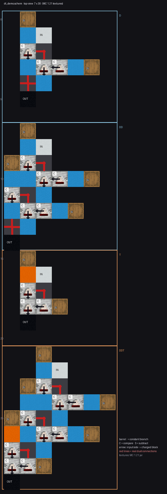

# D/T 嵌套函数：一元离散函数的函数谱

状态: 待验
可信度: 精确枚举（深度 1~3 完整穷举，可重跑）；深度 4 为保留结果表（生成程序未归档）
最后核实: 2026-10-31
适用: 红石比较器串成的一元链 $f:\{0,\dots,15\}\to\{0,\dots,15\}$；**不含** DT 矩阵、上传网、树形或并行拓扑

---

## 引言

比较器不只是“开关门”。把两个宏单元——**D**（两个比较器并联取大）和 **T**（两条被动支路进第三个比较器）——
**首尾串起来**，每串一个单元就得到一个新的一元函数：

$$x\in\{0,\dots,15\}\ \longrightarrow\ \boxed{D}\ \longrightarrow\ \boxed{T}\ \longrightarrow\ \dots\ \longrightarrow\ y$$

这一页只回答三个问题：这两个单元**各是什么**、**怎么串**、串到几层能生成**多少个不同的函数**。

### 先讲清四个词

**① 模拟函数**：一个 16 点输出序列，$x=0,1,\dots,15$ 各有一个 0~15 的读数。
例如 $D$ 取 $b=5$ 时得到的

$$f=(5,5,5,5,5,5,6,7,8,9,10,11,12,13,14,15)$$

读法：输入 0~5 都输出 5，输入 $x\ge6$ 输出 $x$——也就是 $\max(5,x)$。**这是一条“函数”，不是一次读数。**

**② 二值函数**：在模拟函数末端再加一次阈值读出（$>k$ 或 $\le k$），把输出压成 0/1。
上面对 $k=7$ 取 $>7$：

$$(0,0,0,0,0,0,0,0,\;1,1,1,1,1,1,1,1)$$

**一个模拟函数配上 32 种阈值读出，最多能给出 32 个二值函数**——这就是为什么“二值函数数”
通常比“模拟函数数”少得多却又能覆盖很多：它们是从同一批模拟函数上“切”下来的。

**③ 反转次数**：这个 0/1 序列里，**相邻两格发生几次 0↔1 变化**。

| 序列 | 反转次数 | 说明 |
|---|---:|---|
| `0000000000000000` | 0 | 全 0（全 1 同理，共 $2\binom{15}{0}=2$ 个） |
| `0000000011111111` | **1** | 只有中间断一次（$2\binom{15}{1}=30$ 个） |
| `0000111100001111` | 3 | 断了三次 |
| `0101010101010101` | 15 | 每格都断（$2\binom{15}{15}=2$ 个） |

恰好 $r$ 次反转的 16 位序列共有 $2\binom{15}{r}$ 个。

**④ $K_{full}$**：这个结构**能不能生成所有“反转次数 $\le K_{full}$”的二值序列**。
它是一把“覆盖到多乱”的尺子：

- $K_{full}=0$ 只说明能做出常 0 / 常 1；
- $K_{full}=2$ 能做出“最多断两次”的全部序列（$2+30+210=242$ 个）；
- 数值越大，说明它能生成的形状越“碎”。

$$\boxed{\ K_{full}\ \text{高} \ne\ \text{“更强”};\ \text{它只说明能做出更碎的图案，是另一类能力}\ }$$

---

## 符号

| 符号 | 含义 |
|---|---|
| $X$ | $\{0,1,\dots,15\}$，比较器的信号范围 |
| $u$ | 比较器的后侧主输入 |
| $l,\ r$ | 两个侧输入 |
| $a,\ b$ | 固定的侧输入（常数参数），$a,b\in X$ |
| $f$ | 一元函数 $X\to X$，用 16 点输出序列表示 |
| $d$ | 深度：串联了几个单元 |
| $R_{>k},\ R_{\le k}$ | 末端阈值读出：$\mathbf 1[y>k]$、$\mathbf 1[y\le k]$，$k=0,\dots,15$ |
| $r$ | 二值序列的**反转次数**（相邻输入上 0/1 变化的次数） |
| $K_{full}$ | 该结构**完整覆盖**了所有反转次数 $\le K_{full}$ 的二值序列 |

结构名**按信号实际经过的顺序**书写：`DT` 表示 $T\circ D$，`DDT` 表示 $T(D(D(x)))$。

---

## 一、四个基础函数

变量从哪里进，决定了它是“被动”还是“主动”。

**被动式**（变量走侧输入，主输入固定为 $a$）：

$$c(x;a)=\begin{cases}a,&x\le a\\0,&x>a\end{cases}\qquad
s(x;a)=\max(0,\ a-x)$$

**主动式**（变量走主输入，侧输入固定为 $a$）：

$$C(x;a)=x\,[x\ge a]\qquad
S(x;a)=\max(0,\ x-a)$$

即 $C$ 是“够门槛就原样放行”，$S$ 是“超出部分才放行”；$c$、$s$ 是它们在侧输入端的对偶。

---

## 二、D：两个比较器并联，取最大

$$\boxed{\ D_{p,A;\,a,b}(x)=\max\bigl(p(x;a),\ A(x;b)\bigr)\ },\qquad
p\in\{c,s\},\ A\in\{C,S\}$$

$$\text{参数组数}=2\times2\times16^2=1024\quad\longrightarrow\quad
\text{去重后}\ \mathbf{739}\ \text{个不同函数}$$

四个子型的函数谱并不对称：

| 子型 | 模拟函数 | 阈值后二值 | 含恒等 | 含恒零 |
|---|---:|---:|:---:|:---:|
| $D(C,c)$ | 121 | 214 | 是 | 否 |
| $D(S,c)$ | 241 | 214 | 是 | 是 |
| $D(C,s)$ | 184 | 242 | 是 | 否 |
| $D(S,s)$ | 256 | 242 | 是 | 是 |

$$\boxed{\ D\ \text{能实现恒等}:\ \ D(x)=\max\bigl(c(x;0),\,C(x;0)\bigr)=x\ }$$

---

## 三、T：两条被动支路进第三个主动比较器

$$\boxed{\ T_{A,p,q;\,a,b}(x)=A\bigl(p(x;a),\ q(x;b)\bigr)\ }$$

这里有两种口径，**别混**：

| 口径 | 约束 | 参数组 | 去重后 |
|---|---|---:|---:|
| **异模式 T** | $\{p,q\}=\{c,s\}$（一被动一主动，必一为 $c$ 一为 $s$） | 1024 | **409** |
| **全状态 T** | $p,q\in\{c,s\}$ 独立选 | 2048 | **618** |

八个子型：

| 子型         |  模拟 |  二值 |  含恒等  | 含恒零 |
| ---------- | --: | --: | :---: | :-: |
| $T(C,c,c)$ |  16 |  30 |   否   |  是  |
| $T(S,c,c)$ | 121 | 212 |   否   |  是  |
| $T(C,c,s)$ |  72 | 142 |   否   |  是  |
| $T(S,c,s)$ | 185 | 242 | **是** |  是  |
| $T(C,s,c)$ |  79 | 214 |   否   |  是  |
| $T(S,s,c)$ | 107 | 116 |   否   |  是  |
| $T(C,s,s)$ |  16 |  32 |   否   |  是  |
| $T(S,s,s)$ | 121 |  32 |   否   |  是  |

$$\boxed{\ T\ \text{也能实现恒等}:\ \ T(x)=S\bigl(c(x;15),\,s(x;15)\bigr)=x\ }$$

**这条性质很关键**：既然 D 和 T 都能当恒等单元，那么**加深一层至少能保住原来的函数**——
函数集随深度单调不减，不会越串越少。

---

## 四、能生成多少个函数（深度 1~3，精确枚举）

“不同函数”指把 16 点输出序列 $(f(0),\dots,f(15))$ 完全相同的只算一个。

| 深度 | 结构 | 模拟函数 | 二值函数 | $K_{full}$ | 最大反转 |
|---:|---|---:|---:|---:|---:|
| 1 | `D` | 739 | 242 | 2 | 2 |
| 1 | `T` | 409 | 508 | 2 | 3 |
| 2 | `DD` | 154 884 | 2 230 | 3 | 4 |
| 2 | `DT` | 117 207 | 6 152 | 4 | 6 |
| 2 | `TD` | 72 023 | 1 538 | 2 | 4 |
| 2 | `TT` | 57 335 | 4 360 | 2 | 7 |
| 3 | `DDD` | 17 710 970 | 13 312 | 4 | 8 |
| 3 | `DDT` | 10 099 840 | **32 088** | **5** | 12 |
| 3 | `DTD` | 10 475 382 | 15 844 | 4 | 8 |
| 3 | `DTT` | 6 963 264 | **32 338** | **5** | 14 |
| 3 | `TDD` | 6 295 283 | 8 538 | 4 | 8 |
| 3 | `TDT` | 3 917 844 | 20 702 | 4 | 12 |
| 3 | `TTD` | 3 311 134 | 7 450 | 2 | 8 |
| 3 | `TTT` | 2 545 754 | 20 914 | 3 | 13 |

三件能直接读出来的事：

1. **顺序真的重要**。同为两个单元，`DT` 有 6 152 个二值函数，`TD` 只有 1 538——**少了 4 倍**。
   名字的顺序就是信号的顺序，不能互换。
2. **三层的“最强”不是 DDD**。`DDD` 模拟函数最多（1771 万），但二值只有 13 312；
   第一梯队是 `DDT` 与 `DTT`（各约 3.2 万、$K_{full}=5$）。
3. **三层八结构的二值并集是 37 932 / 65 536**（约 58%），并集的 $K_{full}=5$。

---

## 五、两个饱和速度完全不同

把各深度的**并集**（所有结构合起来）数出来：

$$\text{二值}:\ 508\ \to\ 7\,044\ \to\ 37\,932\ \to\ 65\,100\quad(\text{第 4 层达 }99.33\%)$$

$$\text{单调模拟}:\ 73\ \to\ 13\,997\ \to\ 291\,730\ \to\ 2\,971\,964\quad(\text{第 4 层仅 }0.989\%)$$

（完整的单调不减函数空间是 $\binom{31}{16}=300\,540\,195$。）

$$\boxed{\ \text{二值函数在四层附近饱和；模拟函数远未饱和}\ }$$

**所以绝对不能说“二值四层够了，模拟四层也够了”。** 这两条增长曲线的量级差着三个数量级，
把它们混为一谈是这类设计里最常见的错。

补充一条：`DDTT` 这类四层结构的 $K_{full}=8$，能覆盖到更高反转数的部分函数——
但并集到 65 100 之后，**再加一元边深度的边际收益已经很小**（二值路线而言）。

---

## 六、包含关系：二值可以剪，模拟不能照搬

三层结构之间，二值函数集合有**严格的包含关系**：

$$\texttt{DDD}\subset\texttt{DDT},\quad \texttt{DTD}\subset\texttt{DDT},\quad \texttt{DTD}\subset\texttt{DTT},\quad
\texttt{TDD}\subset\texttt{TDT},\quad \texttt{TTD}\subset\texttt{TDT},\quad \texttt{TTD}\subset\texttt{TTT}$$

对应的“独占”函数数（只有它自己有的）：

| 结构 | `DDD` | `DDT` | `DTD` | `DTT` | `TDD` | `TDT` | `TTD` | `TTT` |
|---|---:|---:|---:|---:|---:|---:|---:|---:|
| 独占二值 | 0 | 2 572 | 0 | 2 804 | 0 | 644 | 0 | 772 |

**但模拟函数集合没有发现这样的整集合包含。** 换句话说：

$$\boxed{\ \text{做二值网络时，可以放心把弱结构剪掉；做模拟中间层时，不能照搬这个剪法}\ }$$

原因不难理解：二值只看末端一次阈值，弱的形状被阈值抹平了；模拟要把中间值原样传下去，
少一个结构就真少一批函数。

---

## 七、输出值域会改变“最佳嵌套”

同一个深度，如果限制输出只能落在某个窄区间，最佳顺序会变。
系统测过宽度为 4 的全部 13 个窗口后，`0~3` 这个窗口对结构化函数（单调、峰形、连续）
有**断层式**的优势，而 `6~9`、`4~11` 的最佳顺序各不相同。

由此得到的设计顺序（不是反过来）：

1. 先定**这一边的输出要多宽**（二值 / 4 级 / 更宽的模拟）；
2. 再定**目标函数族长什么样**（单调 / 峰形 / 一般波形）；
3. 最后才选 D/T 的顺序与 T 的模式空间。

$$\text{不要先固定 `DDDD` 之类的宏序列，再让训练去适应它。}$$

---

## 八、实物：一个 schem 里的四个结构

理论上的 D/T 长什么样，可以看一份真机方块表（`dt_demo.schem`，7×1×30，一层平铺，
四段依次是 **D / DD / T / DDT**）。淡蓝混凝土是 D 的结构，橙色是 T 的；每段各有一个
白块（**输入端**，从上往下注入 $x$）和一个黑块（**输出端**，读它的充能）。

*俯视图，方块贴的是 **MC 1.21 的真实材质**（从游戏 jar 里取的）。读图要点：*

- **木桶**（木纹方块）= 常数支路，桶里放多少东西决定它给多少信号；
- **比较器**（灰白方块，左上角标 `C`/`S`）= 比较模式（本图全是 `C`）。**短尾在输入端（`facing` 那一侧），
  长箭头指向“它去充能的那一格”**——也就是输出。所以箭头方向 = 信号流向；
- **红石粉**（红线）= 按方块状态里的 `east/west/north/south` **逐边**画的，画成 L 形还是十字形，
  就是它在游戏里的实际连接形状；
- `IN` / `OUT` = 白/黑混凝土：白块是注入端，黑块是读数端。

用模拟器（把三期那份比较器模拟器加上了红石粉）跑一遍，各段的行为：

**单 D**：一个支路读木桶常数 $b$、经被动比较器变成 $c(x;b)$，另一支路是 $S(x;a)$，两者取大。

| $b$ | $a$ | $x=0,1,\dots,15$ 的输出 | 读出来是 |
|---:|---:|---|---|
| 0 | 0 | 0,1,2,…,15 | 恒等 |
| 5 | 0 | 5,5,5,5,5,5,6,…,15 | $\max(5,x)$ |
| 0 | 5 | 0,0,0,0,0,5,6,…,15 | $x\,[x\ge5]$ |
| 10 | 0 | 10,…,10,11,…,15 | $\max(10,x)$ |

$$\boxed{\ \text{D 的两个支路各管一半：一个给“地板”，一个给“门槛”——输出是两者的较大者}\ }$$

**单 T**：三个比较器串成“被动支路 → 主动比较器，再把另一支路灌进它的侧输入”。

| $b$ | $a$ | 输出 | 读出来是 |
|---:|---:|---|---|
| 10 | 5 | 10 次（$x\le10$），然后 0 | 阈值门：$b\cdot[x\le b]$ |
| 5 | 10 | 全 0 | 侧支路比它大，整段关掉 |
| 5 | 0 | 5 次，然后 0 | 同上但门槛是 5 |

$$\boxed{\ \text{T 是“拿一个常数去和信号比”：过门槛就整段放行，不过就归零}\ }$$

**DD 与 DDT**：把同样的常数灌给所有桶时，$\text{DD}$ 与 $\text{D}$ 输出**完全一样**（$\max$ 是幂等的），
`DDT` 又与 `T` 一样（$\text{DD}$ 没改变信号，后面的 T 照常工作）——

$$\text{常数全相同时：}\ \text{DD}=\text{D},\qquad \text{DDT}=\text{T}$$

**这正是“嵌套要看参数”的实物版**：只有当各段的桶取不同值时，多一层才真的多出形状。
函数谱那一节说“深度增加会扩大函数集”，指的就是**遍历所有参数**的情形。

> **建模说明（诚实交代）**：这份模拟器是三期 `cmp_sim` 的改造版，加了红石粉（三期那版没有粉），
> 规则写在 `_calc/dt_sim.py` 顶部。两处简化：① 导体块的充能只认“指向它的比较器”，
> 不模拟弱充能；② 只有**读数点（黑块）**接受相邻红石粉的充能，其余方块不接，以避免
> “粉↔方块”互喂的循环。这两条不影响上面四段的定性结论，但**定量读数不要当游戏实测**。

---

## 判据与反例

1. **D 不是加法，T 不是逻辑门。** 它们是 $\max$ 与主动比较器的复合；把 D/T 当“求和单元”会推错函数谱。
2. **`DT` 与 `TD` 不等价。** 6 152 vs 1 538，差 4 倍。名字顺序 = 信号顺序，写反了结论全错。
3. **深度不是越深越强。** 三层里 `DDD` 的二值只有 13 312，`DTD` 只有 15 844 且 $K_{full}=4$；
   第一梯队是 `DDT`/`DTT`。
4. **二值饱和 ≠ 模拟饱和。** 四层到 99.33% 的是二值；模拟四层只有 0.989%。
5. **全状态 T 到深度 3 并没有扩大二值并集。** 它主要增加**模拟**函数（只在 `TDT`、`TTD` 各多几百个二值）；
   想省结构时，异模式 T 够用。
6. **$K_{full}$ 高不等于“更强”。** 反转次数 $r$ 的 16 位序列恰好有 $2\binom{15}{r}$ 个，
   覆盖高 $r$ 意味着能生成“更碎”的函数——那是另一类能力，不是同一把尺子上的进步。

---

## 遗留

- **深度 4 的精确函数谱没有可重跑的生成程序**（只有保留的结果表，证据等级 B）。
  要引用四层的精确数字，先重建那段枚举。
- **`0~3` 窗口在深度 3 的精确谱只做过采样**，没做完整穷举；`DDT`/`DTD` 在该值域下的精确覆盖仍是空的。
- **宽度 2、3、5、6 的窗口没系统测**，“`0~3` 特殊”到底是“含 0”还是“宽度恰为 4”没分开。
- **深度与成本的关系不在本页**：本页只谈函数谱，一串结构要多少方块属于编译层的事。

---

## 来源

基础函数、D/T 的定义与子型表、深度 1~3 的精确计数、包含关系、饱和曲线与 `0~3` 窗口的结论，
均取自零期的两份调研（多比较器结构的数学性质调研 v2、深度 1~3 嵌套枚举报告）；
它们本身就是代码级穷举（证据等级 A），本页只做组织与取舍。
