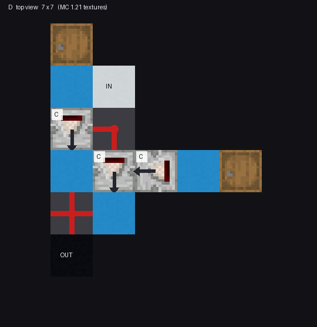
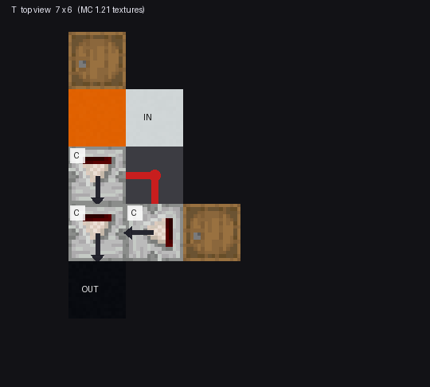
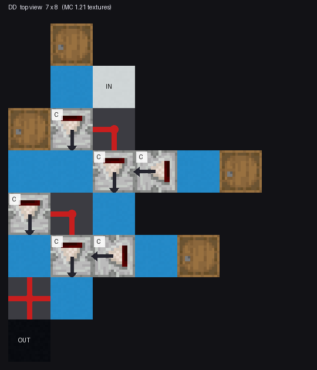
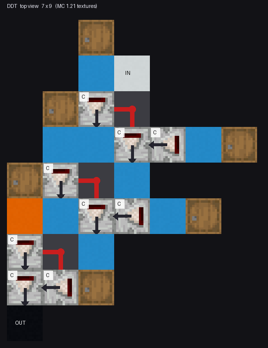

# D/T 嵌套函数：一元离散函数的函数谱

状态: 定案
可信度: 精确枚举（深度 1~3 完整穷举，可重跑）；深度 4 为保留结果表（生成程序未归档）
最后核实: 2026-10-31 · czm 批准定案
适用: 红石比较器串成的一元链 $f:\{0,\dots,15\}\to\{0,\dots,15\}$；**不含** DT 矩阵、上传网、树形或并行拓扑

---

## 引言

比较器不只是“开关门”。比较器对模电信号的处理似乎仅限于减法和各种截断，但是把多个比较器组合到一起之后会得到很丰富的输入到输出的模拟信号函数变换关系。把两个宏单元——**D**（两个比较器并联取大）和 **T**（两条被动支路进第三个比较器）——**首尾串起来**，每串一个单元就得到一个新的一元函数：

$$x\in\{0,\dots,15\}\ \longrightarrow\ \boxed{D}\ \longrightarrow\ \boxed{T}\ \longrightarrow\ \dots\ \longrightarrow\ y$$

这一页只回答三个问题：这两个单元**各是什么**、**怎么串**、串到几层能生成**多少个不同的函数**。

### 先讲清四个词

**① 模拟函数**：一个从0~15映射到0~15的整数函数，或称一个 16 点输出序列，$x=0,1,\dots,15$ 各有一个 0~15 的读数。
例如 $D$ 取 $b=5$ 时得到的

$$f=(5,5,5,5,5,5,6,7,8,9,10,11,12,13,14,15)$$

读法：输入 0~5 都输出 5，输入 $x\ge6$ 输出 $x$——也就是 $\max(5,x)$。**这是一条“函数”，不是一次读数。**

**② 二值函数**：在模拟函数末端再加一次阈值读出（$>k$ 或 $\le k$），把输出压成 0/1。
以 $k=7$ 为例，则是取 $>7$ 的输出置 1，其他置 0：

$$(0,0,0,0,0,0,0,0,\;1,1,1,1,1,1,1,1)$$

**一个模拟函数配上 32 种阈值读出，最多能给出 32 个二值函数**——这就是为什么“二值函数数”
通常比“模拟函数数”少得多却又能覆盖很多：它们是从同一批模拟函数上“切”下来的。

**③ 反转次数**：这个 0/1 序列里，**相邻两格发生几次 0↔1 变化**。

| 序列 | 反转次数 | 说明 |
|---|---:|---|
| `0000000000000000` | 0 | 全 0（全 1 同理，共 $2\binom{15}{0}=2$ 个） |
| `0000000011111111` | **1** | 只有中间断一次（$2\binom{15}{1}=30$ 个） |
| `0000111100001111` | 3 | 断了三次 |
| `0101010101010101` | 15 | 每格都断（$2\binom{15}{15}=2$ 个） |

恰好 $r$ 次反转的 16 位序列共有 $2\binom{15}{r}$ 个。

**④ $K_{full}$**：这个结构**能不能生成所有“反转次数 $\le K_{full}$”的二值序列**。
它是一把“覆盖到多乱”的尺子：

- $K_{full}=0$ 只说明能做出常 0 / 常 1；
- $K_{full}=2$ 能做出“最多断两次”的全部序列（$2+30+210=242$ 个）；
- 数值越大，说明它能生成的形状越“碎”。

$$\boxed{\ K_{full}\ \text{高} \ne\ \text{“更强”};\ \text{它只说明能做出更碎的图案，是另一类能力}\ }$$

---

## 符号

| 符号         | 含义                                                   |
| ---------- | ---------------------------------------------------- |
| $x$        | 输入，取值 $0,1,\dots,15$                                 |
| $y$        | 输出，取值 $0,1,\dots,15$                                 |
| $c,\ s$    | **被动**式基础函数（变量走侧输入）                                  |
| $C,\ S$    | **主动**式基础函数（变量走主输入）                                  |
| $a,\ b$    | 常数参数：固定侧输入的强度，或读数支路取的那个值                             |
| $f$        | 一元函数，用 16 点序列 $\bigl(f(0),f(1),\dots,f(15)\bigr)$ 表示 |
| $r$        | 二值序列的**反转次数**（相邻两格 0/1 变化的次数）                        |
| $K_{full}$ | 该结构**完整覆盖**了所有反转次数 $\le K_{full}$ 的二值序列              |

结构名**按信号实际经过的顺序**书写：`DT` 表示 $T\circ D$，`DDT` 表示 $T(D(D(x)))$。

---

## 一、四个基础函数

变量从哪里进，决定了它是“被动”还是“主动”。

**被动式**（变量走侧输入，主输入固定为 $a$）：

$$c(x;a)=\begin{cases}a,&x\le a\\0,&x>a\end{cases}\qquad
s(x;a)=\max(0,\ a-x)$$

**主动式**（变量走主输入，侧输入固定为 $a$）：

$$C(x;a)=x\,[x\ge a]\qquad
S(x;a)=\max(0,\ x-a)$$

即 $C$ 是“够门槛就原样放行”，$S$ 是“超出部分才放行”；$c$、$s$ 是它们在侧输入端的对偶。

这四个都是 $x\mapsto y$ 的映射，输入 $x$ 与输出 $y$ 都在 $0\sim15$ 里取值。

---

## 二、D：两个比较器并联，取最大

$$\boxed{\ D_{p,A;\,a,b}(x)=\max\bigl(p(x;a),\ A(x;b)\bigr)\ },\qquad
p\in\{c,s\},\ A\in\{C,S\}$$

$$\text{参数组数}=2\times2\times16^2=1024\quad\longrightarrow\quad
\text{去重后}\ \mathbf{739}\ \text{个不同函数}$$

四个子型的函数谱并不对称：

| 子型 | 模拟函数 | 阈值后二值 | 含恒等 | 含恒零 |
|---|---:|---:|:---:|:---:|
| $D(C,c)$ | 121 | 214 | 是 | 否 |
| $D(S,c)$ | 241 | 214 | 是 | 是 |
| $D(C,s)$ | 184 | 242 | 是 | 否 |
| $D(S,s)$ | 256 | 242 | 是 | 是 |

$$\boxed{\ D\ \text{能实现恒等}:\ \ D(x)=\max\bigl(c(x;0),\,C(x;0)\bigr)=x\ }$$

**实物长这样**（一份真机方块表的俯视图，贴的是 MC 1.21 的材质）：

*信号从 `IN`（白块）进来，经红石粉送到右边那个主动比较器；
左边木桶经被动比较器给出常数支路。两路的输出分别充到两块淡蓝混凝土上，
再由同一根红石粉**取大**——这就是 $\max$ 在红石里的实现。*

*怎么读图：木桶 = 常数支路；比较器左上角 `C` = 比较模式（`S` 是减法）；短尾在**输入端**，
长箭头指向**它去充能的那一格**；红线是红石粉，按方块状态逐边画的，L 形/十字形就是实际的连接形状。*

---

## 三、T：两条被动支路进第三个主动比较器

$$\boxed{\ T_{A,p,q;\,a,b}(x)=A\bigl(p(x;a),\ q(x;b)\bigr)\ }$$

$T$ 里有**三个**比较器。

| 角色 | 符号 | 两档 | 变量接在哪 |
|---|---|---|---|
| 第一条**被动**支路 | $p\in\{c,s\}$ | $c$ 比较 / $s$ 减法 | 侧输入 |
| 第二条**被动**支路 | $q\in\{c,s\}$ | $c$ 比较 / $s$ 减法 | 侧输入 |
| **主动**合成级 | $A\in\{C,S\}$ | $C$ 比较 / $S$ 减法 | 主输入（rear） |

**两条支路都是被动的**（变量都从侧输入进），区别只在用比较还是用减法。
把两档全放开，一共是 $2\times2\times2=\mathbf 8$ 种比较器模式组合——这就是参考资料里说的“三个比较器状态全部开放”。

两种口径的**唯一区别**，是限不限制 $p$ 与 $q$ 取同一个值：

| 口径 | 参考材料里的别名 | 约束 | 模式组合 | 参数组 | 去重后函数 |
|---|---|---|---:|---:|---:|
| **异模式 T** | Canonical-T | $\{p,q\}=\{c,s\}$：一条支路用 $c$、另一条用 $s$，**必须不同** | 4 | 1024 | **409** |
| **全状态 T** | Full-T | $p,q$ 各自独立，**可以相同** | 8 | 2048 | **618** |

$$\boxed{\ \text{异模式}\subset\text{全状态},\qquad 409\subset 618\ }$$

**这两者不是并列的两个方案，而是“子集 / 全集”**：异模式能做的每一个函数，全状态都能做；
全状态多出来的那 209 个，靠的是 $p=q$ 那几种被异模式排除掉的组合。

> **命名提醒**：零期的两份材料用了两套名字——调研报告叫“异模式 / 全状态”，枚举报告叫 “Canonical-T / Full-T”。
> 指的是同一对东西，读旧材料时别当成四样。

八个子型（即全状态的 8 种模式组合；异模式只占其中 4 个——$T(C,c,s)$、$T(S,c,s)$、$T(C,s,c)$、$T(S,s,c)$）：

| 子型         |  模拟 |  二值 |  含恒等  | 含恒零 |
| ---------- | --: | --: | :---: | :-: |
| $T(C,c,c)$ |  16 |  30 |   否   |  是  |
| $T(S,c,c)$ | 121 | 212 |   否   |  是  |
| $T(C,c,s)$ |  72 | 142 |   否   |  是  |
| $T(S,c,s)$ | 185 | 242 | **是** |  是  |
| $T(C,s,c)$ |  79 | 214 |   否   |  是  |
| $T(S,s,c)$ | 107 | 116 |   否   |  是  |
| $T(C,s,s)$ |  16 |  32 |   否   |  是  |
| $T(S,s,s)$ | 121 |  32 |   否   |  是  |

**注意“逐行相加 ≠ 去重总数”**：异模式那四行加起来是 $72+185+79+107=443$，去重后只有 **409**——不同子型会撞出相同的函数（某些参数下 $c$ 与 $s$ 都退化成常值）。上表的每一行单独去重，行与行之间没有。

$$\boxed{\ T\ \text{也能实现恒等}:\ \ T(x)=S\bigl(c(x;15),\,s(x;15)\bigr)=x\ }$$

**这条性质很关键**：既然 D 和 T 都能当恒等单元，那么**加深一层至少能保住原来的函数**——
函数集随深度单调不减，不会越串越少。

T 能做出多“弯”的形状？在 §八 有一个具体例子：**三次反转**。

**实物**：

*信号从 `IN` 进红石粉，落到中间那个比较器的侧输入；左侧木桶经橙色方块被比较器读成常数支路。
最后一级比较器把“被动支路”和“侧支路”合起来，输出充到黑块上。*

---

## 四、能生成多少个函数（深度 1~3，精确枚举）

先看一眼“串起来”在实物里长什么样——把 D 串两层、以及 D 后面再接一个 T：

*`DD`：两套 D 单元上下叠着，上单元的输出进入下单元。*

*`DDT`：前面两段是 D，最后一段接 T。*

“不同函数”指把 16 点输出序列 $(f(0),\dots,f(15))$ 完全相同的只算一个。

|  深度 | 结构    |       模拟函数 |       二值函数 | $K_{full}$ | 最大反转 |
| --: | ----- | ---------: | ---------: | ---------: | ---: |
|   1 | `D`   |        739 |        242 |          2 |    2 |
|   1 | `T`   |        409 |        508 |          2 |    3 |
|   2 | `DD`  |    154 884 |      2 230 |          3 |    4 |
|   2 | `DT`  |    117 207 |      6 152 |          4 |    6 |
|   2 | `TD`  |     72 023 |      1 538 |          2 |    4 |
|   2 | `TT`  |     57 335 |      4 360 |          2 |    7 |
|   3 | `DDD` | 17 710 970 |     13 312 |          4 |    8 |
|   3 | `DDT` | 10 099 840 | **32 088** |      **5** |   12 |
|   3 | `DTD` | 10 475 382 |     15 844 |          4 |    8 |
|   3 | `DTT` |  6 963 264 | **32 338** |      **5** |   14 |
|   3 | `TDD` |  6 295 283 |      8 538 |          4 |    8 |
|   3 | `TDT` |  3 917 844 |     20 702 |          4 |   12 |
|   3 | `TTD` |  3 311 134 |      7 450 |          2 |    8 |
|   3 | `TTT` |  2 545 754 |     20 914 |          3 |   13 |

三件能直接读出来的事：

1. **顺序真的重要**。同为两个单元，`DT` 有 6 152 个二值函数，`TD` 只有 1 538。
   名字的顺序就是信号的顺序，不能互换。
2. **最擅长处理模拟函数和二值函数的结构往往不同**。`DDD` 模拟函数最多（1771 万），但二值只有 13 312；
   第一梯队是 `DDT` 与 `DTT`（各约 3.2 万、$K_{full}=5$）。
3. **三层八结构的二值并集是 37 932 / 65 536**（约 58%），并集的 $K_{full}=5$。

---

## 五、两个饱和速度完全不同

把各深度的**并集**（所有结构合起来）数出来：

$$\text{二值}:\ 508\ \to\ 7\,044\ \to\ 37\,932\ \to\ 65\,100\quad(\text{第 4 层达 }99.33\%)$$

$$\text{单调模拟}:\ 73\ \to\ 13\,997\ \to\ 291\,730\ \to\ 2\,971\,964\quad(\text{第 4 层仅 }0.989\%)$$

（完整的单调不减函数空间是 $\binom{31}{16}=300\,540\,195$。）

$$\boxed{\ \text{二值函数在四层附近饱和；模拟函数远未饱和}\ }$$

**所以绝对不能说“二值四层够了，模拟四层也够了”。** 这两条增长曲线的量级差着三个数量级，
把它们混为一谈是这类设计里最常见的错。

补充一条：`DDTT` 这类四层结构的 $K_{full}=8$，能覆盖到更高反转数的部分函数——
但并集到 65 100 之后，**再加一元边深度的边际收益已经很小**（二值路线而言）。

---

## 六、包含关系：二值可以剪，模拟不能照搬

### 6.1 先把“$\subset$”说清楚

写 $S_1\subset S_2$ 的意思是：**$S_1$ 能生成的每一个二值函数，$S_2$ 都能生成。**
（只对**二值**函数集成立，模拟函数集不享受这个记号，见 6.4。）

对外部读者的实际含义是：**只要你手里有一个 $S_2$，你就不需要 $S_1$ 了**——
$S_1$ 的硬件可以整段省掉，不会少任何一个函数。

### 6.2 三层结构之间的完整包含表

$$\texttt{DDD}\subset\texttt{DDT},\qquad
\texttt{DTD}\subset\texttt{DDT},\qquad
\texttt{DTD}\subset\texttt{DTT}$$

$$\texttt{TDD}\subset\texttt{TDT},\qquad
\texttt{TTD}\subset\texttt{TDT},\qquad
\texttt{TTD}\subset\texttt{TTT}$$

注意两件容易被忽略的事：

- **`DTD` 被两个结构同时包含**（`DDT` 和 `DTT`），它是三层里最“可替代”的一个；
- 反过来看，`DDT`、`DTT`、`TDT`、`TTT` **不被任何同深度结构包含**。

### 6.3 于是只有四个结构是不可替代的

把“只有它自己才有的二值函数”数出来：

| 结构 | `DDD` | `DDT` | `DTD` | `DTT` | `TDD` | `TDT` | `TTD` | `TTT` |
|---|---:|---:|---:|---:|---:|---:|---:|---:|
| 独占二值 | **0** | 2 572 | **0** | 2 804 | **0** | 644 | **0** | 772 |

四个“独占 0”的（`DDD`、`DTD`、`TDD`、`TTD`）意味着：

$$\boxed{\ \text{三层八结构里，只要保留 }\texttt{DDT},\texttt{DTT},\texttt{TDT},\texttt{TTT}\text{ 四个，并集一个函数都不少}\ }$$

三层并集 37 932 个二值函数，就是这四个结构撑起来的。

### 6.4 怎么用这条结论（三步）

1. **先确定要的是二值还是模拟。** 只有二值能剪；模拟输出（要把中间值原样传下去）**不能**按这张表剪——
   模拟函数集合之间没有发现任何整集合包含（见 6.5）。
2. **看目标函数有多碎。** 数一数它需要几次反转 $r$。四个不可替代结构的 $K_{full}$ 是
   `DDT`/`DTT` 为 5、`TDT` 为 4、`TTT` 为 3。若 $r\le3$，`TTT` 就够；$r\le4$ 用 `TDT`；
   要 5 就得 `DDT` 或 `DTT`。
3. **按“最浅 + 被包含最少”选型。** 能用两层的就别上三层；必须三层时，优先 `DDT`/`DTT`
   （它们同时把 `DDD`、`DTD` 那一片都盖住了）。

### 6.5 为什么模拟不能照搬

二值只看**末端一次阈值**，弱的形状被阈值抹平了，所以集合之间会互相吞并；
模拟要把中间值原样传给下一层，少一个结构就真少一批函数——穷举里没有出现任何整集合包含。

$$\boxed{\ \text{剪枝规则只对二值成立。把它套到模拟中间层上，会悄悄丢掉一整片函数}\ }$$

---

## 七、输出值域会改变“最佳嵌套”

同一个深度，如果限制输出只能落在某个窄区间，最佳顺序会变。不只是二值和模拟的分别会改变最有能力的嵌套组合。我们也可以对模拟函数加一些限制，比如把值域限制在 0~3、1~4……这样宽度为 4 的窗口上。系统测过宽度为 4 的全部 13 个窗口后，`0~3` 这个窗口对结构化函数（单调、峰形、连续）有**断层式**的优势，而 `6~9`、`4~11` 的最佳顺序各不相同。我们也可以对函数类型进行限制，比如只需生成单调不减的函数等。

由此得到的设计顺序（不是反过来）：

1. 先定**这一边的输出要多宽**（二值 / 4 级 / 更宽的模拟）；
2. 再定**目标函数族长什么样**（单调 / 峰形 / 一般波形）；
3. 最后才选 D/T 的顺序与 T 的模式空间。

不过在实践中，如果要堆叠DT嵌套函数结构，堆叠中的单元往往做不到因地制宜。也就是说，在一个整体堆叠中，每个输入和每个输出之间经过的函数一经选定就不能更改。比如，如果根据二值输出的条件确定`DDT`作为结构，那么在堆叠后，不能再有任何的单个输入到输出的关系不是它，此时`DTT`等结构的独特优势就必然要被舍弃。

---

## 八、实物：四个结构的行为

结构图已在 §二（D）、§三（T）、§四（DD、DDT）里给出，这里只把**跑出来的行为**列出来。

用模拟器跑一遍，各段的行为：

**单 D**：一个支路读木桶常数 $b$、经被动比较器变成 $c(x;b)$，另一支路是 $S(x;a)$，两者取大。

| $b$ | $a$ | $x=0,1,\dots,15$ 的输出 | 读出来是 |
|---:|---:|---|---|
| 0 | 0 | 0,1,2,…,15 | 恒等 |
| 5 | 0 | 5,5,5,5,5,5,6,…,15 | $\max(5,x)$ |
| 0 | 5 | 0,0,0,0,0,5,6,…,15 | $x\,[x\ge5]$ |
| 10 | 0 | 10,…,10,11,…,15 | $\max(10,x)$ |

$$\boxed{\ \text{D 的两个支路各管一半：一个给“地板”，一个给“门槛”——输出是两者的较大者}\ }$$

**单 T**：三个比较器默认都是比较模式时，它只能得到阈值门形状：

| $b$ | $a$ | 输出 | 读出来是 |
|---:|---:|---|---|
| 10 | 5 | 10 次（$x\le10$），然后 0 | 阈值门：$b\cdot[x\le b]$ |
| 5 | 10 | 全 0 | 侧支路比它大，整段关掉 |

**但把三个比较器的模式调一下，同一个 T 就能做出三次反转。** 取

| 位置                            | 改成       | 木桶                  |
| ----------------------------- | -------- | ------------------- |
| `(1,0,17)`（rear 读木桶、侧输入读 $x$） | **减法 S** | $b=7$（桶 `(1,0,15)`） |
| `(2,0,18)`（rear 读木桶、输出进上者侧输入） | 比较 C     | $a=4$（桶 `(3,0,18)`） |
| `(1,0,18)`（合成级）               | 比较 C     | —                   |

输出序列是

$$f=(7,6,5,4,\;\mathbf 0,\;2,1,0,0,0,0,0,0,0,0,0)$$

读法：$x\le3$ 时第一级 $S$ 给出 $7,6,5,4$，比侧输入的 4 不小，原样放行；到 $x=4$ 时第一级已降到 3，
**被侧输入那一路压过去，整段归零**；$x=5,6$ 侧输入掉回 0，第一级剩下的 $2,1$ 又露出来——
曲线**先降、见底、再起一下**。

**注意这里换了口径**：数“有几个弯”用的是**二值化输出**，即末端再取一次 $>0$：

$$\mathbf 1[y>0]=\texttt{1111\,0110\,0000\,0000}\quad\Longrightarrow\quad r=3$$

从前往后数：$1\to0$ 一次、$0\to1$ 一次、$1\to0$ 一次。

对照 §四 的表：`T` 在深度 1 的**最大反转就是 3**，而 $K_{full}$ 只有 2。两者差的正是
“能不能把 3 次反转的**全部**序列都做出来”：

$$\text{能做}\ \exists\,r=3\quad\ne\quad\text{能覆盖}\ \forall\,r\le3$$

**$K_{full}$ 是“全覆盖”的尺子，最大反转是“够得着多高”的尺子**——两个都得看。

> 对照 §三 的八种子型：这组参数正落在 **$T(C,s,c)$** 那一格——第一级接成 $s$（变量在侧输入、减法模式），
> 第二级接成 $c$（变量在侧输入、比较模式），合成为 $C$。所以它本来就算在那 79 个模拟 / 214 个二值函数里，
> 不是额外的新能力。**模式也是参数**：只调木桶不动模式，得到的永远是一族单调形状。

**DD 与 DDT**：把同样的常数灌给所有桶时，$\text{DD}$ 与 $\text{D}$ 输出**完全一样**（$\max$ 是幂等的），
`DDT` 又与 `T` 一样（$\text{DD}$ 没改变信号，后面的 T 照常工作）——

$$\text{常数全相同时：}\ \text{DD}=\text{D},\qquad \text{DDT}=\text{T}$$

**这正是“嵌套要看参数”的实物版**：只有当各段的桶取不同值时，多一层才真的多出形状。
函数谱那一节说“深度增加会扩大函数集”，指的就是**遍历所有参数**的情形。

---

## 判据与反例

1. **D 不是加法，T 不是逻辑门。** 它们是 $\max$ 与主动比较器的复合；把 D/T 当“求和单元”会推错函数谱。
2. **`DT` 与 `TD` 不等价。** 6 152 vs 1 538。名字顺序 = 信号顺序，写反了结论全错。
3. **二值饱和 ≠ 模拟饱和。** 四层到 99.33% 的是二值；模拟四层只有 0.989%。
4. **全状态 T 到深度 3 并没有扩大二值并集。** 它主要增加**模拟**函数（只在 `TDT`、`TTD` 各多几百个二值）；想省结构时，异模式 T 够用。
5. **$K_{full}$ 高不等于“更强”。** 反转次数 $r$ 的 16 位序列恰好有 $2\binom{15}{r}$ 个，
   覆盖高 $r$ 意味着能生成“更碎”的函数——那是另一类能力，不是同一把尺子上的进步。
6. **异模式不是“另一种方案”，它是全状态的子集。** 409 与 618 是“子集 / 全集”，不能并列比较；
   两套旧名字（异模式/全状态、Canonical-T/Full-T）说的是同一对东西。
7. **不要把子型的行相加当总数。** 异模式四行 443，去重 409；全状态八行合计 717，去重 618。
   行内去重、行间不去重，任何跨行求和都要重新去重一遍。

---

## 遗留

- **深度 4 的精确函数谱没有可重跑的生成程序**（只有保留的结果表）。要引用四层的精确数字，先重建那段枚举。
- **`0~3` 窗口在深度 3 的精确谱只做过采样**，没做完整穷举；`DDT`/`DTD` 在该值域下的精确覆盖仍是空的。
- **宽度 2、3、5、6 的窗口没系统测**，“`0~3` 特殊”到底是“含 0”还是“宽度恰为 4”没分开。
- **深度与成本的关系不在本页**：本页只谈函数谱，一串结构要多少方块属于编译层的事。
- 当要求生成限定条件不同的模拟函数子集时，各个嵌套组合的能力都需要重新测试。

---

## 来源

基础函数、D/T 的定义与子型表、深度 1~3 的精确计数、包含关系、饱和曲线与 `0~3` 窗口的结论，
均取自零期的两份调研（多比较器结构的数学性质调研 v2、深度 1~3 嵌套枚举报告）；
它们本身就是代码级穷举，本页只做组织与取舍。
