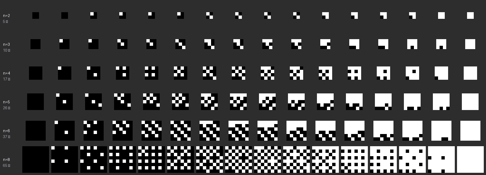
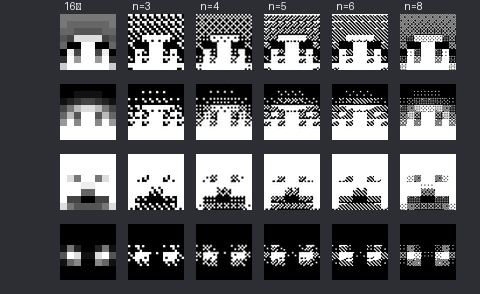
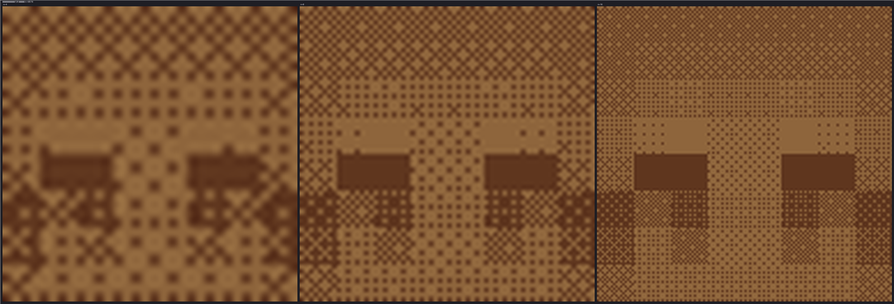
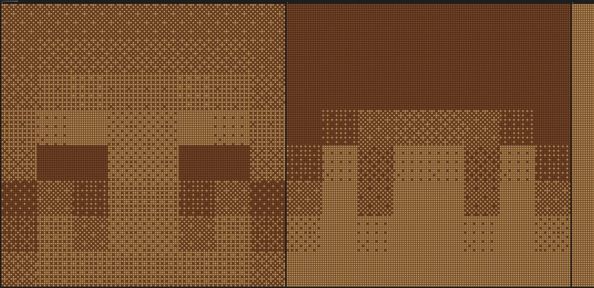
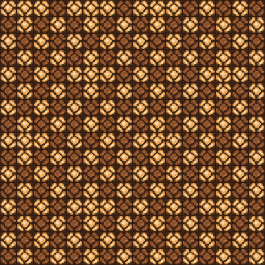
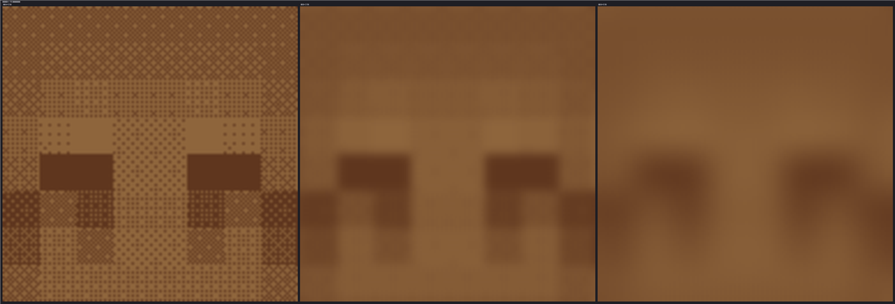

# 单色屏上的灰度：用亮/灭近似 16 级

状态: 定案
可信度: 数值计算 + 材质实测（亮度取自真实贴图）
最后核实: 2026-10-31
适用: 只有亮/灭两态的显示元件（典型是红石灯）；目标是把一块 $n\times n$ 的区域读成**一个**灰度像素

---

## 引言

红石灯只有两种状态，可你想显示灰度。这两件事并不矛盾——**人眼在足够远处会对一小块区域做空间积分**，
只看到它的**平均亮度**。所以灰度的信息来源不是“每盏灯多亮”，而是“这一块里亮了几盏”。

这一页回答三个问题：**块要多大、图案怎么排、这个方案在哪里会崩**。
第三个问题的答案可能出乎意料：**瓶颈不是块的大小，而是灯的对比度。**

---

## 符号

| 符号 | 含义 | 取值 |
|---|---|---|
| $n$ | 一块的边长（灯数） | 整数 |
| $k$ | 这块里**亮着**的灯数 | $0\sim n^2$ |
| $L$ | 目标灰级 | $0\sim15$ |
| $\hat L$ | 实际做出来的等效灰级 | 实数 |
| $p$ | 相邻灯的间距（方块） | 通常 1 |
| $D$ | 观看距离（方块） | |
| $\rho$ | 对比度（亮/灭的亮度比） | |

---

## 一、只有“顺序抖动”能用

| 方法 | 原理 | 能不能用 |
|---|---|---|
| 半色调 | 点的大小可变、密度固定 | ✗ 灯没有“大小” |
| **顺序抖动** | 格子有固定等级，按等级点亮前 $k$ 个 | ✓ **同级的图案固定，静态可存** |
| 误差扩散（Floyd–Steinberg） | 逐像素依赖邻域 | ✗ 每个格子的图案取决于邻居，块内不能独立决定 |

顺序抖动里最经典的是 **Bayer 矩阵**：一个 $2^m\times2^m$ 的等级表，性质是“任意前 $k$ 个点在块里尽可能分散”，
所以图案最均匀，也最适合远看。

$$B_{4}=\begin{pmatrix}0&8&2&10\\12&4&14&6\\3&11&1&9\\15&7&13&5\end{pmatrix}$$

用法：把 $B_4$ 的 16 个值从小到大排成 rank 0~15，**前 $k$ 个 rank 对应的格子点亮**，其余熄灭。

*每行一个 $n$，16 列是 16 级灰度——**这就是“图案”长什么样**。$n=2$ 整行只有 5 种图案、
$n=3$ 只有 10 种；$n=4$ 起 16 种全不同，能看出 Bayer 的交叉纹理；再往下更细。*

---

## 二、块要多大：一条硬约束

一块 $n\times n$ 能亮 $0,1,\dots,n^2$ 盏，所以能做出 $n^2+1$ 种亮度：

$$\text{可表现级数}=n^2+1\ \ge 16\quad\Longrightarrow\quad\boxed{n\ge4}$$

| $n$ | 级数 | 够 16 级？ |
|---:|---:|:---:|
| 2 | 5 | ✗ |
| 3 | 10 | ✗ |
| **4** | **17** | **✓** |
| 8 | 65 | ✓ |
| 16 | 257 | ✓ |

$n=3$ 只有 10 级，硬要显示 16 级就必然出现**条带**（相邻两级被画成同一图案）。

*第一列是 16 级灰度参照，后面依次是 $n=3,4,5,6,8$ 的单色抖动。$n=3$ 的脸色已经断层，$n\ge4$ 结构正确。*

---

## 三、映射公式与误差

$$k=\mathrm{round}\!\left(\frac{L\,n^2}{15}\right),\qquad \hat L=\frac{15k}{n^2}$$

$$\text{最大级误差}\ \le\ \frac{15}{2n^2}$$

| $n$ | 上界 | 实测最大误差 |
|---:|---:|---:|
| 4 | 0.469 | **0.438** |
| 8 | 0.117 | 0.109 |
| 16 | 0.029 | **0.027** |

$n=4$ 的最大误差 0.438 **约等于半个灰级**——而 16 级显示器本身就有半级量化误差。
$$\boxed{\ n=4\ \text{的抖动误差已经和显示器的量化极限同量级，再做细也换不来精度}\ }$$

> 注意这句话只说**精度**。$n$ 继续变大仍会让画面更平滑——那是另一件事，见 §五。

> **16 到 17 不整除的必然结果**：$n=4$ 时有 17 个密度可挑，却只要 16 级，
> 于是某个 $k$ 会被跳过（$L=8$ 映射到 $k=9$，$k=8$ 不用）。
> 这不会让误差变大——它仍然是半级。

---

## 四、两种典型规模

| 用途 | 头像分辨率 | $n$ | 灯阵 | 灯数 |
|---|---|---:|---|---:|
| 小规模试做 | 8×8 | 4 | 32×32 | 1 024 |
| 满屏 | 128×128 像素 | 16 | 256×256 方块 | 16 384 |

$n$ 不是随便挑的：它等于“显示区边长 ÷ 头像格数”。所以**要么缩头像，要么扩屏**，
用 $n$ 去凑。

> **但“一盏灯一个像素”在实践中往往做不到。** 一种简单办法是**用 2×2 盏灯表示一个像素**：
> 灯阵的线性尺度翻倍、灯数翻两番（4 倍）。
> 若这 4 盏同开同关，则一格里的独立开关数仍是 $n^2$，**级精度不变**——
> 换来的是布线松、亮度足；要把级精度也一起提上去，才需要让它们独立控制（等效于 $n$ 翻倍）。

---

## 五、短板一：抖动的格子 = 头像的格子

印刷里的半色调，网点**远小于**图像细节，眼睛积分掉网点时细节还在。这里两者**同尺度**：

$$\text{眼睛积分掉抖动}\ \Longrightarrow\ \text{同时把头像糊掉约一格}$$

**这与 $n$ 无关，是这个方案的固有代价。** 说法上必须讲清楚，否则用户会以为是实现没调好。

不过 $n$ 大能**缓解**它——而且这件事与“级精度”是两条线，别混：

| | 随 $n$ 怎么变 | 什么时候够用 |
|---|---|---|
| **级精度** | $\propto1/n^2$ | $n=4$ 就封顶（0.438，已是半级） |
| **平滑度** | $\propto n$：图案周期更长、每个尺度上都更均匀 | 一直变好，$n=16$ 明显更细 |

$$\boxed{\ n=4\ \text{买的是“够用”，}\ n=16\ \text{买的是“好看”}\ }$$

级精度在 $n=4$ 之后**基本不再增长**，但观感还在涨——这是两回事。
$n$ 越大，Bayer 图案在每个尺度上都更局部均匀，所以**很小的模糊就足以把抖动抹平**，
人像还没被糊掉：

| 模糊宽度 | 观感（$n=16$ 的 128×128 屏） |
|---|---|
| 0.5 灯 | 人脸清楚，抖动纹理明显 |
| **2 灯** | **抖动基本消失，人脸仍清楚 ← 甜点** |
| 6 灯 | 人脸也糊了 |

$$\boxed{\ \text{大 }n\text{ 把“平均掉抖动”与“保住人像”这两件事解耦}\ }$$

*同一张头像、同样宽度，依次 $n=4,\ 8,\ 16$。最左斑块粗大、几乎盖过人脸；最右细到接近纹理级别——**这就是“级精度封顶了但 $n=16$ 仍然更好”的样子**。*

---

## 六、短板二：对比度——这才是真正的瓶颈

用真实贴图算两种状态的平均亮度（Rec.709 加权）：

| 状态 | 平均色 | 亮度 |
|---|---|---:|
| 熄灭 | (95.2, 54.6, 30.1) | **61.5** |
| 点亮 | (142.9, 101.8, 60.6) | **107.6** |

$$\rho=\frac{107.6}{61.5}=1.75:1,\qquad
\text{可用范围}=\frac{107.6-61.5}{255}=18.1\%\ \text{（满量程）}$$

$$\boxed{\ \text{红石灯的“熄灭”是深棕色，不是黑色}\ }$$

后果很直接：16 级摊在这点范围内，

$$\text{相邻级间距}=\frac{107.6-61.5}{15}=3.07\quad(\approx3.6\%\ \text{Weber 对比度})$$

$$\boxed{\ \text{相邻两级只差 2\textasciitilde3 个 JND——刚能分辨，稍远就看不出}\ }$$

*$n=16$、128×128 像素的四组结果，用真实红石灯材质渲染。人脸结构清楚，但整体偏棕、对比偏低——与上面的数字一致。*

*放大到一个头像格（16×16 盏灯，1:1 纹素）。能看到每盏灯自己的纹理，以及“熄灭”那一档有多亮。*

**换一对高反差方块（黑混凝土 vs 白混凝土，约 27:1）**，同样的 16 级会拉成约 14 单位/级，
可辨识性提高约 **4.6 倍**。

$$\boxed{\ n=16\ \text{在抖动数学上完全够；限制观感的是灯的对比度，不是 }n\ }$$

---

## 七、短板三：观看距离

要让一块 $n\times n$ 读成“一块灰”而不是“一堆点”，这块得落在眼睛的分辨极限附近：

$$\frac{n\,p}{D}\lesssim3\times10^{-3}\ \text{rad}\quad\Longrightarrow\quad
\boxed{\ D\ \gtrsim\ 340\,n\,p\ }$$

| $n$ | 所需距离（$p=1$） |
|---:|---:|
| 3 | 1 020 方块 |
| **4** | **1 360 方块** |
| 8 | 2 720 方块 |

$\boxed{\text{这个距离超出了游戏的渲染距离（约 }512\text{ 方块）}}$

*同一张 $n=16$ 头像，从左到右施加越来越宽的高斯模糊（单位=灯）。模糊 0.5 灯时人脸清楚、抖动纹理明显；
2 灯时抖动基本消失而人脸仍清楚；6 灯时人脸也被糊掉了。*

所以**裸眼在游戏里**看，$n=4$ 的黑白点仍会被看成点阵，而不是灰。

### 但这个距离是可以调的

$340\,np$ 是“把一格**完全**积分成灰”的条件，不是硬墙。可调的杠杆有四个：

| 手段 | 效果 | 代价 |
|---|---|---|
| **截图后缩小 / 看缩略图** | 等效软件下采样，直接把格子压到分辨极限以下 | 只能看静态 |
| **加大 $n$** | 图案更局部均匀，**部分融合就够**，不必等到完全积分 | 灯数按 $n^2$ 涨 |
| 站得更远（原版渲染距离上限约 512 方块） | 直接加大 $D$ | 超过视距就看不见了 |
| **用模组拉远渲染距离** | 把 $D$ 的上限从 512 方块抬到足够远 | **吃性能**：要渲染的区块成倍增加 |
| 减小 $n$ 或减小灯距 $p$ | 直接压低 $np$ | $n<4$ 精度崩；$p$ 最小 1 方块，压不下去 |

$$\boxed{\ \text{真正好用的是“大 }n\text{ + 缩小观看”，而不是“站远”}\ }$$

> 望远镜、视场缩放这类手段**帮不上忙**：它们只改视场，不改物体本身的物理张角，
> 反而让点看得更清楚。要动就动“能看多远”（渲染距离），那才是 $D$。

$$\boxed{\ \text{真正好用的是“大 }n\text{ + 缩小观看”，而不是“站远”}\ }$$

这也是为什么 $n=16$ 在实用上更好：它把“需要多远”从硬门槛变成了“随便什么距离都有点糊、但已经够平滑”。

---

## 八、结论与建议

$$\boxed{\ n_{\min}=4\ }$$

| 上限来源 | 说明 |
|---|---|
| 计数 | $n^2+1\ge16$，$n=3$ 只有 10 级 |
| 精度 | $n=4$ 已达半个灰级，与显示器自身的量化极限同量级 |

**要提升观感，优先级是：**

1. **换一对高反差的方块**（黑/白混凝土之类）——提升约 4.6 倍，最有效；
2. **把 $n$ 做到 16**——买的是平滑度，不是精度（级精度 $n=4$ 就封顶了）；
3. 接受低对比——数学上正确，观感是“棕对棕”。

$$\boxed{\text{级精度靠 }n{=}4\text{ 就够；远看更平滑靠 }n{=}16\text{；两者不是一回事}}$$

---

## 判据与反例

1. **$n$ 不能低于 4。** $n=3$ 只有 10 个密度，显示 16 级必然条带；这不是“看起来还行”的问题，是信息不足。
2. **别用误差扩散。** 它的图案取决于邻居，块内无法独立决定——在静态显示里存不下来。
3. **抖动格与像元同尺度，必然糊一格。** 这一条要在介绍方案时就讲，别等用户发现。
4. **对比度是瓶颈，不是 $n$。** 红石灯只有 1.75:1，16 级相邻差 2~3 个 JND；把 $n$ 从 4 加到 16 不会改变这件事。
5. **“远看就是灰”要先算距离。** $D\gtrsim340\,np$，$n=4$ 要 1360 方块，超出渲染距离。但这个门槛能靠“缩小观看 / 加大 $n$”绕开，别当成不可逾越的墙。
6. **别用级精度去评价 $n$。** $n=4$ 之后精度封顶，可平滑度还在涨；说“$n=16$ 收益接近零”是把两件事混成一件。
7. **16→17 不整除会跳掉一个密度。** $L=8$ 落到 $k=9$，$k=8$ 不用；误差仍在半级内，但别在实现里“修”它。

---

## 来源

数值（对比度、亮度、级误差、模糊甜点、观看距离）来自对真实贴图的亮度计算与数值模拟；
映射与误差公式为本文推导。
