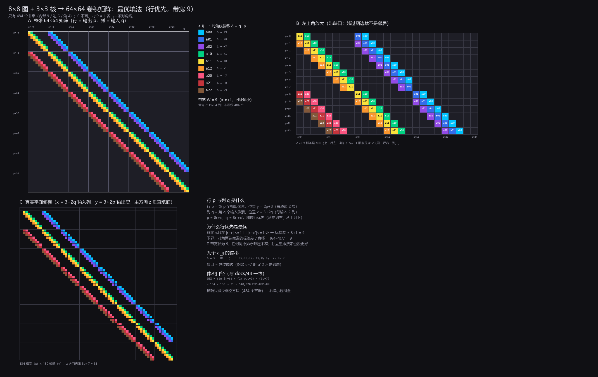
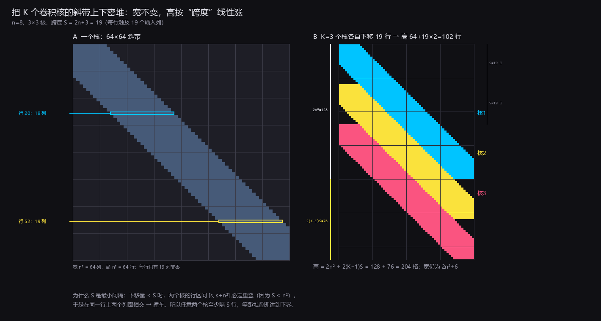

# 卷积写成矩阵：一行的跨度，与多核密堆

状态: 待验
可信度: 推导 + 数值验证（脚本穷举/搜索，$n\le32$；无实机）
最后核实: 2026-10-31
适用: 数模结合的强模网络；**单个** $n\times n$ 单通道输入、$k\times k$ 核、stride $s$、padding $p$。本页只谈"矩阵非零元的几何跨度"，不谈方块数、容器成本与体积

---

## 引言

强模里没有乘法器，卷积只能写成矩阵乘法：把输入摊成 $n^2$ 个整数、输出也是 $n^2$ 个，
中间一张 $n^2\times n^2$ 的权重矩阵。这张矩阵几乎全是 0——3×3 核在 $8\times8$ 图上只有 484 个非零，
占 4096 个格的 12%。

问题不在"有多少个非零"，而在"**一行要横向铺多宽**"。因为编译成电路之后，
矩阵的列对应输入（每列一个输入位块，占固定的横向位置），行对应输出（每行一条累加链）。
一行里最左与最右那个非零相隔多少列，就决定了这一行在平面上横跨多少格。

本页回答两个纯几何问题：**一行的跨度是多少**，以及**多个核能不能靠密堆省掉高度**。

---

## 符号

| 符号 | 含义 | 取值/说明 |
|---|---|---|
| $n$ | 输入边长 | 每边 $n$ 个像素 |
| $k$ | 核边长 | $k\times k$ |
| $s$ | stride | |
| $p$ | padding | 单边填充 |
| $m$ | 输出边长 | $m=\lfloor (n+2p-k)/s\rfloor+1$ |
| $N=n^2$, $M=m^2$ | 输入、输出个数 | 矩阵是 $M\times N$ |
| $i,j$ | 非零所在的核坐标 | $0\le i,j\le k-1$ |
| $a_{ij}$ | 核的第 $(i,j)$ 个分量 | |
| $\sigma$ | **列排序**：输入像素 → 矩阵列号（双射） | |
| $\pi$ | **行排序**：输出像素 → 矩阵行号（双射） | |
| $\Delta$ | 列标签差 $\sigma(q)-\pi(o)$ | 非零元所在的"对角线偏移" |
| $S$ | **跨度**：一行触及的列数 | $S=1+\max_o\bigl(\max\sigma(N_o)-\min\sigma(N_o)\bigr)$ |
| $W$ | 带宽 | $W=(S-1)/2$ |

$$\boxed{\ \text{跨度 }S\ \text{只由列排序}\ \sigma\ \text{决定；行排序}\ \pi\ \text{只影响}\ W\ }$$

---

## 一、矩阵长什么样

像素记 $p=(r,c)$、$q=(r',c')$，都按行优先编号 $\text{id}=nr+c$。矩阵元

$$M_{\text{id}(p),\,\text{id}(q)}=\begin{cases}a_{i,j},& i=1+r-r',\ j=1+c-c'\\ 0,&\text{否则}\end{cases}$$

$$\text{非零}\iff |r-r'|\le1\ \text{且}\ |c-c'|\le1\qquad(\text{3×3 核，}s=1,\ p=1)$$

**行列的字面含义**：行 = 一个输出像素（它要算的那个点），列 = 一个输入像素（它读的那个点）。
所以在 $n=8$ 时，行 0 是输出像素 $(0,0)$，列 0 是输入像素 $(0,0)$。



九个 $a_{ij}$ 各占一条对角线（行优先列序下）：

$$\Delta=9-8i-j\ \Longrightarrow\ +9,+8,+7,\ +1,0,-1,\ -7,-8,-9$$

| $a_{ij}$ | $a_{00}$ | $a_{01}$ | $a_{02}$ | $a_{10}$ | $a_{11}$ | $a_{12}$ | $a_{20}$ | $a_{21}$ | $a_{22}$ |
|---|---:|---:|---:|---:|---:|---:|---:|---:|---:|
| $\Delta$ | +9 | +8 | +7 | +1 | 0 | −1 | −7 | −8 | −9 |
| 个数 | 49 | 56 | 49 | 56 | 64 | 56 | 49 | 56 | 49 |

$$\text{合计 }484=9n^2-12n+4\quad(\text{内部 }9/\text{边 }6/\text{角 }4)$$

对角线在**越过图边处会断**：$c=7$ 的那一行，$a_{12}$（往右一列）根本不是邻居，所以那里是 0。
"带"只是上界的说法，带内仍有空洞。

---

## 二、$s=1$：跨度的闭式

$$\boxed{\ S=(k-1)(n+1)+1\ }$$

推导只有一步。行优先列序下，非零处的列标签差是

$$\Delta=\delta_r n+\delta_c,\qquad \delta_r,\delta_c\in[0,\ k-1]$$

（$\delta$ 是核内偏移；$p$ 只把整条带整体平移，不改变跨度。）于是

$$\max|\Delta|=(k-1)(n+1)\ \Longrightarrow\ S=2\max|\Delta|+1=(k-1)(n+1)+1$$

**两条推论**：

1. **跨度只由 $k$ 与 $n$ 决定**，与 padding 无关——$p$ 只改输出个数 $m$，矩阵变窄变宽，跨度不变。
2. **跨度随 $n$ 线性涨，随 $k$ 也线性涨**，而矩阵本身是 $n^2\times n^2$——所以相对浪费比例
   $S/n^2\approx(k-1)/n$ 随 $n$ 减小。

随 $n$ 伸缩（$s=1$ 实测，与闭式逐项相符）：

| $n$ | $k=1$ | $k=3$ | $k=5$ | $k=7$ |
|---:|---:|---:|---:|---:|
| 4 | 1 | 11 | 16$^{\ast}$ | 16$^{\ast}$ |
| 8 | 1 | **19** | 37 | 55 |
| 16 | 1 | 35 | 69 | 103 |
| 32 | 1 | 67 | 133 | 199 |

$^{\ast}$ 核大于图时窗口被裁剪（整张图都落在窗口内），实际跨度是 $n^2-1$，小于闭式。

$$\text{例：}n=8,k=3\ \Longrightarrow\ S=2\times9+1=19$$

---

## 三、行优先已经是最优（$s=1$）

上面的 19 是**行优先**排出来的。它已经是最小值，理由是两句话：

**下界**。把像素看成一个图（相邻 = 棋盘距离 1）。标签最小的像素与最大的像素之间，
沿图有一条长度不超过 $n-1$ 的路（对角最远，正好 $n-1$ 步），标签从 1 走到 $n^2$，
这条路上必然有一次跳幅 $\ge \dfrac{n^2-1}{n-1}=n+1$。所以

$$W\ \ge\ n+1\ \Longrightarrow\ S\ \ge\ 2n+3$$

**上界**。行优先的相邻标签差最大 $n+1$，直接取到 $2n+3$。

$$\boxed{\ W_{\min}=n+1,\qquad S_{\min}=2n+3\quad(n=8:\ 19) }$$

**"九个 $a_{ij}$ 紧挨成 9 对角"做不到。** 那要求 $S=9$，即 $n+1\le4$，只有 $n\le3$。
$n=3$ 是个真正的例外：整张图恰好就是一个 3×3 核的覆盖范围，那时 $S=9$ 成立。$n\ge4$ 起就封死了。

**允许行、列各自重排，也没有更窄。** 固定列序后，"每行的行号落在区间
$[\max\sigma(N_o)-W,\ \min\sigma(N_o)+W]$ 内"是一个区间匹配问题，可判可行；据此对列序做交换式搜索，
$n=2\ldots8$ 全部停在 $n+1$。（可证的下界只有 $\lceil (k^2-1)/2\rceil$，所以"压不窄"目前是强证据而非定理。）

---

## 四、stride 只有在 $s\ge k$ 时帮上忙

$$s<k:\ S=(k-1)(n+1)+1\ \text{不变};\qquad s\ge k:\ S\approx k^2$$

道理：**窗口的形状是 $k\times k$，与 stride 无关**。stride 只减少窗口的**个数**，不改它们的**形状**，
所以一行仍然要跨 $k$ 个连续行、每行隔 $n$，跨度就是 $2(k-1)(n+1)/2+1$。只有当 $s\ge k$ 时
各输出的窗口才**互不相交**，可以把每块 $k^2$ 排在连续的 $k^2$ 个列标签上——那时是平凡的，不再展开。

$n=8$ 实测：

| $k$ | $s$ | $p$ | 输出 $m$ | 跨度 $S$ |
|---:|---:|---:|---:|---:|
| 3 | 1 | 0 / 1 | 6 / 8 | **19** |
| 3 | 2 | 0 / 1 / 2 | 3 / 4 / 5 | **19** |
| 5 | 1 | 0 / 2 | 4 / 8 | **37** |
| 5 | 2 | 2 | 4 | **37** |
| 3 | 3 | 0 | 2 | 9（平凡） |

$$\boxed{\ \text{padding 与 stride（在 } s<k \text{ 时）都不是压窄跨度的旋钮} }$$

---

## 五、$K$ 个核的密堆

一个核的矩阵是宽 $N$、高 $N$ 的斜带；$K$ 个核就叠出 $K$ 条斜带。**列不动**（同一批输入位块被所有核共用），
只把第 $k$ 个核整体下移，就能让它们在高度上互相错开：

$$\boxed{\ \text{宽}\ \approx 2n^2\ (\text{不变}),\qquad \text{高}=2n^2+2(K-1)S\ }$$



**为什么 $S$ 就是最小间隔**（所以这个高度是下界，不是估计）：

第 $k$ 个核下移 $s_k$ 行后，它在第 $r$ 行占的列窗是

$$\bigl[r-s_k-\tfrac{S-1}{2},\ r-s_k+\tfrac{S-1}{2}\bigr]$$

两个核 $k,k'$ 要在同一行共存，必须 $|s_k-s_{k'}|\ge S$（否则两个列窗相交，抢同一批列）。
反过来，若 $|s_k-s_{k'}|<S$，则两者的行区间 $[s_k,s_k+n^2]$ 与 $[s_{k'},s_{k'}+n^2]$ **必然重叠**
（因为 $S<n^2$），它们总会在某一行上撞车。所以

$$|s_k-s_{k'}|\ \ge\ S\quad\forall k\ne k'\ \Longrightarrow\ \text{高}\ \ge\ n^2+(K-1)S\ \text{行}$$

等距堆叠（$s_k=kS$）正好达到下界。

**校验**：$K=1$ 时公式退化为 $2n^2$，与单核情形一致。

---

## 判据与反例

1. **跨度不是非零个数。** 一行有 $k^2$ 个非零，但跨度是 $(k-1)(n+1)+1$——$n=8,k=3$ 时 9 个非零跨 19 列。
   两者相差约 $2(n+1)/k^2$ 倍，这是"窗口跨行"的必然代价。
2. **别指望 stride 压窄跨度。** $s<k$ 时窗口形状不变，$n=8$、$s=2$ 的跨度仍是 19，不是 10。
3. **别把 padding 当旋钮。** 它只改输出个数与矩阵的行数，不改跨度。
4. **别把 $W$ 和 $S$ 混用。** $S=2W+1$；说"带宽 9"和"跨度 19"是同一件事的两种说法。
5. **别以为能做 9 对角。** 那是 $S=9$，只有 $n\le3$ 成立；$n\ge4$ 时下界就把路堵死了。
6. **核大于图时会被裁剪**（$n=4,k=5$ 实测 16 而非 21），闭式只在 $k\le n$ 时可用。
7. **主方向的选择不影响这些数。** 矩阵的行恒对应输出堆叠方向，列沿哪个方向铺由编译时选，
   但"一行跨多少列"是矩阵自身的性质，换个方向只是把它画在别的平面上。

---

## 遗留

| # | 项 | 说明 |
|---:|---|---|
| 1 | $s<k$ 时闭式是否**最优** | 目前是"行优先能到 + 搜索没找到更小"，没有证明 |
| 2 | 多通道 $C_{\rm in}\times C_{\rm out}$ | 一行非零变 $k^2C_{\rm in}$，但窗口形状不变 ⟹ 跨度不变；未实测 |
| 3 | dilation | 预计跨度 $\approx(k-1)d(n+1)+1$，未验 |
| 4 | $K$ 个核各用不同列序 | 可能堆得更紧，但会失去"列共享"，总账未知 |
| 5 | 与容器成本的关系 | 本页只给跨度；一行的容器数与非零数相同，但那是另一本账 |

---

## 复现

```powershell
python 03_phase3_quantized_network/src/conv_bandwidth.py --iters 30000 --nmax 6
python 03_phase3_quantized_network/src/conv_bandwidth_gen.py --n 8 --iters 6000
python 03_phase3_quantized_network/src/conv_matrix_fig.py         # 图 1
python 03_phase3_quantized_network/src/conv_band_stack_fig.py     # 图 2
```

---

*首版 · 2026-10-31 · 由 czm 提出"多核密堆高度是多少"，本页给闭式与下界；只写跨度，不写体积*
