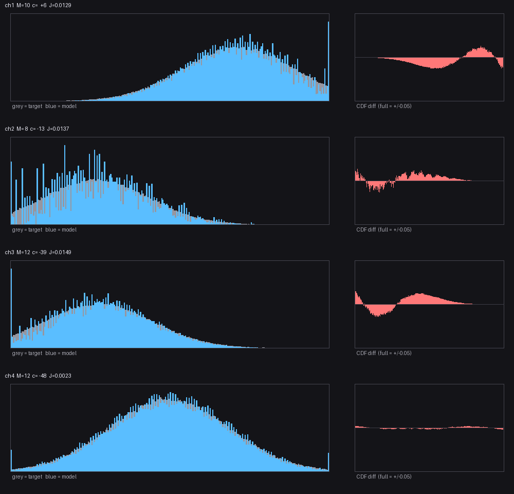

# 用一群三值随机源拟合一个分布：模型与搜索

状态: 待验
可信度: 实测（24 通道逐个拟合，CDF 差 0.0015~0.028）
最后核实: 2026-10-31
适用: 用 $M$ 个**独立、同规格**的三值随机源（投掷器）去逼近一个**有界离散分布**；不含随机源本身怎么造

---

## 引言

投掷器一次只给三个值之一（$\Delta s\in\{0,1,2\}$），概率由形状 $(a,b,c)/k$ 定。
单看一个投掷器，它什么都做不了；但**把一群投掷器的输出加权相加**，就能凑出相当细的分布。

这一页讲的是“怎么凑”：模型长什么样、目标函数怎么选、为什么必须用离散搜索、
以及这套搜索的**天花板在哪里**（这个答案比方法本身更重要）。

$$\boxed{\ X=\mathrm{clip}\Bigl(c+\sum_{k=1}^{M}w_kv_k,\ 0,\ 255\Bigr)\ }$$

没有乘法器，没有网络——只有 $M$ 次加法和一个截断。

---

## 符号

| 符号 | 含义 |
|---|---|
| $M$ | 投掷器个数（一个通道用几个） |
| $v_k$ | 第 $k$ 个投掷器的输出，$\{0,1,2\}$ |
| $(a_k,b_k,c_k)$ | 它的形状，$a+b+c=9$，概率 $=\frac{(a,b,c)}{9}$ |
| $w_k$ | 它的权重（正整数） |
| $c$ | 偏置（整数，可负） |
| $X$ | 合成输出，$0\sim255$ |
| $p^*(x)$ / $F^*(x)$ | 目标分布 / 目标 CDF |
| $\hat p$ / $\hat F$ | 模型分布 / 模型 CDF |
| $J$ | 目标函数（KS 距离） |

---

## 一、模型与卷积

$M$ 个投掷器**互相独立**，所以和的分布是各自分布的**卷积**：

$$q(s)=\Pr\Bigl[\sum_{k=1}^{M}w_kv_k=s\Bigr],\qquad s=0,\dots,2\sum_k w_k$$

算起来就是**迭代卷积**：从 $0$ 处的 δ 出发，每加一个投掷器，把当前分布复制三份，
分别平移 $0,\ w_k,\ 2w_k$，按概率加权相加。

$$q\ \longleftarrow\ q*\bigl(\tfrac{a}{9}\delta_0+\tfrac{b}{9}\delta_{w_k}+\tfrac{c}{9}\delta_{2w_k}\bigr)$$

最后平移 $c$ 并截断：

$$\hat p(x)=\sum_{\substack{s\\ \mathrm{clip}(c+s,0,255)=x}}q(s)$$

**这条链只有两个可调的东西**：$M$ 个权重、$M$ 个形状（外加一个偏置）。
所以“能拟合多准”是有限的，下一节就算这笔账。

---

## 二、自由度 vs 约束：残差不可能归零

| | 数目 |
|---|---:|
| 目标要拟合的概率值 | 256 |
| 自由整数（$M$ 个权重 + $M$ 个形状 + 1 个偏置） | $2M+1$，取 $M\!\approx\!11$ 时约 23 |

$$\text{严重超定}\quad\Longrightarrow\quad\text{残差有下限}$$

$$\boxed{\ \text{CDF 差停在 0.015 附近，不是搜索没做好，是这个“形状族”的表达能力到此为止}\ }$$

这句话很重要：它意味着**再优化也压不下去**，想再好只能换家族（更多源、更细的分母）。

---

## 三、目标函数：用 CDF，不用 TV

$$\mathrm{TV}=\tfrac12\sum_x\lvert \hat p(x)-p^*(x)\rvert,\qquad
J=\max_x\bigl\lvert\hat F(x)-F^*(x)\bigr\rvert$$

$J$ 就是 **Kolmogorov–Smirnov 统计量**：取任意阈值 $x$，模型说“有 $\hat F(x)$ 比例的样本不大于 $x$”，
真值是 $F^*(x)$；$J$ 是这个差在**所有阈值上的最坏值**。

**为什么不看 TV**：和的取值落在由权重生成的**格点**上，点态概率会剧烈振荡。
同一次拟合里实测：

$$\mathrm{CDF}=0.0100\qquad\text{而}\qquad\mathrm{TV}=0.0678$$

TV 被格点振荡放大了近 7 倍，CDF 不受影响。三个理由选 $J$：

1. **它直接管分位数误差**：$J\le\varepsilon$ 意味着任何分位点最多错 $\varepsilon$ 的质量；
2. **它在离散化下稳定**：格点怎么排都不改变它；
3. **它才对应下游**：关心的通常是“某个区间出现多频繁”，不是“某个值出现多精确”。

$$\boxed{\ \text{取最大值，不取平方和：平方和会被 256 个点摊薄，压不住单点最坏差}\ }$$

---

## 四、搜索：为什么只能离散地爬

目标函数是**整数变量的函数**。把某个权重改 1，所有原子整体平移 1，$J$ **跳变**：

$$\text{目标函数分段常数}\quad\Longrightarrow\quad\text{没有梯度，连续优化用不上}$$

所以用**离散局部搜索**：随机挑一个投掷器，改权重（$\pm1,\pm2$）或换形状，重算 $J$，按规则接受/丢弃。

$$\text{每轮}=\text{挑一个源}\to\text{改一个整数}\to\text{重算 }J$$

### 4.1 把偏置从搜索里消掉

**均值错一点，整条曲线就整体平移，$J$ 会立刻跳到 0.5 量级。** 所以不把 $c$ 当搜索变量，
而是每步都把它**重算成“让均值对齐”的值**：

$$c=\mathrm{round}\bigl(m-\textstyle\sum_k w_kE[v_k]\bigr)$$

$$\boxed{\ \text{一个连续约束被“每步重设”吃掉，搜索就只需管形状}\ }$$

### 4.2 接受准则：延迟接受爬山（LAHC）

普通爬山只接受更优解，容易一进去就出不来。LAHC 改成跟 **$L$ 步之前**的历史值比：

$$J_{\text{候选}}\le H[i\bmod L]\quad\text{或}\quad J_{\text{候选}}<J_{\text{当前}}$$

$H$ 是长度 $L$ 的环形历史数组。早期 $H$ 里全是差记录、什么移动都收；后期被好值填满，
自动收紧成爬山——**容忍度自己衰减，不需要温度表**。

---

## 五、初值：先钉住前两个矩

初值用**所有源同形状 $(4,1,4)$、同权重 $w$**：

$$E[X]=c+Mw,\qquad \mathrm{Var}(X)=Mw^2\cdot\tfrac89$$

由“方差对得上”解出权重，由“均值对得上”解出偏置：

$$\boxed{\ w=\mathrm{round}\sqrt{\frac{s^2}{0.8889\,M}},\qquad c=\mathrm{round}(m-Mw)\ }$$

### 5.1 为什么是 $(4,1,4)$

它**不是**方差最大的三值形状（最大是 $(4,0,5)/(5,0,4)$ 的 0.9877）。选它有三个理由：

| 理由 | 说明 |
|---|---|
| 在 $E[v]=1$ 那一族里方差最大 | 0.8889；同族 $(3,3,3)$ 只有 0.6667、$(0,9,0)$ 为 0 |
| $E[v]=1$ 让偏置公式最简 | $\sum w_kE[v_k]=\sum w_k$，于是 $c=m-Mw$ |
| 三个值都用上、且对称（$a=c$） | 比两点分布格点更密；不带人为偏态 |

### 5.2 方差对上，支撑也自动够

$$2Mw=2.12\,s\sqrt{M}$$

| $M$ | 支撑 | 相当于 |
|---:|---|---|
| 8 | $6.0s$ | $\pm3.0\sigma$ |
| **10** | **$6.7s$** | **$\pm3.35\sigma$** |
| 12 | $7.3s$ | $\pm3.7\sigma$ |

$$\boxed{\ \text{“方差对”和“支撑够”其实是一件事的两面}\ }$$

### 5.3 但初值只值 20~50% 的准确度

实测 24 个通道：初值 $J\in[0.035,\ 0.21]$，终值可到 $0.0015$。
**搜索贡献了约 90% 的精度**，剩下的全靠它：

$$\text{初值负责“多大、多宽、在哪”；搜索负责“什么形状”}$$

---

## 六、放开形状：误差为什么减半

形状固定为 $(4,1,4)$ 时，每个源都是**同一个三点分布的缩放**，
$M$ 个的和就是同一形状的 $M$ 次卷积——整个族每通道只剩“权重”一个自由度。

放开形状后，每个源多两个自由度（$a+b+c=9$），分别控制：

$$E[v]=\frac{b+2c}{9}\ (\text{质量落在中间偏哪}),\qquad
\mathrm{Var}(v)=\frac{b+4c}{9}-E[v]^2\ (\text{多散})$$

$$\text{只放开权重：CDF }0.0315\qquad\text{形状也放开：CDF }0.0152$$

搜索选出来的形状呈现**明显的两极分化**：

| 形状 | 概率 | 性质 |
|---|---|---|
| $(3,0,6)$ | .33, 0, .67 | 两点，偏上 |
| $(7,0,2)$ | .78, 0, .22 | 两点，偏下 |
| $(3,3,3)$ | 1/3, 1/3, 1/3 | 均匀，最平滑 |
| $(4,1,4)$ | .44, .11, .44 | 方差最大 |

$$\boxed{\ \text{机制：把“窄分量”与“宽分量”混在一起}\ }$$

纯卷积只能给出**单一形状**的和；混不同形状等于在多个尺度上叠加，才能拟合**非纯高斯**的
有界分布（被截断过的分布本来就偏）。

---

## 七、例：4 个通道，均值与方差各不同

设某应用需要 4 个通道，每个都要一条 $0\sim255$ 上的**近似正态**分布，
但它们的均值和方差都不一样。对每个通道各跑一遍上面的流程，结果：

| 通道 | 目标 $\mu$ | 目标 $\sigma$ | $M$ | $c$ | $J$ |
|---|---:|---:|---:|---:|---:|
| 1 | 179 | 39 | 10 | $+6$ | 0.0129 |
| 2 | 72 | 37 | 8 | $-13$ | 0.0132 |
| 3 | 75 | 38 | 12 | $-39$ | 0.0150 |
| 4 | 127 | 47 | 12 | $-48$ | **0.0023** |

三件可读的事：

1. **$M$ 不是统一值**，8~12 各挑各的——它是“支撑够不够”和“维度过高会卡”之间挤出来的；
2. **$c$ 从 $+6$ 到 $-48$**，跨度 54。偏置不参与搜索，但会自己找到该在的位置；
3. **$J$ 差一个数量级**（0.0023 vs 0.0150）：同一个族对不同目标的难度不同。
   目标越“像”三值源能拼出来的形状，就越好拟合。

通道 1 的完整解（$M=10$，$c=+6$）：

| $k$ | 1 | 2 | 3 | 4 | 5 | 6 | 7 | 8 | 9 | 10 |
|---|---:|---:|---:|---:|---:|---:|---:|---:|---:|---:|
| $w_k$ | 21 | 19 | 10 | 11 | 12 | 15 | 8 | 10 | 18 | 18 |
| $(a,b,c)$ | (3,1,5) | (2,2,5) | (5,2,2) | (3,1,5) | (3,1,5) | (2,3,4) | (3,6,0) | (1,6,2) | (1,2,6) | (3,0,6) |
| $E[v]$ | 1.22 | 1.33 | 0.67 | 1.22 | 1.22 | 1.22 | 0.67 | 1.11 | 1.56 | 1.33 |
| $\mathrm{Var}(v)$ | .84 | .67 | .67 | .84 | .84 | .62 | **.22** | .32 | .47 | **.89** |

- **权重差 2.6 倍**（8~21），形状从 $(3,6,0)$（几乎只出 0/1，最窄）到 $(3,0,6)$（只出 0/2，最宽）
  ——§六 说的“窄宽混合”不是理论说辞，是搜出来的样子；
- 支撑 $0\sim284$，而 $\mu\approx179$、$\sigma\approx39$：**左端是被 `clip` 切过的**，
  目标在 0 附近的质量被堆到 0 上——这正是“边界尖峰是定义、不是误差”；
- $J=0.0129$ 的意思是：**取任何阈值，累计概率最多差 1.3%**。

*每一行一个通道。左：灰=目标概率，蓝=模型概率——包络对得上，蓝线有尖刺，那是格点振荡；
右：CDF 差，满格 $\pm0.05$，全程压在 $\pm0.03$ 以内。*

$$\boxed{\ \text{方程数与形状都不变，只是}\mu,\sigma\text{ 换了——每个通道单独跑一遍就行}\ }$$

---

## 八、边界：这套搜索在哪里失效

| 限制 | 影响 |
|---|---|
| **维度过高会卡** | $M\ge14$ 时爬山容易陷局部极小，$M=11$ 左右最好 |
| **支撑有界** | $M<8$ 铺不到 $\pm3.5\sigma$；但要的 $\pm3.5\sigma$ 之外本来就没多少质量 |
| **格点稀疏** | 点态概率剧烈振荡，**CDF 与下游都不受影响** |
| **形状种类有限** | 只枚举了 55 种（分母固定 9） |
| **目标本身有界** | 目标分布若在 0/255 处有质量，截断会把它堆到边界上，$J$ 天然偏高 |

最后一行是一类常见误解：**边界上的尖峰不是拟合失败**，是 `clip` 的定义。

---

## 判据与反例

1. **别用 TV 当目标。** 格点振荡会把它放大近 7 倍（同一拟合 $0.0100$ vs $0.0678$），优化方向会被带偏。
2. **别用平方和。** 256 个点一平均，单点 0.05 的差就被掩盖了；要的是最坏差。
3. **别把偏置交给搜索。** 均值偏一点 $J$ 就崩到 0.5；每步重设 $c$ 更省也更快。
4. **别用梯度法。** 整数变量让目标函数分段常数，没有梯度可用。
5. **$M$ 不是越大越好。** $M\ge14$ 时搜索质量下降，这是**搜索的极限**，不是模型的极限。
6. **形状固定 = 单参数族。** 只放开权重的效果约为放开形状的一半（0.0315 vs 0.0152）。
7. **CDF 差压不下去不是没调好。** 自由度约 23 对 256 个约束，残差有下限。
8. **别照搬别人调好的参数表。** 参数是**对着某一份目标直方图**搜出来的，目标一变就作废。

---

## 遗留

- **分母没放开。** 这里只枚举了分母为 9 的形状（55 种）。但投掷器的概率分母其实是**占用槽数**，
  可以取 2~9（见 `10_游戏机制/投掷器.md`）——把 $k<9$ 的形状也算进来，族会大得多，
  残差下限可能被压低。这一条还没试。
- **取值范围换了会怎样，没系统验过。** 本页把 $X$ 钉在 $0\sim255$，但模型里真正起作用的不是“255”，
  而是三个量：**目标级数**、**目标跨度**、**单个权重 $w$ 的上限**。照这个思路外推：

| 情形          | 会怎样                                    |
| ----------- | -------------------------------------- |
| 更窄（级数少、跨度小） | 自由度相对充裕，$J$ 更小，可能压到 0.001 以下           |
| 更宽（级数多、跨度大） | 约束变多而自由度不变，$J$ 变大；支撑不够时只能加 $M$ 或加大 $w$ |
| 加 $M$ 去补    | 撞上“$M\ge14$ 爬山变差”——**先卡住的是搜索，不是模型**    |

  $$\text{难度大致由}\ \frac{\text{目标级数}}{\text{自由度数}}\ \text{决定，而不是由 }0\sim255\ \text{这个区间决定}$$

  也就是说：把目标从 256 级换成 16 级会**容易得多**，换成 1024 级会**难得多**，
  而 $\mathrm{clip}$ 的上下界本身只是两个常数——换成别的区间，模型与搜索一个字都不用改。
  这一条只是外推，没有实测。
- **目标从哪来。** 本页只讲“给定目标怎么拟合”；目标分布本身的估计、以及它与下游显示的关系不在本页。

---

## 来源

模型、目标函数、初值公式与实测数字（$0.0015\sim0.028$、$0.0315\to0.0152$、初值 $0.035\sim0.21$、
$M\ge14$ 变差）来自本项目的三值源拟合实验（24 通道逐个搜索、每通道多次重启）。
