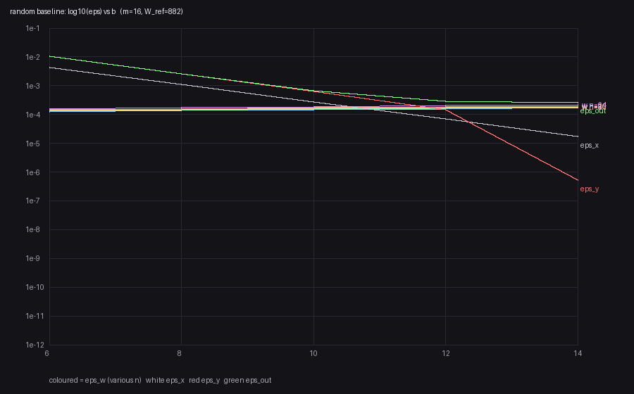

# 三类误差与最优位宽

状态: 待验
可信度: 推导（标度律，结构性）+ 随机设定实测（可复现脚本，不依赖任何具体网络）
最后核实: 2026-11-01
适用: **以数模结合构型（位权重 + 容器）为准**推的误差式；换成强模 LUT 时，输入/输出两类误差照用，权重量化那一类要换一个等效 $W_{\mathrm{ref}}$（见 §三.4）。只谈误差与位宽，不谈容器数、环体积、归一化电路

---

## 引言

量化网络里有三类独立的误差，**标度律方向相反**：

$$\text{输入量化}\ \epsilon_x\propto2^{-b}\qquad
\text{权重取整}\ \epsilon_w\propto\frac{\sqrt b}{W_{\mathrm{ref}}}\qquad
\text{输出量化}\ \epsilon_y\propto2^{-b}$$

前两类随位宽猛降，第三类随位宽缓缓上升。一降一升，交点就是**最优位宽**。

$$\boxed{\ \text{位宽不是越大越好——加位只压输入与输出，权重那一项反而变大}\ }$$

本页的实测数字都取自一个可复现的**随机设定**（§五），不含任何具体网络的影子。
设定一换，**常数**会变，**形状**不变——这两者的区别贯穿全页。

> **两件事要分开。**
>
> - **结构性的**：只要前提成立就成立（$\epsilon_x=2^{-(b+1)}$、$\sigma$ 与 $b$ 无关、范围与 $b$ 无关）；
> - **案例性的**：只在某个具体设定、某个判据下才成立（具体系数、交叉点落在哪一位）。

> **本页是按数模结合写的。** 三类误差里，输入与输出两类与构型无关（它们只涉及“量化多少级”），
> 直接搬过去；**权重量化那一类随构型变**——强模 LUT 的容器里放的是步长而不是位权重，
> 每格的分辨率相对整条阶梯更高，等效于把 $W_{\mathrm{ref}}$ 放大到约 $4\times882$，详见 §三.4。

---

## 符号

沿用本库 `20_数学` 的记号：**下标顺序（输出，输入），上标是位号**。

| 符号 | 含义 | 取值 |
|---|---|---|
| $b$ | **输入位宽**（每层独立） | 整数 |
| $b_Y$ | **输出位宽**（层边界上等于下一层的 $b$） | 整数 |
| $b^*$ | **最优输入位宽** | 本页求其标度 |
| $n$ / $m$ | 该层的输入个数 / 输出个数 | 整数 |
| $\Delta_i$ | 第 $i$ 个输入的跨度 | 实数 |
| $\Delta_Y$ | 该层输出的实际跨度 | 实数 |
| $\delta_{X,i}$ | 输入分辨率 $\Delta_i/2^b$ | 实数 |
| $\delta_{Y,j}$ | 输出分辨率 | 实数 |
| $W^{(k)}_{j,i}$ | 整数位权重 | 整数 |
| $W_{\mathrm{ref}}$ | 次高位位权重的目标值 | 由加几个环定 |
| $\sigma_j$ / $\sigma$ | 缩放因子：逐通道 / 整层 | $>0$ |
| $X_i^{(k)}$ | $X_i$ 的第 $k$ 位 | $\{0,1\}$ |
| $\pi_i^{(k)}$ | 该位为 1 的概率 $\Pr[X_i^{(k)}=1]$ | $[0,1]$ |
| $\eta_j$ | 实数预激活 | |
| $N_j$ / $N_j^{\max}$ | 非负累加量 / 上界 | 整数 |
| $P_j$ | 整数零点 | 整数 |
| $\Gamma_j$ | 输出量化步长 | 整数 $\ge1$ |
| $R_n$ | 范围比 $\dfrac{\sum_i\lvert w_{j,i}\rvert}{\max_i\lvert w_{j,i}\rvert}$ | 见 §2.4 |
| $\epsilon_x,\ \epsilon_w,\ \epsilon_y$ | 三类**相对**误差（RMS 口径） | 无量纲 |

$$\sigma=\frac{W_{\mathrm{ref}}}{\max_{j,i}\lvert w_{j,i}\rvert\,\delta_{X,i}\,2^{b-2}}
=\frac{4\,W_{\mathrm{ref}}}{\max_{j,i}\lvert w_{j,i}\rvert\,\Delta_i}$$

**右边那个等式是结构性的**：$\delta_{X,i}2^{b-2}=\Delta_i/4$ 恒成立，所以 **$\sigma$ 与 $b$ 无关**。
后面所有标度律都架在这一条上。

> **与旧材料的记号对照**：旧文的 $c_j=\Gamma_j$、$A_j=P_j$、位指示量 $A^{(k)}_j=X_i^{(k)}$、
> $\beta=\sigma$、$w_{ref}=W_{\mathrm{ref}}$、“$Z$ 的位宽”$=b_Y$。**本页不混用旧记号。**

---

## 一、第一类：输入量化（结构性）

$$X_i=\mathrm{clip}\Bigl(\Bigl\lfloor\frac{x_i-x_{i,\min}}{\Delta_i}2^b\Bigr\rfloor,0,2^b-1\Bigr),\qquad
\hat x_i=x_{i,\min}+\bigl(X_i+\tfrac12\bigr)\delta_{X,i}$$

取格心（$+\frac12$）时误差对称，**峰值**是半格：

$$\epsilon_x^{\max}=\frac{\delta_{X,i}/2}{\Delta_i}=\boxed{\frac{1}{2^{b+1}}}$$

$$\boxed{\ \epsilon_x\ \text{只由 }b\text{ 决定，与网络、与层、与跨度、与 }n\text{ 都无关}\ }$$

**但量 RMS 时要再除以 $\sqrt3$。** 误差在 $[-\tfrac{\delta}{2},\tfrac{\delta}{2}]$ 上均匀，标准差是
$\delta/\sqrt{12}$，所以

$$\epsilon_x^{\rm rms}=\frac{1}{\sqrt{12}}\cdot2^{-b}$$

实测（数值见 §五）：$\epsilon_x/2^{-(b+1)}=0.5772\sim0.5775$，与 $1/\sqrt{12}=0.5774$ 一致到四位。

> **口径提醒**：若实现省掉那 $+\frac12$（直接截断），峰值从半格变成整格，$\epsilon_x$ 再翻一倍成 $2^{-b}$。
> 三个口径（峰值 / RMS / 截断）混用，是这类数字对不上的头号原因。

---

## 二、第二类：输出量化

$$\epsilon_y=\frac{\delta_{Y,j}}{2\Delta_Y}\ \text{（口径见 §2.1）},\qquad
\delta_{Y,j}=\frac{\Gamma_j}{\sigma_j}$$

$\Gamma_j$ 按**可达**极差定，而不是按实际跨度；并且至少取 1（否则不能当除数）：

$$\Gamma_j=\max\left(\Bigl\lceil\frac{N_j^{\max}-P_j}{2^{b_Y}-1}\Bigr\rceil,\ 1\right)$$

由此分两种情形，**不能一概而论**：

- **$\Gamma_j>1$**（输出位宽不够，必须压缩）：这时
  $\Gamma_j\ge\dfrac{N^{\max}_j-P_j}{2^{b_Y}-1}\ge\dfrac{\Delta_Y\sigma_j}{2^{b_Y}-1}$，于是

  $$\epsilon_y\ \ge\ \frac{1}{2(2^{b_Y}-1)}\approx2^{-(b_Y+1)}$$

  可达极差只会比实际跨度宽，所以 $\epsilon_y$ **只会偏大**——偏多少取决于宽出多少。

- **$\Gamma_j=1$**（位宽够用，只截取）：上面那个下界不成立了，因为下取整被钳到 1。
  这时 $\epsilon_y\equiv0$，见 §2.2。

### 2.1 三类误差各自独立衡量

三类误差必须分开量，否则会把同一个误差数两遍。各用哪一路当尺子，是有讲究的：

| 误差 | 比的双方 | 输入取什么 |
|---|---|---|
| $\epsilon_x$ | 真实 $x$ ↔ 量化后的逆回 $\hat x$ | 真实 $x$ |
| $\epsilon_w$ | 精确路径 $w\cdot\hat x$ ↔ 整数路径 $(N-P)/\sigma$ | **量化后的逆回 $\hat x$**——把 $\epsilon_x$ 挡在外面 |
| $\epsilon_y$ | $Y$ 的逆回 $Y\Gamma_j/\sigma_j$ ↔ **$N-P$ 的逆回** | 同一条整数路径——把 $\epsilon_x$、$\epsilon_w$ 都挡在外面 |

$$\boxed{\ \epsilon_y=\frac{\mathrm{rms}\bigl(\hat y-\hat\eta\bigr)}{\Delta_Y},\qquad
\hat y=\frac{Y\Gamma_j}{\sigma_j},\quad \hat\eta=\frac{N-P}{\sigma_j}\ }$$

**参考值取 $N-P$ 的逆回，不是真值。** 因为这一路要问的是“把 $N-P$ 压成 $Y$ 亏了多少”，
而不是“整层到底有多准”（那是判据 $\epsilon_{\rm out}$ 的事，§4.2）。

### 2.2 于是 $\epsilon_y$ 是可能为零的

$$\Gamma_j=1\ \Longleftrightarrow\ N_j^{\max}-P_j\le 2^{b_Y}-1$$

$$\Gamma_j=1\quad\Longrightarrow\quad Y=N-P\quad\Longrightarrow\quad \hat y=\hat\eta\quad\Longrightarrow\quad \boxed{\epsilon_y\equiv0}$$

**输出位宽够装下整个范围时，这一步只做截取、不做压缩，输出量化误差就没有了**——
不是“小”，是**恒等于零**。所以“每一层都有 $\epsilon_y$”“输出误差不能取消”这类说法都不成立：
有没有，取决于 $\Gamma_j$ 是不是 1，也就是取决于**输出位宽够不够**。

| 情形 | $\Gamma_j$ | $\epsilon_y$ |
|---|---|---|
| 输出位宽不够，必须压缩 | $>1$ | $\Gamma_j/(2\sigma_j\Delta_Y)$ |
| 输出位宽够用，只截取 | $=1$ | $\mathbf 0$ |

### 2.3 决定 $\epsilon_y$ 的是 $N-P$ 的范围

$\Gamma_j$ 的分子是可达极差 $N_j^{\max}-P_j$。这个量有个干净的估计：

$$N_j^{\max}=\sum_{k,i}\bigl\lvert W^{(k)}_{j,i}\bigr\rvert
\ \approx\ \sigma_j\,\delta_{X,i}\sum_{k}2^k\sum_i\lvert w_{j,i}\rvert
\ =\ \sigma_j\,\Delta_i\,(2^{b}-1)\sum_i\lvert w_{j,i}\rvert$$

$$\boxed{\ N_j^{\max}-P_j\ \sim\ 4\,W_{\mathrm{ref}}\cdot\frac{\sum_i\lvert w_{j,i}\rvert}{\max_i\lvert w_{j,i}\rvert}\ }$$

三件事一眼就能看出来：

- **与 $b$ 几乎无关**——$2^b-1\approx2^b$ 与 $\delta_{X,i}=\Delta_i/2^b$ 正好抵掉，位宽加多少都不会把范围撑大；
- **随 $n$ 涨，但比线性慢**——见 2.4；
- **强烈依赖权重分布**——同样的 $n$，权重越“平均”（$\max$ 不突出），这个比值越大。

所以

$$\Gamma_j=\frac{N^{\max}_j-P_j}{2^{b_Y}-1}\ \sim\ \frac{4\,R_n\,W_{\mathrm{ref}}}{2^{b_Y}}$$

$$\Longrightarrow\qquad
\epsilon_y\ \propto\ \frac{2^{-b_Y}}{\sigma_j\Delta_Y}\cdot R_n$$

**$\epsilon_y$ 与 $\epsilon_x$ 按同一个 $2^{-b}$ 下降**——两者的分母里都有 $2^b$，谁也不会掉得更陡。
差别在常数：$\epsilon_y$ 多带一个 $R_n/(\sigma_j\Delta_Y)$ 的因子。这一点很容易被“输出量化看起来更细”的直觉带偏。

### 2.4 $R_n$ 随 $n$ 怎么涨：不是线性

$R_n$ 是“$n$ 个数绝对值之和 ÷ 其中最大者”。分子随 $n$ 涨，**但分母也在涨**——$n$ 个数里最大的那个，
本身就是一个随 $n$ 上升的量。所以 $R_n$ 的增长由**权重的尾部分布**决定：

$$R_n\ \sim\ n\cdot\frac{\mathbb E\lvert w\rvert}{\mathbb E[\max_i\lvert w_i\rvert]}$$

| 权重分布 | $\mathbb E[\max_i\lvert w_i\rvert]$ | $R_n$ 的标度 |
|---|---|---|
| 均匀 $U[0,1]$ | $\dfrac{n}{n+1}\to1$（**有界，不再涨**） | $\dfrac{n}{2}$ —— **线性** |
| 指数 $\mathrm{Exp}(1)$ | $H_n\approx\ln n+\gamma$ | $\dfrac{n}{\ln n}$ |
| 正态 $N(0,1)$ | $\approx\sqrt{2\ln n}$ | $\dfrac{n}{\sqrt{\pi\ln n}}$ |

以指数分布为例看一眼推导：$\sum_i\lvert w_i\rvert\sim\Gamma(n,1)$，均值 $n$；
$n$ 个指数样本的最大值，期望是调和数 $H_n\approx\ln n$。两者一除，线性里就多了一个 $1/\ln n$。

$$\boxed{\ \text{只有\emph{有界}分布才给出线性；无界的轻尾要再除以一个缓慢增长的因子}\ }$$

实测（正态权重，$n=4,8,16,32,64$）：$R_n=2.30,\ 3.80,\ 6.29,\ 11.28,\ 20.21$；
公式 $n/\sqrt{\pi\ln n}$ 给 $1.92,\ 3.13,\ 5.42,\ 9.70,\ 17.7$——**形状一致，系统性低约 18%**
（$\mathbb E[1/\max]\ne1/\mathbb E[\max]$）。$n$ 涨 16 倍，$R_n$ 只涨 8.8 倍。

> 这个估计在**编译选型**时比在误差分析时更有用：一层的 $N-P$ 有多宽，直接决定它的输出要几位、以及各通道能不能共用一把尺子（“输出可比”）。$n$ 大的层，范围也大，共用尺子的代价也更高。

实测一条（数值见 §五，$b=10$）：$n=4$ 时 $\epsilon_y=4.1\times10^{-4}$，$n=64$ 时 $1.2\times10^{-3}$——涨 3.0 倍。
按 $R_n$ 的标度，同期 $R_n$ 涨 8.8 倍、而 $n$ 涨 16 倍，所以 $\epsilon_y$ 的涨幅应当**明显低于 16 倍**，与实测相合。不过可知，实测时的涨幅依然更慢。

---

## 三、第三类：权重取整（最反直觉的一类）

### 3.1 每位等权——但这条有前提

直觉会说：低位权重小，取整误差也小，加起来像等比级数，可以忽略。**错**，因为：

- $\mathrm{err}^{(k)}_{j,i}\in[-\tfrac12,\tfrac12]$：**恒为半格量级，与 $k$ 无关**。取整 3 和取整 1764，残差都是 $\pm\frac12$；
- $X_i^{(k)}\in\{0,1\}$：**位值也是 0/1，与 $k$ 无关**。$2^k$ 已经被吃进 $W^{(k)}$ 里了。

$$\Delta\eta_j=\frac{1}{\sigma}\sum_{k,i}\mathrm{err}^{(k)}_{j,i}\,X_i^{(k)}$$

$$\mathrm{Var}(\Delta\eta_j)=\frac{1}{12\,\sigma^2}\sum_{k,i}\pi_i^{(k)}$$

**这是一般式**：只要求各位取整误差独立、方差为 $\frac1{12}$，**不要求输入分布**。
当输入在位级上近似均匀（$\pi\approx\frac12$）时才有

$$\mathrm{Var}(\Delta\eta_j)=\frac{nb}{24\,\sigma^2},\qquad
\epsilon_w=\frac{\sqrt{nb/24}}{\sigma\,\Delta_Y}$$

$$\boxed{\ \text{“方差 }\propto b\text{”用的是 }\pi\approx\tfrac12\text{；位级不均匀时要回到 }\sum\pi\ \text{那一版}\ }$$

> 位级不均匀长什么样：某输入的取值总在低位区间时，它的高位恒为 0，那一位不贡献误差；
> 总在高位区间时，高位恒为 1，那一位贡献满额。**$\sum_{k,i}\pi^{(k)}$ 才配叫“有效位数”。**

### 3.2 两种归一，只有标度能外推

**绝对式**（上式）结构清楚，但漏掉了一件事：$P_j$、$\Gamma_j$ 是用**取整后**的权重重算的，
取整误差的常数部分被抵消掉一部分，而绝对式把它当独立误差算进去 → 会系统偏高。

**另一条路是“相对式”：按最大权重归一。** 它数值上贴合得很好，但系数是从单一设定里拟合出来的——
绑定了一份权重分布、一个 $n$、一个 $b$，换个设定就不该指望它还是那个数。本页因此**不采用**它，
只保留下面这条能外推的标度。

$$\boxed{\ \text{能外推的只有标度：}\ \epsilon_w\ \propto\ \frac{\sqrt{\sum_{k,i}\pi^{(k)}}}{W_{\mathrm{ref}}}
\ \xrightarrow{\ \pi\approx1/2\ }\ \frac{\sqrt{nb}}{W_{\mathrm{ref}}}\ }$$

### 3.3 $\sqrt b$ 有多弱

$n=16$、$W_{\mathrm{ref}}=882$，只改 $b$：

| $b$ | 6 | 8 | 10 | 12 | 14 |
|---|---:|---:|---:|---:|---:|
| $\epsilon_w$ | 1.418e-4 | 1.539e-4 | 1.680e-4 | 1.781e-4 | 1.881e-4 |

$$\text{$b$ 从 6 到 14（分辨率差 256 倍），}\epsilon_w\ \text{只涨 1.33 倍}\qquad(\sqrt{14/6}=1.53)$$

**涨得比 $\sqrt b$ 还慢一点**——高位补上来的那些位，其 $\pi^{(k)}$ 未必满额（见 3.1 的前提）。

### 3.4 换成强模 LUT 要改哪一项

上面整套是按**数模结合**推的：容器里放的是**位权重** $W^{(k)}_{j,i}$，一个输入拆成 $b$ 位、每位一个容器，
容器内容取 $15+\lvert W\rvert$，上限 897。

**强模 LUT 的容器里放的是“步长”**：一条阶梯 16 档，相邻两档之差 $\Delta\Lambda$ 由容器内容决定，
而整条阶梯的摆幅可以到 $15\times868$。同一个容器能表达的**相对分辨率**因此比数模结合高得多，
取整误差相对整条阶梯的摆幅就被压得更小。

$$\boxed{\ \text{LUT 的权重量化误差可沿用本页式子，只把 }W_{\mathrm{ref}}\text{ 换成约 }4\times882\ }$$

也就是说：**输入、输出两类误差照用**（它们只涉及“量化多少级”，与容器里放什么无关）；
**权重量化那一类要换标尺**——LUT 下等效的 $W_{\mathrm{ref}}$ 约为数模结合的 4 倍，
同一块容器换来的精度更高，于是最优位宽也随之往右挪。

> 这个 4 倍是构型对比给出的等效值，不是从 LUT 反解出来的；要做精细选型，
> 应当按 `强模LUT` 那页的 $\lvert\Delta\Lambda\rvert_{\max}=868$ 直接重算 $\epsilon_w$。

---

## 四、交点在哪儿：最优位宽

$$\epsilon_x\approx\epsilon_w:\qquad
\frac{1}{2^{b+1}}\approx\frac{1}{\sigma\Delta_Y}\sqrt{\frac{1}{12}\sum_{k,i}\pi_i^{(k)}}$$

忽略 $\sqrt b$（对数级弱项），代入 $\sigma=\dfrac{4W_{\mathrm{ref}}}{\max\lvert w\rvert\Delta}$：

$$\boxed{\ b^*=\log_2 W_{\mathrm{ref}}+c\ }$$

$$c\ \text{含}\ n,\ \Delta_Y,\ \text{权重分布与}\ \pi\ \text{——与具体网络绑定，不能跨网络挪用}$$

**能跨网络用的只有斜率：** $W_{\mathrm{ref}}$ 翻倍 ⟹ $b^*$ 加 1。

### 4.1 误差在哪儿交叉

|    $b$ | $\epsilon_x$ | $\epsilon_w$ | $\epsilon_y$ | $\epsilon_x/\epsilon_w$ | 谁主导      |
| -----: | -----------: | -----------: | -----------: | ----------------------: | -------- |
|      6 |     4.512e-3 |     1.418e-4 |     1.071e-2 |                    31.8 | 输入（输出次之） |
|      8 |     1.128e-3 |     1.539e-4 |     2.706e-3 |                     7.3 | 输入       |
| **10** | **2.818e-4** | **1.680e-4** | **6.623e-4** |                 **1.7** | 输入、输出    |
| **12** | **7.044e-5** | **1.781e-4** | **1.518e-4** |                **0.40** | **权重**   |
|     14 |     1.762e-5 |     1.881e-4 |     **5.3e-7** |                    0.09 | 权重       |

**$b=14$ 那一格的 $\epsilon_y$ 塌到 $10^{-7}$**，因为 $\Gamma_j$ 已经钳到 1（§2.2）——
输出位宽够装了，这一步只剩截取。这正好是全表唯一一处“输出误差消失”。

$$\boxed{\ \text{交叉落在 }b\approx11\quad(\log_2 882=9.8)\ }$$

**斜率与 $b^*=\log_2W_{\mathrm{ref}}+c$ 对得上**；常数 $c\approx1.2$ 只属于这一组设定，换网络就换。

*白线 $\epsilon_x$、红线 $\epsilon_y$ 都在掉；彩色一组是不同 $n$ 的 $\epsilon_w$，几乎是平的；
绿线是 $\epsilon_{\rm out}$（§4.2 的判据）。*

### 4.2 判据：单层输出的逆回误差

**没有一个脱离判据的“最优 $b$”。** 本页统一用**单层网络输出的逆回值误差**当判据：

$$\epsilon_{\rm out}=\frac{\mathrm{rms}\bigl(\hat y-y\bigr)}{\Delta_Y},\qquad
\hat y=\mathrm{relu}\!\left(\frac{Y\Gamma}{\sigma}\right),\quad y=\mathrm{relu}(\eta)$$

即“把这一层吐出的整数 $Y$ 逆回成实数，与它本来应该输出的实数相比，差多少”。
这个判据**同时含三类误差**（$\epsilon_x$ 经 $\eta$、$\epsilon_w$ 经 $\hat\eta$、$\epsilon_y$ 经 $\Gamma$ 的除法），
所以它就是“这一层到底有多准”的直接度量。

实测（设定见 §五；$W_{\mathrm{ref}}=882$，$m=16$）：

| $b$ | 4 | 6 | 8 | 10 | 12 | 14 | 16 | 18 | 20 |
|---|---:|---:|---:|---:|---:|---:|---:|---:|---:|
| $\epsilon_{\rm out}$（$n{=}16$） | 4.2e-2 | 1.1e-2 | 2.7e-3 | 7.0e-4 | 3.0e-4 | **2.7e-4** | 2.7e-4 | 2.7e-4 | 2.8e-4 |

$$\boxed{\ b^*\approx12\sim14\ }$$

（这个数值属于上面那一组设定与那一个判据。）

**注意它不是个尖峰，是个平台**：从 12 到 20 之间 $\epsilon_{\rm out}$ 只差不到 10%。
所以“最优位宽”实际上是一段，不是一位；差一两档在误差上看不出来。

> 其他判据是存在的，**换判据最优位宽会变**，而且变多少取决于那个判据怎么归一。本页只用上面这一个，不展开比较。

**为什么会有平台**：$b$ 越过交叉点后，$\epsilon_x,\epsilon_y$ 已经掉到 $\epsilon_w$ 以下，
继续加位压的是已经不主导的那两项——总误差被 $\epsilon_w$ 的地板接住。

---

## 五、随机设定：这套数是怎么来的

**基线设定**（脚本 `_calc/error_baseline.py`，可重跑）：

| 项 | 取值 |
|---|---|
| 网络 | 单层全连接，**随机权重**；输入个数 $n$ 可变，输出个数固定 $m=16$ |
| 权重 | iid 正态，标准差 $1/\sqrt n$；**无偏置** |
| 输入 | 均匀分布 $U[-3.5,\,3.5]$，每格点 4096 个样本 |
| 位宽 | 输入位宽 = 输出位宽 $=b$ |
| 缩放 | 逐通道 $\sigma_j$（隐层口径）；$W_{\mathrm{ref}}=882$（单侧加环） |
| 统计 | 每格点 40 次独立随机实例，取均值 |
| 三个误差 | $\epsilon_x$：$\mathrm{rms}(\hat x-x)/\Delta$；$\epsilon_w$：$\mathrm{rms}\bigl(\frac{N-P}{\sigma}-w\cdot(\hat x-\hat x_0)\bigr)/\Delta_\eta$（用逆回输入、以格点为共同原点，隔离权重取整）；$\epsilon_y$：$\delta_Y/(2\Delta_\eta)$；$\epsilon_{\rm out}$：$\mathrm{rms}(\hat y-y)/\Delta_Y$ |

**实测**（$W_{\mathrm{ref}}=882$，$m=16$，$n=16$）：

| $b$ | $\epsilon_x$ | $\epsilon_w$ | $\epsilon_y$ | $\epsilon_{\rm out}$ | $\epsilon_x/2^{-(b+1)}$ |
|---:|---:|---:|---:|---:|---:|
| 6 | 4.512e-3 | 1.418e-4 | 1.071e-2 | 1.072e-2 | 0.5775 |
| 8 | 1.128e-3 | 1.539e-4 | 2.706e-3 | 2.717e-3 | 0.5773 |
| 10 | 2.818e-4 | 1.680e-4 | 6.623e-4 | 7.006e-4 | 0.5772 |
| 12 | 7.044e-5 | 1.781e-4 | 1.518e-4 | 2.964e-4 | 0.5771 |
| 14 | 1.762e-5 | 1.881e-4 | **5.3e-7** | 2.671e-4 | 0.5774 |

> 两张表（这里与 §4.1）的 $\epsilon_y$ 不同，是因为 §4.1 那版按 $\Delta_\eta$ 归一、
> 这张按 $\Delta_Y$（relu 之后的跨度）归一——**同一批数据，两种归一**。这正好又说明：
> 数字离开了归一约定就没意义。

扫输入个数（$b=10$）：

| $n$ | 4 | 8 | 16 | 32 | 64 |
|---|---:|---:|---:|---:|---:|
| $\epsilon_w$ | 1.543e-4 | 1.595e-4 | 1.680e-4 | 1.814e-4 | 1.926e-4 |
| $\epsilon_y$ | 4.105e-4 | 5.039e-4 | 6.623e-4 | 8.977e-4 | 1.242e-3 |

**四件能直接读出来的事**：

1. $\epsilon_x$ 那一列除以 $2^{-(b+1)}$ **恒等于 0.5774**——理论与实测对到四位；
2. $\epsilon_w$ 随 $b$ 只涨 1.33 倍、随 $n$ 只涨 1.25 倍——**弱得几乎看不出**，但方向对；
3. $\epsilon_y$ 随 $n$ 明显变粗（2.5 倍），因为 $N^{\max}\sim nb$；
4. 交叉在 $b\approx11$，而**按 $\epsilon_{\rm out}$ 判据的最优点在 12~14 且是平台**——
   这正是“判据决定最优点”的实测版。

> **这组数字属于这个基线。** 换权重分布、换输入分布、加偏置，常数都会变；
> 变的是**常数**，不是**标度**。想验证某个具体设计，照上表重跑一遍即可。

---

## 六、串联时误差怎么传

### 6.1 每个输入的 $\delta_{X,i}$ 本来就可以不同

输入跨度 $\Delta_i$ 逐坐标不同时，$\delta_{X,i}=\Delta_i/2^b$ 也跟着不同。这影响三处：

| 量 | 会不会变 |
|---|---|
| $\epsilon_x$ | **不变**——它是**相对各自的 $\Delta_i$** 算的，恒为 $1/2^{b+1}$ |
| $\sigma_j$ | 变——分母是 $\max_i(\lvert w_{j,i}\rvert\delta_{X,i})$，**谁顶到上限由 $\lvert w\rvert\delta$ 决定，不是由 $\lvert w\rvert$** |
| $\epsilon_w$ | 变——因为 $\sigma$ 变了，而 $\epsilon_w\propto1/\sigma$ |

$$\boxed{\ \text{跨度不齐不会让 }\epsilon_x\text{ 变差，但会改变谁“吃满”容器，从而改变 }\epsilon_w\ }$$

这条很容易漏：把 $\delta_i$ 当成一个常数提出去，就会得出“跨度不齐对精度没影响”的错结论。

### 6.2 上一层的 $\epsilon_y$ 就是这一层的 $\epsilon_x$

层与层之间有个硬约定：**上一层的输出分辨率，就是下一层的输入分辨率**。

$$\delta_{Y,j}^{(A)}=\delta_{X,i}^{(B)}\qquad\text{（编译时就定死，不是巧合）}$$

理由直接：$A$ 交出去的是整数 $Y_j\in[0,2^{b_Y}-1]$，$B$ 的入口正好是 $b_Y$ 位、跨度 $\Delta_Y$ 的量化器；
同一个格距、同一个位宽，两边的量化是**同一件事**。

于是：

$$\epsilon_x^{(B)}=\frac{\delta_X^{(B)}/2}{\Delta_Y}=\frac{\delta_Y^{(A)}/2}{\Delta_Y}=\epsilon_y^{(A)}$$

$$\boxed{\ \text{上一层量化的那一下，和这一层“输入量化”是同一个动作——同一个误差，不是两个}\ }$$

**所以两层不能把 $\epsilon_y^{(A)}$ 与 $\epsilon_x^{(B)}$ 相加**：那是把同一笔账记两遍，结果高估约 $\sqrt2$ 倍。
分别只留一个才是对的。

**什么时候才会真的多出一份**：只有下游**重新量化**到一套不同的格子时才发生——
比如 CLIP 出口接一个更窄的 RELU（重新取 $P'$、$\Gamma'$），或者中间插了一次归一化把范围重标定。
这时候多出来的那一份是新误差，才谈得上平方和相加。

| 情形 | 总误差 |
|---|---|
| 直接串联（格距按约定相同） | 就是上一层那一份 |
| 下游重新量化到更细的格子 | 两份独立，平方和相加 |
| 下游重新量化到更粗的格子 | 取大更接近，相加明显高估 |

$$\boxed{\ \text{“加起来高估”在直接串联时几乎总成立；“去掉一个低估”只在重新量化时才成立}\ }$$

**这条对多层网络的误差预算很要紧**：把每层的 $\epsilon_y$ 加起来，等于把层与层之间传导的那份误差数了 $L$ 遍。
真正的端到端账是“输入端量化 + 各层权重取整 + 最后一次输出量化”，中间的 $\epsilon_y$ 不额外记账。

---

## 判据与反例

1. **先分清结构性与案例性。** 公式无前提、数字有前提。
2. **三个口径先对齐再比较。** 峰值 $2^{-(b+1)}$、RMS $2^{-b}/\sqrt{12}$、截断 $2^{-b}$——差着 2~3 倍。
3. **$\epsilon_x$ 与网络无关。** 只由 $b$ 决定；某层特别大，先查口径。
4. **$\epsilon_x$ 与 $\epsilon_y$ 按同一个 $2^{-b}$ 掉**（在 $\Gamma_j>1$ 的区间内）。两者的分母里都有 $2^b$，
   差别只在常数（$\epsilon_y$ 多一个 $R_n/(\sigma_j\Delta_Y)$）。别以为输出量化“级更细”就掉得更快。
5. **$\epsilon_y$ 随 $n$ 变差，但不是线性。** 靠的是 $R_n=\sum\lvert w\rvert/\max\lvert w\rvert$，
   而它本身是 $n$ 除以“最大值的典型大小”——有界分布才线性，正态约 $n/\sqrt{\ln n}$。
6. **$\epsilon_y$ 的参考值是 $N-P$ 的逆回，不是真值。** 混用会把权重误差算进输出误差里；
   按这个口径，$\Gamma_j=1$ 时 $\epsilon_y$ 恒为零——所以“输出误差一定存在”是错的。
7. **别以为低位可以忽略。** 残差恒半格、位值恒 0/1，每位等权。
8. **“方差 $\propto b$”依赖 $\pi\approx\frac12$。** 不均匀时回到 $\frac{1}{12\sigma^2}\sum\pi^{(k)}$。
9. **$\sigma$ 与 $b$ 无关。** 因为 $\delta_{X,i}2^{b-2}=\Delta_i/4$。
10. **别用系数拟合出来的式子做外推。** 相对式的系数绑定单一设定，本页只用标度。
11. **“最优 $b$”必须带判据与设定。** 换判据换最优点；换设定换常数。
12. **换构型只换权重那一项。** 强模 LUT 下把 $W_{\mathrm{ref}}$ 换成约 $4\times882$；
    输入、输出两类误差与构型无关。
13. **直接串联时，上一层的 $\epsilon_y$ 就是这一层的 $\epsilon_x$。** 只能记一次。

---

## 遗留

- **$\epsilon_w$ 的常数项没有落实。** 绝对式系统性偏高，相对式数值好但系数来历不清。
  目前只能说标度是 $\sqrt{\sum\pi}/W_{\mathrm{ref}}$，常数未知。
- **$\epsilon_w$ 随 $n$ 涨得比 $\sqrt n$ 慢**（16 倍 $n$ 只涨 1.25 倍）。怀疑是 $\sigma\propto\sqrt n$
  把输入个数的影响抵掉了，未逐项拆开。
- **$R_n$ 的推导只到标度**（$n/\sqrt{\ln n}$ 等），常数项偏约 18%，没有做更精确的尾部分析。
- **LUT 的等效 $W_{\mathrm{ref}}$ 只有“约 4 倍”这个量级**，没有从 $\lvert\Delta\Lambda\rvert_{\max}=868$
  逐项反解；精细选型要按强模 LUT 那页重算。
- **多层误差怎么累积没算。** 本页全是单层账；一层输出进下一层时，$\epsilon_y$ 变成下一级的 $\epsilon_x$，
  中间还夹归一化。
- **判据之间没有桥。** 单层相对误差、端到端误差、整图不一致率三者只有定性关系。
- **环的可行性未定。** 本页把 $W_{\mathrm{ref}}$ 当已知量；能否取到 1764 取决于环的实装。

---

## 来源

三类误差的推导、$\sigma$ 与 $b$ 无关这一步、以及“每位等权”的论证，来自本库 `20_数学` 两页定稿
（数模结合、激活与输出）；$\pi^{(k)}$ 的一般式与 $R_n$ 的标度推导是本页为说清前提补的。
强模 LUT 的等效 $W_{\mathrm{ref}}$ 由作者给出量级，本页只做转述。
全部实测数字由 `_calc/error_baseline.py` 在随机设定上重跑得到，脚本与参数一并留档。
符号按作者 2026-10-30 的修订版统一。
