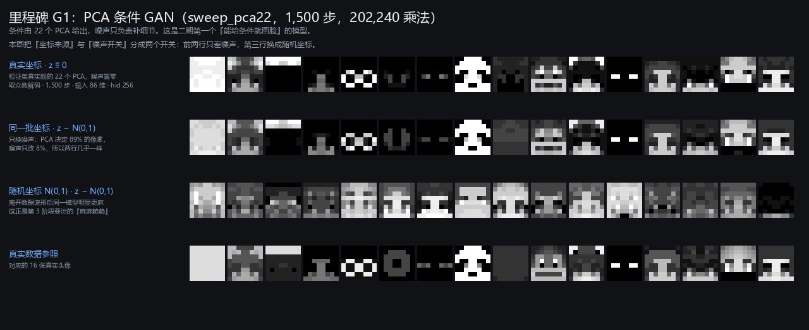
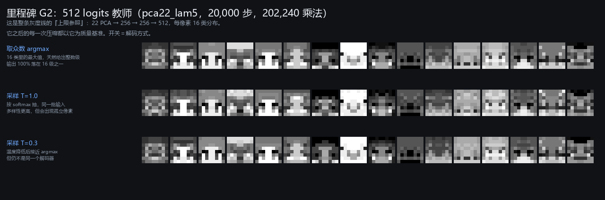
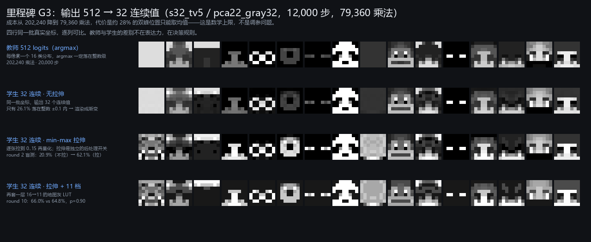
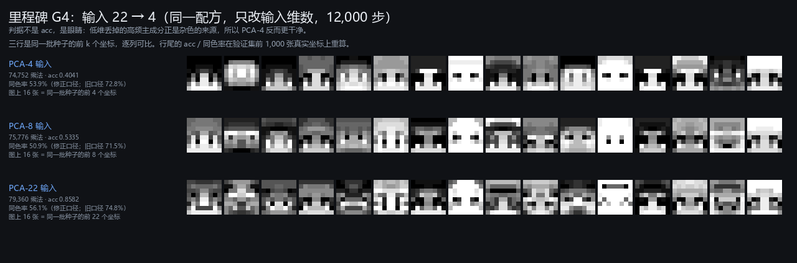
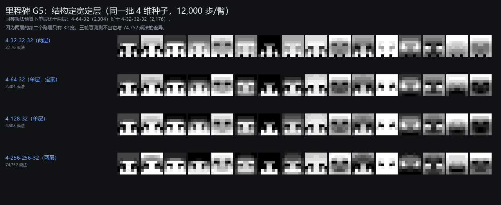
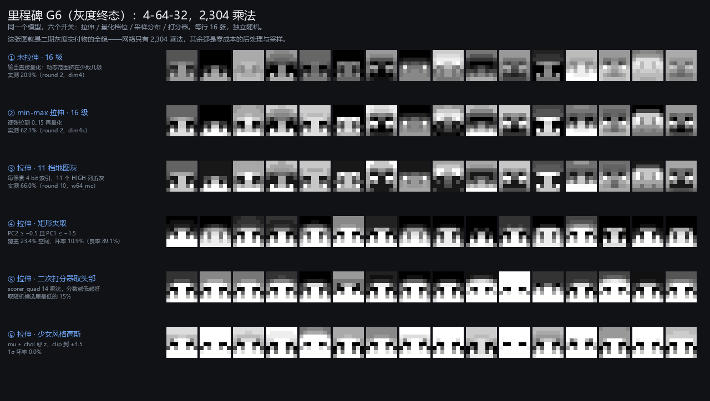
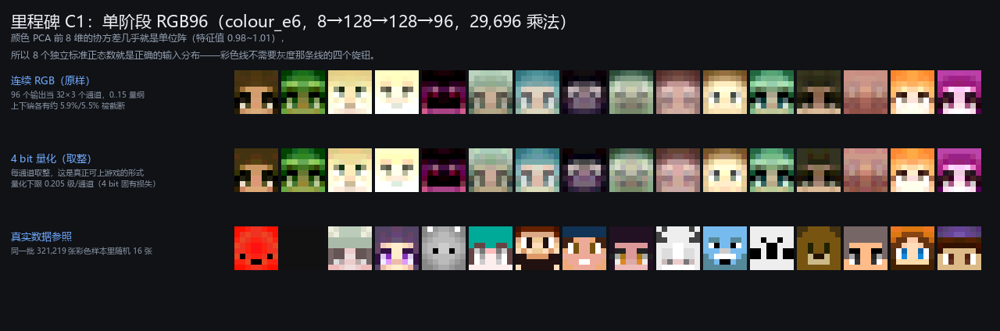
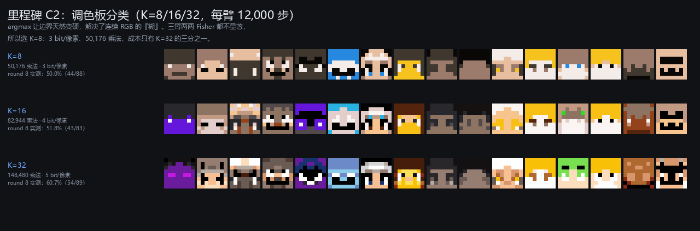
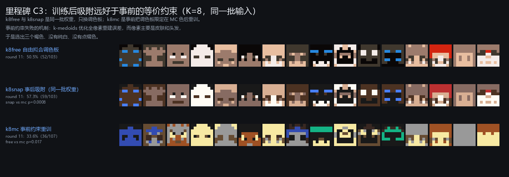
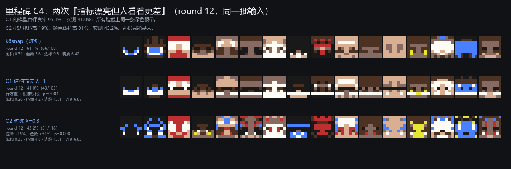

# 二期里程碑模型档案

状态: 记录
可信度: 数值验证（乘法数与准确率由 `tools/phase2_figs.py` 从 `webapp/*.json` 复算；效果图由同一脚本重绘）
最后核实: 2026-11-01 · DSH 整理
适用: 二期十个里程碑模型的结构 / 超参 / 训练方式 / 成本 / 效果。**图里的每一张脸都是本次从部署用的 JSON 权重重新前向出来的**，不是文档里搬来的旧图。

每张卡的字段固定：身份 → 结构 → 训练配方 → 评价 → 效果图 → 结论 → 四期可用性。
"开关"指同一批权重下不同的解码 / 后处理 / 采样选择——二期的所有取舍都落在这几个开关上。

---

## 灰度线

### G1 · PCA 条件 GAN 成立（sweep_pca22）

| 项 | 值 |
|---|---|
| 产物 | `02_phase2_avatar/webapp/pca22_model.json` |
| 结构 | 86 (= 22 PCA + 64 噪声) → 256 → 256 → 512 logits（= 32 位置 × 16 级） |
| 乘法数 | **218,624**（复算；同族的无噪声版才是 202,240） |
| 输入 | 22 个标准化 PCA 系数 **+ 64 维标准正态噪声** |
| 损失 | 交叉熵 1.0 + 对抗 BCE（真样本标签平滑 0.9）+ R1 梯度罚 γ=2.0、每 8 步 |
| 优化器 | Adam，G `3e-4` / D `2e-4`，betas (0.5, 0.999) |
| 步数 / batch | **1,500** / 256（八臂同一晚扫完，10-16 19:48–20:04） |
| 数据 | 规范集 311,583 train / 9,636 val |
| 记录指标 | 逐像素 acc 0.3820（512 logits 口径）；换掉 PCA 值改 55.4/64 像素，换掉全部 64 维噪声只改 26.9 像素 |

**效果图**：`kb/figures/phase2/G01_pca条件GAN_噪声与坐标开关.png`

四行 = 两个开关：**坐标来源**（验证集真实脸的 22 个 PCA / 独立标准正态）× **噪声开关**（z≡0 / z~N(0,1)），最后一行是真实数据参照。
前两行几乎一样——这就是"PCA 决定 89% 的像素、噪声只改 8%"的直观证据；第三行换成随机坐标后明显变麻，这才是第 3 阶段要治的"麻麻赖赖"。

**结论**：这是二期第一个"给条件就能画脸"的模型。它同时确立了此后所有实验的共同前提——**条件由 PCA 给出，噪声是可选配件**，而后续 22→4 的压缩正是从"PCA 决定大部分像素"这条观察出发的。

**四期可用性**：低。噪声输入 64 维在红石上是 64 条独立随机源，且这个配置的 218,624 乘法此后被压掉了 97%。可继承的只有"条件 + 噪声"的思路。

---

### G2 · 512 logits 教师（final_lam5_20k）

| 项 | 值 |
|---|---|
| 产物 | `webapp/pca22_lam5_model.json` |
| 结构 | 22 → 256 → 256 → 512 logits；203,264 参数 |
| 乘法数 | **202,240**（复算通过） |
| 输入 / 输出 | 22 个 PCA 系数，**无噪声** / 每位置 16 类分布，argmax 解码 |
| 损失 | 交叉熵 1.0 + **TV 罚在 softmax 概率上、λ=5.0** + 对抗 BCE 1.0 |
| 优化器 | Adam，G `3e-4` / D `2e-4`，betas (0.5, 0.999) |
| 步数 / batch | **20,000** / 256 |
| 记录指标 | acc(mode) 0.7005；同 1,000 张留出重算 **0.7151**，同色率（旧口径）77.59%（真实 77.65%，即已达到真实平滑度） |

**效果图**：`kb/figures/phase2/G02_512logit教师_解码开关.png`

三行 = 解码开关：argmax / softmax 采样 T=1.0 / T=0.3。argmax 必然给出整数级，采样则引入孤立像素——**开关本身就是"清晰 vs 多样"的取舍**。

**结论**：整条灰度线的**上限参照**。此后每一次压缩都以它为质量基准，而它自己的结局是"表达力被证明不是瓶颈"：512 logits 的优势来自决策规则（argmax 选更常见的峰），不来自表达力。

**四期可用性**：中低。202,240 乘法是 4-64-32 的 88 倍；但"每像素 16 类 + argmax"这一编码是可靠基线，四期若做离散 token 类方案，它是第一个该对比的对象。

---

### G3 · 输出 512 → 32 连续值（s32_tv5）

| 项 | 值 |
|---|---|
| 产物 | `webapp/pca22_gray32_model.json` |
| 结构 | 22 → 256 → 256 → **32 连续值**；79,904 参数 |
| 乘法数 | **79,360**（复算通过；是教师的 39%） |
| 损失 | MSE（对真实灰度级）+ **5.0 × TV（由连续输出构造的高斯软分布，σ=0.35）** + 对抗 BCE 1.0 |
| 优化器 | Adam，G `3e-4` / D `2e-4`，betas (0.5, 0.999) |
| 步数 / batch | **12,000** / 256 |
| 记录指标 | 自报 0.7594 / 留出重算 **0.7719**（比教师高）；落整数级 ±0.1 只有 26%~29% |

**效果图**：`kb/figures/phase2/G03_输出512到32_教师与学生.png`

四行同一批真实坐标：教师 argmax / 学生未拉伸 / 学生 min-max 拉伸 + 16 级 / 再套 11 档 LUT。教师与学生结构相近，学生更软——这正是"落在级间"的可见形态。

**结论**：成本降 61% 而留出 acc 不降反升。代价锁定在 **28.14% 的多峰位置**：连续标量在数学上无法表达双峰，MSE 的最优解是条件均值，只能取到两峰之间的不存在的级。这个误差**不可通过调参消除**，只能由后处理把它转成局部误差。

**被否决的同族方案**（都不出图，因为都没走到"可用"）：
- 蒸馏 `distill_plain`（22→256→256→32，14,000 步，纯 MSE 对教师期望值）：0.7348，比硬目标 + TV 的 0.7719 更差；与教师一致率仅 70.8%。
- 混合密度两分量（64 输出）：落级率 27.7%→51.2%，但 acc 崩到 0.4782。
- TV 连续场 λ 扫描：λ≤0.2 只动 0.4 点，λ=1 崩到 0.5024。

**四期可用性**：高。**32 个连续值 + 后处理量化**是二期最省的结构，也是四期"每像素一条通路"成本模型的基准。

---

### G4 · 输入 22 → 4（dim4 / dim8 / dim22）

| 项 | 值 |
|---|---|
| 产物 | `webapp/pca22_dim4_model.json` / `pca22_dim8_model.json` / `pca22_dim22_model.json` |
| 结构 | k → 256 → 256 → 32，k=4/8/22 |
| 乘法数 | **74,752 / 75,776 / 79,360**（复算全部通过） |
| 训练方式 | **同一配方只改输入维数**（取自 s32_tv5）：MSE + 5.0×TV + 对抗 BCE 1.0，无噪声 |
| 优化器 / 步数 | Adam G `3e-4` / D `2e-4`，**12,000** 步，batch 256 |
| 记录指标 | acc **0.4041 / 0.5335 / 0.8582**（本次在验证集前 1,000 张真实坐标上逐位复现，见 03 §V2）；同色率旧口径 0.7279 / 0.7146 / 0.7479，**修正口径 0.539 / 0.509 / 0.561**（旧口径有 bug，见 01 §F2）；线性上限 0.3269 / 0.4220 / 0.7999 |
| 数据事故 | 首次训练 k=4/8 只得 acc 0.05，原因是量化函数换成 `rint` 导致行序错开，见 01 §F2 |

**效果图**：`kb/figures/phase2/G04_输入维数阶梯_同种子.png`

三行同一批种子的前 k 个坐标（因此是"逐列可比"的同一批脸）。判据不是 acc——PCA-22 的 0.8582 远高于 PCA-4 的 0.4041，但人看的是哪张更像脸、更干净。

**结论**：二期的关键转折。**低维丢掉的正是产生杂色的高频主成分**，所以 acc 掉而观感升。它同时把后续宽度压缩变成可能：输入 4 维后，4-64-32 才够用。

**四期可用性**：高（作为方法）。四期彩色线是 8 个独立正态输入，与这条线同构：**少量旋钮 + 采样分布**就是全部输入设计。

---

### G5 · 结构定宽定层（→ 4-64-32）

| 项 | 值 |
|---|---|
| 产物 | `webapp/pca22_dim4w64L1_model.json`（定案）+ `grayscale_family.json` 里 10 个规模 |
| 结构 | 4 → 64 → 32（**单隐层**）；2,400 参数 |
| 乘法数 | **2,304**（复算；是教师 202,240 的 1/88） |
| 训练方式 | 同 G4 配方，**12,000 步，batch 256**，无噪声；显示端 min-max |
| 记录指标 | acc **0.3651**（同色率旧口径 70.3%） |
| 盲测 | round 7（248 条）：60.5% / 59.5% / 61.4%，p≈1.0；round 9（263 条）：64.8% / 62.5% / 61.8%，p=0.76/0.75/1.00 |

**效果图**：`kb/figures/phase2/G05_结构家族_同种子.png`

四行同一批 4 维种子：4-32-32-32（2,176）/ **4-64-32（2,304，定案）** / 4-128-32（4,608）/ 4-256-256-32（74,752）。

**结论**：**同乘法预算下，单层优于两层**——4-64-32（2,304）好于 4-32-32-32（2,176），因为两层的第二个隐层只有 32 宽，表达力在那一层被卡住。三轮盲测测不出它与 74,752 乘法的差异，于是 4-64-32 定案。这是二期最大的一笔压缩，也是唯一"成本降 97% 而测不出质量损失"的一步。

**四期可用性**：**最高**。4-64-32 是灰度终态，2,304 乘法是四期的成本锚点。

---

### G6 · 灰度终态与六个开关

| 项 | 值 |
|---|---|
| 模型 | 同 G5（`pca22_dim4w64L1_model.json`，2,304 乘法） |
| 后处理 | 逐张 min-max 拉伸到 [0,15] → 量化 16 级，或查 11 档地图灰 LUT |
| 打分器 | `scorer_quad.json`：4 线性 + 4 平方 + 6 交叉 + 常数，**14 乘法**（按变数×变数算 10） |
| 采样限幅 | `PC2 ≥ −0.5 且 PC1 ≤ −1.5`（零成本，随机源限幅） |
| 风格 | `styles_gauss.json` 六个联合高斯（均值 + Cholesky） |

**效果图**：`kb/figures/phase2/G06_最终4-64-32_六个开关.png`

六行 = 六个开关：①未拉伸+16 级（20.9%）②min-max+16 级（62.1%）③拉伸+11 档地图灰（66.0%）④矩形夹取（覆盖 23.4%、良率 89.1%）⑤二次打分器取头部 15% ⑥少女风格高斯（1σ 坏率 0.0%）。

**结论**：**交付物的全貌**——网络只有 2,304 乘法，其余全是零成本的后处理与采样选择，而良率的差别（20.9% → 89.1%）全部来自这些开关。打分器的 AUC 为 0.853（本次复算 0.856，见 03 §V6），但它在角落仍有约 15% 误判，安全区必须以离散标签为准。

**四期可用性**：高。**"网络只占成本的一小部分，其余是显示端的量化与采样"这一结构**直接适用于四期彩色。

---

## 彩色线

彩色线的公共数据：与灰度**逐行一致**的 321,219 张彩色样本；目标 RGB96 = 32 位置 × 3 通道、每通道 4 bit；颜色镜像精确一致率 98.7%（本次复算 98.69%）。输入一律是颜色 PCA 的前 k 个系数（标准化），**8 维的协方差几乎就是单位阵**（特征值 0.982~1.015、条件数 1.033、平均非对角相关 0.0029），所以"8 个独立标准正态"就是正确的输入分布，不需要 8×8 变换。

### C1 · 单阶段 RGB96（E6）

| 项 | 值 |
|---|---|
| 产物 | `webapp/colour_e6_model.json` |
| 结构 | 8 → 128 → 128 → **96**（32 位置 × 3 通道）；30,048 参数 |
| 乘法数 | **29,696**（复算通过；比灰度 74,752 还少） |
| 输入 | 8 个颜色 PCA 系数（标准化），部署时 8 个独立 N(0,1) 截断 ±3.5 |
| 损失 | MSE（对 rgb96/15 回归）；Adam `3e-4`；**12,000 步 / batch 256** |
| 记录指标 | RGB MAE 1.349 级、色相误差 0.043、4 bit 量化下限 0.205 级；round 6 人工盲测 **32.8%（67/204）** |

**效果图**：`kb/figures/phase2/C01_彩色RGB96_量化开关.png`

三行：连续 RGB / 4 bit 量化（真正能上游戏的形式）/ 真实数据参照。

**结论**：**两阶段被判死、单阶段成立**。E3（32 灰度 + cPC8，40 维）的 MAE 1.369 与 E6（只 cPC8，8 维）的 1.349 几乎相同——颜色 PCA 是对整张 RGB 图做的，PC0 基本就是亮度，再喂灰度是重复输入。更要紧的是**生成**：两阶段的灰度来自这张脸、颜色分量来自另一张脸，模型只能输出极端值，于是出荧光色。所以判据④（灰度一致性 < 1.5 级）失败不是小瑕疵，它就是"生成时会炸"的同一个病。

**四期可用性**：中。连续 RGB 每像素 12 bit（全脸 384 bit），红石代价是索引分类的 4 倍；但它证明了"8 个独立随机数就够描述一张彩色头像"，这是四期输入设计的地基。

---

### C2 · 调色板索引分类（K=8 / 16 / 32）

| 项 | 值 |
|---|---|
| 产物 | `webapp/colour_pal8_model.json`（= S8）/ `colour_pal16`（= S16）/ `colour_pal32`（= S32） |
| 结构 | 8 → 128 → 128 → **32×K** logits，逐位置 argmax → 查表 |
| 乘法数 | **50,176 / 82,944 / 148,480**（复算全部通过） |
| 输出编码 | K=8/16/32 → **3/4/5 bit 每像素**，全脸 96/128/160 bit |
| 标签构造 | 调色板由 40k 像素上 k-means（40 轮）定；每个像素取最近色的索引；部署的三个模型用的是**饱和优化调色板**（沿各自色度方向离灰 ×1.2，CLI 取值未记录） |
| 损失 / 优化器 | 逐像素交叉熵；Adam `3e-4`；**12,000 步 / batch 256** |
| 记录指标 | round 8 良率 **50.0% / 51.8% / 60.7%**；Fisher 8v16 p=0.879、16v32 p=0.282、8v32 p=0.175（本次复算同值） |

**效果图**：`kb/figures/phase2/C02_调色板尺寸K_同种子.png`

三行同一批输入：K=8 / K=16 / K=32。看得出的差别是"越大多彩、越软"，看不出的是良率差别。

**结论**：**离散化本身是彩色线唯一确定的收益**——连续 RGB 的 round 6 是 32.8%，8 色索引的 round 8 是 50.0%，大致翻倍。而 K 从 8 加到 32 多花 96% 乘法，良率差 p=0.175 不显著，边缘反而更软（14.267 → 13.556）、离最近 MC 色更远（1.93 → 2.28 级，32 色里 25 色差 >1 级）。K=8 是部署档。

**四期可用性**：**最高**。这是四期最该继承的编码：**每像素一个 K 路 argmax + 调色板查表**，3 bit/像素，且调色板里的每一种颜色都能用真实地图色摆出来。

---

### C3 · 训练后吸附 ≫ 事前约束（k8free / k8snap / k8mc）

| 项    | 值                                                                                                                                                               |
| ---- | --------------------------------------------------------------------------------------------------------------------------------------------------------------- |
| 产物   | `webapp/colour_pal8_model.json`（free）/ `colour_k8snap_model.json`（snap）/ `colour_k8mc_model.json`（mc）                                                           |
| 结构   | 三者同为 8 → 128 → 128 → 256，**50,176 乘法**                                                                                                                          |
| 差别   | **free 与 snap 是同一批权重**，只换调色板；mc 是事前把调色板限定在 61 个 MC HIGH 色上（k-medoids 选 8 个）重训                                                                                   |
| 训练   | mc：交叉熵，Adam `3e-4`，**12,000 步 / batch 256**                                                                                                                     |
| 记录指标 | round 11（313 条）：**50.5% / 57.3% / 33.6%**；Fisher free\|snap p=0.402、free\|mc **p=0.017**、snap\|mc **p=0.0008**（本次逐值复现）                                          |
| 本次复算 | 吸附后的 8 色**逐一等于**自由调色板各自最近的 HIGH 色，8 色无撞色；mc 的 8 色全在 HIGH 集内（SAND / LIGHT_GRAY / BLUE / BROWN / BLACK / TERRACOTTA_ORANGE / TERRACOTTA_GRAY / WARPED_WART_BLOCK） |

**效果图**：`kb/figures/phase2/C03_三种配色方案_同种子.png`

三行同一批输入：自由拟合 / 事后吸附 / 事前约束重训。第三行的脸明显更平、更脏——那是结构一起坏掉，不只是颜色不准。

**结论**：**"先自由拟合、训完再把颜色吸到真实色"远好于"一开始就把调色板锁死在真实色"**。机制：k-medoids 优化的是全像素重建误差，而像素主要是皮肤和头发，于是选出三个褐色、没有纯白也没有点缀色；自由拟合出的 8 色吸附后反而得到 QUARTZ（纯白）、CRIMSON_NYLIUM（红）、LAPIS（蓝）这种"美术调好的"配色。

**四期可用性**：**高，且是四期最容易踩的坑**。若四期改用 16 色或 diffusion 潜变量，仍然应该**在成品上调色板**，而不是把调色板塞进训练目标。

---

### C4 · 结构与对抗两臂（C1 / C2，round 12）

| 项 | 值 |
|---|---|
| 产物 | `webapp/colour_c1_model.json` / `colour_c2_model.json` |
| 结构 | 同为 8 → 128 → 128 → 256，**50,176 乘法** |
| C1 损失 | 交叉熵 + `1.0·relu(3.0 − 行方差)` + `1.0·relu(5.5 − 眼睛对比)`（目标值写死在脚本里） |
| C2 损失 | 交叉熵 + `0.3·BCE(D(期望色), 1)`，D 为 96 → 128 → 64 → 1 |
| 训练 | Adam `3e-4`，**12,000 步 / batch 256** |
| 记录指标 | round 12（331 条）：k8snap **61.1%** / c1struct **41.0%** / c2adv **43.2%**；Fisher 对 k8snap 分别为 **p=0.004** / **p=0.008**（本次逐值复现） |
| 三处"指标骗人" | C1 代理预测 95.1%，实测 41.0%；C2 边缘 +19%、颜色数 +31%，实测 43.2% |

**效果图**：`kb/figures/phase2/C04_结构与对抗两臂_同种子.png`

三行同一批输入，每行附饱和度 / 色数 / 边缘 / 明度。C1 那一行的脸都像戴了同一条深色眼带——因为损失奖励的是"眼睛对比大"，不是"像脸"。

> 图里每行的统计量由本脚本按自己的定义算（饱和度、量化后色数、RGB 梯度 p90、明度），与存档里"边缘 +19%、颜色数 +31%"**不是同一把尺**，只能同图内横比。同图内可见：色数 3.6 → 4.8（对抗臂确实更"花"），而两条臂的良率都掉 18~20 点。

**结论**：**彩色线的良率瓶颈不在损失函数，在信息与编码**。
- C1 买到的"结构"是横带：眼带深度 −0.065 vs 对照 −0.106，行方差 3.648 vs 2.362。
- C2 的判别器从未接近平衡：D 损失恒在 0.326~0.339，而标签平滑 0.9 下的完美分离下限是 0.325 —— 从第 2,000 步起 D 就把真假完全分开了。直通硬采样后 D 准确率 0.87→0.99，眼睛对比塌到 1.27。
- 根因：生成器输出最多 8 种硬颜色，真脸是连续色，**D 的任务在 8×8 上是平凡可分的**，对抗梯度不携带"像不像脸"的信息。

**四期可用性**：中。作为**反例**极有价值：四期若用 diffusion 或对抗，必须先证明 D 不是平凡可分，否则同样的失败会重演。C1 的眼带则提醒：任何可微的结构奖励都可能被模型用最省力的方式满足。

---

## 一览表

| 里程碑 | 结构 | 乘法 | 训练步数 | 记录良率 / acc | 图 |
|---|---|---:|---:|---|---|
| G1 PCA 条件 GAN | 86→256→256→512 | 218,624 | 1,500 | acc 0.3820 | G01 |
| G2 512 logits 教师 | 22→256→256→512 | 202,240 | 20,000 | acc 0.7151（留出） | G02 |
| G3 输出→32 连续 | 22→256→256→32 | 79,360 | 12,000 | acc 0.7719（留出） | G03 |
| G4 输入 22→4 | k→256→256→32 | 74,752 / 75,776 / 79,360 | 12,000 | acc 0.4041 / 0.5335 / 0.8582 | G04 |
| G5 结构定案 | **4→64→32** | **2,304** | 12,000 | acc 0.3651；盲测 60.5~64.8% | G05 |
| G6 灰度终态 | 4→64→32 + 后处理 | 2,304 + 14（打分器） | — | 20.9% → 62.1% → 89.1% | G06 |
| C1 单阶段 RGB96 | 8→128→128→96 | 29,696 | 12,000 | 32.8%（round 6） | C01 |
| C2 调色板 K 扫描 | 8→128→128→32K | 50,176 / 82,944 / 148,480 | 12,000 | 50.0% / 51.8% / 60.7% | C02 |
| C3 配色三方案 | 8→128→128→256 | 50,176 | 12,000（snap 不训） | 50.5% / 57.3% / 33.6% | C03 |
| C4 结构 / 对抗两臂 | 8→128→128→256 | 50,176 | 12,000 | 41.0% / 43.2%（对照 61.1%） | C04 |

所有图的生成脚本：`tools/phase2_figs.py figs`。所有数字的复算：`tools/phase2_figs.py verify` → `tools/verify_phase2.json`。
